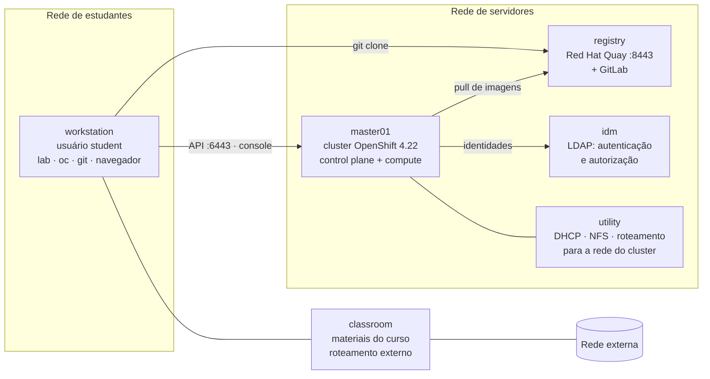

# Ambiente oficial de laboratório da Red Hat

| Campo | Valor |
|-------|-------|
| Referência | Capítulo 0 — *Orientation to the Classroom Environment*, PDF p. 9–12 |

Os exercícios do DO280 rodam em um ambiente fornecido pela Red Hat. Este
repositório **não** reproduz esse ambiente, **não** cria infraestrutura própria e
**não** registra suas senhas (elas estão na apostila e nos enunciados).

## Arquitetura do ambiente

- Cluster **Red Hat OpenShift Container Platform 4.22** de **nó único**, instalado em
  **bare metal** no modo **UPI** (*User Provisioned Infrastructure*).
- Todas as máquinas ficam no domínio DNS `lab.example.com`.
- Você trabalha no `workstation` e tem **privilégios de administrador do cluster**.
- O ambiente é autocontido: imagens e repositórios Git vêm de servidores internos,
  sem depender da internet.

## Papel de cada máquina

| Máquina | Papel | Se estiver indisponível... |
|---------|-------|----------------------------|
| `workstation` | Estação gráfica do aluno: `lab`, `oc`, `git`, navegador | Não há como trabalhar |
| `master01` | O cluster inteiro: control plane **e** compute | Não há cluster |
| `registry` | Registry privado **Red Hat Quay** e servidor **GitLab** (`https://git.lab.example.com`) | Pods não baixam imagens; `git clone` dos exercícios falha |
| `idm` | Serviço LDAP usado pelo cluster para autenticação e autorização | Login de usuários do diretório falha (relevante no Cap. 3) |
| `utility` | DHCP, NFS e roteamento para a rede do cluster | O cluster pode não funcionar ou travar no boot |
| `classroom` | Materiais do curso e roteamento para a rede externa | As demais máquinas podem não funcionar ou travar no boot |

⚠️ Um cluster de nó único é uma simplificação de treinamento. Em produção há vários
nós de control plane e de compute.

## Pontos de acesso

| Acesso | Endereço |
|--------|----------|
| Web console | `https://console-openshift-console.apps.lab.example.com` |
| API | `https://api.lab.example.com:6443` |
| Registry de imagens | `https://registry.lab.example.com:8443/` |
| GitLab | `https://git.lab.example.com` |

Rotas de aplicações seguem o padrão `<nome-da-route>-<projeto>.apps.lab.example.com`.

## Contas

| Conta | Onde | Perfil |
|-------|------|--------|
| `student` | Máquinas do aluno | Usuário de trabalho (também existe `root`) |
| `developer` | Cluster OpenShift e registry | Usuário comum |
| `admin` | Cluster OpenShift | Administrador do cluster |

> As senhas estão na orientação da apostila (PDF p. 9–11) e nos enunciados.
> Não as copie para este repositório.

## Registry e GitLab da sala de aula

- As imagens usadas são **espelhos** de repositórios públicos (`quay.io/redhattraining`,
  `registry.redhat.io`, `registry.access.redhat.com`, `docker.io`, `quay.io/openshift`)
  com caminhos equivalentes no registry interno. A tabela completa está no PDF (p. 11–12).
- Muitos exercícios do DO280 começam com `git clone` de um repositório no GitLab
  interno e usam **branches e tags Git** para representar versões da aplicação.
  Revise `git clone --branch`, `git checkout`, `git log --oneline` e `git show`
  antes do Capítulo 1.

## Ambientes próprios para praticar fora do curso

Para revisar conceitos (nunca para reproduzir os exercícios oficiais):

- 📘 **Red Hat OpenShift Local** ou **Developer Sandbox**, como no DO180.
- Para o Capítulo 1, muita coisa pode ser treinada **sem cluster**: `oc kustomize`
  (ou o binário `kustomize`) apenas renderiza YAML localmente.

---
[← Revisão do DO180](revisao-do180.md) | [Índice](README.md) | [Próximo: Preparação para os laboratórios →](preparacao-para-os-laboratorios.md)
