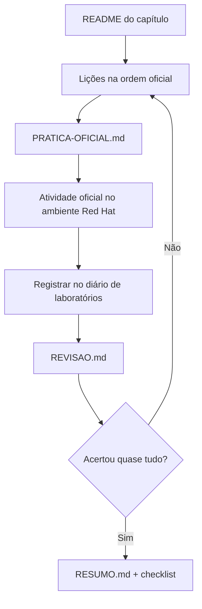

# Como usar este repositório

## A ideia central

A apostila oficial é longa, densa e em inglês. Este repositório reorganiza o mesmo
currículo em lições em português que respondem sempre às mesmas perguntas:
**o que é, que problema resolve, como funciona, como o administrador usa, como
verificar, como diagnosticar e o que pode dar errado.**

O laboratório continua sendo feito no ambiente da Red Hat. Aqui você chega ao
laboratório sabendo **por que** cada passo existe e como confirmar o resultado.

Ele segue a mesma metodologia do
[guia de estudos do DO180](https://github.com/eduardoandradej/openshift-do180-4.22-estudos),
com uma dimensão a mais: **raciocínio operacional e diagnóstico**, porque o DO280
e o EX280 cobram a capacidade de encontrar e corrigir configurações erradas.

## Como uma lição está organizada

| Parte | Conteúdo | Use para |
|-------|----------|----------|
| Identificação | Seção oficial, objetivo, páginas do PDF | Localizar-se no curso |
| Pré-requisitos | Retomada curta do DO180, com links | Revisar a base sem reler tudo |
| A — Conceito | O problema e a solução, em linguagem própria | Primeira leitura |
| B — Modelo mental e arquitetura | Diagrama ou comparação técnica | Fixar como as peças se relacionam |
| C — Aplicação prática | Comandos e manifestos explicados + diagnóstico | Consulta durante o lab |
| D — Relações | Comparações entre recursos que se confundem | Evitar erros conceituais |
| E — Preparação para o lab | Competências que a atividade exige | Antes do lab oficial |
| F — Fixação | Perguntas com respostas recolhíveis | Autoavaliação |
| G — Essencial | Lista curta para memorizar | Revisão rápida |

## O ciclo de estudo de um capítulo

## Convenções

- `comando` em bloco de código: algo que você digita.
- `<VALOR>` em maiúsculas: substitua pelo seu valor.
- 🔍 comando somente leitura · ✏️ comando que altera o cluster · 🖥️ só local.
- **PDF p. NN**: página da apostila oficial (rodapé "Page NN | 468").
- 📘 **Fonte externa**: informação da documentação pública ou de teste próprio, não da apostila.
- ⚠️ **Alerta operacional**: erro comum ou ação que exige cuidado.

## Onde está cada coisa

- `00-comecar-aqui/`: o curso, o ambiente e a ponte com o DO180.
- `capitulos/`: segue exatamente a numeração do DO280 4.22.
- `consulta-rapida/`: tabelas para consulta diária, alimentadas a cada capítulo.
- `exemplos-originais/`: manifestos autorais para leitura e testes em clusters próprios.
- `certificacao/`: matriz de competências do EX280.
- `progresso/`: estado da documentação, checklist do aluno, diário de laboratórios.
- `modelos/`: modelos usados para escrever novas lições.

## Status da documentação × status do seu estudo

Um capítulo marcado ✅ no [README principal](../README.md) significa que **a
documentação** foi escrita e validada. Seu estudo é registrado separadamente no
[checklist geral](../progresso/checklist-geral.md) e no
[diário de laboratórios](../progresso/diario-de-laboratorios.md).

---
[← Sobre o curso](sobre-o-curso.md) | [Índice](README.md) | [Próximo: Roteiro de estudos →](roteiro-de-estudos.md)
