# OpenShift DO280 4.22 — Guia de Estudos

> Guia pessoal e autoral para estudar o curso **Red Hat OpenShift Administration II:
> Configuring a Production Cluster (DO280)**, versão **4.22** (OpenShift Container
> Platform 4.22), com foco na administração de clusters de produção e no exame EX280.

Este repositório **não substitui nem reproduz** a apostila oficial. Ele explica os
conceitos com palavras próprias, organiza os comandos com contexto, ensina a
diagnosticar e faz a ponte para os laboratórios, que continuam sendo executados no
ambiente da Red Hat. É a continuação do
[guia de estudos do DO180](https://github.com/eduardoandradej/openshift-do180-4.22-estudos),
com a mesma metodologia.

---

## Início rápido

1. Leia [Comece aqui](00-comecar-aqui/README.md): o curso, o ambiente oficial e o comando `lab`.
2. Faça o autoteste da [Revisão do DO180](00-comecar-aqui/revisao-do180.md).
3. Para cada capítulo: lições → `PRATICA-OFICIAL.md` → atividade oficial → `REVISAO.md` → `RESUMO.md`.
4. Registre cada atividade no [diário](progresso/diario-de-laboratorios.md) e marque o [checklist](progresso/checklist-geral.md).
5. O estado da documentação está em [estado-do-projeto.md](progresso/estado-do-projeto.md).

## Progressão do aprendizado

```mermaid
flowchart LR
    D180[DO180<br/>operar aplicações] --> C1[1. Gerenciamento<br/>declarativo]
    C1 --> C2[2. Aplicações<br/>empacotadas]
    C2 --> C3[3. Autenticação<br/>e autorização]
    C3 --> C4[4. Segurança<br/>de rede]
    C4 --> C5[5. Aplicações<br/>não HTTP/SNI]
    C5 --> C6[6. Autosserviço]
    C6 --> C7[7. Operators]
    C7 --> C8[8. Segurança de<br/>aplicações]
    C8 --> C9[9. Atualizações]
    C9 --> C10[10. Revisão<br/>integrada]
    C10 --> EX[EX280]
```

## Conteúdo

| Módulo | Tema | Documentação |
|--------|------|--------------|
| [00 — Comece aqui](00-comecar-aqui/README.md) | Sobre o curso, ambiente oficial, comando `lab`, ponte com o DO180 | ✅ |
| [Capítulo 1](capitulos/01-gerenciamento-declarativo/README.md) | Declarative Resource Management | ✅ |
| [Capítulo 2](capitulos/02-aplicacoes-empacotadas/README.md) | Deploying Packaged Applications | ⏳ Aguardando PDF |
| [Capítulo 3](capitulos/03-autenticacao-autorizacao/README.md) | Authentication and Authorization | ⏳ Aguardando PDF |
| [Capítulo 4](capitulos/04-seguranca-de-rede/README.md) | Network Security | ⏳ Aguardando PDF |
| [Capítulo 5](capitulos/05-redes-nao-http/README.md) | Exposing Non-HTTP/SNI Applications | ⏳ Aguardando PDF |
| [Capítulo 6](capitulos/06-autosservico/README.md) | Enabling Developer Self-service | ⏳ Aguardando PDF |
| [Capítulo 7](capitulos/07-operadores-kubernetes/README.md) | Managing Kubernetes Operators | ⏳ Aguardando PDF |
| [Capítulo 8](capitulos/08-seguranca-aplicacoes/README.md) | Application Security | ⏳ Aguardando PDF |
| [Capítulo 9](capitulos/09-atualizacoes-openshift/README.md) | OpenShift Updates | ⏳ Aguardando PDF |
| [Capítulo 10](capitulos/10-revisao-integrada/README.md) | Comprehensive Review | ⏳ Aguardando PDF |

Legenda: ✅ documentação concluída e validada · ⏳ aguardando o PDF do capítulo.
O status refere-se à **documentação**, não ao seu estudo.

## Consulta rápida

| Arquivo | Para que serve |
|---------|----------------|
| [comandos-oc.md](consulta-rapida/comandos-oc.md) | Comandos `oc` agrupados por tarefa |
| [exemplos-yaml.md](consulta-rapida/exemplos-yaml.md) | Manifestos, patches e kustomizations comentados |
| [troubleshooting.md](consulta-rapida/troubleshooting.md) | Sintoma → causa provável → como verificar |
| [glossario.md](consulta-rapida/glossario.md) | Termos em ordem alfabética |

Cobertura atual: Capítulo 1. Cada arquivo remete à consulta rápida do DO180 para os
assuntos anteriores.

## Outros diretórios

| Diretório | Conteúdo |
|-----------|----------|
| [exemplos-originais/](exemplos-originais/README.md) | Manifestos e kustomizations autorais, validados |
| [certificacao/](certificacao/README.md) | Matriz de competências EX280 |
| [progresso/](progresso/estado-do-projeto.md) | Estado da documentação, checklist, diário, objetivos, dificuldades |
| [modelos/](modelos/modelo-licao.md) | Modelos de lição, capítulo e prática oficial |

## Meu progresso de estudo

- [ ] Comece aqui + revisão do DO180
- [ ] Capítulo 1 — lições, atividades oficiais, revisão
- [ ] Capítulo 2
- [ ] Capítulo 3
- [ ] Capítulo 4
- [ ] Capítulo 5
- [ ] Capítulo 6
- [ ] Capítulo 7
- [ ] Capítulo 8
- [ ] Capítulo 9
- [ ] Capítulo 10 — revisão integrada

> Marque aqui quando **você** concluir o estudo. Detalhes em
> [progresso/checklist-geral.md](progresso/checklist-geral.md).

## DO180 → DO280 → EX280

| Etapa | Foco | Papel |
|-------|------|-------|
| **DO180** | Operar aplicações em um cluster existente | Base operacional |
| **DO280** | Configurar o cluster para produção: implantação declarativa, autenticação, RBAC, segurança de rede, quotas, Operators, segurança de aplicações, atualizações | Administração da plataforma |
| **EX280** | Exame prático baseado em desempenho | Certificação de administrador OpenShift |

## Referências públicas

- Documentação OpenShift 4.22: <https://docs.redhat.com/en/documentation/openshift_container_platform/4.22>
- Curso DO280: <https://www.redhat.com/en/services/training/red-hat-openshift-administration-ii-configuring-a-production-cluster>
- Exame EX280: <https://www.redhat.com/en/services/training/red-hat-certified-openshift-administrator-exam>
- Guia de estudos DO180: <https://github.com/eduardoandradej/openshift-do180-4.22-estudos>

## Aviso

Repositório de estudo pessoal, mantido **privado** até decisão explícita do autor. Ele
não contém o PDF do curso, extrações de texto, soluções de laboratório nem
credenciais. Red Hat, OpenShift e nomes relacionados são marcas da Red Hat, Inc. O
conteúdo oficial do curso pertence à Red Hat e não está incluído aqui.
