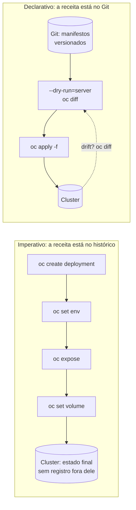
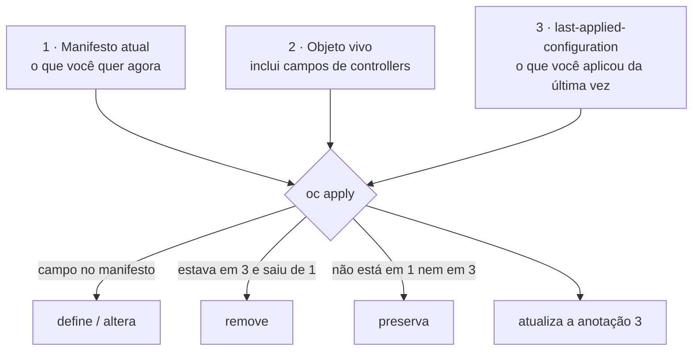
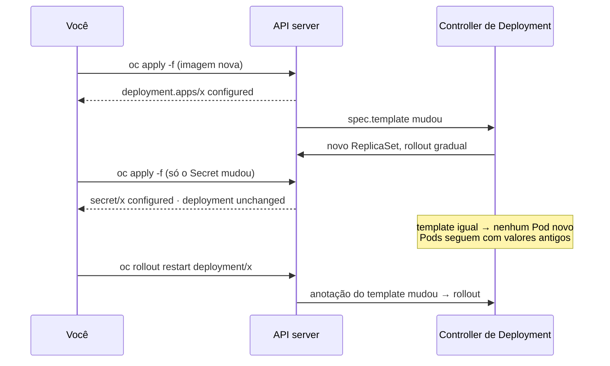

# 1.1 — Manifestos de recursos

| Campo | Valor |
|-------|-------|
| Curso | DO280 — OpenShift 4.22 |
| Capítulo / seção | Capítulo 1 · Seção 1.1 |
| Título original | Resource Manifests |
| Título em português | Manifestos de recursos |
| Objetivo | Implantar e atualizar aplicações a partir de manifestos de recursos armazenados em arquivos YAML |
| Referência | PDF p. 16–25 · Guided Exercise 1.2 p. 26–34 |

## Pré-requisitos e conhecimentos anteriores

No DO180 você aprendeu que todo objeto do Kubernetes tem `apiVersion`, `kind`,
`metadata` e `spec`, e que o cluster escreve o `status`. Também viu que
**controllers** comparam o estado desejado com o observado e agem para igualá-los,
que um Deployment encontra seus Pods por **labels**, que `--dry-run=client -o yaml`
gera um manifesto inicial, e que variáveis vindas de ConfigMaps e Secrets só são
lidas quando o container inicia. Esta lição transforma essas peças em um **método
de trabalho**.

| Conceito | Onde revisar |
|----------|--------------|
| Anatomia de um objeto, `spec` × `status`, `oc explain` | [DO180 · F5 — Kubernetes API e YAML](https://github.com/eduardoandradej/openshift-do180-4.22-estudos/blob/main/01-fundamentos-essenciais/05-kubernetes-api-e-yaml.md) |
| Controllers e reconciliação | [DO180 · F2 — Arquitetura Kubernetes](https://github.com/eduardoandradej/openshift-do180-4.22-estudos/blob/main/01-fundamentos-essenciais/02-arquitetura-kubernetes.md) |
| Imperativo × declarativo, geração de manifesto | [DO180 · 4.1 — Implantar a partir de imagem e template](https://github.com/eduardoandradej/openshift-do180-4.22-estudos/blob/main/capitulos/04-deploy-e-redes/4.1-implantar-a-partir-de-imagem-e-template.md) |
| `oc edit` e `oc patch` | [DO180 · 3.5 — Diagnosticar containers e Pods](https://github.com/eduardoandradej/openshift-do180-4.22-estudos/blob/main/capitulos/03-containers-e-pods/3.5-diagnosticar-containers-e-pods.md) |
| ConfigMaps, Secrets e reinício de Pods | [DO180 · 5.1 — Externalizar configuração](https://github.com/eduardoandradej/openshift-do180-4.22-estudos/blob/main/capitulos/05-configuracao-e-storage/5.1-externalizar-configuracao.md) |
| Rollout e `oc rollout restart` | [DO180 · 7.3 — Atualizar imagem e configurações](https://github.com/eduardoandradej/openshift-do180-4.22-estudos/blob/main/capitulos/07-atualizacao-aplicacoes/7.3-atualizar-imagem-e-configuracoes.md) |

## Parte A — Entendendo o conceito

### O problema: uma aplicação é um conjunto de objetos que precisam concordar

Uma aplicação simples já envolve um Deployment, um Service, uma Route, um ConfigMap
e um Secret. Esses objetos **dependem uns dos outros** por meio de valores que
precisam coincidir:

- os labels do template do Pod precisam casar com o `selector` do Deployment e do Service;
- a Route aponta para o **nome** do Service e para uma porta que ele expõe;
- o Deployment referencia o **nome** do ConfigMap e do Secret;
- a porta do container precisa coincidir com o `targetPort` do Service.

Se você monta tudo com comandos soltos (`oc create deployment`, `oc set env`,
`oc expose`...), o resultado final só existe **dentro do cluster**. A "receita" fica
espalhada no histórico do terminal. O curso aponta três consequências:

1. **Reprodutibilidade prejudicada:** recriar o mesmo ambiente em outro projeto ou
   cluster exige repetir a sequência exata de comandos, na ordem certa.
2. **Sem controle de versão:** não há um artefato para revisar, comparar ou reverter.
3. **Sem suporte a GitOps:** ferramentas de entrega contínua precisam de arquivos
   em um repositório Git, não de comandos executados por alguém.

### A solução: descrever o estado desejado em arquivos

Um **manifesto de recurso** é um arquivo YAML (ou JSON) que descreve **como o
recurso deve ficar**. Um conjunto de manifestos descreve a aplicação inteira, em um
ou vários arquivos. Com manifestos:

- a aplicação é recriada com **um comando** (`oc apply -f <diretório>`);
- cada mudança é um **commit**: dá para revisar, rastrear quem mudou o quê e
  **reverter** uma alteração ruim;
- o mesmo conjunto serve de entrada para pipelines de CI/CD e ferramentas GitOps.

### Duas camadas de "declarativo" (não confunda)

| Camada | O que é declarativo | Quem age |
|--------|---------------------|----------|
| **A API do Kubernetes** | Todo objeto tem `spec` (desejado) e `status` (observado); controllers reconciliam continuamente | Controllers do cluster |
| **O seu fluxo de trabalho** | Você mantém o estado desejado em arquivos e pede ao cluster que **compare e ajuste** (`oc apply`) | Você, a CLI e o Git |

Mesmo um comando imperativo como `oc scale` apenas **altera o `spec`**: quem cria ou
remove Pods é o controller. A diferença do fluxo declarativo é **onde mora a fonte da
verdade**: no arquivo versionado, e não na memória de quem digitou os comandos.

### Imperativo ainda tem lugar

O curso compara o fluxo imperativo a usar um *debugger* passo a passo: você adiciona
um componente por vez e, se algo falha, o erro aponta para aquele componente. Isso é
ótimo para **desenvolver e experimentar**. Já depurar uma aplicação implantada de uma
vez por manifestos é como depurar o programa já completo: o erro pode estar em
qualquer objeto. A prática recomendada é:

1. experimentar com comandos imperativos em um projeto de teste;
2. **capturar** o resultado como manifesto (`--dry-run=client -o yaml`, visão YAML
   da console, `oc get -o yaml` limpo);
3. versionar, validar e aplicar declarativamente nos ambientes reais.

### Como o `oc apply` sabe o que mudar

`oc create -f` apenas **cria**: se o objeto já existe, falha com `AlreadyExists`.
`oc apply -f` **cria ou atualiza**. Para atualizar sem estragar o que outros
componentes escreveram no objeto, ele compara **três fontes** (*three-way merge*):

1. o **manifesto** que você está aplicando agora (o desejado);
2. o **objeto vivo** no cluster;
3. a anotação **`kubectl.kubernetes.io/last-applied-configuration`**, que guarda a
   cópia do **último manifesto aplicado**.

Com isso, o `oc apply` consegue distinguir dois casos que parecem iguais:

- um campo **ausente do manifesto que estava no último manifesto aplicado** → você
  o removeu de propósito → o `apply` **remove** do objeto vivo;
- um campo **ausente do manifesto que nunca foi aplicado por você** (preenchido por
  um controller, por padrão da API ou por outro comando) → **não é seu** → o `apply`
  **preserva**.

Depois de aplicar, a anotação é atualizada com o novo manifesto. `oc create
--save-config` grava essa mesma anotação, preparando o objeto para futuros `apply`.

### Validar e comparar antes de aplicar

- `--dry-run=client` apenas monta o objeto localmente; não fala com o cluster.
- `--dry-run=server` envia a requisição ao API server, que executa validação de
  schema, **admission** (políticas, quotas, defaults) e retorna o resultado **sem
  persistir**. Um YAML sintaticamente perfeito ainda pode ser recusado pelo cluster.
- `--validate=true` valida os campos contra o schema e falha se houver erro.
- `oc diff -f` mostra a diferença entre o objeto vivo e o objeto **como ficaria**
  após o `apply`. Ele ignora o "ruído" que controllers adicionam (anotações,
  `status`, campos padrão) e **mascara valores de Secrets**. Ferramentas GitOps usam
  essa mesma lógica para detectar alterações feitas fora do fluxo (*drift*).

### Nem toda mudança no manifesto recria Pods

Um Deployment só cria Pods novos quando o **template do Pod** muda (imagem, env,
volumes, labels do template...). Se você altera **apenas** os dados de um ConfigMap
ou Secret, o `apply` atualiza esses objetos, mas os Pods continuam rodando com os
valores antigos carregados na inicialização. O resultado é uma aplicação em estado
**inconsistente** — exatamente o que acontece no Guided Exercise 1.2 (uma réplica
nova com a configuração nova conversando com um banco que ainda usa a antiga).

A correção é `oc rollout restart deployment/<nome>`, que altera uma anotação do
template e provoca um rollout controlado. Com uma única réplica, apagar o Pod também
resolve; com várias réplicas, o rollout é preferível porque substitui os Pods de forma
gradual. A seção 1.3 mostra como os **generators do Kustomize** eliminam esse problema.

> 📘 *Fonte externa (DO180 5.1 e documentação Kubernetes):* variáveis de ambiente
> nunca são atualizadas em um container em execução. Arquivos de ConfigMap/Secret
> montados como volume são atualizados pelo kubelet depois de algum tempo (exceto
> com `subPath`), mas muitas aplicações só leem a configuração ao iniciar.

### Alterações pontuais e repetíveis: `oc patch`

`oc patch` altera **apenas os campos informados** em um objeto existente, a partir de
um trecho JSON/YAML (`-p`) ou de um arquivo (`--patch-file`). É útil para distribuir
uma correção pontual que pode ser aplicada da mesma forma em vários ambientes.

O ponto que mais causa erro é **como listas são combinadas**. Por padrão, para tipos
nativos, o `oc patch` usa *strategic merge patch*, que combina itens de listas por uma
**chave de mesclagem** definida na API:

| Lista | Chave de mesclagem (📘 API Kubernetes) |
|-------|----------------------------------------|
| `containers`, `initContainers` | `name` |
| `volumes` | `name` |
| `env` | `name` |
| `ports` (container) | `containerPort` |
| `volumeMounts` | `mountPath` |

Consequências práticas:

- o `name` do container no patch **precisa existir**; caso contrário o patch tenta
  **adicionar** um container novo (sem imagem), e o API server recusa;
- em `volumes`, um item com o mesmo `name` é **mesclado** (ex.: trocar `claimName`);
- em `volumeMounts`, um item com `mountPath` **diferente** é **adicionado**; o ponto de
  montagem antigo **permanece**. Para *trocar* o caminho, use JSON Patch (`replace`)
  ou edite o manifesto e aplique.

> ⚠️ **Divergência registrada:** o exemplo de `--patch-file` da apostila (PDF p. 23–25)
> afirma que o patch altera o `mountPath` existente. Pela chave de mesclagem
> `mountPath`, o resultado é um **segundo** ponto de montagem do mesmo volume; só o
> `claimName` é de fato substituído. Comportamento conferido com a biblioteca
> `strategicpatch` do Kubernetes (k8s.io/apimachinery v0.33).

## Parte B — Modelo mental e arquitetura

### Fluxo imperativo × fluxo declarativo



### O *three-way merge* do `oc apply`



### O que o `apply` muda e o que acontece depois



## Parte C — Aplicação prática

> Legenda: 🔍 somente leitura · ✏️ altera o cluster · 🖥️ só local (não fala com o cluster)
>
> Os exemplos usam uma aplicação fictícia `catalogo` no projeto `catalogo-dev`.
> Manifestos completos em [exemplos-originais/manifestos-catalogo](../../exemplos-originais/manifestos-catalogo/).

### 1. Gerar um manifesto inicial: `oc create ... --dry-run=client -o yaml` 🖥️

```bash
mkdir -p ~/catalogo
oc create deployment catalogo \
  --image registry.access.redhat.com/ubi9/httpd-24 --port 8080 --replicas 2 \
  --dry-run=client -o yaml > ~/catalogo/deployment.yaml
```

- **Finalidade:** obter um esqueleto correto (apiVersion, kind, selector e labels coerentes) sem escrever do zero.
- **Parâmetros relevantes:** `--dry-run=client` não envia nada ao cluster; `-o yaml` imprime o objeto; `--save-config` (opcional) já inclui a anotação `last-applied-configuration`.
- **Permissões:** nenhuma no cluster (mas o `oc` precisa de um contexto válido para alguns tipos).
- **Objetos afetados:** nenhum; só o arquivo local.
- **Resultado esperado:** um Deployment com campos vazios ou nulos (`creationTimestamp: null`, `resources: {}`, `strategy: {}`, `status: {}`).
- **Como verificar:** abra o arquivo; confira `selector.matchLabels` = labels do template.
- **Erros comuns:** versionar o arquivo sem **limpar** os campos vazios e o `status`; esquecer o redirecionamento `>` e só imprimir na tela.

Depois de limpo e ajustado, o manifesto fica assim (original):

```yaml
apiVersion: apps/v1
kind: Deployment
metadata:
  name: catalogo
  namespace: catalogo-dev          # evita aplicar no projeto errado (ver Parte D)
  labels:
    app: catalogo
spec:
  replicas: 2
  selector:
    matchLabels:
      app: catalogo
  template:
    metadata:
      labels:
        app: catalogo
    spec:
      containers:
        - name: httpd
          image: registry.access.redhat.com/ubi9/httpd-24
          ports:
            - containerPort: 8080
              protocol: TCP
          envFrom:
            - configMapRef:
                name: catalogo-config
```

Outras fontes de esqueleto: a visão **YAML** de um recurso na web console e
`oc get <tipo> <nome> -o yaml` de um objeto que já funciona. Neste último caso,
remova `status`, `metadata.uid`, `metadata.resourceVersion`,
`metadata.creationTimestamp`, `metadata.generation`, `metadata.managedFields` e
anotações geradas pelo cluster.

### 2. Descobrir campos: `oc explain` 🔍

```bash
oc explain deployment.spec.template.spec.containers.envFrom
oc explain deployment.spec.strategy --recursive
```

Use antes de acrescentar um campo que você não lembra. É a "documentação offline" mais
confiável, porque vem do próprio cluster (versão 4.22).

### 3. Organizar arquivos e criar: `oc create -f` ✏️

```bash
oc create -f ~/catalogo/deployment.yaml          # um arquivo
oc create -f ~/catalogo/                         # todos os manifestos do diretório
oc create -R -f ~/catalogo/                      # inclui subdiretórios
oc create -f https://exemplo.com/catalogo.yaml   # também aceita URL
```

- **Finalidade:** criar objetos a partir de manifestos.
- **Parâmetros:** `-f` arquivo, diretório, URL ou `-` (stdin); `-R`/`--recursive` percorre subdiretórios; `--save-config` grava a anotação para futuros `apply`.
- **Permissões:** `create` sobre cada tipo no projeto (ex.: papel `edit` ou `admin` do projeto).
- **Resultado esperado:** `deployment.apps/catalogo created`, uma linha por objeto.
- **Erros comuns:** `AlreadyExists` ao executar de novo (o `create` não compara estados); diretório com arquivos que não são manifestos.

Um arquivo pode conter vários manifestos separados por `---`. Juntar ou separar é
preferência: um arquivo único mantém juntos os objetos que mudam juntos; vários
arquivos facilitam compartilhar e revisar cada objeto.

### 4. Validar antes de aplicar: `--dry-run=server --validate=true` 🔍

```bash
oc apply -f ~/catalogo/ --dry-run=server --validate=true
```

- **Finalidade:** perguntar ao cluster "o que aconteceria?" sem persistir nada.
- **Resultado esperado:** `deployment.apps/catalogo created (server dry run)` ou `configured (server dry run)`.
- **O que ele pega e o `client` não:** campos desconhecidos para a versão da API do cluster, campos imutáveis alterados, namespace inexistente, recusa por políticas de admission ou quotas, falta de permissão.
- 📘 *Fonte externa:* nas versões atuais do `kubectl`/`oc`, `--validate` aceita `strict` (equivalente a `true`), `warn` e `ignore`.

### 5. Ver o que vai mudar: `oc diff -f` 🔍

```bash
oc diff -f ~/catalogo/
```

- **Finalidade:** comparar o objeto **vivo** com o objeto **resultante** do `apply`.
- **Leitura da saída:** formato `diff -u`; linhas com `-` são o estado atual, com `+` o estado após aplicar. Uma mudança no template costuma vir acompanhada de `generation` aumentando.
- **Pontos fortes:** ignora o que controllers acrescentam; mascara valores de Secrets (`'***'`, `(before)`/`(after)`).
- 📘 *Fonte externa:* código de saída `0` = sem diferenças, `1` = há diferenças, maior que `1` = erro. Útil em scripts e pipelines.
- **Erros comuns:** usar `diff`/`git diff` contra `oc get -o yaml` e se perder em centenas de linhas irrelevantes.

### 6. Criar ou atualizar: `oc apply -f` ✏️

```bash
oc apply -f ~/catalogo/
```

- **Finalidade:** levar o cluster ao estado descrito, criando o que falta e atualizando o que mudou.
- **Permissões:** `get`, `create` e `patch` sobre cada tipo no projeto.
- **Resultado esperado por objeto:** `created`, `configured` (algo mudou) ou `unchanged`.
- **Como verificar:** `oc get deployment,pods,svc,route`; `oc rollout status deployment/catalogo`.
- **Erros comuns:**
  - `field is immutable` ao mudar `spec.selector` de um Deployment existente (exige recriar o objeto);
  - `the namespace from the provided object "A" does not match the namespace "B"` quando o manifesto tem `namespace` e você passa outro `-n`;
  - aviso de anotação ausente ao aplicar sobre um objeto criado sem `--save-config` (📘 o `oc` cria a anotação automaticamente e segue).

Para ler a anotação que o `apply` usa:

```bash
oc get deployment catalogo \
  -o jsonpath='{.metadata.annotations.kubectl\.kubernetes\.io/last-applied-configuration}{"\n"}'
oc apply view-last-applied deployment/catalogo      # 📘 subcomando do apply; mostra em YAML
```

### 7. Forçar Pods novos depois de mudar só configuração: `oc rollout restart` ✏️

```bash
oc apply -f ~/catalogo/configmap.yaml       # configmap/catalogo-config configured
oc get pods -l app=catalogo                 # mesmos Pods, mesma idade
oc rollout restart deployment/catalogo
oc rollout status deployment/catalogo
```

- **Finalidade:** recriar os Pods com o mesmo template para que leiam a nova configuração.
- **Permissões:** `patch` em Deployments do projeto.
- **Comportamento:** respeita a estratégia do Deployment (RollingUpdate substitui aos poucos).
- **Erros comuns:** reiniciar só a aplicação e esquecer o componente que **também** lê o valor alterado (no GE 1.2, o banco de dados).

### 8. Correções pontuais: `oc patch` ✏️

**Strategic merge (padrão para tipos nativos) com trecho inline:**

```bash
oc patch deployment catalogo -p \
  '{"spec":{"template":{"spec":{"containers":[{"name":"httpd","resources":{"requests":{"cpu":"100m"}}}]}}}}'
```

**A partir de arquivo** (`patch-limites.yaml`, original):

```yaml
spec:
  template:
    spec:
      containers:
        - name: httpd              # precisa ser o nome de um container existente
          resources:
            limits:
              memory: 256Mi
```

```bash
oc patch deployment catalogo --patch-file patch-limites.yaml
```

**JSON Patch, quando é preciso precisão em listas** (📘 tipo `json`):

```bash
oc patch deployment catalogo --type json -p \
  '[{"op":"replace","path":"/spec/template/spec/containers/0/volumeMounts/0/mountPath","value":"/var/www/html"}]'
```

- **Finalidade:** mudar poucos campos de forma repetível, sem editor.
- **Tipos** (📘 `--type`): `strategic` (padrão para tipos nativos; usa chaves de mesclagem), `merge` (JSON merge patch: listas são **substituídas inteiras**; é a opção para recursos customizados), `json` (operações `add`/`remove`/`replace`... em caminhos exatos).
- **Permissões:** `patch` no tipo do recurso.
- **Resultado esperado:** `deployment.apps/catalogo patched` (ou `(no change)`).
- **Como verificar:** `oc get deployment catalogo -o yaml` ou JSONPath no campo alterado.
- **Erros comuns:** nome de container inexistente (o patch tenta adicionar um container sem imagem); esperar que `volumeMounts` seja substituído (é mesclado por `mountPath`); aspas do shell quebrando o JSON.

> ⚠️ Um `oc patch` em um objeto gerenciado por manifesto cria **divergência**: o
> próximo `oc apply` do arquivo pode desfazer a correção. Leve a mudança também ao
> manifesto no Git.

### 9. Remover o que foi aplicado: `oc delete -f` ✏️

```bash
oc delete -f ~/catalogo/
```

Remove exatamente os objetos descritos nos manifestos. Objetos criados por fora
(ex.: com `oc create` manual) não são afetados.

### Raciocínio operacional e diagnóstico

| Sintoma | Hipótese | Como confirmar | Correção segura |
|---------|----------|----------------|-----------------|
| `Error from server (AlreadyExists)` | Uso de `oc create -f` para atualizar | O objeto existe: `oc get <tipo> <nome>` | Usar `oc apply -f` |
| `apply` não remove um campo que você apagou do arquivo | O campo foi adicionado por comando imperativo e nunca esteve no `last-applied` | `oc apply view-last-applied <tipo>/<nome>` | Remover com `oc patch`/`oc edit` uma vez; dali em diante, só pelo manifesto |
| Réplicas "voltam" ao número do arquivo | O manifesto define `replicas` e alguém escalou com `oc scale` | `oc diff -f` mostra `replicas` | Decidir a fonte da verdade; 📘 com HPA, omitir `replicas` do manifesto |
| `field is immutable` | Mudança em `spec.selector` (ou outro campo imutável) | Mensagem do `apply` | Recriar o objeto em janela controlada (`oc replace --force` ou delete + apply) |
| `dry-run=client` passa, `dry-run=server` falha | Campo inválido para a API do cluster, admission, quota ou permissão | Mensagem do servidor | Corrigir com `oc explain`; verificar permissões e quotas |
| Pods em `CrashLoopBackOff` logo após um `apply` que mudou Secret/ConfigMap | Componentes com configuração antiga e nova misturadas | `oc diff` mostrou só Secret/ConfigMap; `oc get pods` mostra Pods antigos de um componente | `oc rollout restart deployment/<componente-afetado>` |
| `oc diff` vazio, mas a aplicação está errada | O desejado foi aplicado; o problema está no **observado** | `oc get pods`, `oc describe`, eventos, logs | Diagnosticar o runtime, não o manifesto |
| Objeto criado no projeto errado | Manifesto sem `namespace` e projeto atual diferente | `oc project`; `oc get <tipo> -A` | `oc delete` no lugar errado; definir `namespace` ou usar `-n` |

## Parte D — Relações importantes

| A | B | Diferença essencial |
|---|---|--------------------|
| Imperativo | Declarativo | Sequência de ações × descrição do estado final versionável |
| `oc create -f` | `oc apply -f` | Só cria (erro se existe) × cria ou atualiza com *three-way merge* |
| `--dry-run=client` | `--dry-run=server` | Monta o objeto localmente × validação real no API server, sem persistir |
| `oc diff` | `diff` / `git diff` | Compara vivo × resultado do apply, sem ruído × compara texto bruto |
| `oc apply` | `oc patch` | Estado completo do arquivo × alteração pontual de campos |
| `oc patch` | `oc edit` | Repetível e scriptável × interativo |
| Strategic merge | JSON merge / JSON Patch | Listas mescladas por chave × listas substituídas × operações em caminhos exatos |
| `oc rollout restart` | Apagar o Pod | Rollout gradual, várias réplicas × recriação abrupta (ok para 1 réplica) |
| `namespace` no manifesto | `-n` na linha de comando | Protege contra o projeto errado, mas prende o arquivo a um projeto × flexível, porém fácil de esquecer |
| 📘 Client-side apply (anotação) | 📘 Server-side apply (`--server-side`, `managedFields`) | Estado no cliente via `last-applied` × o API server registra o "dono" de cada campo e acusa conflitos |

> A tensão entre "fixar o `namespace` no arquivo" e "reutilizar o manifesto em vários
> ambientes" é exatamente o problema que o Kustomize resolve na
> [seção 1.3](1.3-overlays-do-kustomize.md).

## Parte E — Preparação para o laboratório oficial

Atividade associada: **1.2 Guided Exercise — Resource Manifests**
(`declarative-manifests`, PDF p. 26–34).

Você deve conseguir, sem consultar a lição:

- clonar um repositório Git e alternar entre **branches** que representam versões;
- validar um diretório inteiro de manifestos com `--dry-run=server` antes de aplicar;
- ler um `oc diff` e prever **quais** Deployments terão Pods novos;
- reconhecer quando uma mudança só em Secret/ConfigMap deixa Pods com dados antigos e corrigir com `oc rollout restart`;
- localizar a anotação `last-applied-configuration`.

Detalhes em [PRATICA-OFICIAL.md](PRATICA-OFICIAL.md#12-guided-exercise-resource-manifests).

## Parte F — Fixação

1. Explique por que "o Kubernetes é declarativo" não implica que todo fluxo de trabalho com `oc` seja declarativo.
2. Você removeu o bloco `resources.limits` do manifesto e executou `oc apply`. Os limits sumiram do objeto vivo. Em outro Deployment, a mesma ação não removeu nada. Qual a diferença provável entre os dois casos?
3. `oc diff -f .` mostra mudança apenas no Secret `banco`. O que acontecerá com os Pods após `oc apply -f .` e o que você deve fazer?
4. Qual comando confirma, sem criar nada, que um manifesto seria aceito pelas políticas do cluster? Por que `--dry-run=client` não basta?
5. Este patch falhou com erro de validação: `oc patch deployment web -p '{"spec":{"template":{"spec":{"containers":[{"name":"app","env":[{"name":"MODO","value":"prod"}]}]}}}}'`. O container do Deployment se chama `web`. O que aconteceu?
6. Um patch strategic merge adicionou `mountPath: /dados` ao volume `www`, que já estava montado em `/data`. Quantos pontos de montagem o container terá? Como trocar o caminho de verdade?
7. Um colega manteve `replicas: 3` no manifesto de um Deployment controlado por HPA. Que efeito isso tem a cada `oc apply`?

<details>
<summary>Respostas comentadas</summary>

1. A **API** é declarativa (spec × status, controllers reconciliam), mas você pode alimentá-la com comandos imperativos (`oc scale`, `oc set env`). O fluxo é declarativo quando o estado desejado vive em arquivos versionados e é aplicado com `oc apply`.
2. No primeiro, os limits estavam no `last-applied-configuration` (foram aplicados pelo manifesto), então o `apply` entendeu a remoção. No segundo, os limits foram colocados por fora (ex.: `oc set resources`) e nunca estiveram na anotação; o `apply` os preserva.
3. O Secret é atualizado, mas nenhum Pod é recriado, porque o template do Deployment não mudou; os Pods continuam com os valores antigos. Execute `oc rollout restart deployment/<cada componente que usa o Secret>`.
4. `oc apply -f <arquivo> --dry-run=server --validate=true`. O modo `client` não passa pela validação do servidor, pelos admission controllers, quotas e permissões.
5. Pela chave de mesclagem `name`, o container `app` não existe, então o patch tenta **adicionar** um segundo container sem `image`, e o API server recusa. Use `"name":"web"`.
6. Dois: `/data` e `/dados`, porque `volumeMounts` é mesclado por `mountPath`. Para trocar, use JSON Patch com `replace` no índice correto ou corrija o manifesto e aplique.
7. Cada `apply` devolve o Deployment a 3 réplicas, brigando com o HPA até ele reagir de novo. Em geral, omite-se `replicas` do manifesto quando um HPA controla a escala (📘).

</details>

## Parte G — Essencial para memorizar

- Manifesto = estado desejado em YAML/JSON, versionável; um ou vários arquivos; `---` separa documentos.
- Imperativo para **experimentar**; declarativo para **reproduzir** e **auditar**.
- Esqueleto: `oc create <tipo> ... --dry-run=client -o yaml > arquivo.yaml`; limpe campos nulos e `status`.
- `oc create -f` só cria; `oc apply -f` cria ou atualiza (*three-way merge* com `last-applied-configuration`).
- Antes de aplicar: `--dry-run=server --validate=true` e `oc diff -f`.
- Mudou só ConfigMap/Secret? Pods não mudam → `oc rollout restart deployment/<nome>`.
- `oc patch`: strategic merge por padrão; chaves de mesclagem (`name`, `mountPath`); `--type json` para precisão; leve o patch ao manifesto.
- `-f` aceita arquivo, diretório (`-R`), URL ou `-`.

---
[← Índice do capítulo](README.md) | [Índice do capítulo](README.md) | [Próximo: 1.3 Overlays do Kustomize →](1.3-overlays-do-kustomize.md)
