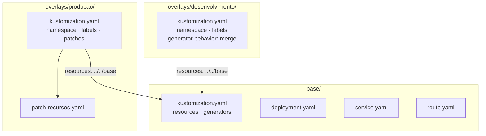
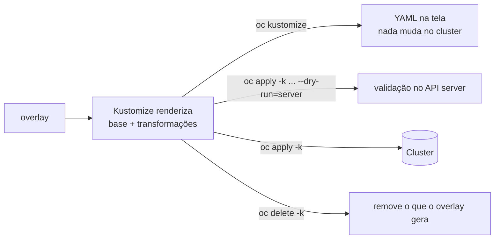
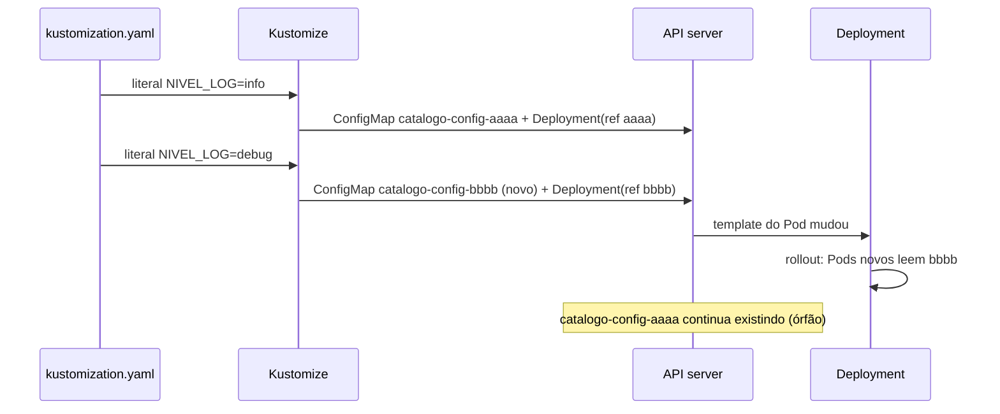

# 1.3 — Overlays do Kustomize

| Campo | Valor |
|-------|-------|
| Curso | DO280 — OpenShift 4.22 |
| Capítulo / seção | Capítulo 1 · Seção 1.3 |
| Título original | Kustomize Overlays |
| Título em português | Overlays do Kustomize |
| Objetivo | Implantar e atualizar aplicações a partir de manifestos complementados pelo Kustomize |
| Referência | PDF p. 35–46 · Guided Exercise 1.4 p. 47–57 · Lab 1.5 p. 58–67 |

## Pré-requisitos e conhecimentos anteriores

Esta lição parte da [1.1 — Manifestos de recursos](1.1-manifestos-de-recursos.md):
você precisa saber aplicar um diretório com `oc apply`, validar com
`--dry-run=server`, ler um `oc diff` e entender por que mudar só um ConfigMap não
recria Pods. Do DO180, retome como labels e selectors ligam Deployments, Services e
Pods (um selector errado deixa o Service sem endpoints) e como Deployments consomem
ConfigMaps e Secrets com `envFrom` e `valueFrom`.

| Conceito | Onde revisar |
|----------|--------------|
| Labels, selectors e templates de Pod | [DO180 · F4 — Pods e workloads](https://github.com/eduardoandradej/openshift-do180-4.22-estudos/blob/main/01-fundamentos-essenciais/04-pods-e-workloads.md) |
| Service → endpoints → Route | [DO180 · 4.5 — Redes de Pods e Services](https://github.com/eduardoandradej/openshift-do180-4.22-estudos/blob/main/capitulos/04-deploy-e-redes/4.5-redes-de-pods-e-services.md) |
| ConfigMaps e Secrets (`envFrom`, `oc extract`) | [DO180 · 5.1 — Externalizar configuração](https://github.com/eduardoandradej/openshift-do180-4.22-estudos/blob/main/capitulos/05-configuracao-e-storage/5.1-externalizar-configuracao.md) |
| Rollout disparado por mudança no template | [DO180 · 7.3 — Atualizar imagem e configurações](https://github.com/eduardoandradej/openshift-do180-4.22-estudos/blob/main/capitulos/07-atualizacao-aplicacoes/7.3-atualizar-imagem-e-configuracoes.md) |

## Parte A — Entendendo o conceito

### O problema: a mesma aplicação, vários ambientes

Uma organização raramente implanta uma aplicação em um só lugar. Há
desenvolvimento, homologação, testes e produção; às vezes vários data centers, regiões
ou equipes. Os ambientes rodam **a mesma aplicação** com **pequenas diferenças**:
namespace, número de réplicas, requests e limits, nível de log, tag da imagem.

Copiar o diretório de manifestos para cada ambiente parece simples, mas cria um
problema clássico: uma correção feita na cópia de produção não chega à de
desenvolvimento, e em pouco tempo ninguém sabe qual cópia é a "certa". Editar os
arquivos com `sed` antes de aplicar é frágil e não deixa rastro.

### A solução: Kustomize

O **Kustomize** é uma ferramenta de gerenciamento de configuração que produz
variações de um conjunto de manifestos **sem modificar os arquivos originais** e
**sem linguagem de template**: a entrada é YAML Kubernetes comum, e a saída também.
Ele está **integrado** ao `oc` e ao `kubectl`:

- `oc kustomize <diretório>` renderiza o resultado (somente local);
- `oc apply -k <diretório>` renderiza e aplica;
- `oc delete -k <diretório>` remove o que aquele diretório gera.

Tudo gira em torno de diretórios que contêm um arquivo **`kustomization.yaml`**
(`apiVersion: kustomize.config.k8s.io/v1beta1`, `kind: Kustomization`).

### Base e overlays

- **Base:** diretório com os recursos comuns a todos os ambientes e um
  `kustomization.yaml` que os lista no campo `resources`. Uma base pode compor outras
  bases (diretórios com seu próprio `kustomization.yaml`), como no GE 1.4, em que a
  base raiz agrega `database` e `exoplanets`.
- **Overlay:** diretório com um `kustomization.yaml` que **referencia** uma ou mais
  bases (`resources: [../../base]`) e declara **apenas as diferenças** daquele
  ambiente. Vários overlays podem reutilizar a mesma base.

O resultado de um overlay = recursos da base + transformações do overlay. A base
nunca é alterada no disco.

### O que um overlay pode mudar

**Campos que valem para todos os recursos** (transformadores globais):

| Campo | Efeito | Observação importante |
|-------|--------|-----------------------|
| `namespace` | Define o namespace de todos os recursos | Não cria o projeto; ele precisa existir (ou estar entre os `resources`) |
| `namePrefix` / `nameSuffix` | Prefixa/sufixa o nome de todos os recursos | Atualiza referências que o Kustomize conhece (ver abaixo) |
| `labels` (com `pairs`) | Adiciona labels a todos os recursos | Por padrão **não** altera selectors nem templates de Pod |
| `commonAnnotations` | Adiciona anotações a todos os recursos | — |
| `commonLabels` | **Obsoleto.** Adiciona labels também aos selectors e templates | Evite em arquivos novos |

> ⚠️ **Precisão técnica (verificado com kustomize v5.7.1):** o campo `labels` com
> apenas `pairs` adiciona os labels em `metadata.labels`, **sem** tocar em
> `spec.selector` nem no template do Pod. Para levá-los ao template use
> `includeTemplates: true`; para levá-los também aos selectors, `includeSelectors: true`.
> O `commonLabels` (obsoleto) é que altera selectors. A apostila descreve `labels`
> como aplicado também aos selectors (PDF p. 37) e mostra uma saída com o label no
> `matchLabels` (p. 40); considere o comportamento padrão descrito aqui.

Por que isso importa: o `spec.selector` de um Deployment é **imutável**. Um overlay
que passa a incluir um label novo nos selectors faz o `oc apply` sobre um Deployment
existente falhar com `field is immutable`. Esse é um dos motivos do `commonLabels`
ter sido substituído. Como diz a apostila, ao usar `commonLabels` a mensagem sugere
`kustomize edit fix`, subcomando que existe só no binário `kustomize`, não no `oc`; a
solução é converter manualmente (📘 no binário kustomize v5.7.1 testado, a mensagem
aparece como aviso e a renderização continua). A conversão manual é:

```text
# Antigo (obsoleto)          # Atual
commonLabels:                labels:
  env: test                    - pairs:
                                   env: test
```

### Patches: mudanças específicas

Para diferenças que não são globais (réplicas de **um** Deployment, recursos de **um**
container), usa-se o campo **`patches`**. Cada item tem o patch e, normalmente, um
**`target`** que diz em qual recurso aplicá-lo (`kind`, `name`; 📘 também `group`,
`version`, `namespace`, `labelSelector`, `annotationSelector`). O patch pode estar
**inline** (`patch: |-`) ou em **arquivo** (`path:`).

Dois formatos são aceitos:

| Formato | Como se escreve | Bom para |
|---------|-----------------|----------|
| **JSON Patch** (RFC 6902) | Lista de operações `op`/`path`/`value` (`add`, `remove`, `replace`...) | Mudanças cirúrgicas em um caminho exato, inclusive item de lista por índice |
| **Strategic merge patch** | Um trecho com a **mesma estrutura** do recurso, só com os campos a mudar | Mudanças legíveis, como "réplicas 3 e estes limits" |

No Kustomize 5, os campos antigos `patchesStrategicMerge` e `patchesJson6902` estão
**obsoletos** e foram unificados em `patches`; os formatos continuam os mesmos.

Sobre **renomear** recursos por patch:

- em um strategic merge patch, um `metadata.name` diferente do alvo só é aplicado com
  `options: allowNameChange: true`; **sem** essa opção, o novo nome é **ignorado em
  silêncio** e o restante do patch é aplicado (verificado com kustomize v5.7.1);
- um JSON Patch `replace` em `/metadata/name` renomeia o recurso;
- na maioria dos casos, `namePrefix`/`nameSuffix` são mais seguros, porque o Kustomize
  ajusta as referências.

### Referências entre recursos

Quando o Kustomize muda um nome (prefixo, sufixo ou hash de generator), ele atualiza
as referências **que conhece** em recursos nativos: o nome de ConfigMaps e Secrets em
`envFrom`, `valueFrom` e `volumes` de workloads, por exemplo. Ele **não** conhece todos
os campos de recursos específicos do OpenShift.

> ⚠️ **Verificado com kustomize v5.7.1:** com `namePrefix: loja-`, o Service vira
> `loja-catalogo`, mas o `spec.to.name` da **Route** continua `catalogo`. A Route
> passa a apontar para um Service inexistente e responde com erro. Ao usar
> prefixo/sufixo com Routes, ajuste a referência com um patch (ou 📘 configure
> `configurations`/`nameReference` do Kustomize). Sempre confira o resultado com
> `oc kustomize` antes de aplicar.

### Generators: ConfigMaps e Secrets gerados

Os campos **`configMapGenerator`** e **`secretGenerator`** geram ConfigMaps e
Secrets a partir de três fontes:

| Fonte | Resultado no `data` |
|-------|---------------------|
| `literals: [CHAVE=valor]` | Uma chave por literal |
| `envs: [arquivo.env]` | Uma chave por linha `CHAVE=valor` do arquivo |
| `files: [arquivo.properties]` | **Uma** chave com o nome do arquivo e o conteúdo inteiro como valor |

O `secretGenerator` funciona igual e ainda faz a codificação **base64** exigida por
Secrets.

O ponto central: o Kustomize **acrescenta um hash do conteúdo ao nome** do objeto
gerado (`catalogo-config-64g2948hf5`) e **atualiza as referências** nos Deployments.
Quando o conteúdo muda, o hash muda, o nome muda, o template do Pod muda e o
Deployment faz **rollout automático**. É a solução para o problema de Pods com
configuração antiga da seção 1.1, sem precisar de `oc rollout restart`.

O campo **`generatorOptions`** altera o comportamento de todos os generators do
`kustomization.yaml`:

- `disableNameSuffixHash: true` desliga o hash (o nome fica fixo e **não** há rollout
  automático). Faz sentido quando quem consome o objeto já observa mudanças por conta
  própria: o curso cita o operator de OAuth do OpenShift, que aplica na hora mudanças
  no Secret de htpasswd (tema do Capítulo 3);
- `labels` e `annotations` adicionam metadados aos objetos gerados.

📘 *Fonte externa (referência do Kustomize):* cada generator pode ter `options`
próprias e um `behavior` (`create` padrão, `merge` ou `replace`). Em um overlay,
redefinir um generator que já existe na base **sem** `behavior: merge` ou `replace`
falha com `... exists; behavior must be merge or replace` (verificado).

> ⚠️ **Segurança:** valores em `literals` de um `secretGenerator` ficam em texto claro
> no repositório Git. O curso usa literais por didática. Em ambientes reais, não
> versione segredos; use mecanismos próprios de gestão de segredos.

## Parte B — Modelo mental e arquitetura

### Estrutura de diretórios



### Do diretório ao cluster



### Por que o hash do generator dispara rollout



## Parte C — Aplicação prática

> Legenda: 🔍 somente leitura · ✏️ altera o cluster · 🖥️ só local
>
> Exemplo completo e validado em
> [exemplos-originais/kustomize-catalogo](../../exemplos-originais/kustomize-catalogo/).

### 1. Base e overlays do exemplo

`base/kustomization.yaml`:

```yaml
apiVersion: kustomize.config.k8s.io/v1beta1
kind: Kustomization
resources:
  - deployment.yaml
  - service.yaml
  - route.yaml
labels:
  - pairs:
      app.kubernetes.io/part-of: catalogo
configMapGenerator:
  - name: catalogo-config
    literals:
      - TITULO=Catalogo de exemplo
      - NIVEL_LOG=info
```

`overlays/producao/kustomization.yaml`:

```yaml
apiVersion: kustomize.config.k8s.io/v1beta1
kind: Kustomization
namespace: catalogo-prod
resources:
  - ../../base
labels:
  - pairs:
      ambiente: producao
patches:
  - path: patch-recursos.yaml          # strategic merge patch em arquivo
    target:
      kind: Deployment
      name: catalogo
  - patch: |-                          # JSON Patch inline
      - op: replace
        path: /spec/replicas
        value: 3
    target:
      kind: Deployment
      name: catalogo
```

`overlays/producao/patch-recursos.yaml`:

```yaml
apiVersion: apps/v1
kind: Deployment
metadata:
  name: catalogo
spec:
  template:
    spec:
      containers:
        - name: httpd
          resources:
            requests:
              cpu: 250m
              memory: 256Mi
            limits:
              memory: 512Mi
```

### 2. Renderizar sem aplicar: `oc kustomize` 🖥️

```bash
oc kustomize overlays/producao
oc kustomize overlays/producao | grep -E 'namespace:|replicas:|name: catalogo-config'
```

- **Finalidade:** ver exatamente o YAML que seria enviado ao cluster.
- **Permissões:** nenhuma; não acessa o cluster.
- **Resultado esperado:** todos os recursos com `namespace: catalogo-prod`, label `ambiente: producao`, `replicas: 3`, os resources do patch e o ConfigMap com sufixo de hash.
- **Como verificar:** compare `oc kustomize base` com `oc kustomize overlays/producao` (por exemplo, com `diff <(oc kustomize base) <(oc kustomize overlays/producao)`).
- **Erros comuns:** caminho errado em `resources` (`../base` × `../../base`); arquivo de patch fora do diretório do overlay; YAML indentado errado dentro do `patch: |-`.

### 3. Validar no cluster: `oc apply -k ... --dry-run=server` 🔍

```bash
oc apply -k overlays/producao --dry-run=server
oc diff -k overlays/producao          # 📘 o diff também aceita -k
```

- **O que pega:** projeto inexistente (`namespaces "catalogo-prod" not found`), permissão insuficiente nesse projeto, campos inválidos, selectors imutáveis alterados.
- **Leitura do diff:** um ConfigMap gerado aparece como objeto **novo** (nome com outro hash) quando o conteúdo muda; o Deployment mostra a troca da referência.

### 4. Aplicar: `oc apply -k` ✏️

```bash
oc new-project catalogo-prod          # o Kustomize não cria o projeto
oc apply -k overlays/producao
oc get deployment,pods,svc,route,configmap -n catalogo-prod
oc rollout status deployment/catalogo -n catalogo-prod
```

- **Finalidade:** criar ou atualizar todos os recursos que o overlay gera.
- **Permissões:** as mesmas do `oc apply -f` no namespace de destino.
- **Objetos afetados:** os renderizados; ConfigMaps/Secrets gerados com hash novo são **criados**, os antigos **permanecem**.
- **Resultado esperado:** uma linha por objeto (`created`, `configured`, `unchanged`). Recursos sem mudança não são reiniciados.
- **Erros comuns:** aplicar a base e depois um overlay **no mesmo namespace** e esquecer que são os mesmos objetos (o overlay sobrescreve o que a base definiu, como no GE 1.4); esperar que o Kustomize crie o projeto.

### 5. Generators na prática ✏️

Mudar um literal do generator no Git e aplicar:

```bash
oc apply -k overlays/desenvolvimento
# configmap/catalogo-config-<hash-novo> created
# deployment.apps/catalogo configured        ← rollout automático
oc get configmap -n catalogo-dev              # o ConfigMap antigo continua listado
oc get deployment catalogo -n catalogo-dev \
  -o jsonpath='{.spec.template.spec.containers[0].envFrom}{"\n"}'
```

Exemplo de `secretGenerator` (valores **fictícios**) e opções:

```yaml
secretGenerator:
  - name: banco-credenciais
    envs:
      - banco.env              # linhas CHAVE=valor; não versionar com valores reais
  - name: banco-admin
    literals:
      - DB_ADMIN_PASSWORD=troque-me
generatorOptions:
  disableNameSuffixHash: false   # padrão; true = nome fixo, sem rollout automático
  labels:
    gerado-por: kustomize
```

Ler o conteúdo de um Secret gerado (o nome muda a cada versão):

```bash
oc get secret -n catalogo-dev
oc extract secret/<nome-com-hash> -n catalogo-dev --to -
```

### 6. Remover: `oc delete -k` ✏️

```bash
oc delete -k overlays/producao
```

Remove os objetos com os nomes que o overlay **gera agora**. ConfigMaps e Secrets
gerados em versões anteriores (outros hashes) **não** são removidos; apague-os à
parte ou remova o projeto inteiro. Se o overlay usa `namePrefix`, apagar com a base
não encontra os objetos (os nomes são diferentes).

### Raciocínio operacional e diagnóstico

| Sintoma | Hipótese | Como confirmar | Correção segura |
|---------|----------|----------------|-----------------|
| `namespaces "x" not found` no `apply -k` | O overlay define `namespace` e o projeto não existe | `oc get project x` | Criar o projeto (ou incluir o `Namespace` nos recursos) |
| `field is immutable` ao aplicar um overlay | Labels levados aos selectors (`commonLabels` ou `includeSelectors: true`) em Deployment existente | `oc kustomize` mostra o label em `matchLabels` | Não alterar selectors de objetos existentes; usar `labels` sem `includeSelectors` |
| Route responde erro depois de usar `namePrefix` | `spec.to.name` não foi prefixado | `oc get route -o yaml` × `oc get svc` | Patch na Route com o nome correto do Service |
| Mudança no ConfigMap não chegou aos Pods | Generator com `disableNameSuffixHash: true` ou ConfigMap manifesto comum | Nome do ConfigMap sem hash; Deployment `unchanged` | Usar hash ou `oc rollout restart` |
| `... exists; behavior must be merge or replace` | Overlay redefine um generator da base | Mesmo `name` na base e no overlay | Adicionar `behavior: merge` (ou `replace`) |
| Patch não aplicado | `target` com `kind`/`name` errado ou nome já alterado por prefixo | `oc kustomize` não mostra a mudança | Corrigir o `target` (o alvo é o nome **antes** do prefixo) |
| Renomeação por patch ignorada | Strategic merge sem `allowNameChange: true` | Nome inalterado na saída renderizada | Adicionar a opção ou usar `nameSuffix`/`namePrefix` |
| Muitos ConfigMaps/Secrets antigos no projeto | Cada versão do generator cria um objeto novo | `oc get cm,secret` | Limpeza planejada dos órfãos, após confirmar que nenhum ReplicaSet de rollback precisa deles |
| `commonLabels` gera aviso | Campo obsoleto | Mensagem sugere `kustomize edit fix` | Converter manualmente para `labels: - pairs:` |

## Parte D — Relações importantes

| A | B | Diferença essencial |
|---|---|--------------------|
| Base | Overlay | Recursos comuns × somente as diferenças de um ambiente |
| `oc kustomize` | `oc apply -k` | Renderiza localmente × renderiza e aplica no cluster |
| `-f` | `-k` | Arquivos YAML como estão × diretório com `kustomization.yaml` processado |
| `labels` | `commonLabels` | Só metadados por padrão × também selectors e templates (obsoleto) |
| JSON Patch | Strategic merge patch | Operações em caminhos exatos × trecho com a estrutura do recurso |
| `patches` | `patchesStrategicMerge` / `patchesJson6902` | Campo atual × campos obsoletos no Kustomize 5 |
| `namePrefix`/`nameSuffix` | Patch em `metadata.name` | Ajusta referências conhecidas × renomeia um recurso isolado |
| `configMapGenerator` | ConfigMap em manifesto | Hash no nome e rollout automático × nome fixo, exige restart manual |
| Hash ativo | `disableNameSuffixHash: true` | Rollout automático, gera órfãos × nome estável, sem rollout |
| Kustomize | `oc patch` (1.1) | Variações declaradas e versionadas por ambiente × correção pontual em um objeto vivo |
| Kustomize | Templates e Helm (Cap. 2) | Patches sobre YAML puro, sem parâmetros × parâmetros/valores aplicados a modelos (ver Capítulo 2) |

## Parte E — Preparação para o laboratório oficial

Atividades associadas:

- **1.4 Guided Exercise — Kustomize Overlays** (`declarative-kustomize`, PDF p. 47–57);
- **1.5 Lab — Manage Declarative Resources** (`declarative-review`, PDF p. 58–67, com `lab grade`).

Você deve conseguir, sem consultar a lição:

- ler a árvore de uma base composta por outras bases e explicar o papel de cada `kustomization.yaml`;
- aplicar uma base e, depois, uma nova versão dela, prevendo o que será reiniciado;
- explicar por que uma mudança de senha no `secretGenerator` gera um **novo** Secret e um rollout;
- ler um overlay com `patches` + `target` e prever o resultado com `oc kustomize`;
- implantar um overlay em **outro** projeto e confirmar réplicas e Route.

Detalhes em [PRATICA-OFICIAL.md](PRATICA-OFICIAL.md#14-guided-exercise-kustomize-overlays).

## Parte F — Fixação

1. Que problema concreto o Kustomize resolve que um simples diretório de manifestos não resolve?
2. Um overlay tem `labels: - pairs: {env: prod}`. Em quais campos do Deployment renderizado o label aparece? E com `commonLabels`?
3. Você mudou um literal do `configMapGenerator` e aplicou o overlay. Descreva, em ordem, o que acontece com o ConfigMap, o Deployment e os Pods.
4. Por que um overlay de produção com `namespace: loja-prod` falha com `namespaces "loja-prod" not found`, e qual a correção?
5. Um strategic merge patch com `metadata.name: web-prod` foi aplicado ao Deployment `web`, mas o nome renderizado continua `web`, enquanto as réplicas mudaram. Explique.
6. Depois de usar `namePrefix: loja-`, a aplicação ficou inacessível pela Route. Qual verificação você faz primeiro?
7. Quando faz sentido `disableNameSuffixHash: true`? Qual efeito colateral você aceita?
8. Escreva um JSON Patch inline que troque a imagem do primeiro container do Deployment `api` para `registry.exemplo.com/api:2.0`.

<details>
<summary>Respostas comentadas</summary>

1. Gerar variações por ambiente a partir de **uma** fonte comum, sem copiar arquivos nem editar os originais; cada diferença fica declarada e versionada no overlay.
2. Com `labels` + `pairs` (padrão), só em `metadata.labels` de cada recurso. Com `commonLabels`, também em `spec.selector.matchLabels` e no template do Pod (por isso é perigoso em Deployments existentes).
3. O Kustomize gera um ConfigMap com **novo hash** no nome (objeto novo, o antigo permanece); o Deployment passa a referenciar o novo nome, o que muda o template; o controller faz rollout e os Pods novos leem os valores novos.
4. O Kustomize define o namespace dos objetos, mas não cria o projeto. Crie-o antes (`oc new-project loja-prod`) ou inclua um recurso `Namespace` na kustomization.
5. Em strategic merge patch, a mudança de nome só vale com `options: allowNameChange: true`; sem ela, o novo nome é ignorado e o resto do patch é aplicado.
6. Comparar `oc get route <r> -o jsonpath='{.spec.to.name}'` com `oc get svc`: o Kustomize prefixou o Service, mas não a referência da Route.
7. Quando quem consome o objeto detecta mudanças sozinho (ex.: um operator que relê o Secret) ou quando outro sistema precisa de um nome fixo. Você abre mão do rollout automático dos workloads que usam o objeto.
8. Exemplo:
   ```yaml
   patches:
     - patch: |-
         - op: replace
           path: /spec/template/spec/containers/0/image
           value: registry.exemplo.com/api:2.0
       target:
         kind: Deployment
         name: api
   ```
   (📘 o campo `images` da kustomization faz o mesmo de forma mais legível: `images: [{name: <imagem-original>, newName: ..., newTag: ...}]`.)

</details>

## Parte G — Essencial para memorizar

- `kustomization.yaml` em todo diretório; `resources` lista arquivos e outras bases.
- Base = comum; overlay = `resources: [../../base]` + diferenças.
- Globais: `namespace`, `namePrefix`, `nameSuffix`, `labels` (`pairs`; selectors só com `includeSelectors`), `commonAnnotations`; `commonLabels` é obsoleto.
- `patches` com `path` ou `patch` inline + `target`; JSON Patch (`op/path/value`) ou strategic merge; `allowNameChange` para renomear por SMP.
- Generators: `configMapGenerator`/`secretGenerator` com `literals`, `envs`, `files`; hash no nome → rollout automático; `generatorOptions.disableNameSuffixHash`.
- `oc kustomize <dir>` (renderiza) · `oc apply -k <dir> [--dry-run=server]` · `oc diff -k` · `oc delete -k <dir>`.
- O Kustomize não cria o projeto, não remove generators antigos e não ajusta `spec.to.name` de Routes.

---
[← 1.1 Manifestos de recursos](1.1-manifestos-de-recursos.md) | [Índice do capítulo](README.md) | [Próximo: Prática oficial →](PRATICA-OFICIAL.md)
