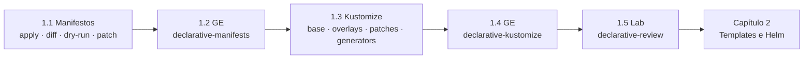

# Capítulo 1 — Declarative Resource Management

**Título em português:** Gerenciamento declarativo de recursos
**Status da documentação:** ✅ concluído e validado
**Referência:** PDF p. 15–68

## Objetivo do capítulo

Implantar e atualizar aplicações a partir de manifestos de recursos
**parametrizados para diferentes ambientes de destino**.

## Por que este capítulo importa

No DO180 você implantou aplicações principalmente com comandos (`oc create`,
`oc new-app`, `oc set`...) e viu manifestos como alternativa. O DO280 começa
mudando o ponto de partida: em um cluster de produção, o estado da aplicação deve
viver em **arquivos versionados**, ser **validado** antes de aplicado e ser
**reproduzível** em vários ambientes. Tudo o que vem depois (templates e Helm no
Capítulo 2, RBAC, NetworkPolicies, quotas, Operators) é configurado do mesmo jeito:
com manifestos aplicados de forma declarativa.

## Seções e atividades (ordem oficial)

| Seção | Tipo | Título original | Material | PDF |
|-------|------|-----------------|----------|-----|
| 1.1 | Conceito | Resource Manifests | [lição](1.1-manifestos-de-recursos.md) | p. 16–25 |
| 1.2 | Guided Exercise | Resource Manifests | [prática](PRATICA-OFICIAL.md#12-guided-exercise-resource-manifests) | p. 26–34 |
| 1.3 | Conceito | Kustomize Overlays | [lição](1.3-overlays-do-kustomize.md) | p. 35–46 |
| 1.4 | Guided Exercise | Kustomize Overlays | [prática](PRATICA-OFICIAL.md#14-guided-exercise-kustomize-overlays) | p. 47–57 |
| 1.5 | Lab | Manage Declarative Resources | [prática](PRATICA-OFICIAL.md#15-lab-manage-declarative-resources) | p. 58–67 |
| 1.6 | Summary | Summary | [RESUMO.md](RESUMO.md) | p. 68 |

Abertura do capítulo (meta e seções): PDF p. 15. Não há quiz neste capítulo.

## Arquivos do capítulo

- [PRATICA-OFICIAL.md](PRATICA-OFICIAL.md): ponte com as atividades oficiais.
- [REVISAO.md](REVISAO.md): questões autorais integradas.
- [RESUMO.md](RESUMO.md): síntese e tabela de comandos.

## Pré-requisitos recomendados

[Revisão do DO180](../../00-comecar-aqui/revisao-do180.md) — em especial
[F5 — Kubernetes API e YAML](https://github.com/eduardoandradej/openshift-do180-4.22-estudos/blob/main/01-fundamentos-essenciais/05-kubernetes-api-e-yaml.md)
e [5.1 — Externalizar configuração](https://github.com/eduardoandradej/openshift-do180-4.22-estudos/blob/main/capitulos/05-configuracao-e-storage/5.1-externalizar-configuracao.md).
Noções de Git (`clone --branch`, `checkout`, `log`, `show`) ajudam nas atividades.

## Checklist do aluno

- [ ] 1.1 lida e Parte F respondida
- [ ] 1.2 Guided Exercise `declarative-manifests` concluído
- [ ] 1.3 lida e Parte F respondida
- [ ] 1.4 Guided Exercise `declarative-kustomize` concluído
- [ ] 1.5 Lab `declarative-review` com `lab grade` aprovado
- [ ] [REVISAO.md](REVISAO.md) respondida
- [ ] Registro no [diário de laboratórios](../../progresso/diario-de-laboratorios.md)

---
[← Comece aqui](../../00-comecar-aqui/README.md) | [Índice geral](../../README.md) | [Próximo: 1.1 Manifestos de recursos →](1.1-manifestos-de-recursos.md)
