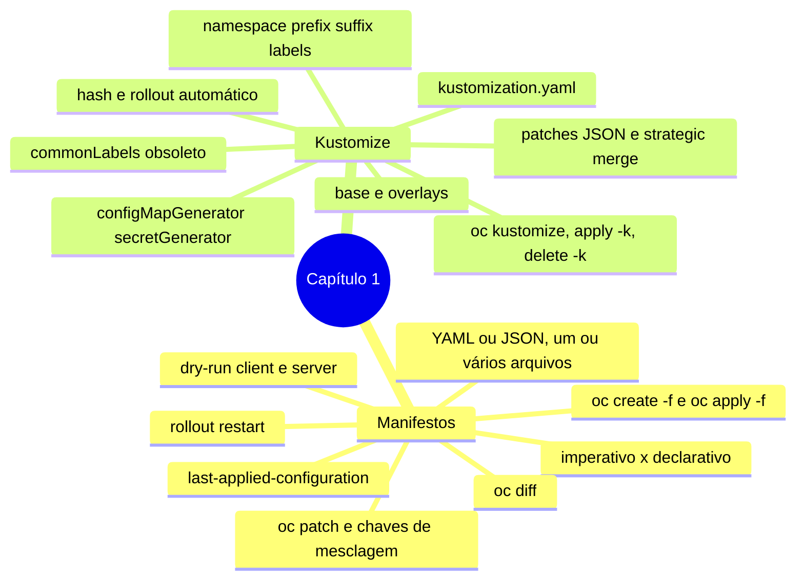

# Resumo — Capítulo 1

Síntese autoral para revisão rápida. Correspondência oficial: seção 1.6 (PDF p. 68).

## Em uma frase por seção

| Seção | Ideia central |
|-------|---------------|
| 1.1 | Manifestos versionados descrevem o estado desejado; `oc apply` reconcilia o vivo com o arquivo (*three-way merge*), `--dry-run=server` e `oc diff` validam antes, `oc rollout restart` cobre mudanças só de configuração e `oc patch` faz ajustes pontuais |
| 1.3 | O Kustomize gera variações por ambiente sem alterar a base: overlays com `namespace`, `labels`, prefixos, `patches` e generators que fazem rollout automático pelo hash no nome |

## Mapa do capítulo

## Tabela de comandos do capítulo

| Tarefa | Comando | Tipo |
|--------|---------|------|
| Gerar esqueleto | `oc create deployment <d> --image  --dry-run=client -o yaml [--save-config] > d.yaml` | 🖥️ |
| Documentar campo | `oc explain <tipo>.<campo>` | 🔍 |
| Criar de arquivos | `oc create -f <arq\|dir\|url> [-R]` | ✏️ |
| Validar no servidor | `oc apply -f <dir> --dry-run=server --validate=true` | 🔍 |
| Comparar com o vivo | `oc diff -f <dir>` · `oc diff -k <dir>` | 🔍 |
| Criar ou atualizar | `oc apply -f <dir>` | ✏️ |
| Ver último aplicado | `oc apply view-last-applied <tipo>/<nome>` | 🔍 |
| Reiniciar Pods | `oc rollout restart deployment/<d>` | ✏️ |
| Patch inline | `oc patch <tipo> <nome> -p '<json>'` | ✏️ |
| Patch de arquivo | `oc patch <tipo> <nome> --patch-file <arq>` | ✏️ |
| Patch preciso | `oc patch <tipo> <nome> --type json -p '[{"op":...}]'` | ✏️ |
| Remover de arquivos | `oc delete -f <dir>` | ✏️ |
| Renderizar Kustomize | `oc kustomize <dir>` | 🖥️ |
| Aplicar Kustomize | `oc apply -k <dir> [--dry-run=server]` | ✏️ |
| Remover Kustomize | `oc delete -k <dir>` | ✏️ |
| Ler Secret gerado | `oc extract secret/<nome-hash> --to -` | 🔍 |

## Alertas operacionais

- ⚠️ `oc create -f` não atualiza: `AlreadyExists`.
- ⚠️ Mudou só ConfigMap/Secret (sem generator)? Os Pods não mudam sozinhos.
- ⚠️ `oc patch` em objeto gerenciado por manifesto: leve a mudança ao Git ou ela será desfeita.
- ⚠️ Strategic merge: `volumeMounts` mescla por `mountPath`; container precisa ter o `name` certo.
- ⚠️ `spec.selector` de Deployment é imutável: cuidado com `commonLabels`/`includeSelectors`.
- ⚠️ O Kustomize não cria projetos, não apaga generators antigos e não ajusta `spec.to.name` de Routes.
- ⚠️ `literals` de `secretGenerator` ficam em texto claro no Git.

## Divergências registradas em relação à apostila

| Ponto | Apostila | Comportamento verificado |
|-------|----------|--------------------------|
| `labels` do Kustomize (p. 37, 40) | Aplicado também a selectors | Por padrão só `metadata.labels`; selectors exigem `includeSelectors: true` |
| Patch de `volumeMounts` (p. 23–25) | Altera o `mountPath` existente | Adiciona um segundo mount (chave `mountPath`); só `claimName` é substituído |

## Ligação com o próximo capítulo

O Capítulo 2 (*Deploying Packaged Applications*) trata de outra forma de
parametrizar implantações: **templates do OpenShift** e **Helm charts**. Compare-os
com o Kustomize à medida que estudar.

---
[← Revisão](REVISAO.md) | [Índice do capítulo](README.md) | [Próximo capítulo →](../02-aplicacoes-empacotadas/README.md)
