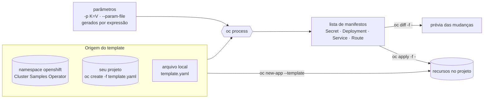

# 2.1 — Usar templates do OpenShift

| Campo | Valor |
|-------|-------|
| Curso | DO280 — OpenShift 4.22 |
| Capítulo / seção | Capítulo 2 · Seção 2.1 |
| Título original | Using OpenShift Templates |
| Título em português | Usar templates do OpenShift |
| Objetivo | Implantar e atualizar aplicações a partir de manifestos empacotados como templates do OpenShift |
| Referência | PDF p. 70–75 · Guided Exercise 2.2 p. 76–81 |

## Pré-requisitos e conhecimentos anteriores

No DO180 você já usou templates do jeito "rápido": `oc new-app --template` com
`--param`, e viu que `oc process` gera a lista de recursos que pode ser enviada ao
`oc apply`. No [Capítulo 1](../01-gerenciamento-declarativo/README.md) você aprendeu a
validar com `--dry-run=server`, comparar com `oc diff` e atualizar com `oc apply`.
Esta lição junta as duas coisas: tratar o template como **fonte de manifestos** de
um fluxo declarativo, inclusive para atualizações.

| Conceito | Onde revisar |
|----------|--------------|
| Templates, `oc new-app --template`, `oc process` | [DO180 · 4.1 — Implantar a partir de imagem e template](https://github.com/eduardoandradej/openshift-do180-4.22-estudos/blob/main/capitulos/04-deploy-e-redes/4.1-implantar-a-partir-de-imagem-e-template.md) |
| `oc apply`, `oc diff`, `--dry-run=server` | [1.1 — Manifestos de recursos](../01-gerenciamento-declarativo/1.1-manifestos-de-recursos.md) |
| Secrets e variáveis de ambiente | [DO180 · 5.1 — Externalizar configuração](https://github.com/eduardoandradej/openshift-do180-4.22-estudos/blob/main/capitulos/05-configuracao-e-storage/5.1-externalizar-configuracao.md) |
| Cluster operators (o Samples Operator é um deles) | [DO180 · 2.5 — Avaliar a saúde do cluster](https://github.com/eduardoandradej/openshift-do180-4.22-estudos/blob/main/capitulos/02-cli-e-apis/2.5-avaliar-a-saude-do-cluster.md) |

## Parte A — Entendendo o conceito

### O problema: "o mesmo conjunto de objetos, com alguns valores diferentes"

No Capítulo 1 o Kustomize resolveu variações por ambiente aplicando **patches** sobre
YAML puro. Há outra abordagem, mais antiga e muito presente no OpenShift: escrever os
manifestos **uma vez**, com **lacunas** (parâmetros), e preencher as lacunas no
momento da implantação. É o que faz um **template**.

### O que é um template

Um **Template** (`template.openshift.io/v1`) é um recurso do OpenShift — uma
extensão da API Kubernetes — que guarda:

| Parte | Para que serve |
|-------|----------------|
| `objects` | A lista de manifestos que serão gerados (qualquer tipo que você tenha permissão de criar no projeto) |
| `parameters` | As lacunas: nome, descrição, valor padrão, obrigatoriedade, ou regra para **gerar** o valor |
| `labels` | Labels aplicados a **todos** os objetos gerados (ex.: `template=...`), úteis para listar e apagar o conjunto |
| `message` | Texto exibido após a instanciação (ex.: como acessar a aplicação) |
| `metadata` | Nome e anotações (descrição, ícone, tags) usados pela console e pela CLI |

Dentro de `objects`, os parâmetros aparecem como `${NOME}`. 📘 *Fonte externa:* a
forma `${{NOME}}` insere o valor **sem aspas**, para campos que não são texto (como
`replicas`, que exige um inteiro).

Um parâmetro pode ter `generate: expression` com `from: "[a-zA-Z0-9]{16}"`: se você
não informar valor, o OpenShift **gera** um que obedece à expressão. É assim que os
templates de banco de dados criam senhas aleatórias.

### Processar ≠ criar

**Processar** um template significa substituir os parâmetros e produzir uma
**lista de manifestos comuns**. Nada é criado no cluster nesse momento. O que você faz
com essa lista é uma decisão separada:

| Forma | O que acontece | Indicada para |
|-------|----------------|---------------|
| `oc new-app --template <t> -p K=V` | Processa e **cria** tudo em um passo | Desenvolvimento e testes rápidos |
| `oc process <t> -p K=V \| oc apply -f -` | Processa e **aplica** (cria ou atualiza) | Fluxo declarativo, reaplicável |
| `oc process <t> -p K=V -o yaml > arquivo.yaml` | Processa e **guarda** o resultado | Revisar, versionar, aplicar depois |

A apostila recomenda o `oc process` + `oc apply` para produção, porque o resultado
pode ser comparado (`oc diff`), versionado e reaplicado. Os **valores de parâmetros**
podem ficar em um arquivo (`--param-file`), uma linha `CHAVE=valor` por parâmetro, que
também vai para o Git como registro do que foi usado em cada ambiente.

### De onde vêm os templates

- O **Cluster Samples Operator** popula templates (e image streams) no namespace
  **`openshift`**. A instalação pode excluir ou restringir esses exemplos.
- Qualquer pessoa pode criar templates próprios em arquivo ou **carregá-los em um
  projeto** com `oc create -f template.yaml`. Note a diferença: esse `oc create` cria
  o **objeto Template**, não os recursos descritos nele.
- Um template carregado em um projeto fica disponível para todos que têm acesso ao
  projeto e aparece no catálogo da console.

### Permissões para processar

O `oc process <nome>` de um template **guardado no cluster** é feito pelo API server
no namespace onde o template está. A apostila destaca que isso exige **permissão de
escrita** nesse namespace. Usuários comuns **leem** os templates do projeto
`openshift`, mas não escrevem nele; o caminho é **copiar** o template para um
projeto próprio (ou para um arquivo) e processar a cópia.

### Atualizar a partir de templates

Como o resultado do processamento é aplicado com `oc apply`, você pode reprocessar com
outros parâmetros e reaplicar. Isso cobre mudanças simples (memória, imagem, réplicas).
Mudanças mais complexas de ciclo de vida não são o ponto forte dos templates: a apostila
sugere Helm ([2.3](2.3-charts-do-helm.md)) para aplicações mais complexas (e Operators
para as ainda mais complexas, assunto do Capítulo 7).

> ⚠️ **Parâmetros gerados são gerados de novo a cada processamento.** Se a primeira
> instalação gerou uma senha aleatória e você reprocessar o template **sem** informar
> aquele parâmetro, uma **nova** senha será gerada e o `oc apply` vai alterar o Secret,
> desencontrando a aplicação de dados que já foram criados com a senha antiga. Em
> atualizações, informe explicitamente os valores que precisam ser preservados
> (como faz o Guided Exercise 2.2 com as credenciais do banco).

### Boas práticas ao copiar um template para uso próprio

1. Exportar: `oc get template <t> -n openshift -o yaml > meu-template.yaml`.
2. Dar um **nome novo**, específico para o uso.
3. Ajustar os **valores padrão** dos parâmetros para o ambiente.
4. Remover `metadata.namespace` (senão o template fica preso ao namespace de origem,
   e a apostila registra erro ao processá-lo em outro projeto) e os campos que o
   cluster preenche (`uid`, `resourceVersion`, `creationTimestamp`, `managedFields`).
5. Carregar no projeto desejado: `oc create -f meu-template.yaml [-n <projeto>]`.

## Parte B — Modelo mental e arquitetura



Compare com o Kustomize: no template, **o autor** decide onde estão as lacunas; quem
usa só preenche. No Kustomize, **quem usa** pode alterar qualquer campo por patch,
sem que o autor tenha previsto.

## Parte C — Aplicação prática

> Legenda: 🔍 somente leitura · ✏️ altera o cluster · 🖥️ só local
>
> Template completo e autoral em
> [exemplos-originais/template-catalogo](../../exemplos-originais/template-catalogo/).

### 1. Descobrir templates: `oc get templates` 🔍

```bash
oc get templates -n openshift                 # catálogo do Samples Operator
oc get templates                              # templates do projeto atual
```

- **Colunas:** nome, descrição, `PARAMETERS` (ex.: `7 (2 generated)` = 7 parâmetros, 2 gerados automaticamente; `(4 blank)` = sem valor padrão) e `OBJECTS` (quantos manifestos o template gera).
- **Permissões:** leitura no namespace. Usuários autenticados leem o `openshift`.

### 2. Avaliar um template: `oc describe template` e `oc process --parameters` 🔍

```bash
oc describe template postgresql-ephemeral -n openshift
oc process --parameters postgresql-ephemeral -n openshift
oc process --parameters -f meu-template.yaml   # template em arquivo
oc get template postgresql-ephemeral -n openshift -o yaml   # o manifesto do template
```

- **O que procurar no `describe`:** descrição (finalidade), parâmetros (`Required`, `Value`, `Generated`/`From`), `Object Labels` (aplicados a tudo) e a seção `Objects` (o que será criado).
- **O que procurar em `--parameters`:** colunas `GENERATOR` e `VALUE`; parâmetros obrigatórios **sem** valor padrão nem gerador precisam ser informados.
- **Atenção:** alguns templates antigos ainda geram `DeploymentConfig`, API obsoleta desde o 4.14; prefira templates que geram `Deployment`.

### 3. Instanciar rapidamente: `oc new-app --template` ✏️

```bash
oc new-app --template mariadb-persistent \
  -p MYSQL_USER=app -p MYSQL_DATABASE=catalogo
```

- **Finalidade:** processar e criar em um passo; a saída lista os parâmetros usados, inclusive os **gerados** (anote-os, não aparecem de novo).
- **Permissões:** criar cada tipo de objeto do template no projeto atual.
- **Verificar:** `oc get all,secret,pvc -l template=<label-do-template>`.
- **Limitação:** não é reaplicável como atualização; repetir dá `AlreadyExists`.

### 4. Processar para um arquivo ou para o `oc apply` ✏️

```bash
# Gerar manifestos (o padrão do oc process é JSON; -o yaml para YAML)
oc process catalogo -p APP_NAME=catalogo -p REPLICAS=2 -o yaml > catalogo-manifestos.yaml

# Template em arquivo
oc process -f template-catalogo.yaml -p APP_NAME=catalogo -o yaml > catalogo-manifestos.yaml

# Parâmetros em arquivo (uma linha CHAVE=valor)
oc process catalogo --param-file parametros-dev.txt | oc apply -f -
```

- **Parâmetros:** `-p CHAVE=valor` (repetível); `--param-file` (arquivo versionável); 📘 `-l chave=valor` acrescenta labels; 📘 `--ignore-unknown-parameters` evita erro quando o arquivo traz parâmetros que o template não declara; 📘 `--local` processa sem contatar o cluster (só com `-f`).
- **Objetos afetados:** nenhum pelo `oc process` sozinho; o `oc apply` cria/atualiza.
- **Resultado esperado no apply:** `secret/... created`, `deployment.apps/... created` etc.
- **Erros comuns:** `templates.template.openshift.io "x" not found` (namespace errado: use `-n`); erro de permissão ao processar no namespace `openshift`; parâmetro obrigatório sem valor padrão nem gerador e não informado (o processamento falha citando o parâmetro); arquivo `.env` bloqueado pelo seu `.gitignore` (como neste repositório: daí o nome `parametros-dev.txt`).

### 5. Atualizar com segurança: reprocessar → `oc diff` → `oc apply` ✏️

```bash
oc process catalogo --param-file parametros-dev-v2.txt | oc diff -f -
oc process catalogo --param-file parametros-dev-v2.txt | oc apply -f -
oc rollout status deployment/catalogo
```

- **Leia o diff procurando:** a mudança que você quer (imagem, memória) **e** mudanças que você **não** quer, como um Secret com valor novo porque um parâmetro gerado foi omitido, ou uma variável que voltou ao padrão porque não foi informada.
- **Lembre do Capítulo 1:** se só o Secret mudar, os Pods não serão recriados sozinhos.

### 6. Copiar e publicar um template no projeto ✏️

```bash
oc get template postgresql-ephemeral -n openshift -o yaml > meu-postgresql.yaml
# editar: metadata.name, valores padrão; remover metadata.namespace e campos do cluster
oc create -f meu-postgresql.yaml                     # no projeto atual
oc create -f meu-postgresql.yaml -n templates-equipe # em outro projeto
oc get templates -n templates-equipe
```

### Raciocínio operacional e diagnóstico

| Sintoma | Hipótese | Como confirmar | Correção segura |
|---------|----------|----------------|-----------------|
| `oc process` falha com `Forbidden` em template do `openshift` | Processar no servidor exige escrita no namespace do template | Mensagem cita o namespace `openshift` | Copiar o template para o seu projeto ou para arquivo |
| `... not found` | Template em outro namespace | `oc get templates -A \| grep <nome>` | Usar `-n <ns>` |
| Aplicação perde acesso ao banco após reaplicar o template | Senha gerada de novo | `oc diff` mostra o Secret mudando | Informar o valor original via `-p`/`--param-file` |
| Variável voltou ao valor padrão | Parâmetro omitido na reaplicação | `oc diff` mostra a variável | Registrar todos os parâmetros no arquivo de parâmetros |
| `replicas` rejeitado como texto | Uso de `${REPLICAS}` em campo inteiro | Erro de validação do Deployment | Usar `${{REPLICAS}}` no template (📘) |
| `oc new-app --template` repetido dá `AlreadyExists` | `new-app` só cria | Objetos já existem | Migrar para `oc process \| oc apply -f -` |
| Dois templates "brigam" pelo mesmo objeto | Templates diferentes geram objeto com o mesmo nome | `oc apply` mostra `configured` em objeto de outro conjunto | Separar nomes ou concentrar a definição em um só lugar |

## Parte D — Relações importantes

| A | B | Diferença essencial |
|---|---|--------------------|
| `oc new-app --template` | `oc process \| oc apply -f -` | Cria em um passo, não reaplicável × gera manifestos reaplicáveis e comparáveis |
| `oc create -f template.yaml` | `oc process -f template.yaml \| oc apply -f -` | Carrega o **objeto Template** × cria os **recursos** descritos |
| `-p` | `--param-file` | Valores na linha de comando × arquivo versionável |
| `${PARAM}` | `${{PARAM}}` (📘) | Valor como texto × valor sem aspas (número, booleano) |
| Parâmetro com `value` | Parâmetro com `generate: expression` | Padrão fixo × valor aleatório novo a cada processamento |
| Template no `openshift` | Template no seu projeto | Catálogo global, só leitura para a maioria × controlado pela equipe |
| Template | Kustomize | Lacunas definidas pelo autor × patches livres sobre YAML puro |
| Template | Helm chart (2.3) | Substituição simples, sem histórico × releases com versões, upgrade e rollback |

## Parte E — Preparação para o laboratório oficial

Atividade associada: **2.2 Guided Exercise — Use OpenShift Templates**
(`packaged-templates`, PDF p. 76–81).

Você deve conseguir, sem consultar a lição:

- localizar no `openshift` o template adequado e ler seus objetos e parâmetros;
- instanciar um template com `oc new-app` informando parâmetros;
- carregar um template próprio no projeto e confirmar com `oc get templates`;
- processar e aplicar com `oc process ... | oc apply -f -`, inclusive com parâmetros que **precisam coincidir** com os usados por outro componente;
- preparar um arquivo de parâmetros, comparar com `oc diff -f -` e aplicar uma versão nova sem perder dados.

Detalhes em [PRATICA-OFICIAL.md](PRATICA-OFICIAL.md#22-guided-exercise-use-openshift-templates).

## Parte F — Fixação

1. Qual a diferença entre `oc create -f modelo.yaml` e `oc process -f modelo.yaml | oc apply -f -`, se `modelo.yaml` contém um `kind: Template`?
2. `oc get templates -n openshift` mostra `9 (3 generated)` para um template. O que isso significa para quem vai usá-lo?
3. Por que a apostila prefere `oc process` + `oc apply` a `oc new-app --template` em produção?
4. Um usuário comum recebe `Forbidden` ao executar `oc process mysql-persistent -n openshift`. Explique e proponha a saída.
5. Você reaplicou um template de banco informando apenas a nova imagem. A aplicação passou a falhar ao autenticar. O que provavelmente aconteceu, e como você teria percebido antes?
6. Que três ajustes você faz em um template copiado do namespace `openshift` antes de carregá-lo no projeto da equipe?

<details>
<summary>Respostas comentadas</summary>

1. O primeiro cria o **objeto Template** no projeto (fica disponível para ser processado); o segundo processa o template e cria/atualiza os **recursos** descritos nele.
2. O template tem 9 parâmetros, e 3 deles recebem valor gerado automaticamente (ex.: senhas) se você não informar. Anote os gerados ou informe-os explicitamente.
3. Porque o resultado é um conjunto de manifestos que pode ser revisado, comparado com `oc diff`, versionado e reaplicado para atualizar; `new-app` só cria e não serve para atualizações.
4. Processar no servidor um template guardado em um namespace exige escrita nesse namespace, e usuários comuns só leem o `openshift`. Copie o template (`oc get template ... -o yaml`) para um arquivo ou para o próprio projeto e processe a cópia.
5. Os parâmetros de senha omitidos foram **gerados de novo**, e o Secret mudou. Rodar `oc process ... | oc diff -f -` antes do apply teria mostrado o Secret alterado.
6. Novo nome; valores padrão ajustados ao ambiente; remoção de `metadata.namespace` e dos campos preenchidos pelo cluster.

</details>

## Parte G — Essencial para memorizar

- Template = `objects` + `parameters` + `labels` (+ `message`); API `template.openshift.io/v1`.
- Samples Operator → templates no namespace `openshift`.
- `oc describe template <t> -n openshift` · `oc process --parameters <t> -n <ns>` · `oc get template <t> -o yaml`.
- Rápido: `oc new-app --template <t> -p K=V`. Declarativo: `oc process <t> -p K=V | oc apply -f -`.
- `--param-file` versiona os valores; `oc process ... | oc diff -f -` antes de aplicar.
- Parâmetros gerados mudam a cada processamento: informe-os em atualizações.
- `oc create -f template.yaml` publica o template; copie, renomeie e tire o `namespace`.

---
[← Índice do capítulo](README.md) | [Índice do capítulo](README.md) | [Próximo: 2.3 Charts do Helm →](2.3-charts-do-helm.md)
