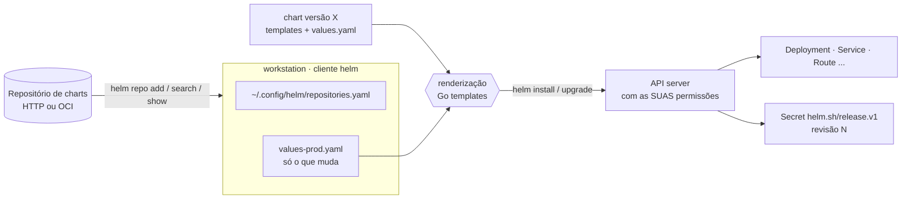
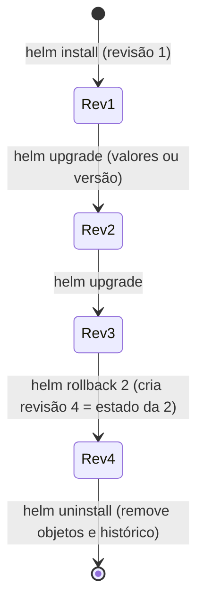

# 2.3 — Implantar charts do Helm

| Campo | Valor |
|-------|-------|
| Curso | DO280 — OpenShift 4.22 |
| Capítulo / seção | Capítulo 2 · Seção 2.3 |
| Título original | Deploying Helm Charts |
| Título em português | Implantar charts do Helm |
| Objetivo | Implantar e atualizar aplicações a partir de manifestos empacotados como charts do Helm |
| Referência | PDF p. 82–93 · Guided Exercise 2.4 p. 94–98 · Lab 2.5 p. 99–108 |

## Pré-requisitos e conhecimentos anteriores

Você já sabe que uma aplicação é um conjunto de objetos coerentes
([1.1](../01-gerenciamento-declarativo/1.1-manifestos-de-recursos.md)), que esse
conjunto pode ser parametrizado por patches (Kustomize, [1.3](../01-gerenciamento-declarativo/1.3-overlays-do-kustomize.md))
ou por parâmetros (templates, [2.1](2.1-templates-do-openshift.md)). Do DO180, retome
requests e limits (o lab 2.5 os configura por valores do chart) e Routes.
A novidade aqui é o **ciclo de vida**: o Helm registra cada implantação como uma
**release** com **revisões**, permitindo upgrade, histórico e rollback.

| Conceito | Onde revisar |
|----------|--------------|
| Requests e limits | [DO180 · 6.5](https://github.com/eduardoandradej/openshift-do180-4.22-estudos/blob/main/capitulos/06-confiabilidade/6.5-reservar-capacidade-de-computacao.md) e [6.7](https://github.com/eduardoandradej/openshift-do180-4.22-estudos/blob/main/capitulos/06-confiabilidade/6.7-limitar-capacidade-de-computacao.md) |
| Routes e hosts | [DO180 · 4.7 — Escalar e expor aplicações](https://github.com/eduardoandradej/openshift-do180-4.22-estudos/blob/main/capitulos/04-deploy-e-redes/4.7-escalar-e-expor-aplicacoes.md) |
| Rollout e rollback de Deployments | [DO180 · 7.3 — Atualizar imagem e configurações](https://github.com/eduardoandradej/openshift-do180-4.22-estudos/blob/main/capitulos/07-atualizacao-aplicacoes/7.3-atualizar-imagem-e-configuracoes.md) |
| Referência completa de imagem (registry/repositório:tag) | [DO180 · 7.1 — Identidade e tags de imagens](https://github.com/eduardoandradej/openshift-do180-4.22-estudos/blob/main/capitulos/07-atualizacao-aplicacoes/7.1-identidade-e-tags-de-imagens.md) |

## Parte A — Entendendo o conceito

### O que é o Helm e que problema resolve

O **Helm** é uma ferramenta de código aberto para gerenciar o **ciclo de vida** de
aplicações Kubernetes. Ele empacota os manifestos de uma aplicação em um **chart**,
que pode ser versionado, publicado em repositórios e instalado por qualquer pessoa,
ajustando apenas os **valores** que o autor expôs. Muitos fornecedores distribuem
suas aplicações como charts — às vezes é o único método suportado de instalação.

O Helm também cobre o que templates e Kustomize não cobrem: ele **lembra** o que
instalou. Cada instalação é uma **release** com histórico de **revisões**, o que
permite atualizar, comparar e voltar atrás com um comando.

A apostila ressalva que o Helm não atende a todas as necessidades: aplicações com
ciclo de vida complexo (backup, failover, migrações contínuas) são mais bem servidas
por **Operators** (Capítulo 7).

### Estrutura de um chart

```text
catalogo/
├── Chart.yaml        # metadados: nome, versão do chart, appVersion...
├── values.yaml       # valores padrão (o "contrato" do chart com quem instala)
└── templates/        # manifestos com marcações da linguagem de templates do Go
    ├── deployment.yaml
    ├── service.yaml
    ├── route.yaml
    └── NOTES.txt     # mensagem exibida após instalar/atualizar
```

Nos arquivos de `templates/`, o autor usa marcações como `{{ .Values.image.tag }}` e
`{{ .Release.Name }}`. Ao instalar, o Helm **renderiza** essas marcações com os valores
finais e envia o resultado ao cluster. Por isso o autor pode, por exemplo, permitir que
o administrador troque a imagem pública por uma de um **registry privado** — exatamente
o que as atividades do capítulo fazem no ambiente sem internet.

Charts podem conter **hooks**: tarefas que o Helm executa em momentos definidos
(antes/depois de instalar ou atualizar). Hooks permitem automatizar passos de
instalação e upgrade; leia a documentação do chart para saber o que eles fazem.

### As três entidades com que o `helm` trabalha

| Entidade | O que é |
|----------|---------|
| **Chart** | O pacote: diretório local, arquivo `.tgz`, URL, imagem OCI ou item de um repositório |
| **Release** | O resultado de instalar um chart: nome único **por namespace**; o mesmo chart pode ser instalado várias vezes |
| **Versão** | Cada versão publicada do chart (campo `version` do `Chart.yaml`); diferente de `appVersion`, a versão da aplicação |

### Antes de instalar: três decisões

1. **Namespace de destino.** A maioria dos charts de aplicação **não cria** namespace;
   os objetos não declaram `namespace` e vão para o namespace em uso (o projeto atual
   do `oc`, ou o informado com `-n`). Crie o projeto antes (`oc new-project`).
2. **Valores a sobrescrever.** Leia a documentação e `helm show values`. Escreva um
   arquivo YAML **só com as chaves que mudam**, seguindo a mesma estrutura.
3. **Nome da release.** Muitos charts usam o nome da release para compor o nome dos
   objetos (ex.: release `prod` → Deployment `prod-etherpad`).

### Como os valores são combinados

📘 *Fonte externa (documentação do Helm):* a ordem de precedência é
`values.yaml` do chart **<** arquivos `-f`/`--values` (o último vence) **<** `--set`.
Mapas são mesclados chave a chave (por isso basta escrever `image.tag` para mudar só a
tag), mas **listas são substituídas inteiras**.

### Releases e o Secret de controle

Ao instalar, além dos objetos da aplicação, o Helm grava o estado da release em um
**Secret do tipo `helm.sh/release.v1`** no namespace (📘 nome no formato
`sh.helm.release.v1.<release>.v<revisão>`, um por revisão). É assim que ele sabe o que
instalou, com quais valores e em qual versão.

> ⚠️ Não edite nem apague esses Secrets. Sem eles, o Helm perde o controle da release.

### Upgrade, histórico e rollback

- `helm upgrade` aplica mudanças a uma release existente: **novos valores** e/ou **nova
  versão do chart**. Cada upgrade cria uma **nova revisão**.
- **Por padrão, o upgrade usa a versão mais recente** do chart disponível no
  repositório. Use `--version` para fixar a versão desejada.
- Como trabalha sobre objetos existentes, o upgrade pode ter efeitos mais complexos que
  a instalação; leia as notas da nova versão e use `--dry-run` para ver os manifestos.
- 📘 *Fonte externa (conferido no código-fonte do Helm 3.17, `pkg/action/upgrade.go`):* se você passar valores (`-f`/`--set`) no upgrade, o Helm usa os
  padrões do chart **mais os valores informados agora** — valores dados em comandos
  anteriores **não** são lembrados (a menos que use `--reuse-values`). Se não passar
  nenhum valor, ele reaproveita os da revisão anterior. Por isso a prática segura é
  manter **um arquivo de valores completo por ambiente** e passá-lo sempre.
- `helm history <release>` mostra as revisões; `helm rollback <release> <revisão>`
  volta ao estado de uma revisão anterior (📘 criando uma **nova** revisão).
- Rollback pode ter implicações maiores que o upgrade: nem toda mudança é reversível
  (ex.: migração de esquema de banco feita por um hook). Teste em um ambiente igual ao
  de produção antes.

### Repositórios

`helm repo add|list|update|remove` gerencia uma lista **local** de repositórios
(arquivo `~/.config/helm/repositories.yaml`). Esses comandos **não alteram o cluster**.
`helm search repo` procura nos repositórios configurados e mostra só a última versão de
cada chart (use `--versions` para todas).

### Helm na web console do OpenShift

A console oferece o ciclo completo em **Ecosystem › Helm**:

- **Instalar** a partir do **Software Catalog** (*Create › Helm Release*) ou de uma **URL**
  (`https://` ou `oci://`; *Create › Helm chart URL*). A tela de valores (Form view ou
  YAML view) equivale ao seu arquivo `values.yaml`.
- **Gerenciar** releases: página de detalhes (Details, Resources, Revision History,
  Release Notes), visualização em **Workloads › Topology**, **Upgrade**, **Rollback** e
  **Delete Helm Release**.

Pontos de atenção da apostila:

- Repositórios adicionados com `helm repo add` ficam só no seu cliente e **não aparecem
  na console**. Para publicar um repositório na console, um administrador cria um
  **`HelmChartRepository`** (todo o cluster) ou um **`ProjectHelmChartRepository`**
  (um projeto).
- Instalar por URL **pula as validações** do catálogo: só use fontes confiáveis.
- Release instalada por URL não permite trocar a versão do chart no upgrade pela console.
- **Desinstalar é irreversível**: remove todos os recursos da release e pode incluir
  dados persistentes se o chart apagar PVCs.

## Parte B — Modelo mental e arquitetura





O Helm 3 não tem componente no cluster: o comando `helm` usa o **mesmo kubeconfig e o
mesmo usuário** do `oc login`. Se você não tem permissão para criar um objeto, o chart
também não consegue criá-lo.

## Parte C — Aplicação prática

> Legenda: 🔍 somente leitura · ✏️ altera o cluster · 🖥️ só local
>
> Chart autoral completo e validado em
> [exemplos-originais/helm-catalogo](../../exemplos-originais/helm-catalogo/).

### 1. Repositórios: `helm repo` 🖥️

```bash
helm repo list                                   # "no repositories to show" se vazio
helm repo add meu-repo https://charts.exemplo.com/
helm repo update                                 # atualiza o índice local
helm search repo                                 # última versão de cada chart
helm search repo catalogo --versions             # todas as versões de um chart
```

- **Permissões:** nenhuma no cluster; altera apenas a configuração local do usuário.
- **Erros comuns:** nome de repositório já usado; esquecer o `update` e não ver versões novas.

### 2. Inspecionar o chart: `helm show` 🖥️

```bash
helm show chart meu-repo/catalogo                  # metadados (versão, mantenedores, fontes)
helm show values meu-repo/catalogo --version 0.1.0 # valores padrão = o que pode ser ajustado
helm show readme meu-repo/catalogo                 # 📘 documentação do chart
```

Leia `show values` procurando: imagem (`repository`, `name`/`tag`), réplicas, Route/host,
`resources`, persistência. Comentários no `values.yaml` costumam mostrar o formato
esperado de blocos como `resources`.

### 3. Preparar o arquivo de valores 🖥️

```yaml
# values-producao.yaml — só as chaves que mudam em relação ao values.yaml do chart
replicaCount: 3
image:
  repository: registry.exemplo.com:8443/equipe/catalogo   # registry privado
  tag: "2.4"
route:
  host: catalogo.apps.exemplo.com
resources:
  requests:
    memory: 128Mi
  limits:
    memory: 256Mi
```

### 4. Prever: `--dry-run` e 📘 `helm template` 🔍

```bash
helm install prod meu-repo/catalogo -f values-producao.yaml --version 0.1.0 --dry-run
helm template prod meu-repo/catalogo -f values-producao.yaml   # 📘 renderiza localmente
```

- **Saída do `--dry-run`:** informações da release que **seria** criada, seção
  `MANIFEST` com tudo que seria aplicado e `NOTES` com as instruções do autor.
- **Verificar no texto:** nomes (com o nome da release), imagem completa, host da Route,
  número de réplicas e bloco `resources` no lugar certo.

### 5. Instalar: `helm install` ✏️

```bash
oc new-project catalogo-prod
helm install prod meu-repo/catalogo -f values-producao.yaml --version 0.1.0
```

- **Sintaxe:** `helm install <release> <chart> [-f valores.yaml] [--set k=v] [--version X] [-n ns]`.
- **Permissões:** as suas no namespace de destino (criar Deployments, Services, Routes, Secrets...).
- **Objetos afetados:** os do chart + o Secret de controle da release.
- **Resultado esperado:** `STATUS: deployed`, `REVISION: 1`.
- **Como verificar:** `helm list`; `oc get all,route`; `oc get secret -l owner=helm` (📘 label dos Secrets de release).
- **Erros comuns:** `cannot re-use a name that is still in use` (release já existe: use `upgrade`); namespace errado (use `-n` ou `oc project`); 📘 `--create-namespace` falhando por falta de permissão para criar namespaces (use `oc new-project`).

### 6. Inspecionar releases 🔍

```bash
helm list                      # releases do namespace atual
helm list -n catalogo-prod     # de um namespace específico
helm list --all-namespaces     # de todos (onde você tem acesso)
helm status prod               # 📘 estado e NOTES
helm get values prod           # 📘 valores informados pelo usuário nesta revisão
helm get values prod --all     # 📘 valores finais (padrões + sobrescritas)
helm get manifest prod         # 📘 manifestos aplicados
```

### 7. Atualizar: `helm upgrade` ✏️

```bash
helm upgrade prod meu-repo/catalogo -f values-producao.yaml --version 0.2.0 --dry-run
helm upgrade prod meu-repo/catalogo -f values-producao.yaml --version 0.2.0
helm list                      # REVISION 2, CHART catalogo-0.2.0
```

- **Finalidade:** mudar valores, versão do chart ou ambos.
- **Atenção:** sem `--version`, vai para a **última** versão do repositório.
- **Atenção:** passe sempre o arquivo de valores **completo** do ambiente; valores de
  upgrades anteriores não são lembrados quando você informa novos (📘).
- **Verificar:** `helm list`, `helm history prod`, `oc get pods` (rollout), `oc describe pod` para conferir `resources`.

### 8. Histórico e rollback ✏️

```bash
helm history prod
helm rollback prod 1
helm history prod              # 📘 nova revisão com DESCRIPTION "Rollback to 1"
```

### 9. Desinstalar ✏️

```bash
helm uninstall prod            # 📘 remove os objetos da release e seu histórico
```

### 10. Repositórios na console (administrador) ✏️ 📘

```yaml
apiVersion: helm.openshift.io/v1beta1
kind: ProjectHelmChartRepository     # HelmChartRepository = cluster inteiro
metadata:
  name: charts-equipe
  namespace: catalogo-prod
spec:
  name: Charts da equipe
  connectionConfig:
    url: https://charts.exemplo.com/
```

### Raciocínio operacional e diagnóstico

| Sintoma | Hipótese | Como confirmar | Correção segura |
|---------|----------|----------------|-----------------|
| `helm list` não mostra a release | Namespace diferente do atual | `helm list -A` | Usar `-n <ns>` |
| `cannot re-use a name that is still in use` | Release com esse nome já existe no namespace | `helm list` | `helm upgrade` (ou outro nome de release) |
| Pods em `ImagePullBackOff` após instalar | Imagem padrão do chart (pública) em ambiente sem internet, ou chaves de imagem erradas | `oc describe pod` mostra a imagem; `helm get values` | Ajustar `image.repository`/`name`/`tag` conforme `helm show values` |
| Upgrade trocou a versão do chart sem você pedir | `helm upgrade` sem `--version` usa a mais recente | `helm list` (coluna CHART) | Sempre informar `--version` |
| Depois de um upgrade, um ajuste anterior "sumiu" (ex.: host da Route) | Valores informados antes não são reaproveitados quando se passa novos valores | `helm get values <r>` nas revisões; `helm history` | Manter um arquivo de valores completo por ambiente |
| `resources` não aparece no Pod | Chave com nome/indentação diferente do que o chart espera | `helm template`/`--dry-run`; `oc describe pod` | Seguir o formato comentado no `values.yaml` |
| `another operation (install/upgrade/rollback) is in progress` | Release em estado `pending-*` após interrupção | `helm history` / `helm status` | Aguardar ou fazer rollback para a última revisão `deployed` |
| Release "quebrada" após apagar Secrets | Secrets `helm.sh/release.v1` removidos | `oc get secret --field-selector type=helm.sh/release.v1` | Não manipular esses Secrets; reinstalar se necessário |
| Repositório não aparece na console | `helm repo add` é local | — | Criar `HelmChartRepository`/`ProjectHelmChartRepository` |

## Parte D — Relações importantes

| A | B | Diferença essencial |
|---|---|--------------------|
| Chart | Release | Pacote × instalação nomeada desse pacote em um namespace |
| `version` | `appVersion` | Versão do chart × versão da aplicação empacotada |
| `values.yaml` do chart | Seu arquivo `-f` | Padrões do autor × só as sobrescritas do ambiente |
| `-f valores.yaml` | `--set chave=valor` | Arquivo versionável × ajuste pontual de maior precedência |
| `helm install --dry-run` | `helm template` (📘) | Prévia ligada ao cluster/release × renderização local |
| `helm upgrade` | `helm rollback` | Nova revisão com mudanças × nova revisão com o estado de uma antiga |
| `helm rollback` | `oc rollout undo` | Volta **todos** os objetos da release × volta só o template de um Deployment |
| `helm repo add` | `HelmChartRepository` | Configuração local do cliente × catálogo da console para o cluster |
| Helm | Template OpenShift | Releases, versões, histórico, hooks, repositórios × substituição simples, sem histórico |
| Helm | Kustomize | Autor define o que é configurável (valores) × usuário altera qualquer campo (patches) |
| Helm | Operator (Cap. 7) | Instala/atualiza manifestos × controller que gerencia o ciclo de vida contínuo |

## Parte E — Preparação para o laboratório oficial

Atividades associadas:

- **2.4 Guided Exercise — Deploy Helm Charts** (`packaged-charts`, PDF p. 94–98);
- **2.5 Lab — Deploy Packaged Applications** (`packaged-review`, PDF p. 99–108, com `lab grade`).

Você deve conseguir, sem consultar a lição:

- adicionar um repositório e listar **todas** as versões de um chart;
- ler `helm show values` e escrever um arquivo de valores que troca a imagem por uma do registry interno (repositório, nome e tag) e define o host da Route;
- instalar uma versão específica com um nome de release em um projeto específico;
- fazer upgrade para outra versão e confirmar com `helm list`;
- instalar o mesmo chart em outro projeto com outra release e outros valores;
- acrescentar `resources` pelo arquivo de valores e confirmar no Pod.

Detalhes em [PRATICA-OFICIAL.md](PRATICA-OFICIAL.md#24-guided-exercise-deploy-helm-charts).

## Parte F — Fixação

1. Qual a diferença entre chart, release e versão? Dê um exemplo em que um chart gera duas releases no mesmo cluster.
2. Onde o Helm guarda o estado de uma release? O que acontece se alguém apagar esse objeto?
3. Você executou `helm upgrade web repo/app -f valores.yaml` e a coluna CHART passou de `app-1.2.0` para `app-1.5.0`. Por quê? Como evitar?
4. O `values.yaml` do chart tem `image: {repository: nginx, tag: "1.25", pullPolicy: IfNotPresent}`. Escreva o arquivo de valores mínimo para usar `registry.exemplo.com/nginx:1.25-fix` sem mudar o `pullPolicy`.
5. Depois de `helm upgrade web repo/app --set replicaCount=3 --version 1.2.0`, o host da Route definido na instalação voltou ao padrão. Explique.
6. Você adicionou um repositório com `helm repo add`, mas um colega não o encontra no Software Catalog da console. Por quê, e o que o administrador deve fazer?
7. `helm rollback web 2` foi executado na revisão 5. Qual será o número da nova revisão e qual estado ela terá?

<details>
<summary>Respostas comentadas</summary>

1. Chart é o pacote; versão é uma edição publicada do pacote; release é uma instalação nomeada do chart em um namespace. Ex.: `helm install test repo/app -n app-test` e `helm install prod repo/app -n app-prod`.
2. Em Secrets do tipo `helm.sh/release.v1` no namespace da release (um por revisão). Sem eles, o Helm não consegue mais gerenciar a release (upgrade, rollback, uninstall).
3. Sem `--version`, o upgrade usa a versão mais recente disponível no repositório. Informe `--version 1.2.0` (e, para trocar de versão, faça-o de propósito e leia as notas).
4. ```yaml
   image:
     repository: registry.exemplo.com/nginx
     tag: "1.25-fix"
   ```
   Mapas são mesclados: `pullPolicy` continua vindo do chart.
5. Ao informar valores novos (`--set`), o Helm parte dos padrões do chart + valores informados agora; o host dado na instalação não foi reaproveitado (📘). Mantenha um arquivo de valores completo e passe-o em todo upgrade.
6. `helm repo add` altera só a configuração local de quem executou. Um administrador cria `HelmChartRepository` (cluster) ou `ProjectHelmChartRepository` (projeto).
7. Revisão 6, com o estado (valores e versão do chart) da revisão 2.

</details>

## Parte G — Essencial para memorizar

- Chart = `Chart.yaml` + `values.yaml` + `templates/`; release = instalação nomeada; revisão = cada mudança.
- `helm repo add|list|update|remove` e `helm search repo [--versions]` são **locais**.
- `helm show chart|values <chart> [--version]` antes de instalar.
- `helm install <release> <chart> -f valores.yaml --version X [--dry-run]`.
- `helm list [-n ns|--all-namespaces]` · `helm history` · `helm rollback <r> <rev>` · `helm uninstall <r>`.
- `helm upgrade` sem `--version` = versão mais recente; passe sempre o arquivo de valores completo.
- Estado da release em Secret `helm.sh/release.v1`: não mexa.
- Console: **Ecosystem › Helm**; repositórios na console via `HelmChartRepository`/`ProjectHelmChartRepository`.

---
[← 2.1 Templates do OpenShift](2.1-templates-do-openshift.md) | [Índice do capítulo](README.md) | [Próximo: Prática oficial →](PRATICA-OFICIAL.md)
