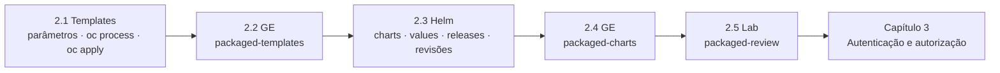

# Capítulo 2 — Deploying Packaged Applications

**Título em português:** Implantar aplicações empacotadas
**Status da documentação:** ✅ concluído e validado
**Referência:** PDF p. 69–109

## Objetivo do capítulo

Implantar e atualizar aplicações a partir de manifestos **empacotados para
compartilhamento e distribuição**: templates do OpenShift e charts do Helm.

## Por que este capítulo importa

O Capítulo 1 mostrou como **você** organiza e varia seus próprios manifestos. Na
prática, muitas aplicações chegam **prontas**, empacotadas por outra equipe ou por um
fornecedor: um template no catálogo do cluster ou um chart em um repositório. O
administrador precisa avaliar o pacote, escolher os valores certos para o ambiente
(registry privado, host, réplicas, recursos), instalar, atualizar e, se preciso,
voltar atrás — sempre com verificação.

## Seções e atividades (ordem oficial)

| Seção | Tipo | Título original | Material | PDF |
|-------|------|-----------------|----------|-----|
| 2.1 | Conceito | Using OpenShift Templates | [lição](2.1-templates-do-openshift.md) | p. 70–75 |
| 2.2 | Guided Exercise | Use OpenShift Templates | [prática](PRATICA-OFICIAL.md#22-guided-exercise-use-openshift-templates) | p. 76–81 |
| 2.3 | Conceito | Deploying Helm Charts | [lição](2.3-charts-do-helm.md) | p. 82–93 |
| 2.4 | Guided Exercise | Deploy Helm Charts | [prática](PRATICA-OFICIAL.md#24-guided-exercise-deploy-helm-charts) | p. 94–98 |
| 2.5 | Lab | Deploy Packaged Applications | [prática](PRATICA-OFICIAL.md#25-lab-deploy-packaged-applications) | p. 99–108 |
| 2.6 | Summary | Summary | [RESUMO.md](RESUMO.md) | p. 109 |

Abertura do capítulo (meta e seções): PDF p. 69. Não há quiz neste capítulo.

## Arquivos do capítulo

- [PRATICA-OFICIAL.md](PRATICA-OFICIAL.md): ponte com as atividades oficiais.
- [REVISAO.md](REVISAO.md): questões autorais integradas.
- [RESUMO.md](RESUMO.md): síntese e tabela de comandos.

## Pré-requisitos recomendados

[Capítulo 1](../01-gerenciamento-declarativo/README.md) (`oc apply`, `oc diff`,
Kustomize) ·
[DO180 · 4.1 — templates e `oc process`](https://github.com/eduardoandradej/openshift-do180-4.22-estudos/blob/main/capitulos/04-deploy-e-redes/4.1-implantar-a-partir-de-imagem-e-template.md) ·
[DO180 · 6.7 — limits](https://github.com/eduardoandradej/openshift-do180-4.22-estudos/blob/main/capitulos/06-confiabilidade/6.7-limitar-capacidade-de-computacao.md)

## Checklist do aluno

- [ ] 2.1 lida e Parte F respondida
- [ ] 2.2 Guided Exercise `packaged-templates` concluído
- [ ] 2.3 lida e Parte F respondida
- [ ] 2.4 Guided Exercise `packaged-charts` concluído
- [ ] 2.5 Lab `packaged-review` com `lab grade` aprovado
- [ ] [REVISAO.md](REVISAO.md) respondida
- [ ] Registro no [diário de laboratórios](../../progresso/diario-de-laboratorios.md)

---
[← Capítulo 1](../01-gerenciamento-declarativo/README.md) | [Índice geral](../../README.md) | [Próximo: 2.1 Templates do OpenShift →](2.1-templates-do-openshift.md)
