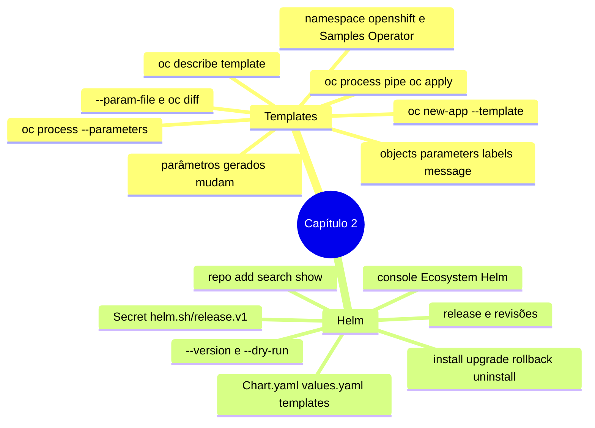

# Resumo — Capítulo 2

Síntese autoral para revisão rápida. Correspondência oficial: seção 2.6 (PDF p. 109).

## Em uma frase por seção

| Seção | Ideia central |
|-------|---------------|
| 2.1 | Templates do OpenShift empacotam objetos com parâmetros; `oc process` gera os manifestos e `oc apply` cria ou atualiza, com `--param-file` versionado e `oc diff -f -` antes |
| 2.3 | Charts do Helm empacotam manifestos com valores configuráveis; cada instalação é uma release com revisões, que pode ser atualizada, revertida e desinstalada pela CLI ou pela console |

## Mapa do capítulo

## Tabela de comandos do capítulo

| Tarefa | Comando | Tipo |
|--------|---------|------|
| Listar templates | `oc get templates [-n openshift]` | 🔍 |
| Detalhar template | `oc describe template <t> -n <ns>` | 🔍 |
| Parâmetros | `oc process --parameters <t> -n <ns>` · `-f arq.yaml` | 🔍 |
| Exportar template | `oc get template <t> -n <ns> -o yaml > arq.yaml` | 🔍 |
| Publicar template | `oc create -f arq.yaml [-n <ns>]` | ✏️ |
| Instanciar rápido | `oc new-app --template <t> -p K=V` | ✏️ |
| Gerar manifestos | `oc process <t> -p K=V -o yaml > m.yaml` | 🔍 |
| Prever atualização | `oc process <t> --param-file p.txt \| oc diff -f -` | 🔍 |
| Aplicar | `oc process <t> --param-file p.txt \| oc apply -f -` | ✏️ |
| Repositórios | `helm repo add\|list\|update\|remove` | 🖥️ |
| Procurar | `helm search repo [<termo>] --versions` | 🖥️ |
| Inspecionar | `helm show chart\|values <chart> [--version X]` | 🖥️ |
| Prévia | `helm install <r> <chart> -f v.yaml --version X --dry-run` | 🔍 |
| Instalar | `helm install <r> <chart> -f v.yaml --version X [-n ns]` | ✏️ |
| Releases | `helm list [-n ns\|--all-namespaces]` | 🔍 |
| Atualizar | `helm upgrade <r> <chart> -f v.yaml --version Y` | ✏️ |
| Histórico / reverter | `helm history <r>` · `helm rollback <r> <rev>` | 🔍 / ✏️ |
| Remover | `helm uninstall <r>` | ✏️ |

## Alertas operacionais

- ⚠️ `oc create -f template.yaml` publica o template; não cria a aplicação.
- ⚠️ Processar templates do `openshift` exige escrita nesse namespace: copie o template.
- ⚠️ Parâmetros gerados mudam a cada processamento; informe-os em atualizações.
- ⚠️ `helm upgrade` sem `--version` vai para a última versão do chart.
- ⚠️ Passe o arquivo de valores completo do ambiente em todo upgrade.
- ⚠️ Não manipule os Secrets `helm.sh/release.v1`.
- ⚠️ `helm repo add` não aparece na console; desinstalar uma release é irreversível.

## Divergências registradas em relação à apostila

Nenhuma imprecisão técnica relevante encontrada neste capítulo. Complementos de fonte
externa estão marcados com 📘 nas lições.

## Ligação com o próximo capítulo

Até aqui, todas as atividades rodaram como um usuário comum com permissão no próprio
projeto. O Capítulo 3 (*Authentication and Authorization*) trata de **quem** pode
entrar no cluster (provedor HTPasswd) e **o que** cada um pode fazer (RBAC).

---
[← Revisão](REVISAO.md) | [Índice do capítulo](README.md) | [Próximo capítulo →](../03-autenticacao-autorizacao/README.md)
