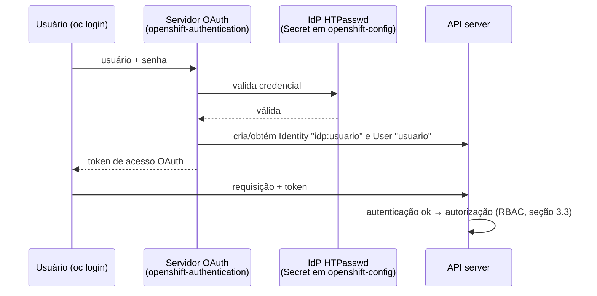
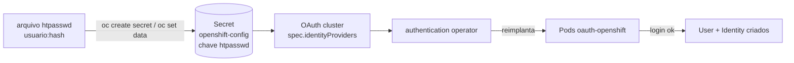

# 3.1 — Configurar o provedor de identidade HTPasswd

| Campo | Valor |
|-------|-------|
| Curso | DO280 — OpenShift 4.22 |
| Capítulo / seção | Capítulo 3 · Seção 3.1 |
| Título original | Configuring the HTPasswd Identity Provider |
| Título em português | Configurar o provedor de identidade HTPasswd |
| Objetivo | Explicar provedores de identidade e configurar o provedor HTPasswd para a autenticação do OpenShift |
| Referência | PDF p. 111–118 · Guided Exercise 3.2 p. 119–128 |

## Pré-requisitos e conhecimentos anteriores

No DO180 você fez `oc login` com usuário e senha, por token e pelo navegador, e viu
que o `oc` guarda o contexto no **kubeconfig**. Também viu que o OpenShift é
gerenciado por **cluster operators** e que um `Forbidden` significa "autenticado, mas
sem permissão". Agora você passa para o outro lado: é o administrador quem decide
**como** as pessoas se autenticam. Do [Capítulo 1](../01-gerenciamento-declarativo/README.md),
lembre que um merge patch **substitui listas inteiras** — isso importa ao editar a
lista de provedores de identidade.

| Conceito | Onde revisar |
|----------|--------------|
| `oc login`, tokens, kubeconfig e contextos | [DO180 · 2.1 — Interfaces de linha de comando](https://github.com/eduardoandradej/openshift-do180-4.22-estudos/blob/main/capitulos/02-cli-e-apis/2.1-interfaces-de-linha-de-comando.md) |
| Componentes do OpenShift (OAuth, operators) | [DO180 · F3 — Arquitetura OpenShift](https://github.com/eduardoandradej/openshift-do180-4.22-estudos/blob/main/01-fundamentos-essenciais/03-arquitetura-openshift.md) |
| Cluster operators e sua saúde | [DO180 · 2.5 — Avaliar a saúde do cluster](https://github.com/eduardoandradej/openshift-do180-4.22-estudos/blob/main/capitulos/02-cli-e-apis/2.5-avaliar-a-saude-do-cluster.md) |
| Secrets, `oc extract`, `oc set data` | [DO180 · 5.1 — Externalizar configuração](https://github.com/eduardoandradej/openshift-do180-4.22-estudos/blob/main/capitulos/05-configuracao-e-storage/5.1-externalizar-configuracao.md) |
| `oc patch` e tipos de patch | [1.1 — Manifestos de recursos](../01-gerenciamento-declarativo/1.1-manifestos-de-recursos.md) |

## Parte A — Entendendo o conceito

### Duas perguntas diferentes: "quem é você?" e "o que você pode fazer?"

Toda requisição à API passa por duas camadas:

1. **Autenticação** — identifica **quem** faz a requisição. O OpenShift aceita dois
   métodos: **tokens de acesso OAuth** e **certificados de cliente X.509**. Requisição
   sem token nem certificado vira o usuário virtual `system:anonymous`, no grupo
   virtual `system:unauthenticated`.
2. **Autorização** — decide se aquele usuário **pode** fazer aquela ação. Usa RBAC
   (seção [3.3](3.3-permissoes-com-rbac.md)).

Esta lição trata da primeira camada.

### Os objetos envolvidos

| Recurso | O que representa | Quem cria |
|---------|------------------|-----------|
| **User** | Um ator que interage com a API (normalmente uma pessoa) | O OpenShift, no primeiro login bem-sucedido |
| **Identity** | O registro de que um usuário se autenticou por **um provedor específico** (nome `provedor:usuário`) | O OpenShift, no primeiro login |
| **Group** | Um conjunto de usuários, para dar permissões de uma vez | O administrador (ou sincronização com LDAP) |
| **ServiceAccount** | Identidade de **aplicações** que chamam a API sem usar credenciais de pessoas | Projetos (automático) e administradores |
| **Role / ClusterRole** | Conjuntos de regras de permissão | Assunto da [3.3](3.3-permissoes-com-rbac.md) |

Ponto que confunde: **User e Identity normalmente não são criados antes**. O
OpenShift os cria depois do primeiro login interativo bem-sucedido. É por isso que
`oc adm policy add-cluster-role-to-user` avisa `User '...' not found` quando a pessoa
ainda não entrou: a permissão é gravada mesmo assim e vale a partir do login.

Existem também **grupos virtuais** que o cluster mantém sozinho, como
`system:authenticated` (todos os autenticados, por qualquer método) e
`system:authenticated:oauth` (só os autenticados por **token OAuth**, ou seja, quem fez
login por um IdP). Quem usa o certificado do kubeconfig do instalador (`system:admin`)
está no primeiro grupo, mas não no segundo.

### O servidor OAuth e os provedores de identidade

O **authentication operator** executa o **servidor OAuth** do OpenShift (Pods
`oauth-openshift` no namespace `openshift-authentication`). Quando alguém faz login:

1. o servidor OAuth pergunta a um **provedor de identidade** (*identity provider*,
   IdP) se usuário e senha são válidos;
2. em caso positivo, **reconcilia** a identidade com um objeto User (criando-os se
   necessário);
3. emite um **token de acesso OAuth**, que o cliente usa nas requisições seguintes.

O servidor OAuth não guarda senhas: ele **delega** a validação aos IdPs configurados
no recurso **`OAuth`** chamado `cluster` (`config.openshift.io/v1`). Podem existir
vários IdPs, do mesmo tipo ou de tipos diferentes. Tipos comuns:

| Tipo | Valida contra |
|------|---------------|
| **HTPasswd** | Um arquivo gerado pelo `htpasswd`, guardado em um Secret |
| **LDAP** | Um servidor LDAPv3 (bind simples) — é o que o ambiente de laboratório já usa |
| **Keystone** | OpenStack Keystone v3 |
| **GitHub / GitHub Enterprise** | O servidor OAuth do GitHub |
| **OpenID Connect** | Um provedor OIDC, pelo *Authorization Code Flow* |

> Em serviços gerenciados (ROSA, OpenShift Dedicated), IdPs **não** são configurados
> por YAML nem pelo `oc`, e sim pelas ferramentas do serviço (`rosa`, `ocm`, Hybrid
> Cloud Console), que sobrescrevem mudanças manuais. O Azure Red Hat OpenShift segue o
> mesmo mecanismo do OpenShift autogerenciado. O ROSA com *hosted control planes* também
> aceita autenticação OIDC externa, que dispensa o operator de OAuth interno.

### Acesso de administrador antes de existir qualquer IdP

Um cluster recém-instalado oferece dois acessos com privilégio de administrador:

| Acesso | Como funciona | Cuidados |
|--------|---------------|----------|
| **kubeconfig do instalador** | Arquivo gerado no diretório `auth` da instalação, com um **certificado de cliente X.509** que, segundo a apostila, nunca expira; não depende do servidor OAuth | Credencial de emergência: guardar em local seguro. Use com `export KUBECONFIG=...` ou `oc --kubeconfig ...` |
| **Usuário virtual `kubeadmin`** | Senha gerada na instalação; o hash fica no Secret `kubeadmin` do namespace `kube-system` | Depois de existir outro usuário com `cluster-admin`, pode ser removido (`oc delete secret kubeadmin -n kube-system`) |

Nos serviços gerenciados o acesso inicial de administrador é diferente: no **Azure Red
Hat OpenShift** existe `kubeadmin`, cujas credenciais se obtêm com
`az aro list-credentials`; no **ROSA** não há usuários locais por padrão e um
administrador temporário é criado com `rosa create admin`; no **OpenShift Dedicated**
também não há `kubeadmin`.

> ⚠️ Apagar o Secret `kubeadmin` **antes** de existir outro administrador deixa só o
> kubeconfig; sem ele, não há como recuperar o acesso — só reinstalando o cluster.
> ⚠️ **No curso, nunca apague o `kubeadmin`**: ele faz parte da arquitetura do
> laboratório; apagá-lo obriga a recriar o ambiente.

### O provedor HTPasswd

O HTPasswd valida usuários contra um **arquivo htpasswd** (usuário + hash da senha
por linha), guardado em um **Secret no namespace `openshift-config`** com a chave
**`htpasswd`**. Características:

- simples, sem servidor externo; ótimo para testes, laboratórios e provas de conceito;
- **não recomendado para produção**: não integra com o diretório da organização;
- só o administrador altera o Secret; **usuários não trocam a própria senha**.

O ciclo de manutenção é sempre o mesmo:

```text
extrair o Secret → editar o arquivo com htpasswd → atualizar o Secret → aguardar os Pods do OAuth
```

Extrair primeiro garante que você edita a **lista atual** de usuários, e não uma cópia
antiga que apagaria quem foi adicionado depois.

### Configurar o IdP no recurso OAuth

```yaml
apiVersion: config.openshift.io/v1
kind: OAuth
metadata:
  name: cluster
spec:
  identityProviders:
    - name: usuarios-locais        # aparece na tela de login e prefixa as Identities
      mappingMethod: claim         # padrão
      type: HTPasswd
      htpasswd:
        fileData:
          name: htpasswd-usuarios  # Secret em openshift-config, chave "htpasswd"
```

- O **`name`** do IdP compõe o nome das identities: `usuarios-locais:ana`.
- **`mappingMethod: claim`** (padrão): cada identidade é ligada a um User de mesmo
  nome; se o nome já pertence a um usuário vindo de **outro** IdP, o login falha. Por
  isso, com `claim`, a mesma pessoa não entra por dois provedores com o mesmo usuário.
  📘 *Fonte externa:* outros valores são `lookup`, `generate` e `add`.
- Como `spec.identityProviders` é uma **lista**, ao acrescentar um IdP é preciso
  **manter os existentes** (no laboratório, o LDAP).

Após mudar o OAuth ou o Secret, o authentication operator **reimplanta** os Pods
`oauth-openshift`; isso pode levar alguns minutos, e logins podem falhar até terminar.

### Remover usuários de verdade

Tirar a pessoa do arquivo htpasswd impede **novos** logins, mas **não** apaga o que o
OpenShift criou. Para remover completamente:

1. remover do arquivo (`htpasswd -D`) e atualizar o Secret;
2. apagar o **User** (`oc delete user <nome>`);
3. apagar a **Identity** (`oc delete identity <idp>:<nome>`).

Sem os passos 2 e 3, sobram objetos que podem conflitar com um futuro usuário de mesmo
nome (com `claim`). E atenção: **RoleBindings e ClusterRoleBindings referenciam o
usuário pelo nome** e não são apagados junto com o User; se outra pessoa receber o
mesmo nome no futuro, herdará essas permissões. Revise-os (ver [3.3](3.3-permissoes-com-rbac.md)).

📘 *Fonte externa (conferido no código do `oauth-apiserver`, `pkg/tokenvalidation`):*
a cada requisição, o token OAuth é validado contra o **User** dono dele, e o UID do User
precisa coincidir com o registrado no token. Por isso:

- tirar a pessoa só do arquivo htpasswd **não** derruba sessões abertas: os tokens já
  emitidos continuam válidos até expirar;
- apagar o User invalida esses tokens imediatamente;
- recriar um User com o mesmo nome **não** reativa tokens antigos (o UID é outro).

## Parte B — Modelo mental e arquitetura





## Parte C — Aplicação prática

> Legenda: 🔍 somente leitura · ✏️ altera o cluster · 🖥️ só local
>
> Os nomes de usuários, senhas e arquivos abaixo são fictícios. Nunca versione um
> arquivo htpasswd real.

### 1. Acesso de administrador pelo kubeconfig 🔍

```bash
export KUBECONFIG=/caminho/seguro/auth/kubeconfig
oc whoami                      # system:admin
oc get nodes
oc --kubeconfig /caminho/seguro/auth/kubeconfig get nodes   # alternativa por comando
unset KUBECONFIG               # voltar ao ~/.kube/config
```

No ambiente do curso, o kubeconfig e a senha do `kubeadmin` ficam na máquina
`utility` (a apostila indica os caminhos na p. 113–114).

### 2. Criar e manter o arquivo: `htpasswd` 🖥️

```bash
htpasswd -c -B -b ~/idp/htpasswd ana 'troque-me-1'    # -c CRIA (apaga se já existir!)
htpasswd -B -b ~/idp/htpasswd bruno 'troque-me-2'     # adiciona ou troca a senha
htpasswd -D ~/idp/htpasswd bruno                      # remove
cat ~/idp/htpasswd                                    # ana:$2y$05$...
```

- **Pacote:** `httpd-tools`.
- **Opções:** `-c` cria o arquivo (só na primeira vez); `-B` força **bcrypt**; `-b` lê a senha da linha de comando; `-D` apaga o usuário.
- **Erros comuns:** usar `-c` em um arquivo existente e perder todos os usuários; senha com caracteres especiais sem aspas simples (o shell interpreta `!`, `$`).
- 📘 Para não deixar a senha no histórico do shell, omita `-b` e digite-a no prompt.

### 3. Criar o Secret: `oc create secret generic` ✏️

```bash
oc create secret generic htpasswd-usuarios \
  --from-file htpasswd=$HOME/idp/htpasswd -n openshift-config
```

- **Parâmetro essencial:** `htpasswd=` define o **nome da chave**; o IdP espera a chave `htpasswd`, qualquer que seja o nome do arquivo.
- **Permissões:** administrador do cluster (escrita em `openshift-config`).
- **Erro comum:** criar o Secret em outro namespace — o OAuth só procura em `openshift-config`.

### 4. Registrar o IdP no recurso OAuth ✏️

**Opção A — exportar, editar e substituir (forma da apostila):**

```bash
oc get oauth cluster -o yaml > oauth.yaml
# editar: acrescentar o item HTPasswd em spec.identityProviders, sem apagar os existentes
oc replace -f oauth.yaml
```

**Opção B — editar direto:** `oc edit oauth cluster`.

**Opção C — 📘 JSON Patch que acrescenta ao fim da lista:**

```bash
oc patch oauth cluster --type json -p '[{"op":"add","path":"/spec/identityProviders/-",
  "value":{"name":"usuarios-locais","mappingMethod":"claim","type":"HTPasswd",
  "htpasswd":{"fileData":{"name":"htpasswd-usuarios"}}}}]'
```

> ⚠️ Um `oc patch --type merge` com `spec.identityProviders` **substitui a lista
> inteira** e removeria os IdPs existentes (como o LDAP do laboratório). Use JSON Patch
> com `add` em `/-` ou edite o arquivo completo.

- **Resultado esperado:** `oauth.config.openshift.io/cluster replaced|edited|patched`.
- **Como verificar:** `oc get oauth cluster -o jsonpath='{.spec.identityProviders[*].name}{"\n"}'`.

### 5. Aguardar o OAuth e confirmar 🔍

```bash
watch oc get pods -n openshift-authentication      # Pods oauth-openshift novos
oc get clusteroperator authentication              # 📘 PROGRESSING volta a False
oc login -u ana -p 'troque-me-1' https://api.<cluster>:6443
oc whoami
oc get users
oc get identities                                  # usuarios-locais:ana
```

### 6. Adicionar, trocar senha ou remover usuários (ciclo completo) ✏️

```bash
oc extract secret/htpasswd-usuarios -n openshift-config --to ~/idp --confirm   # traz o atual
htpasswd -B -b ~/idp/htpasswd carla 'troque-me-3'                              # editar
oc set data secret/htpasswd-usuarios -n openshift-config \
  --from-file htpasswd=$HOME/idp/htpasswd                                      # devolver
watch oc get pods -n openshift-authentication                                  # aguardar
```

- `oc extract ... --to <dir> --confirm` grava um arquivo por chave, sobrescrevendo; `--to -` imprime na tela.
- `oc set data secret/... --from-file htpasswd=<arquivo>` atualiza só a chave indicada.

Remoção completa:

```bash
htpasswd -D ~/idp/htpasswd carla
oc set data secret/htpasswd-usuarios -n openshift-config --from-file htpasswd=$HOME/idp/htpasswd
oc delete user carla
oc get identities | grep carla
oc delete identity usuarios-locais:carla
```

### 7. Dar privilégio de administrador do cluster ✏️

```bash
oc adm policy add-cluster-role-to-user cluster-admin ana
# Warning: User 'ana' not found   ← normal se ela ainda não fez login
oc get clusterrolebinding -o wide | grep -w ana
```

A apostila observa que, como já existe um ClusterRoleBinding chamado `cluster-admin`,
o comando cria um com sufixo numérico (`cluster-admin-0`, `-1`...).

### 8. Remover o acesso `kubeadmin` (somente fora do curso) ✏️

```bash
oc delete secret kubeadmin -n kube-system   # só depois de confirmar outro cluster-admin funcionando
```

### Raciocínio operacional e diagnóstico

| Sintoma | Hipótese | Como confirmar | Correção segura |
|---------|----------|----------------|-----------------|
| `Login failed (401 Unauthorized)` logo após mudar o Secret/OAuth | Pods `oauth-openshift` ainda sendo reimplantados | `oc get pods -n openshift-authentication`; `oc get co authentication` | Aguardar e tentar de novo |
| 401 persistente para um usuário novo | Usuário não está no Secret, chave errada ou Secret fora de `openshift-config` | `oc extract secret/<s> -n openshift-config --to -` | Recriar com `--from-file htpasswd=...` no namespace certo |
| IdP não aparece na tela de login | OAuth não referencia o Secret ou YAML com indentação errada | `oc get oauth cluster -o yaml` | Corrigir `spec.identityProviders` |
| O LDAP sumiu depois de configurar o HTPasswd | Lista de IdPs substituída (merge patch ou arquivo sem o item antigo) | `oc get oauth cluster -o yaml` | Restaurar o item; usar JSON Patch `add` |
| Usuários antigos desapareceram | `htpasswd -c` em arquivo existente ou edição de cópia desatualizada | Comparar com `oc extract` | Sempre extrair antes; `-c` só na criação |
| Login falha com erro de mapeamento para um nome já usado | `mappingMethod: claim` e User já ligado a Identity de outro IdP | `oc get user <u> -o yaml` (campo `identities`) | Remover User/Identity antigos ou usar outro nome |
| Usuário removido do arquivo ainda aparece em `oc get users` | User/Identity não foram apagados | `oc get users`, `oc get identities` | `oc delete user` e `oc delete identity` |
| `Forbidden` depois de logar com sucesso | Autenticação ok, falta autorização | `oc auth can-i ...` (3.3) | Conceder papel adequado (3.3) |

## Parte D — Relações importantes

| A | B | Diferença essencial |
|---|---|--------------------|
| Autenticação | Autorização | Quem é você × o que pode fazer |
| User | Identity | O ator no OpenShift × o vínculo desse ator com um IdP (`idp:usuario`) |
| User | ServiceAccount | Pessoa × aplicação que chama a API |
| HTPasswd | LDAP / OIDC | Arquivo local em Secret, sem integração × diretório/SSO da organização |
| kubeconfig do instalador | `kubeadmin` | Certificado X.509, não depende do OAuth × usuário virtual que obtém token OAuth |
| `oc create secret ... --from-file htpasswd=` | `oc set data secret/... --from-file htpasswd=` | Cria o Secret × atualiza a chave de um Secret existente |
| `oc replace -f oauth.yaml` | `oc patch --type merge` | Substitui o objeto pelo arquivo completo × substitui listas inteiras (perigo) |
| `htpasswd -c` | `htpasswd` sem `-c` | Cria/zera o arquivo × adiciona ou atualiza |
| Tirar do arquivo | Apagar User e Identity | Impede novos logins × remove os objetos do cluster |

## Parte E — Preparação para o laboratório oficial

Atividade associada: **3.2 Guided Exercise — Configure Identity Providers**
(`auth-providers`, PDF p. 119–128).

Você deve conseguir, sem consultar a lição:

- criar um arquivo htpasswd com bcrypt e acrescentar usuários sem apagar os existentes;
- criar o Secret no namespace correto com a chave `htpasswd`;
- acrescentar um IdP HTPasswd ao OAuth **preservando o LDAP** já configurado;
- acompanhar a reimplantação dos Pods do OAuth e testar logins;
- dar `cluster-admin` a um usuário e comprovar a diferença de acesso com outro usuário;
- trocar senha e remover um usuário completamente (arquivo, Secret, User, Identity).

Detalhes em [PRATICA-OFICIAL.md](PRATICA-OFICIAL.md#32-guided-exercise-configure-identity-providers).

## Parte F — Fixação

1. Por que `oc adm policy add-cluster-role-to-user cluster-admin ana` mostra `User 'ana' not found` e, mesmo assim, funciona?
2. Em que namespace deve ficar o Secret do HTPasswd, e qual deve ser o nome da chave?
3. Você rodou `htpasswd -c -B -b htpasswd novo senha` em um arquivo extraído com 10 usuários e atualizou o Secret. O que aconteceu?
4. Descreva os passos para remover completamente o usuário `bruno` do IdP `usuarios-locais`.
5. Qual a diferença entre o acesso pelo kubeconfig do instalador e pelo `kubeadmin`? Qual deles continua funcionando se o servidor OAuth falhar?
6. Por que `oc patch oauth cluster --type merge -p '{"spec":{"identityProviders":[...]}}'` é arriscado?
7. Depois de atualizar o Secret, o novo usuário recebe 401 por alguns minutos e depois consegue entrar. Explique.

<details>
<summary>Respostas comentadas</summary>

1. O User só é criado no primeiro login. O comando grava o ClusterRoleBinding com o **nome** do usuário; quando ele entrar, a permissão já vale.
2. Em `openshift-config`, com a chave `htpasswd` (por isso `--from-file htpasswd=<arquivo>`).
3. `-c` recriou o arquivo só com `novo`; ao atualizar o Secret, os outros 10 usuários perderam o acesso.
4. Extrair o Secret, `htpasswd -D <arquivo> bruno`, `oc set data secret/<s> -n openshift-config --from-file htpasswd=<arquivo>`, `oc delete user bruno`, `oc delete identity usuarios-locais:bruno`.
5. O kubeconfig usa um certificado X.509 de cliente e não depende do OAuth; o `kubeadmin` autentica pelo servidor OAuth e recebe um token. Se o OAuth falhar, só o kubeconfig funciona.
6. Merge patch substitui listas inteiras: os IdPs existentes que não estiverem no patch são removidos.
7. O authentication operator reimplanta os Pods `oauth-openshift` após a mudança; até os novos Pods ficarem prontos, a configuração antiga (sem o usuário) ainda responde.

</details>

## Parte G — Essencial para memorizar

- Autenticação (token OAuth ou certificado X.509) ≠ autorização (RBAC). Sem credencial: `system:anonymous`.
- User e Identity são criados no **primeiro login**; Identity = `idp:usuario`.
- IdPs ficam em `oauth/cluster` → `spec.identityProviders` (lista: preserve os existentes).
- HTPasswd: Secret em **`openshift-config`**, chave **`htpasswd`**; `htpasswd -c` só para criar; `-B` bcrypt.
- Ciclo: `oc extract` → `htpasswd` → `oc set data` → `watch oc get pods -n openshift-authentication`.
- Remover usuário = arquivo + Secret + `oc delete user` + `oc delete identity`.
- `cluster-admin`: `oc adm policy add-cluster-role-to-user cluster-admin <u>`.
- kubeconfig do instalador = acesso de emergência; `kubeadmin` só se remove depois de outro admin (nunca no curso).

---
[← Índice do capítulo](README.md) | [Índice do capítulo](README.md) | [Próximo: 3.3 Permissões com RBAC →](3.3-permissoes-com-rbac.md)
