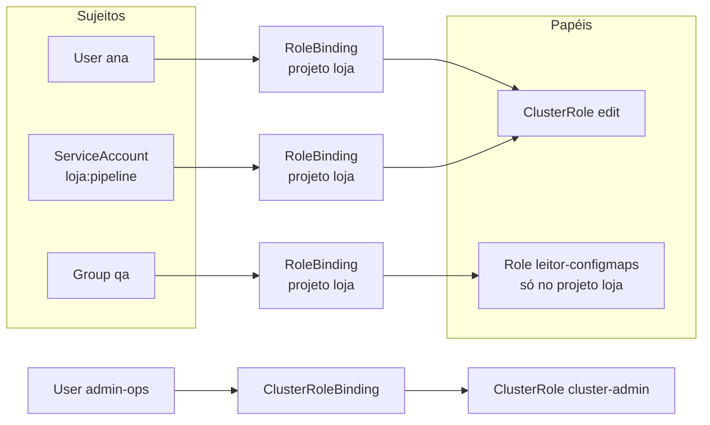
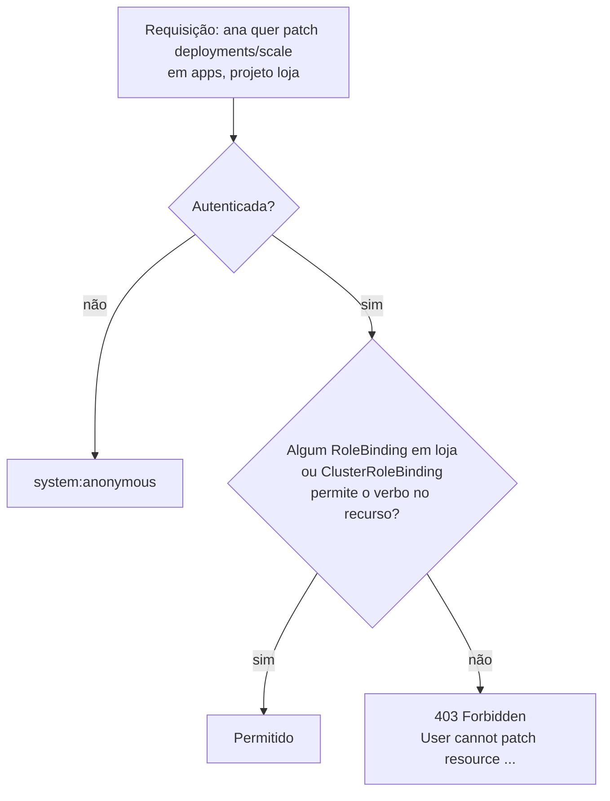

# 3.3 — Definir e aplicar permissões com RBAC

| Campo | Valor |
|-------|-------|
| Curso | DO280 — OpenShift 4.22 |
| Capítulo / seção | Capítulo 3 · Seção 3.3 |
| Título original | Defining and Applying Permissions with RBAC |
| Título em português | Definir e aplicar permissões com RBAC |
| Objetivo | Definir controles de acesso baseados em papéis e aplicar permissões a usuários |
| Referência | PDF p. 129–133 · Guided Exercise 3.4 p. 134–137 · Lab 3.5 p. 138–144 |

## Pré-requisitos e conhecimentos anteriores

Na [3.1](3.1-provedor-de-identidade-htpasswd.md) você fez as pessoas entrarem no
cluster. Agora decide o que cada uma pode fazer. Do DO180, retome três ideias: todo
recurso tem um **tipo** em um **grupo de API** (`apps`, `route.openshift.io`, core),
recursos podem ser de **namespace** ou de **cluster** (`oc api-resources
--namespaced=false`), e a CLI usa **verbos** que viram operações na API (`get`, `list`,
`create`, `patch`, `delete`...). O RBAC é escrito exatamente nesses termos.

| Conceito | Onde revisar |
|----------|--------------|
| Grupos de API, escopo de recursos, `oc api-resources` | [DO180 · 2.3 — Inspecionar recursos](https://github.com/eduardoandradej/openshift-do180-4.22-estudos/blob/main/capitulos/02-cli-e-apis/2.3-inspecionar-recursos-kubernetes.md) |
| Projetos e namespaces | [DO180 · 2.1 — Interfaces de linha de comando](https://github.com/eduardoandradej/openshift-do180-4.22-estudos/blob/main/capitulos/02-cli-e-apis/2.1-interfaces-de-linha-de-comando.md) |
| `Forbidden` e diagnóstico de acesso | [DO180 · troubleshooting](https://github.com/eduardoandradej/openshift-do180-4.22-estudos/blob/main/consulta-rapida/troubleshooting.md) |
| Users, Groups e Identities | [3.1 — Provedor HTPasswd](3.1-provedor-de-identidade-htpasswd.md) |

## Parte A — Entendendo o conceito

### O que é RBAC

**Role-based access control** decide se um sujeito pode executar uma ação em um
recurso. Em vez de dar permissões diretamente a cada pessoa, você agrupa permissões em
**papéis** (*roles*) e **liga** esses papéis a usuários, grupos ou service accounts.
A autorização é uma etapa **separada** da autenticação: primeiro o cluster sabe quem
você é, depois avalia as regras.

### As três peças

| Peça | O que é | Exemplo |
|------|---------|---------|
| **Regra** (*rule*) | Verbos permitidos sobre recursos de um grupo de API | `get, list, watch` em `pods` do grupo core |
| **Papel** (*Role* / *ClusterRole*) | Conjunto de regras | `view`: ler quase tudo de um projeto |
| **Vínculo** (*RoleBinding* / *ClusterRoleBinding*) | Liga um papel a sujeitos (users, groups, service accounts) | "grupo `qa` tem `view` no projeto `loja`" |

O RBAC só **permite**: não há regra de negação. Uma ação é autorizada se **algum**
vínculo aplicável a permitir; as permissões se **somam**.

### Dois níveis: cluster e local

| Nível | Objetos | Alcance |
|-------|---------|---------|
| **Cluster RBAC** | ClusterRole + **ClusterRoleBinding** | Todos os projetos e recursos de cluster |
| **Local RBAC** | Role ou ClusterRole + **RoleBinding** | Apenas o projeto do RoleBinding |

O ponto-chave é que um **RoleBinding pode referenciar uma ClusterRole**. Assim, papéis
padrão como `admin`, `edit` e `view` são definidos **uma vez** (como ClusterRoles) e
concedidos **projeto a projeto** por RoleBindings. Uma Role local serve para permissões
específicas de um único projeto. Na avaliação, o cluster considera **ambos** os tipos
de vínculo.

### Papéis padrão

| Papel | Para quem | Pode | Não pode |
|-------|-----------|------|----------|
| `cluster-admin` | Administradores da plataforma | Qualquer ação em qualquer recurso do cluster | — |
| `cluster-reader` | Auditores | Ler a maioria dos objetos do cluster | Alterar |
| `cluster-status` | Monitoração | Ler informações de status do cluster | — |
| `admin` | Dono/gestor do projeto | Gerenciar todos os recursos do projeto, inclusive **dar acesso** a outros, quotas e limit ranges | Recursos de cluster |
| `edit` | Desenvolvedor | Criar, alterar e apagar recursos comuns (Deployments, Services, Routes...) | Gerenciar permissões, quotas e limit ranges |
| `view` | Leitura (QA, suporte) | Ver recursos do projeto | Alterar; 📘 também não lê Secrets |
| `basic-user` | Todos | Informações básicas sobre projetos e usuários | — |
| `self-provisioner` | Quem cria projetos | Criar projetos próprios | — |

Detalhes do curso:

- Quem **cria** um projeto recebe automaticamente o papel `admin` nele.
- O ClusterRoleBinding `self-provisioners` liga `self-provisioner` ao grupo
  `system:authenticated:oauth`, ou seja, por padrão quem entra por OAuth pode criar
  projetos. Desativar isso é assunto do Capítulo 6.
- Os papéis padrão podem ser customizados, mas isso está fora do escopo do curso.
- Em ROSA e OpenShift Dedicated, administração é delegada por papéis próprios
  (`cluster-admins`, `dedicated-admins`) e pelas ferramentas do serviço, não por
  `oc adm policy`.

### Tipos de usuário

| Tipo | Nome na API | Exemplo |
|------|-------------|---------|
| Usuário comum | Nome do User | `ana` |
| Usuário de sistema | `system:<...>` | `system:admin`, `system:node:<nó>`, `system:anonymous` |
| Service account | `system:serviceaccount:<projeto>:<nome>` | `system:serviceaccount:loja:pipeline` |

Service accounts são identidades de **aplicações** dentro de um projeto. Cada projeto
recebe algumas automaticamente, e administradores podem criar outras para dar a uma
carga de trabalho acesso a APIs específicas. A apostila afirma que, por padrão, elas não
têm papéis; 📘 na prática, algumas service accounts criadas pelo OpenShift recebem
vínculos de sistema (por exemplo, para puxar imagens). O uso de service accounts por
aplicações é tema do Capítulo 8.

### Grupos

Grupos simplificam: em vez de 20 RoleBindings (um por pessoa), um RoleBinding para o
grupo, e a entrada/saída de pessoas é feita no grupo. O ambiente do curso já tem grupos
vindos do LDAP; grupos locais são criados com `oc adm groups`.

### Quem pode dar permissões

`oc policy add-role-to-user` cria RoleBindings; para isso é preciso poder gerenciar
RoleBindings no projeto, o que o papel `admin` permite e o `edit` não.
📘 *Fonte externa:* o Kubernetes também impede **escalada**: só é possível conceder
permissões que você mesmo possui.

## Parte B — Modelo mental e arquitetura





A mensagem de `Forbidden` diz **exatamente** o que faltou: usuário, verbo, recurso
(e subrecurso), grupo de API e namespace. Ela é a melhor pista para o diagnóstico.

## Parte C — Aplicação prática

> Legenda: 🔍 somente leitura · ✏️ altera o cluster
>
> Manifestos RBAC autorais em [exemplos-originais/rbac](../../exemplos-originais/rbac/).

### 1. Papéis de cluster: `oc adm policy ...-cluster-role-...` ✏️

```bash
oc adm policy add-cluster-role-to-user cluster-admin ana
oc adm policy remove-cluster-role-from-user cluster-admin ana
oc adm policy add-cluster-role-to-group cluster-reader auditores
oc adm policy remove-cluster-role-from-group cluster-reader auditores
```

- **Permissões:** administrador do cluster.
- **Objeto afetado:** ClusterRoleBinding (criado ou alterado).
- **Verificar:** `oc get clusterrolebinding -o wide | grep -w ana`.

### 2. Papéis no projeto: `oc policy add-role-to-...` ✏️

```bash
oc policy add-role-to-user admin lider -n loja
oc policy add-role-to-group edit desenvolvedores -n loja
oc policy add-role-to-group view qa -n loja
oc policy add-role-to-user basic-user ana -n loja     # ClusterRole limitada ao projeto
oc policy remove-role-from-group view qa -n loja
oc policy add-role-to-user leitor-configmaps ana --role-namespace loja -n loja   # 📘 Role local
```

- **Finalidade:** criar RoleBindings no projeto (equivalentes: `oc adm policy add-role-to-user ...`).
- **Permissões:** `admin` do projeto ou administrador do cluster.
- **Objeto afetado:** RoleBinding no namespace (`admin`, `admin-0`, `edit`, `view`...).
- **Saída:** `clusterrole.rbac.authorization.k8s.io/edit added: "desenvolvedores"`.
- **Erros comuns:** esquecer `-n` e conceder no projeto errado; usuário sem `admin` recebe `Forbidden` ao listar RoleBindings.

### 3. Grupos: `oc adm groups` ✏️

```bash
oc adm groups new desenvolvedores
oc adm groups new qa ana bruno                # 📘 já com membros
oc adm groups add-users desenvolvedores carla
oc adm groups remove-users desenvolvedores carla
oc get groups
oc delete group qa
```

### 4. Inspecionar quem tem acesso 🔍

```bash
oc get rolebindings -n loja -o wide                     # ROLE, USERS, GROUPS, SERVICEACCOUNTS
oc get rolebindings -n loja -o wide | grep -v '^system:'   # sem os vínculos de sistema
oc describe rolebinding edit -n loja
oc get clusterrolebindings -o wide | grep -w ana
oc describe clusterrole edit                            # as regras do papel
oc adm policy who-can delete users                      # quem pode executar a ação
oc adm policy who-can create deployments -n loja
```

### 5. Testar permissões: 📘 `oc auth can-i` 🔍

```bash
oc auth can-i create deployments -n loja                # eu posso?
oc auth can-i delete projects -n loja                   # → yes / no
oc auth can-i --list -n loja                            # tudo que eu posso no projeto
oc auth can-i patch deployments/scale -n loja --as qa-user            # como administrador, simular outro usuário
oc auth can-i get pods -n loja --as system:serviceaccount:loja:pipeline
```

- **Finalidade:** verificar **antes** de entregar o acesso ou **ao diagnosticar** um `Forbidden`.
- **Permissões:** `--as` (impersonação) exige permissão de *impersonate* (administrador).
- **Atenção:** `--as` de um usuário não inclui automaticamente os grupos dele; use também `--as-group` se o acesso vier de um grupo.

### 6. RBAC declarativo (Capítulo 1 + Capítulo 3) ✏️

```yaml
apiVersion: rbac.authorization.k8s.io/v1
kind: Role
metadata:
  name: leitor-configmaps
  namespace: loja
rules:
  - apiGroups: [""]                 # "" = grupo core
    resources: ["configmaps"]
    verbs: ["get", "list", "watch"]
---
apiVersion: rbac.authorization.k8s.io/v1
kind: RoleBinding
metadata:
  name: desenvolvedores-edit
  namespace: loja
subjects:
  - kind: Group
    apiGroup: rbac.authorization.k8s.io
    name: desenvolvedores
roleRef:                            # imutável depois de criado
  apiGroup: rbac.authorization.k8s.io
  kind: ClusterRole
  name: edit
```

```bash
oc apply -f rbac-loja.yaml --dry-run=server
oc apply -f rbac-loja.yaml
oc create role leitor-configmaps --verb get,list,watch --resource configmaps -n loja      # 📘 imperativo
oc create rolebinding desenvolvedores-edit --clusterrole edit --group desenvolvedores -n loja                      # 📘 imperativo
```

📘 O `roleRef` de um binding é imutável: para trocar o papel, apague e recrie o binding.

### Raciocínio operacional e diagnóstico

| Sintoma | Hipótese | Como confirmar | Correção segura |
|---------|----------|----------------|-----------------|
| `User "x" cannot list resource "nodes" ... at the cluster scope` | Recurso de cluster sem ClusterRoleBinding adequado | `oc auth can-i list nodes --as x` | ClusterRole mínima necessária (ex.: `cluster-reader`), não `cluster-admin` por padrão |
| `cannot patch resource "deployments/scale"` | Usuário só tem `view` | `oc get rolebindings -o wide -n <p>` | `edit` se ele deve alterar, ou manter `view` |
| `cannot list resource "rolebindings"` ao dar acesso | Quem concede tem `edit`, não `admin` | `oc auth can-i create rolebindings -n <p>` | Pedir ao `admin` do projeto |
| Permissão concedida, mas o usuário ainda recebe `Forbidden` | Binding no projeto errado, nome do usuário/grupo digitado errado ou usuário fora do grupo | `oc describe rolebinding`; `oc get group <g>` | Corrigir sujeito/namespace; adicionar ao grupo |
| Acesso "demais" que você não deu | Vínculo via grupo (inclusive grupos do LDAP ou virtuais) | `oc adm policy who-can <verbo> <recurso>` | Remover o vínculo correto |
| Usuário não consegue apagar o projeto | Não é `admin` do projeto | `oc auth can-i delete projects -n <p>` | Esperado para `edit`/`view` |
| Novo administrador não vê nós | `cluster-admin` concedido como RoleBinding local | `oc get rolebinding -A -o wide \| grep <u>` | Usar `add-cluster-role-to-user` |

## Parte D — Relações importantes

| A | B | Diferença essencial |
|---|---|--------------------|
| Role | ClusterRole | Definida em um projeto × definida no cluster, reutilizável |
| RoleBinding | ClusterRoleBinding | Vale em um projeto × vale em todo o cluster |
| ClusterRole + RoleBinding | ClusterRole + ClusterRoleBinding | Papel padrão concedido em **um** projeto × em **todos** |
| `oc adm policy add-cluster-role-to-user` | `oc policy add-role-to-user` | ClusterRoleBinding × RoleBinding no projeto |
| `admin` | `edit` | Gerencia o projeto e seus acessos × trabalha no projeto, sem gerenciar acessos/quotas |
| `edit` | `view` | Altera recursos × só lê |
| `cluster-admin` | `cluster-reader` | Faz tudo × lê quase tudo |
| User | Group | Uma pessoa × conjunto de pessoas (um vínculo para todos) |
| User | ServiceAccount | Pessoa × aplicação (`system:serviceaccount:<ns>:<nome>`) |
| `oc adm policy who-can` | `oc auth can-i` (📘) | Quem pode fazer X × eu (ou `--as`) posso fazer X? |
| RBAC | Autenticação (3.1) | O que pode fazer × quem é |

## Parte E — Preparação para o laboratório oficial

Atividades associadas:

- **3.4 Guided Exercise — Define and Apply Permissions with RBAC** (`auth-rbac`, PDF p. 134–137);
- **3.5 Lab — Configure Authentication and Authorization** (`auth-review`, PDF p. 138–144, com `lab grade`).

Você deve conseguir, sem consultar a lição:

- criar um projeto como administrador e conceder `admin` a outro usuário;
- criar grupos, adicionar membros e conceder `edit`/`view` a grupos no projeto;
- listar RoleBindings filtrando os de sistema e interpretar as colunas;
- provar, com comandos, que cada usuário tem exatamente o acesso esperado (inclusive os `Forbidden` esperados);
- no lab: combinar tudo da 3.1 (HTPasswd, `cluster-admin`) com grupos e papéis de projeto.

Detalhes em [PRATICA-OFICIAL.md](PRATICA-OFICIAL.md#34-guided-exercise-define-and-apply-permissions-with-rbac).

## Parte F — Fixação

1. Por que se costuma conceder a ClusterRole `edit` com um RoleBinding em vez de criar uma Role `edit` em cada projeto?
2. Um usuário com `edit` tenta `oc policy add-role-to-user view ana`. O que acontece e por quê?
3. Leia: `User "qa1" cannot patch resource "deployments/scale" in API group "apps" in the namespace "loja"`. Que papel o usuário provavelmente tem e o que ele tentou fazer?
4. Qual comando mostra todos os sujeitos que podem apagar projetos no cluster?
5. Você concedeu `cluster-admin` a `ana` com `oc policy add-role-to-user cluster-admin ana -n loja`. Ela consegue listar nós? Por quê?
6. Escreva o comando para dar ao grupo `suporte` acesso somente leitura ao projeto `pagamentos`.
7. Como testar, antes de avisar a equipe, se o grupo `suporte` realmente consegue listar Pods em `pagamentos`?

<details>
<summary>Respostas comentadas</summary>

1. Para reutilizar uma definição única e consistente: a ClusterRole é mantida pelo cluster e o RoleBinding limita o alcance ao projeto.
2. Recebe `Forbidden`: gerenciar RoleBindings exige `admin` do projeto (ou mais); `edit` não inclui isso.
3. Provavelmente `view`; ele tentou escalar um Deployment (`oc scale`), que exige `patch` no subrecurso `scale`.
4. `oc adm policy who-can delete projects`.
5. Não. Um RoleBinding vale só no projeto `loja`; nós são recursos de cluster. Use `oc adm policy add-cluster-role-to-user cluster-admin ana`.
6. `oc policy add-role-to-group view suporte -n pagamentos`.
7. Como administrador: `oc auth can-i list pods -n pagamentos --as <um-membro> --as-group suporte` (📘), ou entrar como um membro e executar `oc get pods -n pagamentos`.

</details>

## Parte G — Essencial para memorizar

- Regra (verbos × recursos × grupo de API) → papel → vínculo → sujeito. RBAC só permite; as permissões somam.
- Role/RoleBinding = projeto; ClusterRole/ClusterRoleBinding = cluster; **RoleBinding pode apontar para ClusterRole**.
- Papéis: `cluster-admin`, `cluster-reader`, `cluster-status`, `admin`, `edit`, `view`, `basic-user`, `self-provisioner`.
- Quem cria o projeto vira `admin`; `self-provisioners` → `system:authenticated:oauth`.
- `oc adm policy add|remove-cluster-role-to|from-user|group` · `oc policy add|remove-role-to|from-user|group -n <p>`.
- `oc adm groups new|add-users|remove-users` · `oc get rolebindings -o wide`.
- Diagnóstico: leia o `Forbidden`; `oc adm policy who-can`; 📘 `oc auth can-i [--as]`.
- Service accounts: `system:serviceaccount:<ns>:<nome>`.

---
[← 3.1 Provedor HTPasswd](3.1-provedor-de-identidade-htpasswd.md) | [Índice do capítulo](README.md) | [Próximo: Prática oficial →](PRATICA-OFICIAL.md)
