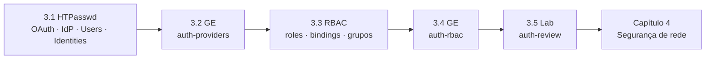

# Capítulo 3 — Authentication and Authorization

**Título em português:** Autenticação e autorização
**Status da documentação:** ✅ concluído e validado
**Referência:** PDF p. 110–145

## Objetivo do capítulo

Configurar a autenticação com o provedor de identidade **HTPasswd** e atribuir
**papéis** a usuários e grupos.

## Por que este capítulo importa

Um cluster de produção é compartilhado por várias equipes. Antes de qualquer outra
política (rede, quotas, segurança de aplicações), o administrador precisa responder a
duas perguntas: **quem pode entrar** e **o que cada um pode fazer**. Neste capítulo
você configura a primeira com um provedor de identidade e a segunda com RBAC — e
aprende a comprovar o resultado testando acessos permitidos e negados.

## Seções e atividades (ordem oficial)

| Seção | Tipo | Título original | Material | PDF |
|-------|------|-----------------|----------|-----|
| 3.1 | Conceito | Configuring the HTPasswd Identity Provider | [lição](3.1-provedor-de-identidade-htpasswd.md) | p. 111–118 |
| 3.2 | Guided Exercise | Configure Identity Providers | [prática](PRATICA-OFICIAL.md#32-guided-exercise-configure-identity-providers) | p. 119–128 |
| 3.3 | Conceito | Defining and Applying Permissions with RBAC | [lição](3.3-permissoes-com-rbac.md) | p. 129–133 |
| 3.4 | Guided Exercise | Define and Apply Permissions with RBAC | [prática](PRATICA-OFICIAL.md#34-guided-exercise-define-and-apply-permissions-with-rbac) | p. 134–137 |
| 3.5 | Lab | Configure Authentication and Authorization | [prática](PRATICA-OFICIAL.md#35-lab-configure-authentication-and-authorization) | p. 138–144 |
| 3.6 | Summary | Summary | [RESUMO.md](RESUMO.md) | p. 145 |

Abertura do capítulo (meta e seções): PDF p. 110. Não há quiz neste capítulo.

## Arquivos do capítulo

- [PRATICA-OFICIAL.md](PRATICA-OFICIAL.md): ponte com as atividades oficiais.
- [REVISAO.md](REVISAO.md): questões autorais integradas.
- [RESUMO.md](RESUMO.md): síntese e tabela de comandos.

## Pré-requisitos recomendados

[DO180 · 2.1 — login, tokens e kubeconfig](https://github.com/eduardoandradej/openshift-do180-4.22-estudos/blob/main/capitulos/02-cli-e-apis/2.1-interfaces-de-linha-de-comando.md) ·
[DO180 · 2.3 — grupos de API e escopo](https://github.com/eduardoandradej/openshift-do180-4.22-estudos/blob/main/capitulos/02-cli-e-apis/2.3-inspecionar-recursos-kubernetes.md) ·
[DO180 · 5.1 — Secrets](https://github.com/eduardoandradej/openshift-do180-4.22-estudos/blob/main/capitulos/05-configuracao-e-storage/5.1-externalizar-configuracao.md) ·
[1.1 — tipos de patch](../01-gerenciamento-declarativo/1.1-manifestos-de-recursos.md)

## Checklist do aluno

- [ ] 3.1 lida e Parte F respondida
- [ ] 3.2 Guided Exercise `auth-providers` concluído
- [ ] 3.3 lida e Parte F respondida
- [ ] 3.4 Guided Exercise `auth-rbac` concluído
- [ ] 3.5 Lab `auth-review` com `lab grade` aprovado
- [ ] [REVISAO.md](REVISAO.md) respondida
- [ ] Registro no [diário de laboratórios](../../progresso/diario-de-laboratorios.md)

---
[← Capítulo 2](../02-aplicacoes-empacotadas/README.md) | [Índice geral](../../README.md) | [Próximo: 3.1 Provedor HTPasswd →](3.1-provedor-de-identidade-htpasswd.md)
