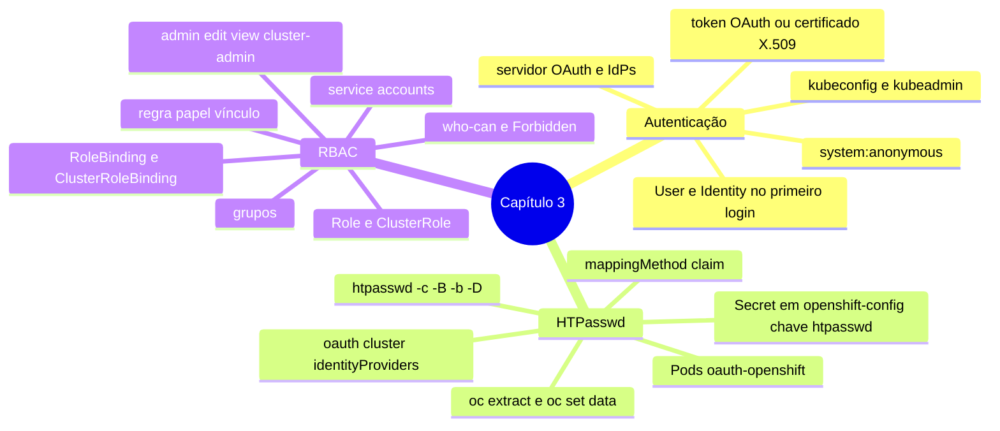

# Resumo — Capítulo 3

Síntese autoral para revisão rápida. Correspondência oficial: seção 3.6 (PDF p. 145).

## Em uma frase por seção

| Seção | Ideia central |
|-------|---------------|
| 3.1 | O servidor OAuth autentica por meio de provedores de identidade declarados no recurso `oauth/cluster`; o HTPasswd usa um arquivo em Secret no `openshift-config`, mantido com o ciclo extrair → editar → devolver, e remover alguém exige apagar também User e Identity |
| 3.3 | O RBAC liga papéis (regras) a usuários, grupos e service accounts por vínculos de projeto ou de cluster; papéis padrão (`admin`, `edit`, `view`, `cluster-admin`...) são concedidos com `oc policy` e `oc adm policy` e verificados com `who-can` |

## Mapa do capítulo

## Tabela de comandos do capítulo

| Tarefa | Comando | Tipo |
|--------|---------|------|
| Usar kubeconfig de administrador | `export KUBECONFIG=<arq>` · `oc --kubeconfig <arq> ...` | 🔍 |
| Criar/atualizar arquivo htpasswd | `htpasswd [-c] -B -b <arq> <usuario> '<senha>'` · `-D` remove | 🖥️ |
| Criar Secret | `oc create secret generic <s> --from-file htpasswd=<arq> -n openshift-config` | ✏️ |
| Extrair Secret | `oc extract secret/<s> -n openshift-config --to <dir> --confirm` | 🔍 |
| Atualizar Secret | `oc set data secret/<s> -n openshift-config --from-file htpasswd=<arq>` | ✏️ |
| Editar OAuth | `oc get oauth cluster -o yaml > o.yaml` + `oc replace -f o.yaml` · `oc edit oauth cluster` | ✏️ |
| Acompanhar OAuth | `watch oc get pods -n openshift-authentication` | 🔍 |
| Usuários e identidades | `oc get users` · `oc get identities` · `oc delete user\|identity <n>` | 🔍 / ✏️ |
| Papel de cluster | `oc adm policy add\|remove-cluster-role-to\|from-user\|group <papel> <sujeito>` | ✏️ |
| Papel no projeto | `oc policy add\|remove-role-to\|from-user\|group <papel> <sujeito> -n 
` | ✏️ |
| Grupos | `oc adm groups new <g>` · `add-users` · `remove-users` · `oc get groups` | ✏️ / 🔍 |
| Ver vínculos | `oc get rolebindings -o wide -n 
` · `oc get clusterrolebindings -o wide` | 🔍 |
| Quem pode | `oc adm policy who-can <verbo> <recurso>` | 🔍 |
| Eu posso? (📘) | `oc auth can-i <verbo> <recurso> [-n 
] [--as <u>]` | 🔍 |
| Remover kubeadmin (fora do curso) | `oc delete secret kubeadmin -n kube-system` | ✏️ |

## Alertas operacionais

- ⚠️ `htpasswd -c` apaga o arquivo existente; extraia o Secret antes de editar.
- ⚠️ Secret do HTPasswd: namespace `openshift-config`, chave `htpasswd`.
- ⚠️ `spec.identityProviders` é lista: preserve os IdPs existentes; evite merge patch.
- ⚠️ Mudanças no OAuth levam minutos (reimplantação dos Pods `oauth-openshift`).
- ⚠️ Remover usuário = arquivo + Secret + User + Identity; bindings pelo nome continuam.
- ⚠️ Tirar só do arquivo não derruba sessões: apagar o User invalida os tokens já emitidos.
- ⚠️ Nunca apague o `kubeadmin` no curso; fora dele, só depois de outro `cluster-admin`.
- ⚠️ RoleBinding com `cluster-admin` vale só no projeto; para o cluster, ClusterRoleBinding.

## Divergências registradas em relação à apostila

| Ponto | Apostila | Observação |
|-------|----------|------------|
| Exemplo de arquivo htpasswd (p. 116) | Criado com `-B`, mas a saída mostra hash `$apr1$` (MD5) | Com `-B` o hash começa com `$2y$` (bcrypt), como nos guided exercises |
| Grupo `system:authenticated:oauth` (p. 131) | Grupo de "todos os usuários autenticados" | Reúne os autenticados por token OAuth; `system:authenticated` é o de todos |

## Ligação com o próximo capítulo

Com identidades e permissões definidas, o Capítulo 4 (*Network Security*) protege o
**tráfego**: TLS nas Routes (edge, passthrough, re-encrypt), NetworkPolicies e proteção
do tráfego interno com TLS.

---
[← Revisão](REVISAO.md) | [Índice do capítulo](README.md) | [Próximo capítulo →](../04-seguranca-de-rede/README.md)
