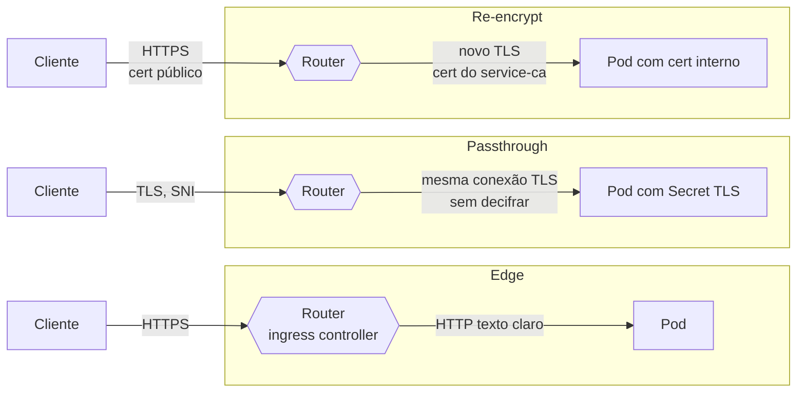
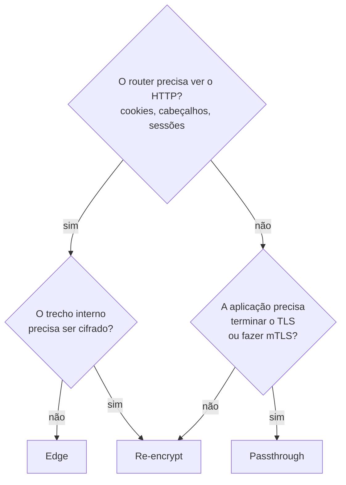

# 4.1 — Proteger o tráfego externo com TLS

| Campo | Valor |
|-------|-------|
| Curso | DO280 — OpenShift 4.22 |
| Capítulo / seção | Capítulo 4 · Seção 4.1 |
| Título original | Protecting External Traffic with TLS |
| Título em português | Proteger o tráfego externo com TLS |
| Objetivo | Permitir e proteger conexões de rede às aplicações dentro de um cluster OpenShift |
| Referência | PDF p. 147–150 · Guided Exercise 4.2 p. 151–160 |

## Pré-requisitos e conhecimentos anteriores

No DO180 você expôs aplicações com **Routes** (`oc expose service`), viu que o
**ingress controller** (o *router*, baseado em HAProxy) recebe o tráfego externo pelo
domínio `*.apps` e entrega aos Pods, e que o Service seleciona os Pods por labels. As
Routes de lá eram HTTP simples. Também viu Secrets montados como volumes. Agora o foco
é **criptografar** esse caminho e decidir **onde** o TLS termina.

| Conceito | Onde revisar |
|----------|--------------|
| Routes, Ingress, router e hostnames | [DO180 · 4.7 — Escalar e expor aplicações](https://github.com/eduardoandradej/openshift-do180-4.22-estudos/blob/main/capitulos/04-deploy-e-redes/4.7-escalar-e-expor-aplicacoes.md) |
| Rede de Pods, Services e DNS interno | [DO180 · 4.5 — Redes de Pods e Services](https://github.com/eduardoandradej/openshift-do180-4.22-estudos/blob/main/capitulos/04-deploy-e-redes/4.5-redes-de-pods-e-services.md) |
| Secrets montados como volume | [DO180 · 5.1 — Externalizar configuração](https://github.com/eduardoandradej/openshift-do180-4.22-estudos/blob/main/capitulos/05-configuracao-e-storage/5.1-externalizar-configuracao.md) |
| Probes (precisam acompanhar a mudança para HTTPS) | [DO180 · 6.3 — Health probes](https://github.com/eduardoandradej/openshift-do180-4.22-estudos/blob/main/capitulos/06-confiabilidade/6.3-health-probes.md) |

## Parte A — Entendendo o conceito

### Formas de expor uma aplicação

O OpenShift oferece vários caminhos para tráfego externo: Services do tipo
`NodePort` ou `LoadBalancer` (tráfego TCP/UDP genérico, tema do Capítulo 5) e os
recursos **Ingress** e **Route** (HTTP, HTTPS e TLS com SNI). Uma **Route** publica a
aplicação em um **hostname único**; o **ingress controller** recebe a conexão no IP
público e a encaminha aos Pods.

Um detalhe de arquitetura que a apostila destaca: por desempenho, o router **não**
passa pelo IP do Service. Ele usa o Service apenas para descobrir os Pods (endpoints) e
envia o tráfego **diretamente aos Pods**, pela rede do cluster.

> Em ROSA e OpenShift Dedicated, clusters privados podem expor aplicações por um
> ingress controller secundário voltado para a internet, que provisiona um balanceador
> nativo da nuvem (NLB/ALB), mantendo o cluster privado.

### Route sem TLS × Route com TLS

Uma Route **sem criptografia** é a mais simples: não exige chaves nem certificados, e
tudo trafega em texto claro (o Guided Exercise 4.2 mostra isso capturando pacotes com
`tcpdump`). Uma Route **com criptografia** define o **tipo de terminação TLS**, isto é,
**onde** a conexão TLS é aberta e decifrada:

| Terminação | Onde o TLS termina | Quem tem o certificado | Router → Pod |
|------------|-------------------|------------------------|--------------|
| **Edge** | No router | A Route (ou, se omitido, um certificado gerado pelo Ingress Operator) | **Texto claro** |
| **Passthrough** | Na aplicação (o router nem decifra) | A aplicação, normalmente via Secret TLS montado | Criptografado (é a mesma conexão do cliente) |
| **Re-encrypt** | No router, que abre **outra** conexão TLS até o Pod | A Route (para o cliente) **e** a aplicação (para o router) | Criptografado (nova conexão TLS) |

Consequências práticas:

- **Edge** é o mais simples e permite que o router inspecione HTTP (cookies de sessão,
  cabeçalhos), mas o trecho interno fica sem criptografia. A apostila lembra que
  **NetworkPolicies** ([4.3](4.3-network-policies.md)) ajudam a proteger esse trecho.
- **Passthrough** cifra o caminho inteiro e permite **autenticação mútua** entre cliente
  e aplicação (o cliente fala TLS diretamente com o Pod). Em troca, o router não vê o
  HTTP e roteia só pelo nome do host (SNI).
- **Re-encrypt** cifra o caminho inteiro **e** mantém o router como ponto de
  terminação para o cliente. O certificado interno do Pod é para o nome interno do
  Service (`<svc>.<ns>.svc`) e precisa de uma PKI interna: o **service-ca** do
  OpenShift ([4.5](4.5-tls-no-trafego-interno.md)).

> **Atenção à comparação de "mais seguro":** a seção 4.1 da apostila apresenta o
> passthrough como alternativa mais segura que o edge (cifra o caminho inteiro); a
> tabela da seção 4.5 chama o re-encrypt de "o tipo mais seguro". Ambos cifram de ponta
> a ponta; a diferença é **onde** o TLS é terminado e **quem** guarda as chaves. Escolha
> pelo requisito (inspeção no router, mTLS na aplicação, certificado público × interno).

### Certificados: de onde vêm

- Com `--key` e `--cert`, a Route usa **o seu** certificado (por exemplo, assinado pela
  CA da organização).
- Sem eles, a Route edge usa o **certificado padrão do ingress controller** (um curinga
  do domínio `*.apps`). Se o administrador não configurou um certificado próprio, esse
  curinga é gerado e assinado pela **CA interna** do Ingress Operator, que pode ser
  consultada no Secret `router-ca` do namespace `openshift-ingress-operator`.
- 📘 O administrador pode **substituir** esse certificado padrão (campo
  `spec.defaultCertificate` do IngressController) por um assinado pela CA da
  organização. É o que acontece no laboratório: no GE 4.2, o `curl -v` mostra como
  emissor a **CA da sala de aula**, não a `router-ca`. Para saber qual CA assinou, leia
  sempre o `issuer` do certificado apresentado.
- Navegadores e `curl` só confiam no certificado se confiarem na CA emissora. No
  ambiente do curso, a CA da sala de aula está instalada no sistema do `workstation`,
  mas o Firefox avisa que é um emissor não reconhecido pela Mozilla — esperado.

### Gerar um certificado assinado por uma CA (visão do fluxo)

O Guided Exercise 4.2 gera, com `openssl`, a chave privada, a requisição de assinatura
(CSR) e o certificado assinado pela CA de treinamento, com um arquivo de extensões para
o **Subject Alternative Name** (SAN). O ponto conceitual: o nome que o cliente usa
(hostname da Route) precisa constar no certificado — hoje, no **SAN**; o CN sozinho não
basta para clientes modernos (📘).

## Parte B — Modelo mental e arquitetura





## Parte C — Aplicação prática

> Legenda: 🔍 somente leitura · ✏️ altera o cluster · 🖥️ só local
>
> Hostnames, arquivos e nomes abaixo são fictícios (`*.apps.exemplo.com`).

### 1. Route sem TLS (ponto de partida) ✏️

```bash
oc expose service loja --hostname loja.apps.exemplo.com
oc get route loja
curl -I http://loja.apps.exemplo.com
```

### 2. Route edge: `oc create route edge` ✏️

```bash
# Certificado da organização
oc create route edge loja-https --service loja \
  --hostname loja-https.apps.exemplo.com --key loja.key --cert loja.crt

# Sem --key/--cert: certificado gerado pelo Ingress Operator (CA interna)
oc create route edge loja-https --service loja --hostname loja-https.apps.exemplo.com
```

- **Parâmetros:** `--service` (destino), `--hostname`, `--key` (chave privada), `--cert` (certificado assinado); 📘 `--ca-cert` (cadeia da CA), `--insecure-policy Redirect|Allow|None` (o que fazer com HTTP).
- **Permissões:** criar Routes no projeto (`edit`).
- **Resultado esperado:** `route.route.openshift.io/loja-https created`.
- **Como verificar:** `oc get route loja-https` (coluna TERMINATION `edge`); `curl -v https://...` mostra `subject`, `subjectAltName` e `issuer`; `SSL certificate verify ok` se a CA for confiável.
- **Atenção (apostila):** os subcomandos `oc create route edge|passthrough|reencrypt` **não respeitam** `--dry-run=server`: a Route é criada mesmo assim. Para gerar o manifesto, use `--dry-run=client -o yaml`.

Ver a CA interna do ingress:

```bash
oc get secret router-ca -n openshift-ingress-operator -o yaml           # 🔍 (administrador)
oc extract secret/router-ca -n openshift-ingress-operator --keys tls.crt --to -   # 📘
```

### 3. Comprovar o trecho interno em texto claro (edge) 🔍

```bash
oc get svc loja -o jsonpath='{.spec.clusterIP}{"\n"}'
oc debug -t deployment/loja --image <imagem-com-curl>   # Pod temporário com a mesma configuração
# dentro do Pod: curl -v http://<cluster-ip>
```

`oc debug -t deployment/<d>` cria um Pod de diagnóstico baseado no Deployment
(📘 com `--image` você troca a imagem por uma que tenha as ferramentas necessárias).
Ao sair, o Pod é removido.

### 4. Preparar a aplicação para passthrough: Secret TLS montado ✏️

```bash
oc create secret tls loja-certs --cert loja.crt --key loja.key
```

Trecho de Deployment (original):

```yaml
spec:
  template:
    spec:
      containers:
        - name: web
          volumeMounts:
            - name: certificados
              mountPath: /usr/local/etc/ssl/certs   # caminho que a APLICAÇÃO espera
              readOnly: true
      volumes:
        - name: certificados
          secret:
            secretName: loja-certs                  # chaves tls.crt e tls.key
```

- **Tipo do Secret:** `kubernetes.io/tls`, com as chaves `tls.crt` e `tls.key`.
- **Ponto crítico:** o caminho de montagem e os nomes de arquivo são definidos pela
  aplicação. Se a aplicação passa a servir **só HTTPS**, as probes HTTP precisam de
  `scheme: HTTPS` (senão o Pod nunca fica pronto) e o Service precisa expor a porta TLS.
- **Verificar:** `oc set volumes deployment/loja` lista Secret, volume e ponto de montagem.

### 5. Route passthrough: `oc create route passthrough` ✏️

```bash
oc create route passthrough loja-tls --service loja-tls --port 8443 \
  --hostname loja-tls.apps.exemplo.com
curl -v --cacert ca-organizacao.pem https://loja-tls.apps.exemplo.com
```

- **`--port`:** a porta (ou o nome da porta) **do Service** para onde o tráfego vai.
- **Sem `--key`/`--cert`:** o certificado é o da aplicação; o router não decifra.
- **Verificar:** o `issuer` mostrado pelo `curl` é a CA que assinou o certificado **da aplicação**, não a CA do ingress.

### 6. Route re-encrypt (visão geral) ✏️ 📘

```bash
oc create route reencrypt loja-re --service loja --hostname loja-re.apps.exemplo.com \
  --key loja.key --cert loja.crt           # certificado apresentado ao cliente
# o Pod serve TLS com um certificado para loja.<ns>.svc (service-ca, seção 4.5)
```

### 7. Gerar um certificado assinado com `openssl` (fluxo genérico) 🖥️

```bash
openssl genrsa -out app.key 4096
openssl req -new -key app.key -out app.csr -subj "/O=Exemplo/CN=app.apps.exemplo.com"
openssl x509 -req -in app.csr -CA ca.pem -CAkey ca.key -CAcreateserial \
  -out app.crt -days 365 -sha256 -extfile san.ext      # san.ext: subjectAltName=DNS:app.apps.exemplo.com
openssl x509 -in app.crt -noout -subject -issuer -ext subjectAltName   # 📘 conferir
```

### Raciocínio operacional e diagnóstico

| Sintoma | Hipótese | Como confirmar | Correção segura |
|---------|----------|----------------|-----------------|
| Navegador avisa "emissor não reconhecido" | CA interna/corporativa não está no repositório de confiança do cliente | `curl -v` mostra o `issuer` | Distribuir a CA aos clientes; no curso, é esperado |
| `curl: (60) SSL certificate problem` | Cliente não confia na CA | Repetir com `--cacert <ca.pem>` | Usar a CA correta |
| Erro de nome (hostname não confere) | Hostname da Route fora do SAN do certificado | `openssl x509 -noout -ext subjectAltName` | Reemitir com o SAN correto |
| Route passthrough responde 503 / conexão recusada | Aplicação não serve TLS na porta indicada, `--port` errado ou Pod não pronto | `oc get endpoints`; `oc describe route` | Conferir porta do Service e estado dos Pods |
| Pod fica `0/1` após habilitar TLS | Probes ainda em HTTP | `oc describe pod` (eventos `Unhealthy`) | `scheme: HTTPS` nas probes |
| Pod não inicia após montar o Secret | Secret inexistente ou com outro nome | `oc describe pod` (`secret "x" not found`) | Criar o Secret ou corrigir `secretName` |
| `oc create route ... --dry-run=server` criou a Route | Limitação desses subcomandos | `oc get route` | Usar `--dry-run=client -o yaml`; apagar a Route criada sem querer |
| `oc create secret tls`: arquivo não encontrado | Comando executado em outro diretório | `ls`; `pwd` | Usar caminho correto para `.crt` e `.key` |

## Parte D — Relações importantes

| A | B | Diferença essencial |
|---|---|--------------------|
| Edge | Passthrough | Router termina TLS, trecho interno em claro × aplicação termina TLS, router não decifra |
| Edge | Re-encrypt | Router → Pod em claro × router abre novo TLS até o Pod |
| Passthrough | Re-encrypt | Certificado só na aplicação, mTLS possível × certificado na Route e no Pod, router ainda vê o HTTP |
| Route | Ingress | Recurso do OpenShift com tipos de terminação × recurso padrão do Kubernetes (o OpenShift o converte em Route) |
| Route | Service LoadBalancer/NodePort | HTTP/HTTPS/TLS com SNI por hostname × qualquer TCP/UDP por IP/porta (Capítulo 5) |
| `oc create secret tls` | `oc create secret generic` | Tipo `kubernetes.io/tls` com `tls.crt`/`tls.key` × chaves livres |
| CA do ingress (`router-ca`) | CA do service-ca (4.5) | Certificados das Routes geradas × certificados dos Services internos |

## Parte E — Preparação para o laboratório oficial

Atividade associada: **4.2 Guided Exercise — Protect External Traffic with TLS**
(`network-ingress`, PDF p. 151–160).

Você deve conseguir, sem consultar a lição:

- expor uma aplicação por Route HTTP e reconhecer o tráfego em texto claro;
- criar uma Route edge sem certificado próprio e identificar a CA emissora;
- gerar chave, CSR e certificado assinado por uma CA com SAN;
- criar um Secret TLS, montá-lo na aplicação e criar uma Route passthrough;
- provar com `curl` (de fora e de dentro do cluster) que o trecho interno está ou não cifrado.

Detalhes e armadilhas do ambiente em
[PRATICA-OFICIAL.md](PRATICA-OFICIAL.md#42-guided-exercise-protect-external-traffic-with-tls).

## Parte F — Fixação

1. Em uma Route edge, o tráfego entre o router e o Pod é cifrado? O que pode reduzir o risco nesse trecho?
2. Que tipo de Route permite autenticação mútua (mTLS) entre o cliente e a aplicação? Por quê?
3. Você criou `oc create route edge web --service web` sem `--key` e `--cert`. Que certificado o cliente recebe?
4. Depois de trocar a aplicação para servir só HTTPS, os Pods ficaram `0/1`. Qual a causa mais provável?
5. Por que `oc create route passthrough ... --dry-run=server` não é uma forma segura de testar?
6. Que informação do `curl -v` comprova que, em passthrough, o certificado vem da aplicação?

<details>
<summary>Respostas comentadas</summary>

1. Não; o router entrega em texto claro. NetworkPolicies limitam quem fala com o Pod; para cifrar o trecho, use re-encrypt ou passthrough.
2. Passthrough: a conexão TLS vai do cliente até o Pod sem ser terminada no router, então a aplicação pode exigir e validar o certificado do cliente.
3. O certificado padrão do ingress controller (curinga do domínio de aplicações): assinado pela CA interna do Ingress Operator, ou pela CA da organização se o administrador o substituiu (caso do laboratório). O `issuer` mostrado pelo `curl -v` diz qual.
4. As probes continuam em HTTP; com TLS obrigatório, falham. Ajuste `scheme: HTTPS`.
5. Segundo a apostila, esses subcomandos ignoram o `--dry-run=server` e criam a Route. Use `--dry-run=client -o yaml`.
6. O `issuer` (e o `subject`) do certificado apresentado: é a CA que assinou o certificado montado no Pod, não a CA do ingress.

</details>

## Parte G — Essencial para memorizar

- Router envia direto aos Pods (usa o Service só para achar endpoints).
- **Edge**: TLS termina no router; interno em claro. **Passthrough**: TLS até o Pod; router não decifra; mTLS possível. **Re-encrypt**: TLS no router + novo TLS até o Pod.
- `oc create route edge|passthrough|reencrypt <nome> --service <s> --hostname <h> [--key --cert] [--port]`.
- Sem `--key/--cert` em edge: certificado padrão do ingress controller (CA interna `router-ca`, ou a CA da organização se o padrão foi substituído).
- `oc create secret tls <s> --cert <crt> --key <key>` + volume no caminho que a aplicação espera.
- TLS na aplicação ⇒ probes `scheme: HTTPS` e porta TLS no Service.
- `oc create route ...` ignora `--dry-run=server`: use `--dry-run=client -o yaml`.

---
[← Índice do capítulo](README.md) | [Índice do capítulo](README.md) | [Próximo: 4.3 Network policies →](4.3-network-policies.md)
