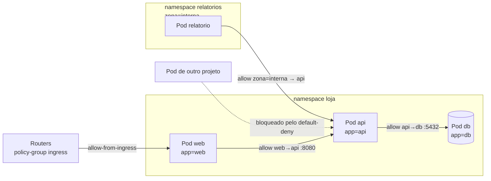
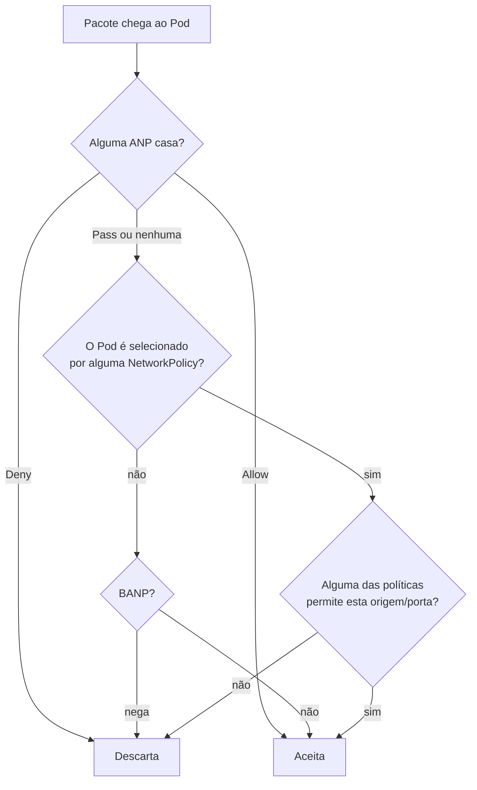

# 4.3 — Configurar network policies

| Campo | Valor |
|-------|-------|
| Curso | DO280 — OpenShift 4.22 |
| Capítulo / seção | Capítulo 4 · Seção 4.3 |
| Título original | Configuring Network Policies |
| Título em português | Configurar network policies |
| Objetivo | Restringir o tráfego de rede entre projetos e Pods |
| Referência | PDF p. 161–168 · Guided Exercise 4.4 p. 169–176 |

## Pré-requisitos e conhecimentos anteriores

No DO180 você viu que todo Pod recebe um IP na rede de Pods, que Services encontram
Pods por **labels** e que, por padrão, qualquer Pod alcança qualquer outro, inclusive
em outros projetos. Também viu `oc exec` e `curl` para testar conectividade. Do
[Capítulo 3](../03-autenticacao-autorizacao/README.md), lembre que **RBAC** controla
chamadas à **API**; ele não controla pacotes entre Pods. Esta lição trata da camada
que faltava: **quem pode abrir conexão de rede com quem**.

| Conceito | Onde revisar |
|----------|--------------|
| Rede de Pods, Services, DNS e testes com `curl` | [DO180 · 4.5 — Redes de Pods e Services](https://github.com/eduardoandradej/openshift-do180-4.22-estudos/blob/main/capitulos/04-deploy-e-redes/4.5-redes-de-pods-e-services.md) |
| Labels e selectors | [DO180 · F4 — Pods e workloads](https://github.com/eduardoandradej/openshift-do180-4.22-estudos/blob/main/01-fundamentos-essenciais/04-pods-e-workloads.md) |
| CNI e OVN-Kubernetes | [DO180 · F6 — Redes e serviços](https://github.com/eduardoandradej/openshift-do180-4.22-estudos/blob/main/01-fundamentos-essenciais/06-redes-e-servicos.md) |
| RBAC (para rotular namespaces é preciso permissão) | [3.3 — Permissões com RBAC](../03-autenticacao-autorizacao/3.3-permissoes-com-rbac.md) |

## Parte A — Entendendo o conceito

### O padrão é tudo aberto

Por padrão, todos os Pods (e VMs) de um projeto aceitam conexões de qualquer Pod, VM
ou endpoint do cluster, inclusive de outros projetos. Isso facilita, mas não atende a
aplicações que exigem **segmentação**.

### O que é uma NetworkPolicy

Uma **NetworkPolicy** (`networking.k8s.io/v1`) é um recurso de **namespace** que diz
quais conexões os Pods selecionados podem **receber** (`ingress`) e/ou **iniciar**
(`egress`). Diferenças em relação a um firewall tradicional:

- usa **labels** (de Pods e de namespaces), não IPs: a regra acompanha a aplicação
  onde quer que ela rode e por mais que escale;
- é criada por quem administra o projeto (não exige administrador do cluster), dando
  aos desenvolvedores controle sobre a própria aplicação;
- permite criar "zonas" lógicas na rede de Pods que espelham as zonas de rede da
  organização.

### Como as políticas se combinam

1. **Um Pod que não é selecionado por nenhuma política não tem restrição.**
2. Assim que **alguma** política seleciona o Pod para ingress, ele passa a aceitar
   **somente** o que alguma política permitir (isolamento).
3. As políticas são **aditivas**: o permitido é a **união** de todas as que selecionam
   o Pod. Não existe regra de "negar" em NetworkPolicy.

Daí o padrão de trabalho:

- criar uma política **default-deny** (`podSelector: {}` e nenhuma regra de ingress),
  que isola todos os Pods do projeto;
- acrescentar políticas **allow** específicas para cada fluxo necessário.

### Anatomia

```yaml
apiVersion: networking.k8s.io/v1
kind: NetworkPolicy
metadata:
  name: permitir-api-do-front
  namespace: loja
spec:
  podSelector:              # DESTINO: Pods deste namespace protegidos pela política
    matchLabels:
      app: api
  ingress:                  # o que eles podem RECEBER
    - from:                 # ORIGENS permitidas (cada item é um "OU")
        - namespaceSelector:
            matchLabels:
              zona: frontend
          podSelector:      # no MESMO item: "E"
            matchLabels:
              app: web
      ports:                # portas de destino permitidas
        - port: 8080
          protocol: TCP
```

- `spec.podSelector` (obrigatório) escolhe os Pods **do próprio namespace** aos quais a
  política se aplica; `{}` = todos.
- `ingress[].from[]` escolhe as **origens**; pode apontar para Pods de **outros**
  namespaces via `namespaceSelector`.
- `ports` limita as portas de destino.
- Sem campo `egress`, a política não restringe saída (📘 o campo `policyTypes` torna
  isso explícito).

### "E" × "OU": a regra que mais causa erro

| Escrita | Significado |
|---------|-------------|
| `namespaceSelector` **e** `podSelector` no **mesmo** item de `from` | Pods com o label X **dentro** de namespaces com o label Y |
| `namespaceSelector` e `podSelector` em **itens separados** de `from` (cada um com seu `-`) | Qualquer Pod de namespaces Y **ou** Pods com label X **do namespace da própria política** |
| Só `podSelector` em um item | Pods com o label X **do mesmo namespace** da política |
| Só `namespaceSelector` em um item | **Todos** os Pods dos namespaces selecionados |

Um único hífen a mais transforma uma regra restritiva em uma bem mais aberta.

> ⚠️ **Divergência:** a apostila (p. 164–165) diz que, no caso "OU", o item só com
> `podSelector` aceita Pods `app=mobile` "de qualquer namespace". Pela especificação da
> API (📘 conferido na definição de `NetworkPolicyPeer` em `k8s.io/api/networking/v1`), um `podSelector` **sem**
> `namespaceSelector` seleciona Pods **do mesmo namespace da política**. Para aceitar
> esse label em **todos** os namespaces, use no mesmo item `namespaceSelector: {}` +
> `podSelector`.

### Labels de namespace

Para permitir tráfego vindo de outro projeto, a política seleciona o **namespace de
origem pelos labels**. A apostila orienta rotular o namespace (`oc label namespace ...`),
o que exige permissão sobre o objeto Namespace (no Guided Exercise 4.4, quem rotula é o
administrador).

> 📘 *Precisão técnica:* a apostila diz que namespaces não recebem labels
> automaticamente, mas a própria saída do exercício mostra o label
> **`kubernetes.io/metadata.name=<nome>`**, que o Kubernetes aplica a **todo**
> namespace. Ele permite selecionar um namespace específico pelo nome sem rotulá-lo.
> Labels próprios (como `network=...`) continuam úteis para selecionar **grupos** de
> namespaces e são o que o curso usa.

### Tráfego da própria plataforma

Ao isolar um projeto, componentes do cluster também passam a precisar de permissão
explícita:

| Origem | Label do namespace de origem a selecionar |
|--------|-------------------------------------------|
| Routers (ingress controller), para Routes funcionarem | `policy-group.network.openshift.io/ingress: ""` |
| Monitoramento (Prometheus), se a aplicação expõe métricas | `network.openshift.io/policy-group: monitoring` |

> ⚠️ **Rede do host:** NetworkPolicies **não** bloqueiam, dentro do **mesmo nó**, o
> tráfego de Pods que usam a rede do host. No cluster de **nó único** do curso, os
> routers usam a rede do host; por isso a Route continua respondendo mesmo com um
> default-deny e sem a política de ingress. Isso **não** significa que a política
> falhou. Em clusters com vários nós, a política para os routers é obrigatória.

> 📌 **Novidade do 4.22 (apostila):** os operators de DNS e de ingress instalam e
> mantêm políticas **deny-all** em `openshift-dns`, `openshift-dns-operator`,
> `openshift-ingress` e `openshift-ingress-operator`. Não altere essas políticas nem
> rode Pods próprios nesses namespaces.

### Três níveis de política no OVN-Kubernetes

| Recurso | Escopo | Quem cria | Avaliação (camada de ACL) |
|---------|--------|-----------|---------------------------|
| **AdminNetworkPolicy** (ANP) | Cluster | Administrador do cluster | Tier 1 — primeiro; `Allow`/`Deny` decidem e encerram; `Pass` delega ao próximo nível |
| **NetworkPolicy** (NP) | Namespace | Administrador do projeto | Tier 2 |
| **BaselineAdminNetworkPolicy** (BANP) | Cluster | Administrador do cluster | Tier 3 — padrão que as NPs podem sobrepor (fora do escopo do curso) |

Consequências: um desenvolvedor **não** consegue liberar com NetworkPolicy o que uma
ANP **nega**; mas consegue liberar o que uma BANP bloqueia.

Pontos da ANP (`policy.networking.k8s.io/v1alpha1`):

- `priority`: **menor número = avaliada primeiro** (faixa 0–99 no OpenShift);
- `subject`: a quem a política se aplica (`namespaces` ou `pods`; `namespaces: {}` = cluster todo);
- cada regra de `ingress`/`egress` precisa de `name` e `action` (`Allow`, `Deny`, `Pass`);
- em `egress`, `networks` seleciona destinos por CIDR (fora do cluster) e `ports` usa `portNumber`.

> ⚠️ **Divergência:** um dos exemplos de ANP da apostila (p. 167) usa
> `matchLabels: {sensitive: true}` sem aspas. Em YAML, `true` vira booleano e o
> `oc apply` recusa (`cannot unmarshal bool ... of type string`). Valores de labels são
> sempre texto: escreva `sensitive: "true"`. Verificado decodificando o manifesto com os
> tipos de `sigs.k8s.io/network-policy-api` v0.1.5.

## Parte B — Modelo mental e arquitetura





## Parte C — Aplicação prática

> Legenda: 🔍 somente leitura · ✏️ altera o cluster
>
> Manifestos completos e validados em
> [exemplos-originais/network-policies](../../exemplos-originais/network-policies/).

### 1. Medir antes: testar a conectividade atual 🔍

```bash
oc get pods -o wide -n loja                     # IPs dos Pods
oc get svc -n loja
oc exec -n loja <pod-web> -- curl -s -m 5 <ip-pod-api>:8080     # -m 5: desiste após 5 s
oc exec -n outro <pod-x> -- curl -s -m 5 api.loja.svc:8080
```

Use sempre um **tempo limite** (`curl -m`/`--max-time`): conexões bloqueadas por
política **não** recebem recusa, ficam sem resposta até o tempo acabar.

### 2. Isolar o projeto: default-deny ✏️

```yaml
apiVersion: networking.k8s.io/v1
kind: NetworkPolicy
metadata:
  name: default-deny
spec:
  podSelector: {}
```

```bash
oc apply -f default-deny.yaml -n loja
oc get networkpolicies -n loja                  # POD-SELECTOR <none> = todos os Pods
```

### 3. Liberar fluxos específicos ✏️

```yaml
apiVersion: networking.k8s.io/v1
kind: NetworkPolicy
metadata:
  name: api-aceita-web
spec:
  podSelector:
    matchLabels:
      app: api
  ingress:
    - from:
        - podSelector:
            matchLabels:
              app: web
      ports:
        - port: 8080
          protocol: TCP
```

Entre projetos (origem rotulada):

```bash
oc label namespace relatorios zona=interna      # exige permissão sobre o Namespace
oc get namespace relatorios --show-labels
```

```yaml
  ingress:
    - from:
        - namespaceSelector:
            matchLabels:
              zona: interna                    # ou kubernetes.io/metadata.name: relatorios (📘)
```

### 4. Permitir routers e monitoramento ✏️

```yaml
apiVersion: networking.k8s.io/v1
kind: NetworkPolicy
metadata:
  name: allow-from-openshift-ingress
spec:
  podSelector: {}
  ingress:
    - from:
        - namespaceSelector:
            matchLabels:
              policy-group.network.openshift.io/ingress: ""
```

### 5. Inspecionar e verificar 🔍

```bash
oc get networkpolicies -n loja
oc describe networkpolicy api-aceita-web -n loja      # resumo legível de quem pode o quê
oc get pods -n loja --show-labels                     # os labels batem com os selectors?
oc get namespace --show-labels
```

`oc describe` traduz a política em frases ("Allowing ingress traffic: To Port: 8080/TCP
From: PodSelector: app=web"); é o jeito mais rápido de conferir "E" × "OU".

### 6. AdminNetworkPolicy (administrador do cluster) ✏️

```yaml
apiVersion: policy.networking.k8s.io/v1alpha1
kind: AdminNetworkPolicy
metadata:
  name: bloquear-nao-confiaveis
spec:
  priority: 50
  subject:
    namespaces: {}
  ingress:
    - name: negar-origem-nao-confiavel
      action: Deny
      from:
        - namespaces:
            matchLabels:
              confiavel: "false"          # valores de label sempre entre aspas
```

```bash
oc apply -f anp.yaml          # recurso de cluster: sem -n
oc get adminnetworkpolicies
```

### Raciocínio operacional e diagnóstico

| Sintoma | Hipótese | Como confirmar | Correção segura |
|---------|----------|----------------|-----------------|
| `curl` "trava" e só termina por tempo | Tráfego bloqueado por política (não há recusa) | `oc get netpol -n <destino>`; `oc describe netpol` | Política allow para essa origem/porta |
| Política allow criada, mas o acesso continua bloqueado | Labels não batem (Pod ou namespace), porta errada, ou política no namespace de **origem** em vez do de **destino** | `oc get pods --show-labels`; `oc get ns --show-labels`; `oc describe netpol` | Corrigir selectors; a política fica no namespace dos Pods de **destino** |
| Acesso liberado demais | `from` com itens separados (OU) em vez de um item (E) | `oc describe netpol` | Juntar `namespaceSelector` e `podSelector` no mesmo item |
| Route para de responder após default-deny (multinó) | Falta permitir os routers | Testar a Route; `oc get netpol` | Política com `policy-group.network.openshift.io/ingress: ""` |
| Route continua respondendo com default-deny (nó único) | Routers na rede do host, mesmo nó | Topologia do cluster | Comportamento esperado; crie a política mesmo assim |
| Métricas da aplicação sumiram | Monitoramento bloqueado | Alvos no console de monitoramento | Política para `network.openshift.io/policy-group: monitoring` |
| `oc label namespace` → `Forbidden` | Sem permissão sobre o Namespace | `oc auth can-i patch namespace/<ns>` | Pedir ao administrador |
| `oc apply` de ANP recusa `matchLabels` | Valor de label sem aspas (`true`) | Mensagem `cannot unmarshal bool` | Pôr o valor entre aspas |
| NetworkPolicy permite, mas o tráfego segue bloqueado | Uma ANP de maior precedência nega | `oc get adminnetworkpolicies` | Ajustar a ANP (administrador) |

## Parte D — Relações importantes

| A | B | Diferença essencial |
|---|---|--------------------|
| NetworkPolicy | RBAC | Pacotes entre Pods × chamadas à API |
| NetworkPolicy | Firewall tradicional | Labels, acompanha a aplicação × IPs e portas fixos |
| `spec.podSelector` | `ingress[].from[].podSelector` | Pods **protegidos** (destino) × Pods **de origem** |
| Mesmo item de `from` | Itens separados de `from` | E (Pods X em namespaces Y) × OU |
| Sem política | Com default-deny | Tudo aberto × só o explicitamente permitido |
| NetworkPolicy | AdminNetworkPolicy | Namespace, só permite, criada pelo projeto × cluster, `Allow`/`Deny`/`Pass`, criada pelo administrador, avaliada antes |
| AdminNetworkPolicy | BaselineAdminNetworkPolicy | Não pode ser sobreposta pelas NPs × padrão que as NPs podem sobrepor |
| Label próprio do namespace | `kubernetes.io/metadata.name` (📘) | Escolhido pelo administrador, agrupa vários × automático, identifica um namespace |

## Parte E — Preparação para o laboratório oficial

Atividade associada: **4.4 Guided Exercise — Configure Network Policies**
(`network-policy`, PDF p. 169–176).

Você deve conseguir, sem consultar a lição:

- testar a conectividade entre Pods e entre projetos com `oc exec ... curl`;
- criar um default-deny e comprovar o bloqueio dentro e entre projetos;
- liberar uma origem específica (Pod + namespace rotulado, mesmo item de `from`) para uma porta;
- comprovar que outras portas e outros Pods continuam bloqueados;
- explicar por que a Route responde no cluster de nó único e criar a política para os routers mesmo assim.

Detalhes e armadilhas do ambiente em
[PRATICA-OFICIAL.md](PRATICA-OFICIAL.md#44-guided-exercise-configure-network-policies).

## Parte F — Fixação

1. Um projeto não tem nenhuma NetworkPolicy. Quem consegue acessar seus Pods?
2. Duas políticas selecionam o mesmo Pod: uma permite a origem A e outra a origem B. O que é permitido?
3. Explique a diferença entre estes dois `from`:
   ```yaml
   # (1)
   - namespaceSelector: {matchLabels: {env: dev}}
     podSelector: {matchLabels: {app: web}}
   # (2)
   - namespaceSelector: {matchLabels: {env: dev}}
   - podSelector: {matchLabels: {app: web}}
   ```
4. Você criou a política de allow no namespace da **origem** e o acesso continua bloqueado. Por quê?
5. Por que um `curl` bloqueado demora e não retorna "connection refused"?
6. No cluster de nó único, a Route responde mesmo após o default-deny. A política falhou?
7. Um desenvolvedor criou uma NetworkPolicy permitindo uma origem, mas o tráfego segue bloqueado; não há erro na política. O que mais pode estar negando?

<details>
<summary>Respostas comentadas</summary>

1. Qualquer Pod (ou VM/endpoint) do cluster: sem política, não há restrição.
2. A união: A e B. Políticas são aditivas.
3. (1) Só Pods `app=web` **dentro** de namespaces `env=dev` (E). (2) **Qualquer** Pod de namespaces `env=dev` **ou** Pods `app=web` do **namespace da própria política** (OU). A forma (2) é mais aberta.
4. A política se aplica aos Pods selecionados no **namespace onde ela está**; para controlar o que um Pod **recebe**, ela precisa estar no namespace do Pod de **destino**.
5. O pacote é descartado em silêncio; o cliente espera até o tempo limite. Use `curl -m`.
6. Não. Os routers usam a rede do host e estão no mesmo nó dos Pods; NetworkPolicy não filtra esse caso. Em multinó, a política para os routers é necessária.
7. Uma AdminNetworkPolicy com `Deny` (avaliada antes e não sobreponível), ou labels/portas que não batem de verdade (`oc describe netpol`, `--show-labels`).

</details>

## Parte G — Essencial para memorizar

- Sem política = tudo aberto; Pod selecionado = só o que alguma política permitir; políticas **somam**.
- Padrão: **default-deny** (`podSelector: {}`) + allows específicos.
- `spec.podSelector` = destino (no namespace da política); `from` = origens; `ports` = portas de destino.
- Mesmo item de `from` = **E**; itens separados = **OU**.
- Entre projetos: `namespaceSelector` + `oc label namespace` (📘 ou `kubernetes.io/metadata.name`).
- Routers: `policy-group.network.openshift.io/ingress: ""`; monitoramento: `network.openshift.io/policy-group: monitoring`.
- Nó único + routers na rede do host ⇒ Route funciona mesmo com default-deny.
- ANP (Tier 1, cluster, `Allow/Deny/Pass`, menor `priority` primeiro) → NP (Tier 2) → BANP (Tier 3).
- Valores de labels sempre como texto (`"true"`).
- Teste com tempo limite: `oc exec <pod> -- curl -s -m 5 <destino>`.

---
[← 4.1 TLS no tráfego externo](4.1-tls-no-trafego-externo.md) | [Índice do capítulo](README.md) | [Próximo: 4.5 TLS no tráfego interno →](4.5-tls-no-trafego-interno.md)
