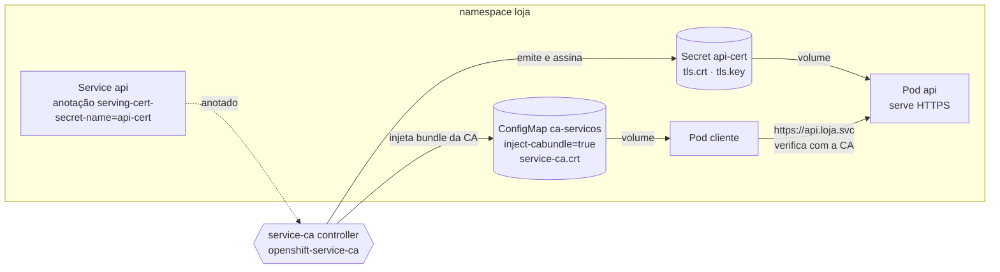

# 4.5 — Proteger o tráfego interno com TLS

| Campo | Valor |
|-------|-------|
| Curso | DO280 — OpenShift 4.22 |
| Capítulo / seção | Capítulo 4 · Seção 4.5 |
| Título original | Protecting Internal Traffic with TLS |
| Título em português | Proteger o tráfego interno com TLS |
| Objetivo | Configurar e usar certificados de serviço automáticos |
| Referência | PDF p. 177–180 · Guided Exercise 4.6 p. 181–185 · Lab 4.7 p. 186–197 |

## Pré-requisitos e conhecimentos anteriores

Em [4.1](4.1-tls-no-trafego-externo.md) você protegeu o caminho **cliente → cluster**
com Routes e viu que o trecho **router → Pod** só é cifrado em passthrough ou
re-encrypt. Em [4.3](4.3-network-policies.md) você limitou **quem** fala com quem.
Falta cifrar e autenticar a conversa **entre aplicações dentro do cluster**. Do DO180,
retome o DNS interno de Services (`<svc>.<ns>.svc`), ConfigMaps e Secrets montados
como volumes, e probes.

| Conceito | Onde revisar |
|----------|--------------|
| DNS interno e Services | [DO180 · 4.5 — Redes de Pods e Services](https://github.com/eduardoandradej/openshift-do180-4.22-estudos/blob/main/capitulos/04-deploy-e-redes/4.5-redes-de-pods-e-services.md) |
| ConfigMaps/Secrets como volume, `items` | [DO180 · 5.1 — Externalizar configuração](https://github.com/eduardoandradej/openshift-do180-4.22-estudos/blob/main/capitulos/05-configuracao-e-storage/5.1-externalizar-configuracao.md) |
| Probes HTTP/HTTPS | [DO180 · 6.3 — Health probes](https://github.com/eduardoandradej/openshift-do180-4.22-estudos/blob/main/capitulos/06-confiabilidade/6.3-health-probes.md) |
| `oc patch --patch-file` e chaves de mesclagem | [1.1 — Manifestos de recursos](../01-gerenciamento-declarativo/1.1-manifestos-de-recursos.md) |

## Parte A — Entendendo o conceito

### Confiança zero

Em um ambiente de **confiança zero** (*zero trust*), nenhuma interação é confiável por
padrão: cada acesso é explicitamente permitido, a comunicação é **cifrada** e o
cliente **verifica a autenticidade** do servidor. Para isso, os certificados precisam
ser assinados por uma **CA confiável**, e o cliente precisa conhecer essa CA.

O OpenShift já cifra o tráfego entre os nós e o control plane (o Kubernetes puro não faz
isso por padrão), mas **não cifra o tráfego das aplicações** nem obriga uma aplicação a
verificar a outra. Isso é responsabilidade de quem configura as aplicações.

### Criptografia pós-quântica (contexto do 4.22)

A apostila registra que o OpenShift 4.22 oferece suporte a troca de chaves híbrida
**ML-KEM** em **TLS 1.3**, combinando curvas elípticas clássicas com algoritmos
pós-quânticos (via bibliotecas criptográficas do RHEL/RHCOS). Para usar, o
administrador configura o perfil de segurança TLS **Modern** (TLS 1.3 mínimo) em API
servers, ingress controllers e outros componentes. Ponto de decisão: hoje esses
algoritmos são **incompatíveis com o modo FIPS 140**; a organização escolhe entre
conformidade FIPS e proteção pós-quântica conforme o seu modelo de ameaças.

### O service-ca: uma PKI interna automática

O OpenShift inclui o controller **service-ca**, que mantém uma CA interna e emite
**certificados de serviço** sob demanda:

1. Você **anota** um Service com
   `service.beta.openshift.io/serving-cert-secret-name=<nome-do-secret>`.
2. O service-ca cria, **no mesmo namespace**, um Secret do tipo `kubernetes.io/tls` com
   `tls.crt` (certificado assinado) e `tls.key`, válido para os nomes DNS do Service
   (`<svc>.<ns>.svc` e `<svc>.<ns>.svc.cluster.local`).
3. Você **monta** o Secret no Deployment, no caminho e com os nomes de arquivo que a
   **aplicação** espera (use `items` para renomear `tls.crt`/`tls.key`).

Do lado do **cliente**, ele precisa confiar na CA do service-ca:

1. Crie um ConfigMap **dedicado** e anote-o com
   `service.beta.openshift.io/inject-cabundle=true`.
2. O service-ca injeta o bundle da CA na chave **`service-ca.crt`** desse ConfigMap.
3. Monte o ConfigMap no cliente, no caminho onde a aplicação (ou o sistema) procura CAs
   confiáveis.

> ⚠️ O service-ca **substitui todo o conteúdo** do ConfigMap anotado pelo bundle. Nunca
> anote um ConfigMap que tenha outros dados.

A anotação de injeção também funciona em **API services**, **CRDs** e **webhooks**
(mutating e validating), onde o bundle é colocado no campo apropriado do objeto.

### Rotação

| Item | Comportamento (apostila) |
|------|--------------------------|
| Validade da CA do service-ca | 26 meses por padrão |
| Rotação automática da CA | Quando a validade restante cai abaixo de 13 meses |
| Período de convivência | 13 meses em que a CA antiga ainda vale; nesse período, reinicie os Pods que confiam na CA antiga para receberem o bundle novo |
| Rotacionar o certificado de um Service | Apague o Secret do certificado; o service-ca gera outro |
| Rotacionar a CA manualmente | Apagar o Secret `signing-key` em `openshift-service-ca` — **invalida a CA anterior imediatamente** para o cluster inteiro |

> ⛔ **Nunca rotacione a CA do service-ca no ambiente do curso.** É uma operação de
> **cluster inteiro**: todos os componentes que usam certificados de serviço precisam
> ser reiniciados. Fazer isso no laboratório pode deixar o ambiente inconsistente.

### Alternativas

- **Red Hat OpenShift Service Mesh**: mTLS automático entre serviços e recursos
  avançados de tráfego.
- **cert-manager Operator**: automatiza o ciclo de vida de certificados e pode delegar
  a assinatura a uma CA externa confiável (por exemplo, Let's Encrypt), com renovação.

### Juntando tudo: TLS de ponta a ponta

A tabela de terminações da apostila nesta seção afirma que **edge é o tipo padrão**
(📘 no sentido de ser o mais comum e o padrão de várias ferramentas; em um manifesto de
Route com `spec.tls`, o campo `termination` é obrigatório) e que **re-encrypt pode usar
um certificado de serviço** no Pod. O laboratório 4.7 combina as peças: certificado de
serviço + CA injetada para o tráfego interno, Secret TLS corporativo + Route passthrough
para o externo, e NetworkPolicies para restringir a entrada.

## Parte B — Modelo mental e arquitetura



```mermaid
sequenceDiagram
    participant Adm as Administrador
    participant S as Service
    participant C as service-ca
    participant D as Deployment servidor
    participant K as Cliente
    Adm->>S: oc annotate serving-cert-secret-name=api-cert
    C->>C: cria Secret api-cert (tls.crt, tls.key)
    Adm->>D: monta api-cert; probes scheme HTTPS
    Adm->>C: ConfigMap anotado inject-cabundle=true
    C->>C: grava service-ca.crt no ConfigMap
    Adm->>K: monta o ConfigMap como CA confiável
    K->>D: TLS → certificado verificado (return code 0)
```

## Parte C — Aplicação prática

> Legenda: 🔍 somente leitura · ✏️ altera o cluster
>
> Manifestos autorais e validados em
> [exemplos-originais/service-ca](../../exemplos-originais/service-ca/).

### 1. Pedir um certificado de serviço: `oc annotate service` ✏️

```bash
oc annotate service api service.beta.openshift.io/serving-cert-secret-name=api-cert
oc describe service api | grep -A3 Annotations      # inclui serving-cert-signed-by
oc get secret api-cert                              # TYPE kubernetes.io/tls
oc get secret api-cert -o jsonpath='{.data.tls\.crt}' | base64 -d \
  | openssl x509 -noout -subject -issuer -ext subjectAltName
```

- **Resultado esperado:** SAN com `api.<ns>.svc` e `api.<ns>.svc.cluster.local`; emissor `openshift-service-serving-signer@...`.
- **Forma declarativa:** a mesma anotação em `metadata.annotations` do manifesto do Service, aplicada com `oc apply`.

### 2. Montar o certificado no servidor ✏️

Patch (strategic merge) para um servidor que espera os arquivos em `/etc/pki/nginx/`:

```yaml
spec:
  template:
    spec:
      containers:
        - name: api                       # nome real do container
          volumeMounts:
            - name: cert-servico
              mountPath: /etc/pki/nginx/
      volumes:
        - name: cert-servico
          secret:
            secretName: api-cert
            defaultMode: 420
            items:
              - key: tls.crt
                path: server.crt
              - key: tls.key
                path: private/server.key
```

```bash
oc patch deployment api --patch-file cert-servico-patch.yaml
oc rollout status deployment/api
oc set volumes deployment/api
```

Se a aplicação passa a servir só HTTPS, ajuste **probes** (`scheme: HTTPS`) e a
**porta** do Service (por exemplo, 443 → porta do container).

### 3. Testar sem a CA (erro esperado) 🔍

```bash
oc exec <pod-cliente> -- openssl s_client -connect api.<ns>.svc:443 -brief
# verify error:num=19:self signed certificate in certificate chain
```

### 4. Injetar a CA para o cliente ✏️

```bash
oc create configmap ca-servicos
oc annotate configmap ca-servicos service.beta.openshift.io/inject-cabundle=true
oc get configmap ca-servicos -o yaml                # data.service-ca.crt preenchido
```

Volume no cliente (o caminho e o nome do arquivo dependem da imagem; em imagens RHEL/UBI,
`/etc/pki/ca-trust/extracted/pem/tls-ca-bundle.pem` é o bundle do sistema):

```yaml
spec:
  template:
    spec:
      containers:
        - name: cliente
          volumeMounts:
            - name: ca-confiavel
              mountPath: /etc/pki/ca-trust/extracted/pem
      volumes:
        - name: ca-confiavel
          configMap:
            name: ca-servicos
            items:
              - key: service-ca.crt
                path: tls-ca-bundle.pem
```

Deployment completo em [04-deployment-cliente.yaml](../../exemplos-originais/service-ca/04-deployment-cliente.yaml).

> ⚠️ Montar o ConfigMap **sobre** o diretório de CAs do sistema **substitui** o bundle
> original naquele container: ele passa a confiar **só** na CA do service-ca. Serve para
> chamadas internas; se o mesmo container precisa chamar serviços externos com CAs
> públicas, monte em outro caminho e configure a aplicação para usá-lo (📘).

### 5. Verificar a conexão confiável 🔍

```bash
oc exec deploy/cliente -- curl -s https://api.<ns>.svc
oc exec deploy/cliente -- openssl s_client -connect api.<ns>.svc:443 </dev/null | grep 'return code'
# Verify return code: 0 (ok)
```

### 6. Rotacionar o certificado de um Service ✏️

```bash
oc delete secret api-cert           # o service-ca recria em seguida
oc get secret api-cert -w
oc rollout restart deployment/api   # 📘 garante que o processo leia o certificado novo
```

### Raciocínio operacional e diagnóstico

| Sintoma | Hipótese | Como confirmar | Correção segura |
|---------|----------|----------------|-----------------|
| Secret do certificado não aparece | Anotação com nome errado ou no objeto errado | `oc describe svc` | Corrigir a anotação no Service |
| Pod do servidor não inicia | Secret ainda inexistente ou `secretName` errado | `oc describe pod` (`secret ... not found`) | Anotar o Service primeiro; corrigir o nome |
| Servidor `0/1` após habilitar TLS | Probes ainda em HTTP | Eventos `Unhealthy` | `scheme: HTTPS` |
| Cliente: `self signed certificate in certificate chain` | Cliente não confia na CA do service-ca | `openssl s_client -brief` | ConfigMap com `inject-cabundle` montado no cliente |
| Cliente: erro de nome do host | Acesso por IP ou nome fora do SAN | `openssl x509 -ext subjectAltName` | Usar `<svc>.<ns>.svc` |
| ConfigMap perdeu dados | Anotação de injeção em ConfigMap com outros dados | `oc get cm -o yaml` | ConfigMap dedicado ao bundle |
| `connection refused` na porta 443 | Service ainda expõe a porta antiga ou `targetPort` errado | `oc get svc`; `oc get endpoints` | Ajustar `port`/`targetPort` |
| Cliente externo de outro serviço passou a falhar no mesmo Pod | Bundle do sistema substituído pelo do service-ca | Caminho do volume | Montar a CA em caminho próprio |

## Parte D — Relações importantes

| A | B | Diferença essencial |
|---|---|--------------------|
| service-ca | CA do ingress (`router-ca`) | Certificados de Services internos × certificados gerados para Routes |
| `serving-cert-secret-name` (Service) | `inject-cabundle` (ConfigMap etc.) | Emite certificado para o **servidor** × entrega a CA ao **cliente** |
| Secret do certificado | ConfigMap do bundle | Chave privada + certificado (sensível) × só a CA pública |
| Apagar o Secret do certificado | Apagar `signing-key` | Novo certificado para **um** Service × nova CA para o **cluster** inteiro |
| service-ca | cert-manager | PKI interna automática para Services × ciclo de vida completo, CAs externas |
| service-ca | Service Mesh | Certificado por Service, a aplicação faz TLS × mTLS transparente entre serviços |
| TLS interno | NetworkPolicy | Confidencialidade e autenticidade × quem pode conectar |

## Parte E — Preparação para o laboratório oficial

Atividades associadas:

- **4.6 Guided Exercise — Protect Internal Traffic with TLS** (`network-svccerts`, PDF p. 181–185);
- **4.7 Lab — Configure Network Security** (`network-review`, PDF p. 186–197, com `lab grade`).

Você deve conseguir, sem consultar a lição:

- anotar um Service, conferir o Secret gerado e o SAN do certificado;
- montar o certificado no servidor com `items` e ajustar probes e porta do Service;
- injetar a CA em um ConfigMap dedicado e montá-la no cliente;
- comprovar com `openssl s_client`/`curl` a diferença entre cliente sem CA e com CA;
- no lab: combinar TLS interno, Route passthrough com certificado corporativo e duas NetworkPolicies.

Detalhes e armadilhas do ambiente em
[PRATICA-OFICIAL.md](PRATICA-OFICIAL.md#46-guided-exercise-protect-internal-traffic-with-tls).

## Parte F — Fixação

1. Qual anotação, em qual objeto, faz o OpenShift gerar um certificado para um serviço interno? Onde ele fica?
2. Por que o cliente precisa de um ConfigMap com `inject-cabundle`, se o servidor já tem certificado?
3. Que cuidado tomar ao escolher o ConfigMap que receberá a anotação de injeção?
4. Para quais nomes DNS o certificado de serviço é válido? Por que acessar pelo IP do Service falha na verificação?
5. Qual a diferença de impacto entre apagar o Secret do certificado de um Service e apagar o Secret `signing-key`?
6. O servidor passou a servir só HTTPS e ficou `0/1`. O que ajustar?

<details>
<summary>Respostas comentadas</summary>

1. `service.beta.openshift.io/serving-cert-secret-name=<secret>` no **Service**; o Secret TLS é criado no mesmo namespace.
2. Para **verificar** o certificado do servidor; sem a CA do service-ca, o cliente vê uma cadeia não confiável.
3. Usar um ConfigMap **dedicado**: o service-ca substitui todos os dados dele pelo bundle.
4. `<svc>.<ns>.svc` e `<svc>.<ns>.svc.cluster.local`. O IP não está no SAN, então a verificação de nome falha.
5. Apagar o Secret do certificado gera um certificado novo só para aquele Service. Apagar `signing-key` gera uma nova CA para o cluster inteiro e invalida a anterior imediatamente, exigindo reiniciar todos os Pods que usam certificados de serviço (nunca no ambiente do curso).
6. As probes (`scheme: HTTPS`) e, se necessário, a porta do Service.

</details>

## Parte G — Essencial para memorizar

- Zero trust: tudo cifrado e o cliente verifica o servidor com uma CA confiável.
- Servidor: `oc annotate service <s> service.beta.openshift.io/serving-cert-secret-name=<secret>` → Secret TLS (`tls.crt`, `tls.key`) → volume com `items`.
- Cliente: ConfigMap dedicado + `service.beta.openshift.io/inject-cabundle=true` → chave `service-ca.crt` → volume.
- Nomes válidos: `<svc>.<ns>.svc` e `<svc>.<ns>.svc.cluster.local`.
- Rotação: CA 26 meses, roda abaixo de 13; certificado de Service: apagar o Secret; CA manual: `signing-key` (cluster inteiro — nunca no curso).
- TLS na aplicação ⇒ probes HTTPS e porta do Service ajustada.
- 4.22: ML-KEM híbrido em TLS 1.3 com perfil Modern; incompatível com FIPS por enquanto.
- Alternativas: Service Mesh (mTLS) e cert-manager.

---
[← 4.3 Network policies](4.3-network-policies.md) | [Índice do capítulo](README.md) | [Próximo: Prática oficial →](PRATICA-OFICIAL.md)
