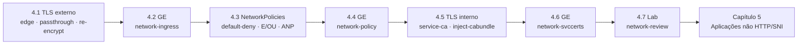

# Capítulo 4 — Network Security

**Título em português:** Segurança de rede
**Status da documentação:** ✅ concluído e validado
**Referência:** PDF p. 146–198

## Objetivo do capítulo

Proteger o tráfego de rede entre aplicações, **dentro e fora** do cluster.

## Por que este capítulo importa

Com identidades e permissões definidas (Capítulo 3), falta proteger os **dados em
trânsito** e limitar **quem conversa com quem**. O capítulo cobre as três frentes que o
administrador combina na prática: TLS no tráfego que chega de fora (Routes edge,
passthrough e re-encrypt), segmentação com NetworkPolicies (e, no nível do cluster,
AdminNetworkPolicies) e TLS no tráfego interno com certificados automáticos do service-ca.

## Seções e atividades (ordem oficial)

| Seção | Tipo | Título original | Material | PDF |
|-------|------|-----------------|----------|-----|
| 4.1 | Conceito | Protecting External Traffic with TLS | [lição](4.1-tls-no-trafego-externo.md) | p. 147–150 |
| 4.2 | Guided Exercise | Protect External Traffic with TLS | [prática](PRATICA-OFICIAL.md#42-guided-exercise-protect-external-traffic-with-tls) | p. 151–160 |
| 4.3 | Conceito | Configuring Network Policies | [lição](4.3-network-policies.md) | p. 161–168 |
| 4.4 | Guided Exercise | Configure Network Policies | [prática](PRATICA-OFICIAL.md#44-guided-exercise-configure-network-policies) | p. 169–176 |
| 4.5 | Conceito | Protecting Internal Traffic with TLS | [lição](4.5-tls-no-trafego-interno.md) | p. 177–180 |
| 4.6 | Guided Exercise | Protect Internal Traffic with TLS | [prática](PRATICA-OFICIAL.md#46-guided-exercise-protect-internal-traffic-with-tls) | p. 181–185 |
| 4.7 | Lab | Configure Network Security | [prática](PRATICA-OFICIAL.md#47-lab-configure-network-security) | p. 186–197 |
| 4.8 | Summary | Summary | [RESUMO.md](RESUMO.md) | p. 198 |

Abertura do capítulo (meta e seções): PDF p. 146. Não há quiz neste capítulo.

## Arquivos do capítulo

- [PRATICA-OFICIAL.md](PRATICA-OFICIAL.md): ponte com as atividades oficiais e **armadilhas do ambiente**.
- [REVISAO.md](REVISAO.md): questões autorais integradas.
- [RESUMO.md](RESUMO.md): síntese, tabela de comandos e divergências do PDF.

## Pré-requisitos recomendados

[DO180 · 4.5 — Redes de Pods e Services](https://github.com/eduardoandradej/openshift-do180-4.22-estudos/blob/main/capitulos/04-deploy-e-redes/4.5-redes-de-pods-e-services.md) ·
[DO180 · 4.7 — Routes](https://github.com/eduardoandradej/openshift-do180-4.22-estudos/blob/main/capitulos/04-deploy-e-redes/4.7-escalar-e-expor-aplicacoes.md) ·
[DO180 · 6.3 — Probes](https://github.com/eduardoandradej/openshift-do180-4.22-estudos/blob/main/capitulos/06-confiabilidade/6.3-health-probes.md) ·
[3.3 — RBAC](../03-autenticacao-autorizacao/3.3-permissoes-com-rbac.md)

## Checklist do aluno

- [ ] 4.1 lida e Parte F respondida
- [ ] 4.2 Guided Exercise `network-ingress` concluído
- [ ] 4.3 lida e Parte F respondida
- [ ] 4.4 Guided Exercise `network-policy` concluído
- [ ] 4.5 lida e Parte F respondida
- [ ] 4.6 Guided Exercise `network-svccerts` concluído
- [ ] 4.7 Lab `network-review` com `lab grade` aprovado
- [ ] [REVISAO.md](REVISAO.md) respondida
- [ ] Registro no [diário de laboratórios](../../progresso/diario-de-laboratorios.md)

---
[← Capítulo 3](../03-autenticacao-autorizacao/README.md) | [Índice geral](../../README.md) | [Próximo: 4.1 TLS no tráfego externo →](4.1-tls-no-trafego-externo.md)
