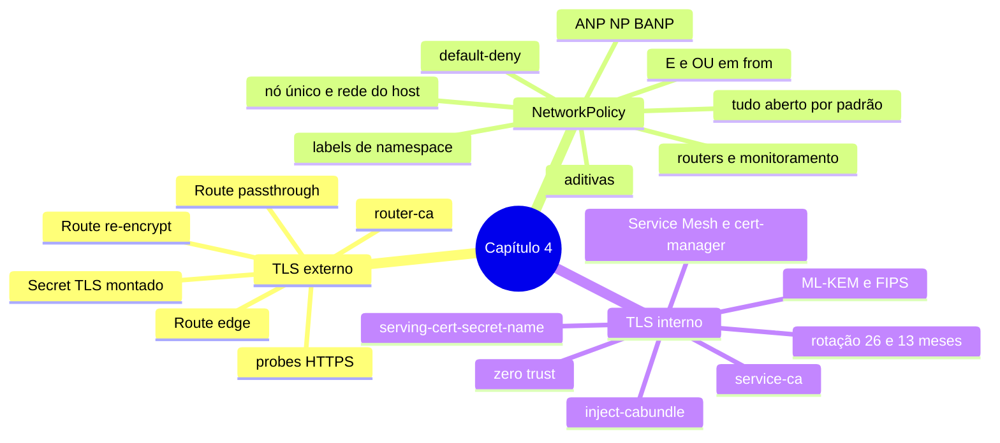

# Resumo — Capítulo 4

Síntese autoral para revisão rápida. Correspondência oficial: seção 4.8 (PDF p. 198).

## Em uma frase por seção

| Seção | Ideia central |
|-------|---------------|
| 4.1 | Routes expõem aplicações por hostname; a terminação TLS (edge, passthrough, re-encrypt) define onde a conexão é decifrada e se o trecho até o Pod é cifrado |
| 4.3 | NetworkPolicies isolam Pods por labels (default-deny + allows aditivos, atenção a E × OU), com AdminNetworkPolicies acima delas no nível do cluster |
| 4.5 | O service-ca emite certificados para Services anotados e injeta sua CA em ConfigMaps dedicados, permitindo TLS interno verificável |

## Mapa do capítulo

## Tabela de comandos do capítulo

| Tarefa | Comando | Tipo |
|--------|---------|------|
| Route HTTP | `oc expose service <s> --hostname <h>` | ✏️ |
| Route edge | `oc create route edge <r> --service <s> --hostname <h> [--key k --cert c]` | ✏️ |
| Route passthrough | `oc create route passthrough <r> --service <s> --port 
 --hostname <h>` | ✏️ |
| Route re-encrypt | `oc create route reencrypt <r> --service <s> --hostname <h> [--key --cert]` | ✏️ |
| Manifesto de Route | `oc create route edge <r> --service <s> --dry-run=client -o yaml` | 🔍 |
| CA do ingress | `oc get secret router-ca -n openshift-ingress-operator -o yaml` | 🔍 |
| Secret TLS | `oc create secret tls <s> --cert <crt> --key <key>` | ✏️ |
| Volumes do Deployment | `oc set volumes deployment/<d>` | 🔍 |
| Pod de diagnóstico | `oc debug -t deployment/<d> --image ` | ✏️ (temporário) |
| Certificado de teste | `curl -v --cacert <ca> https://<h>` · `openssl s_client -connect <h>:443` | 🔍 |
| Políticas | `oc get networkpolicy` · `oc describe networkpolicy <np>` | 🔍 |
| Aplicar política | `oc apply -f <np>.yaml -n <ns>` | ✏️ |
| Rotular namespace | `oc label namespace <ns> chave=valor` | ✏️ |
| Testar conectividade | `oc exec <pod> -- curl -s -m 5 <destino>` | 🔍 |
| ANPs | `oc get adminnetworkpolicies` | 🔍 |
| Certificado de serviço | `oc annotate service <s> service.beta.openshift.io/serving-cert-secret-name=<secret>` | ✏️ |
| Injetar CA | `oc annotate configmap <cm> service.beta.openshift.io/inject-cabundle=true` | ✏️ |
| Rotacionar certificado de um Service | `oc delete secret <secret>` | ✏️ |

## Alertas operacionais

- ⚠️ Edge: router → Pod em texto claro.
- ⚠️ `oc create route ...` ignora `--dry-run=server`.
- ⚠️ TLS na aplicação ⇒ probes `scheme: HTTPS` e porta do Service.
- ⚠️ A NetworkPolicy fica no namespace do **destino**; um hífen muda E para OU.
- ⚠️ Nó único: Route funciona mesmo com default-deny (routers na rede do host).
- ⚠️ Valores de label sempre como texto (`"true"`).
- ⚠️ Não altere as políticas deny-all dos namespaces de DNS/ingress (4.22).
- ⚠️ ConfigMap com `inject-cabundle` deve ser dedicado.
- ⛔ Não rotacione a CA do service-ca (`signing-key`) no ambiente do curso.

## Divergências registradas em relação à apostila

| Ponto | Apostila | Comportamento correto / observação |
|-------|----------|------------------------------------|
| "OU" em `from` (p. 164–165) | Item só com `podSelector` aceitaria Pods de qualquer namespace | Seleciona Pods do **namespace da política** (definição de `NetworkPolicyPeer`) |
| Exemplo de ANP (p. 167) | `matchLabels: {sensitive: true}` | Booleano é recusado; use `"true"` (verificado com os tipos da API) |
| Labels de namespace (p. 173) | "Namespaces não recebem labels automaticamente" | Todo namespace tem `kubernetes.io/metadata.name` (a própria saída do exercício mostra) |
| "Mais seguro" (p. 149 × p. 178) | Passthrough "mais seguro" em 4.1; re-encrypt "o mais seguro" em 4.5 | Ambos cifram ponta a ponta; escolha pelo requisito |
| GE 4.2 (p. 151–152) | O `lab start` cria o projeto, e o passo 1 manda criá-lo | Basta `oc project`; ver armadilhas na prática oficial |
| GE 4.2 (p. 158) | Prompt mostra outro diretório ao criar o Secret TLS | Criar a partir do diretório dos certificados |

## Ligação com o próximo capítulo

Routes atendem HTTP, HTTPS e TLS com SNI. O Capítulo 5 (*Exposing Non-HTTP/SNI
Applications*) trata do que fica de fora: Services do tipo **LoadBalancer** e **redes
adicionais** para Pods.

---
[← Revisão](REVISAO.md) | [Índice do capítulo](README.md) | [Próximo capítulo →](../05-redes-nao-http/README.md)
