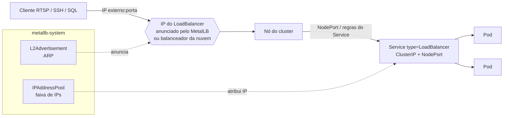
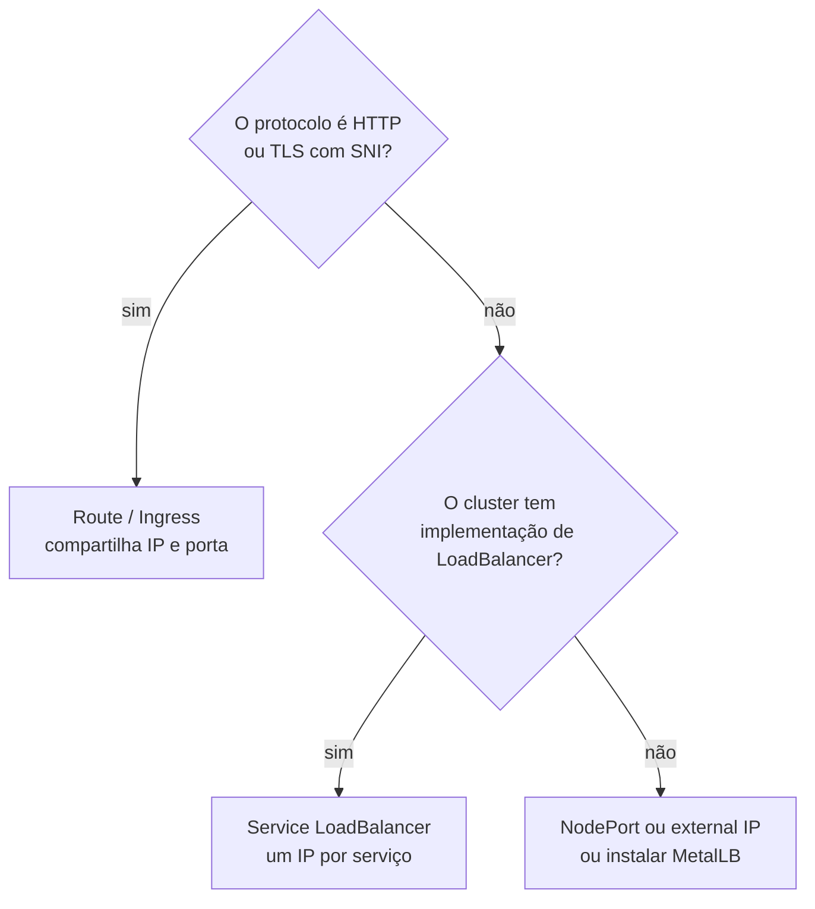

# 5.1 — Services do tipo LoadBalancer

| Campo | Valor |
|-------|-------|
| Curso | DO280 — OpenShift 4.22 |
| Capítulo / seção | Capítulo 5 · Seção 5.1 |
| Título original | Load Balancer Services |
| Título em português | Services do tipo LoadBalancer |
| Objetivo | Expor aplicações ao acesso externo usando Services do tipo LoadBalancer |
| Referência | PDF p. 200–206 · Guided Exercise 5.2 p. 207–212 |

## Pré-requisitos e conhecimentos anteriores

No DO180 você viu que um **Service** dá um endereço estável (ClusterIP e nome DNS) a
um conjunto de Pods escolhidos por **selector**, e que existem tipos de Service além do
`ClusterIP`. No [Capítulo 4](../04-seguranca-de-rede/README.md) você expôs aplicações
com **Routes**, que funcionam para HTTP e para TLS com SNI. Esta lição trata do que as
Routes **não** cobrem.

| Conceito | Onde revisar |
|----------|--------------|
| Services, selectors, endpoints e tipos de Service | [DO180 · 4.5 — Redes de Pods e Services](https://github.com/eduardoandradej/openshift-do180-4.22-estudos/blob/main/capitulos/04-deploy-e-redes/4.5-redes-de-pods-e-services.md) |
| `oc expose`, Routes e Ingress | [DO180 · 4.7 — Escalar e expor aplicações](https://github.com/eduardoandradej/openshift-do180-4.22-estudos/blob/main/capitulos/04-deploy-e-redes/4.7-escalar-e-expor-aplicacoes.md) |
| Terminações TLS e SNI | [4.1 — TLS no tráfego externo](../04-seguranca-de-rede/4.1-tls-no-trafego-externo.md) |
| Operators (o MetalLB é instalado como um) | [DO180 · 1.3 — Componentes do OpenShift](https://github.com/eduardoandradej/openshift-do180-4.22-estudos/blob/main/capitulos/01-introducao-kubernetes-openshift/1.3-componentes-e-edicoes-do-openshift.md) |

## Parte A — Entendendo o conceito

### Por que Routes não servem para tudo

Routes e Ingress usam uma propriedade do HTTP: **hospedagem virtual**. Um único servidor
(o router) recebe todas as conexões em poucas portas e decide o destino pelo **nome do
host** que vem na requisição HTTP ou, em TLS, na extensão **SNI** do handshake. Assim,
milhares de aplicações compartilham o mesmo IP e a mesma porta.

Muitos protocolos não carregam esse nome:

- protocolos de texto como **SMTP, POP3, IMAP**;
- protocolos binários como **SSH, LDAP**, bancos de dados (**MySQL**, **PostgreSQL**),
  **RTSP** (vídeo, usado no Guided Exercise 5.2).

Para eles, o cliente simplesmente conecta em **IP + porta**. Como não há nome para
diferenciar, cada serviço exposto precisa do seu próprio par IP/porta, o que custa mais
configuração e mais endereços. Por isso a apostila recomenda: **prefira Routes e
Ingress** sempre que o protocolo permitir.

### Os tipos de Service

| Tipo | Alcance | Como o cliente chega |
|------|---------|----------------------|
| `ClusterIP` | Só dentro do cluster | IP virtual do Service; balanceia entre os Pods prontos |
| `NodePort` | Fora do cluster | `IP-de-qualquer-nó:porta-alta` (mesma porta em todos os nós) |
| `LoadBalancer` | Fora do cluster | **Um IP externo próprio** na porta do serviço |
| `ClusterIP` com *external IPs* | Fora do cluster | IP externo configurado manualmente (citado pela apostila) |

Um Service `LoadBalancer` é construído **sobre** os outros: ele também recebe um
ClusterIP e uma NodePort (a coluna `PORT(S)` mostra `8554:32170/TCP`), e um componente
externo ao Kubernetes publica um IP que leva o tráfego até os nós.

### Quem implementa o LoadBalancer

O tipo `LoadBalancer` só **pede** um balanceador; quem entrega depende do ambiente:

| Ambiente | Implementação |
|----------|---------------|
| Nuvem (AWS, Azure, GCP, IBM Cloud) | O *cloud controller manager* cria um balanceador do provedor (ex.: Elastic Load Balancing, Azure Load Balancer). ⚠️ Cada Service cria um balanceador **cobrado** |
| Bare metal / hipervisores (sem nuvem) | Um operador como o **MetalLB** atribui IPs de um **pool** preparado pelo administrador e os anuncia na rede |

Em bare metal, o administrador precisa garantir que a rede consiga **rotear** os IPs do
pool até um nó do cluster.

### MetalLB

O **MetalLB** é instalado com o **Operator Lifecycle Manager** (Capítulo 7) e
configurado com recursos próprios no namespace `metallb-system`:

| Recurso | Função |
|---------|--------|
| `MetalLB` | A instância principal que o operator implanta |
| `IPAddressPool` | A faixa de IPs que pode ser entregue a Services `LoadBalancer` |
| `L2Advertisement` | Anuncia os IPs dos pools escolhidos por **ARP gratuito** (camada 2) |
| 📘 `BGPPeer` / `BGPAdvertisement` | Configuração do modo camada 3 |

Dois modos de anúncio:

| Modo | Como funciona | Observação |
|------|---------------|------------|
| **Camada 2 (ARP)** | Um nó responde ao ARP do IP do serviço; o tráfego entra por ele | Padrão ao configurar pelo operator; simples, sem roteador especial |
| **Camada 3 (BGP)** | Os nós anunciam rotas aos roteadores (peers BGP); o roteador escolhe um nó que anunciou o IP | Exige número de AS e roteadores BGP; distribui melhor |

Ponto de atenção: o pool é **finito**. Quando todos os IPs estão em uso, um novo Service
`LoadBalancer` fica com `EXTERNAL-IP <pending>` até algum IP ser liberado — exatamente o
que o Guided Exercise 5.2 demonstra com um pool de dois endereços e três serviços.

Usuários comuns não enxergam os recursos do MetalLB: um administrador precisa dar acesso
ao projeto `metallb-system`.

### Depois de expor: verifique do lugar certo

A apostila insiste: confirme a disponibilidade **a partir das redes de onde os clientes
virão**, com um **cliente do próprio protocolo** (ex.: um player RTSP, `psql`, `ssh`), e
teste o balanceamento. Ferramentas como `ping`, `traceroute` e `nc` ajudam a separar
problema de rede de problema da aplicação. Alguns protocolos precisam de ajustes para
funcionar atrás de um balanceador.

## Parte B — Modelo mental e arquitetura





## Parte C — Aplicação prática

> Legenda: 🔍 somente leitura · ✏️ altera o cluster
>
> Manifestos autorais e validados em
> [exemplos-originais/load-balancer](../../exemplos-originais/load-balancer/).

### 1. Ver a configuração do MetalLB (administrador) 🔍

```bash
oc get metallb -n metallb-system
oc get ipaddresspool -n metallb-system           # coluna ADDRESSES: faixa disponível
oc get l2advertisement -n metallb-system         # quais pools são anunciados
```

### 2. Criar o Service: `oc expose --type LoadBalancer` ✏️

```bash
oc expose deployment/camera --type LoadBalancer --port 8554 --target-port 8554
oc expose deployment/camera --name camera-lb --type LoadBalancer   # nome próprio
```

- **Parâmetros:** `--type LoadBalancer`; `--port` (porta exposta pelo Service); `--target-port` (porta do container); `--name` (padrão: nome do Deployment); 📘 `--protocol UDP` para serviços UDP.
- **Permissões:** criar Services no projeto (`edit`). Não é preciso ser administrador para **usar** o MetalLB.
- **Resultado esperado:** `service/camera exposed`; em seguida `EXTERNAL-IP` preenchido.

Forma declarativa (original):

```yaml
apiVersion: v1
kind: Service
metadata:
  name: camera-lb
spec:
  type: LoadBalancer
  selector:
    app: camera
  ports:
    - name: rtsp
      port: 8554
      targetPort: 8554
      protocol: TCP
```

### 3. Descobrir o IP externo 🔍

```bash
oc get service camera-lb                         # EXTERNAL-IP e PORT(S) porta:nodeport
oc get service camera-lb -o jsonpath='{.status.loadBalancer.ingress[0].ip}{"\n"}'
oc describe service camera-lb                    # eventos do MetalLB (IP atribuído ou não)
```

### 4. Testar do lado do cliente 🔍

```bash
nc -vz <ip-externo> 8554                         # a porta aceita conexão?
vlc rtsp://<ip-externo>:8554/stream              # cliente do protocolo (exige interface gráfica)
psql -h <ip-externo> -U <usuario> <banco>        # exemplo para banco de dados
```

### 5. Liberar um IP do pool ✏️

```bash
oc delete service camera-lb                      # o IP volta ao pool
oc get services -w                               # um Service <pending> recebe o IP liberado
```

### Raciocínio operacional e diagnóstico

| Sintoma | Hipótese | Como confirmar | Correção segura |
|---------|----------|----------------|-----------------|
| `EXTERNAL-IP <pending>` indefinidamente | Pool esgotado | `oc get svc -A \| grep LoadBalancer`; `oc get ipaddresspool -n metallb-system` | Liberar um Service que não é mais necessário ou ampliar o pool (administrador) |
| `<pending>` em um cluster sem MetalLB nem nuvem | Não há implementação de LoadBalancer | `oc get metallb -A` | Instalar/configurar MetalLB, ou usar NodePort |
| IP atribuído, mas a conexão não chega | IP não anunciado (sem `L2Advertisement` para o pool) ou rede não roteia o IP até o nó | `oc get l2advertisement -n metallb-system`; `ping`/`traceroute` | Corrigir o anúncio ou a rede (administrador) |
| `nc` conecta, mas o cliente falha | Problema no protocolo/aplicação, porta errada | `oc logs`; testar com o cliente do protocolo | Ajustar a aplicação ou `targetPort` |
| `nc` recusa | Service sem endpoints (selector errado) ou `targetPort` errado | `oc get endpoints <svc>`; `oc describe svc` | Corrigir selector/porta |
| Custo inesperado na nuvem | Um balanceador por Service | Console do provedor | Consolidar com Routes onde possível |

## Parte D — Relações importantes

| A | B | Diferença essencial |
|---|---|--------------------|
| Route / Ingress | Service LoadBalancer | Compartilha IP e porta por nome de host (HTTP/SNI) × um IP por serviço, qualquer protocolo TCP/UDP |
| `ClusterIP` | `NodePort` | Interno × porta alta em todos os nós |
| `NodePort` | `LoadBalancer` | IP do nó + porta alta × IP dedicado na porta do serviço |
| Nuvem | MetalLB | Balanceador do provedor (pago, automático) × IPs de um pool local anunciados pelos nós |
| Camada 2 (ARP) | Camada 3 (BGP) | Um nó responde pelo IP × roteadores escolhem entre nós via BGP |
| `IPAddressPool` | `L2Advertisement` | Quais IPs podem ser usados × como eles são anunciados |
| `port` | `targetPort` | Porta exposta pelo Service × porta do container |

## Parte E — Preparação para o laboratório oficial

Atividade associada: **5.2 Guided Exercise — Configure Load Balancer Services**
(`non-http-lb`, PDF p. 207–212).

Você deve conseguir, sem consultar a lição:

- expor um Deployment não HTTP com um Service `LoadBalancer`;
- encontrar o IP externo e testar com `nc` e com o cliente do protocolo;
- explicar o `<pending>` quando o pool acaba e resolvê-lo liberando um IP.

Detalhes e armadilhas do ambiente em
[PRATICA-OFICIAL.md](PRATICA-OFICIAL.md#52-guided-exercise-configure-load-balancer-services).

## Parte F — Fixação

1. Por que uma Route não consegue expor um servidor PostgreSQL?
2. O que acontece com um Service `LoadBalancer` quando o pool do MetalLB não tem mais IPs livres?
3. Na coluna `PORT(S)` aparece `5432:31502/TCP`. O que é cada número?
4. Qual a diferença entre `IPAddressPool` e `L2Advertisement`?
5. Em uma nuvem pública, que cuidado de custo existe com Services `LoadBalancer`?
6. Um Service `LoadBalancer` tem IP externo e `nc` recusa a conexão. Por onde começar?

<details>
<summary>Respostas comentadas</summary>

1. Routes roteiam pelo nome do host do HTTP ou pelo SNI do TLS; o protocolo do PostgreSQL não oferece esse nome ao router, então não há como compartilhar IP/porta.
2. Ele fica com `EXTERNAL-IP <pending>` até que um IP seja liberado (por exemplo, apagando outro Service) ou o pool seja ampliado.
3. `5432` é a porta do Service (a que o cliente usa no IP externo); `31502` é a NodePort alocada automaticamente.
4. O pool define **quais** IPs podem ser atribuídos; o L2Advertisement define que esses IPs serão **anunciados** por ARP na camada 2.
5. Cada Service cria um balanceador do provedor, que é cobrado; prefira Routes quando o protocolo permitir.
6. Verifique se o Service tem endpoints (`oc get endpoints`) e se `targetPort` corresponde à porta do container; depois, a aplicação.

</details>

## Parte G — Essencial para memorizar

- Routes/Ingress = HTTP e TLS com SNI. Outros protocolos ⇒ `NodePort` ou `LoadBalancer`.
- Prefira Routes; `LoadBalancer` consome um IP por serviço.
- `oc expose deployment/<d> --type LoadBalancer [--port] [--target-port] [--name]`.
- IP externo: `oc get svc` (`EXTERNAL-IP`) ou `.status.loadBalancer.ingress`.
- Bare metal: **MetalLB** (`metallb-system`): `MetalLB`, `IPAddressPool`, `L2Advertisement`; modos ARP (L2) e BGP (L3).
- Pool esgotado ⇒ `<pending>`; apagar um Service devolve o IP ao pool.
- Teste com o cliente do protocolo, a partir da rede do cliente.

---
[← Índice do capítulo](README.md) | [Índice do capítulo](README.md) | [Próximo: 5.3 Redes adicionais de Pods →](5.3-redes-adicionais-de-pods.md)
