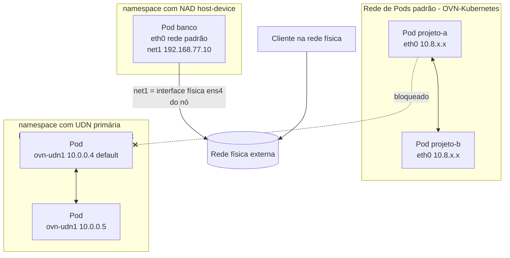
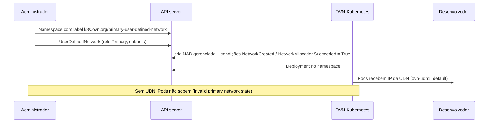

# 5.3 — Configurar redes adicionais de Pods

| Campo | Valor |
|-------|-------|
| Curso | DO280 — OpenShift 4.22 |
| Capítulo / seção | Capítulo 5 · Seção 5.3 |
| Título original | Configure Additional Pod Networks |
| Título em português | Configurar redes adicionais de Pods |
| Objetivo | Configurar redes definidas pelo usuário (UDN) para isolar workloads e definições de anexação de rede (NAD) para acesso externo |
| Referência | PDF p. 213–224 · Guided Exercise 5.4 p. 225–233 · Lab 5.5 p. 234–243 |

## Pré-requisitos e conhecimentos anteriores

No DO180 você viu que o Kubernetes mantém duas redes: a **rede de Pods** (um IP por Pod,
todos se alcançam) e a **rede de Services** (IPs virtuais estáveis), implementadas no
OpenShift pelo plug-in CNI **OVN-Kubernetes**. No [Capítulo 4](../04-seguranca-de-rede/4.3-network-policies.md)
você isolou Pods com NetworkPolicies **dentro** dessa rede única. Esta lição mostra a
alternativa: dar a Pods **outras redes**, isoladas ou ligadas a redes físicas.

| Conceito | Onde revisar |
|----------|--------------|
| Rede de Pods, rede de Services, CNI | [DO180 · F6 — Redes e serviços](https://github.com/eduardoandradej/openshift-do180-4.22-estudos/blob/main/01-fundamentos-essenciais/06-redes-e-servicos.md) |
| IPs de Pods e testes de conectividade | [DO180 · 4.5 — Redes de Pods e Services](https://github.com/eduardoandradej/openshift-do180-4.22-estudos/blob/main/capitulos/04-deploy-e-redes/4.5-redes-de-pods-e-services.md) |
| Labels de namespace e isolamento por política | [4.3 — Network policies](../04-seguranca-de-rede/4.3-network-policies.md) |
| JSONPath com chaves que contêm pontos | [DO180 · 2.3 — Inspecionar recursos](https://github.com/eduardoandradej/openshift-do180-4.22-estudos/blob/main/capitulos/02-cli-e-apis/2.3-inspecionar-recursos-kubernetes.md) |
| `oc debug node/<nó>` | [DO180 · 2.5 — Avaliar a saúde do cluster](https://github.com/eduardoandradej/openshift-do180-4.22-estudos/blob/main/capitulos/02-cli-e-apis/2.5-avaliar-a-saude-do-cluster.md) |

## Parte A — Entendendo o conceito

### Por que mais de uma rede

A rede de Pods padrão liga todos os Pods entre si. Há motivos para ligar alguns Pods (ou
VMs) a **outras** redes:

- **desempenho**: tráfego específico em rede e interfaces dedicadas;
- **segurança**: uma rede com propriedades próprias, isolada do restante do cluster;
- **simplicidade**: controlar a saída de tráfego ou isolar inquilinos sem dezenas de
  NetworkPolicies;
- **acesso a redes externas**: colocar um Pod diretamente em uma rede física do data center.

O plug-in **Multus** permite que um Pod tenha **várias interfaces**, cada uma ligada a
uma rede. Para redes físicas, a rede precisa estar disponível nos nós; operators como o
**Kubernetes NMState** (configuração de rede dos nós por CRs) e o **SR-IOV Network
Operator** (placas SR-IOV para alta banda e baixa latência) preparam os nós.

No OpenShift há três formas de definir redes extras:

| Recurso | Escopo / quem cria | Uso típico |
|---------|--------------------|-----------|
| **UserDefinedNetwork (UDN)** | Namespace / administrador do projeto | Rede isolada de um projeto (primária ou secundária), gerenciada pelo OVN-Kubernetes |
| **ClusterUserDefinedNetwork (CUDN)** | Cluster / **administrador do cluster** | Uma rede compartilhada por vários namespaces (um inquilino) |
| **NetworkAttachmentDefinition (NAD)** | Namespace | Ligar Pods a redes **externas** ou usar um plug-in CNI específico (bridge, MACVLAN, IPVLAN, host-device) |

A apostila posiciona as UDNs como a forma **recomendada** para redes isoladas dentro do
cluster: configuração mais simples, **validação** do recurso e uma seção **status** com
condições e erros. O OVN-Kubernetes observa as UDN/CUDN e cria por conta própria as NADs
correspondentes.

> Em ROSA, ARO e OpenShift Dedicated, ligar Pods diretamente à rede física (bridge,
> MACVLAN, IPVLAN, host-device) **não** é suportado; em nuvens públicas, a recomendação
> é usar UDNs com topologia de camada 2.

### UDN primária × secundária

| Papel (`role`) | Efeito |
|----------------|--------|
| **Primary** | **Todos** os Pods do namespace usam a UDN como interface **padrão**; todo o tráfego sai por ela |
| **Secondary** | A UDN vira uma interface **extra**; só o tráfego destinado àquela rede passa por ela, e o Pod precisa pedir a rede (anotação, ver abaixo) |

Benefícios de uma UDN primária:

- **isolamento de inquilinos**: Pods de outros namespaces (na rede padrão ou em outras
  UDNs) não alcançam os Pods da UDN — sem escrever NetworkPolicies;
- **endereçamento previsível**: você escolhe a sub-rede e pode **reutilizá-la** em vários
  namespaces isolados (dev, teste e produção com a mesma faixa, sem conflito);
- com `ipam.lifecycle: Persistent`, os IPs persistem entre reinícios e migrações (exigido
  para *live migration* de VMs).

Um Pod em UDN primária ainda mostra a interface `eth0` da rede padrão na anotação de
status, mas a interface marcada como `default: true` é a da UDN (`ovn-udn1`), e o tráfego
entre a UDN e a rede padrão é bloqueado nos dois sentidos (no GE 5.4 o Pod da UDN recebe
`No route to host` ao chamar um Pod da rede padrão; no Lab 5.5 o caminho inverso
termina por tempo).

### Topologias Layer2 e Layer3

| Topologia | Endereçamento |
|-----------|---------------|
| `Layer2` | **Uma** sub-rede para a rede inteira, compartilhada por todos os nós (como um único segmento) |
| `Layer3` | A sub-rede é **dividida por nó**; cada nó recebe um pedaço e o Pod recebe IP do pedaço do seu nó (como a rede de Pods padrão) |

> ⚠️ **Precisão técnica:** a apostila (p. 215) descreve "IP da sub-rede do nó, uma
> sub-rede por nó, IP muda ao migrar de nó" como se valesse para UDNs em geral; isso é o
> comportamento da topologia **Layer3**. Na **Layer2**, uma única sub-rede atende todos
> os nós. 📘 Conferido nos comentários da API `UserDefinedNetwork` do OVN-Kubernetes
> (`Layer3Subnet`: "split into smaller subnets for every node"; `Layer2Config.subnets`:
> "used for the pod network across the cluster").

### Regras da UDN primária (as que mais causam erro)

1. O namespace precisa ter o label **`k8s.ovn.org/primary-user-defined-network`**
   **desde a criação**. Não é possível acrescentar esse label a um namespace existente.
2. Com o label, **nenhum Pod sobe** no namespace até existir a UDN; o evento do Pod
   mostra `invalid primary network state for namespace ...`.
3. Sem o label, a UDN até é criada, mas a rede **não** é provisionada; as condições da
   UDN mostram o erro.
4. Pela console (**Networking › UserDefinedNetworks**), cria-se **uma** UDN por namespace,
   e ela é usada como primária.
5. Ordem segura: **namespace com label → UDN (condições `True`) → workloads**.

Criar o namespace com o label exige permissão sobre Namespaces (administrador, como no
curso). Um `oc new-project` cria um projeto **sem** esse label, e o label não pode ser
acrescentado depois.

Por padrão, Pods em UDN ficam isolados até da rede padrão. A anotação de Pod
**`k8s.ovn.org/open-default-ports`** abre portas específicas para acesso a partir da rede
padrão (por exemplo, para monitoramento).

### CUDN: uma rede para vários namespaces

A **ClusterUserDefinedNetwork** (administrador do cluster) usa um `namespaceSelector`
(`matchLabels` ou `matchExpressions`, inclusive por `kubernetes.io/metadata.name`) para
juntar vários namespaces na mesma rede. Ao ser criada, ela gera uma NAD **com o mesmo
nome** em cada namespace selecionado: se já existir uma NAD com esse nome, a criação falha
(`foreign NetworkAttachmentDefinition with the desired name already exist`). Use nomes
únicos para UDNs e CUDNs no cluster.

### NAD: redes externas e plug-ins específicos

Uma **NetworkAttachmentDefinition** (`k8s.cni.cncf.io/v1`, recurso de namespace) traz,
em `spec.config`, a **configuração CNI em JSON**:

| Tipo (`type`) | O que faz |
|---------------|-----------|
| `host-device` | Move uma interface do nó para **um único** Pod |
| `bridge` | Usa ou cria uma bridge no nó; os Pods conectados se falam pela bridge e alcançam as redes ligadas a ela |
| `macvlan` | Interfaces virtuais com MAC próprio sobre uma interface do nó |
| `ipvlan` | Como MACVLAN, mas compartilhando o MAC da interface (útil quando a rede limita MACs) |

O bloco **`ipam`** define como o Pod recebe IP nessa rede: `dhcp`, `static` (endereço
fixo), entre outros. Alternativamente, o administrador pode declarar a rede extra em
`spec.additionalNetworks` do recurso `Network` (`operator.openshift.io/v1`, `cluster`),
com `type: Raw` e o mesmo JSON em `rawCNIConfig`.

### Pedir uma rede extra para o Pod

A anotação **`k8s.v1.cni.cncf.io/networks`** no **template** do Pod lista as redes extras
(nome de NAD, UDN secundária ou CUDN; ou uma lista de mapas com opções). Atenção: **sem
espaços** quando houver várias redes separadas por vírgula. O Multus cria interfaces
`net1`, `net2`... e publica o resultado na anotação
**`k8s.v1.cni.cncf.io/network-status`**.

## Parte B — Modelo mental e arquitetura





## Parte C — Aplicação prática

> Legenda: 🔍 somente leitura · ✏️ altera o cluster
>
> Manifestos autorais e validados em
> [exemplos-originais/redes-adicionais](../../exemplos-originais/redes-adicionais/).

### 1. Namespace preparado para UDN primária (administrador) ✏️

```yaml
apiVersion: v1
kind: Namespace
metadata:
  name: pagamentos-isolado
  labels:
    k8s.ovn.org/primary-user-defined-network: ""
```

```bash
oc create -f namespace-udn.yaml
oc get namespace pagamentos-isolado --show-labels
```

Console: **Administration › Namespaces › Create Namespace**, acrescentando o label.

### 2. Criar a UDN ✏️

```yaml
apiVersion: k8s.ovn.org/v1
kind: UserDefinedNetwork
metadata:
  name: udn-pagamentos
  namespace: pagamentos-isolado
spec:
  topology: Layer2
  layer2:
    role: Primary
    subnets:
      - "10.100.0.0/24"
    ipam:
      lifecycle: Persistent
```

```bash
oc apply -f udn.yaml
oc get userdefinednetwork -n pagamentos-isolado
oc get userdefinednetwork udn-pagamentos -n pagamentos-isolado -o yaml   # status.conditions
```

- **Resultado esperado:** condições `NetworkCreated` e `NetworkAllocationSucceeded` com `status: "True"`.
- **Console:** **Networking › UserDefinedNetworks › Create › UserDefinedNetwork** (projeto e CIDR); conferir a seção **Conditions**.

### 3. Verificar em qual rede o Pod está 🔍

```bash
oc get pod <pod> -o jsonpath='{.metadata.annotations.k8s\.v1\.cni\.cncf\.io/network-status}'
```

Procure a entrada com `"default": true`: em UDN primária é a interface `ovn-udn1`, com IP
da sub-rede da UDN. Os pontos no nome da anotação precisam de `\.` no JSONPath.

### 4. Testar o isolamento 🔍

```bash
oc get pod -n outro-projeto -o wide                              # IP na rede padrão
oc exec -n pagamentos-isolado deploy/app -- curl -s --connect-timeout 5 <ip-na-rede-padrão>:8080
oc exec -n outro-projeto deploy/app -- curl -s --connect-timeout 5 <ip-na-udn>:8080
# ambos devem falhar por tempo (ou "No route to host")
```

### 5. CUDN para vários namespaces (administrador do cluster) ✏️

```yaml
apiVersion: k8s.ovn.org/v1
kind: ClusterUserDefinedNetwork
metadata:
  name: cudn-financeiro
spec:
  namespaceSelector:
    matchLabels:
      inquilino: financeiro
  network:
    topology: Layer2
    layer2:
      role: Primary
      subnets:
        - "10.200.0.0/16"
```

```bash
oc apply -f cudn.yaml
oc describe clusteruserdefinednetwork cudn-financeiro
oc get net-attach-def -A -l k8s.ovn.org/user-defined-network     # NADs geradas por UDN/CUDN
```

### 6. NAD host-device para uma rede física ✏️

```bash
oc debug node/<nó> -- chroot /host ip addr show <interface>      # 🔍 a interface existe no nó?
```

```yaml
apiVersion: k8s.cni.cncf.io/v1
kind: NetworkAttachmentDefinition
metadata:
  name: rede-armazenamento
spec:
  config: |-
    {
      "cniVersion": "0.3.1",
      "name": "rede-armazenamento",
      "type": "host-device",
      "device": "eth9",
      "ipam": {
        "type": "static",
        "addresses": [ { "address": "192.168.77.10/24" } ]
      }
    }
```

- O `name` dentro do JSON deve ser **igual** ao `metadata.name` da NAD.
- `host-device` entrega a interface a **um** Pod: com `RollingUpdate`, o Pod novo não
  consegue a interface enquanto o antigo existe; use `strategy: Recreate` e uma réplica.
- IP estático + mais de uma réplica = conflito de endereço.

### 7. Anexar a rede ao Deployment ✏️

```yaml
spec:
  strategy:
    type: Recreate
  template:
    metadata:
      annotations:
        k8s.v1.cni.cncf.io/networks: rede-armazenamento   # várias: "rede-a,rede-b" (sem espaços)
```

```bash
oc apply -f deployment.yaml
oc get pod <pod> -o jsonpath='{.metadata.annotations.k8s\.v1\.cni\.cncf\.io/network-status}'
# entrada "<ns>/rede-armazenamento", interface net1, IP configurado na NAD
```

### Raciocínio operacional e diagnóstico

| Sintoma | Hipótese | Como confirmar | Correção segura |
|---------|----------|----------------|-----------------|
| Pods não sobem; evento `invalid primary network state for namespace` | Namespace com label de UDN primária e sem UDN | `oc get userdefinednetwork -n <ns>`; eventos do Pod | Criar a UDN; os Pods sobem em seguida |
| UDN criada, mas condições com erro | Namespace sem o label de UDN primária | `oc get ns <ns> --show-labels`; `status.conditions` | Recriar o namespace com o label (não dá para acrescentar depois) |
| `oc label namespace ... primary-user-defined-network` não resolve | O label só vale na criação | — | Planejar o namespace desde o início |
| CUDN falha com `foreign NetworkAttachmentDefinition ... already exist` | NAD com o mesmo nome já existe | `oc get net-attach-def -A` | Nome único para a CUDN |
| Pod não ganha `net1` | Anotação no Deployment (não no template), nome de NAD errado, NAD em outro namespace ou espaços na lista | `oc get pod -o yaml` (anotações); eventos | Anotação em `spec.template.metadata.annotations`; NAD no mesmo namespace |
| Pod novo preso em `ContainerCreating` após mudar Deployment com host-device | Pod antigo ainda segura a interface (RollingUpdate) | Eventos do Pod | `strategy: Recreate`; uma réplica |
| Cliente externo não alcança o IP da NAD | Cliente fora daquela rede física, ou interface/IP errados | `network-status`; teste a partir de uma máquina **na** rede | Testar do lugar certo; corrigir `device`/`ipam` |
| Pods da UDN precisam ser coletados pelo monitoramento | Isolamento padrão da UDN | — | Anotação `k8s.ovn.org/open-default-ports` |

## Parte D — Relações importantes

| A | B | Diferença essencial |
|---|---|--------------------|
| UDN | CUDN | Um namespace, administrador do projeto × vários namespaces, administrador do cluster |
| UDN | NAD | Rede isolada gerenciada pelo OVN-Kubernetes, com status × configuração CNI crua para redes externas/plug-ins específicos |
| Primary | Secondary | Interface padrão de todos os Pods do namespace × interface extra pedida por anotação |
| Layer2 | Layer3 | Uma sub-rede para todos os nós × sub-rede dividida por nó |
| UDN primária | NetworkPolicy (Cap. 4) | Isolamento por rede separada, sem regras × isolamento por regras na mesma rede |
| host-device | bridge / MACVLAN / IPVLAN | Interface física inteira para um Pod × compartilhamento da interface/segmento por vários Pods |
| MACVLAN | IPVLAN | Um MAC por interface virtual × MAC compartilhado (redes que limitam MACs) |
| `k8s.v1.cni.cncf.io/networks` | `k8s.v1.cni.cncf.io/network-status` | Pedido (você escreve) × resultado (o Multus escreve) |
| NAD | `additionalNetworks` do recurso `Network` | Recurso no namespace × configuração central do Cluster Network Operator |

## Parte E — Preparação para o laboratório oficial

Atividades associadas:

- **5.4 Guided Exercise — Configure Additional Pod Networks** (`non-http-multiple`, PDF p. 225–233);
- **5.5 Lab — Expose Non-HTTP/SNI Applications** (`non-http-review`, PDF p. 234–243, com `lab grade`).

Você deve conseguir, sem consultar a lição:

- criar um namespace com o label de UDN primária e uma UDN (CLI ou console), conferindo as condições;
- implantar no namespace e confirmar pela anotação `network-status` que o Pod usa a UDN;
- provar o isolamento entre a UDN e a rede padrão;
- criar uma NAD `host-device` com IP estático, anexá-la a um Deployment e testar o acesso a partir da rede física;
- no lab: combinar um Service LoadBalancer (5.1) com uma UDN primária e delegar o projeto a um usuário comum.

Detalhes e armadilhas do ambiente em
[PRATICA-OFICIAL.md](PRATICA-OFICIAL.md#54-guided-exercise-configure-additional-pod-networks).

## Parte F — Fixação

1. Que diferença prática existe entre uma UDN primária e uma secundária?
2. Você criou o projeto com `oc new-project` e depois tentou rotulá-lo para UDN primária. Por que não funciona, e qual o caminho correto?
3. O namespace tem o label de UDN primária e os Pods não sobem. O que falta?
4. Por que uma CUDN pode falhar com `foreign NetworkAttachmentDefinition ... already exist`?
5. Um Deployment com NAD `host-device` ficou com o Pod novo preso após uma atualização. Explique.
6. Como descobrir, olhando o Pod, em quais redes ele está e qual interface é a padrão?
7. Em que situação você usaria UDN primária em vez de um default-deny com NetworkPolicies?

<details>
<summary>Respostas comentadas</summary>

1. Na primária, todos os Pods do namespace usam a UDN como interface padrão e todo o tráfego passa por ela; na secundária, a UDN é uma interface extra, pedida por anotação, usada só para o tráfego daquela rede.
2. O label de UDN primária só pode ser definido na **criação** do namespace. Apague e recrie o namespace já com o label (como administrador), depois crie a UDN.
3. A própria UDN: sem ela, o OVN-Kubernetes não tem rede primária válida para o namespace.
4. Porque a CUDN cria uma NAD com o mesmo nome em cada namespace selecionado; se já existir uma NAD com esse nome, há conflito. Use nomes únicos.
5. `host-device` entrega a interface do nó a um único Pod; com `RollingUpdate`, o Pod novo espera a interface que o antigo ainda segura. Use `strategy: Recreate`.
6. Pela anotação `k8s.v1.cni.cncf.io/network-status` (JSONPath com `\.`): cada rede aparece com interface e IP; a padrão tem `"default": true`.
7. Quando se quer isolamento de inquilino por padrão, sem manter regras, e/ou reutilizar a mesma faixa de IPs em ambientes isolados.

</details>

## Parte G — Essencial para memorizar

- Routes/LoadBalancer expõem; redes adicionais **ligam Pods a outras redes**. Multus = várias interfaces por Pod.
- UDN (namespace) · CUDN (cluster, vários namespaces, administrador) · NAD (CNI cru: host-device, bridge, macvlan, ipvlan).
- UDN primária: label `k8s.ovn.org/primary-user-defined-network` **na criação** do namespace → UDN → workloads.
- Layer2 = uma sub-rede para todos os nós; Layer3 = sub-rede por nó.
- Condições da UDN: `NetworkCreated` e `NetworkAllocationSucceeded` = `True`.
- Pedir rede: `k8s.v1.cni.cncf.io/networks` no **template** (sem espaços). Ver resultado: `k8s.v1.cni.cncf.io/network-status`.
- `oc get net-attach-def -A -l k8s.ovn.org/user-defined-network` lista NADs geradas por UDN/CUDN.
- host-device ⇒ um Pod por interface; `strategy: Recreate`.

---
[← 5.1 Services LoadBalancer](5.1-servicos-load-balancer.md) | [Índice do capítulo](README.md) | [Próximo: Prática oficial →](PRATICA-OFICIAL.md)
