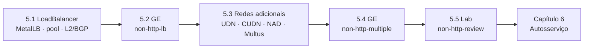

# Capítulo 5 — Exposing Non-HTTP/SNI Applications

**Título em português:** Expor aplicações não HTTP/SNI
**Status da documentação:** ✅ concluído e validado
**Referência:** PDF p. 199–244

## Objetivo do capítulo

Expor aplicações ao acesso externo **sem usar um ingress controller** e ligar Pods a
redes adicionais.

## Por que este capítulo importa

Routes resolvem HTTP e TLS com SNI, mas bancos de dados, SSH, LDAP, e-mail e vídeo
precisam de IP e porta próprios. Além disso, algumas cargas precisam de **outra rede**:
isolada do restante do cluster (inquilinos) ou ligada diretamente a uma rede física. Este
capítulo cobre as duas necessidades: Services `LoadBalancer` (com MetalLB em bare metal) e
redes adicionais com UDN, CUDN e NAD.

## Seções e atividades (ordem oficial)

| Seção | Tipo | Título original | Material | PDF |
|-------|------|-----------------|----------|-----|
| 5.1 | Conceito | Load Balancer Services | [lição](5.1-servicos-load-balancer.md) | p. 200–206 |
| 5.2 | Guided Exercise | Configure Load Balancer Services | [prática](PRATICA-OFICIAL.md#52-guided-exercise-configure-load-balancer-services) | p. 207–212 |
| 5.3 | Conceito | Configure Additional Pod Networks | [lição](5.3-redes-adicionais-de-pods.md) | p. 213–224 |
| 5.4 | Guided Exercise | Configure Additional Pod Networks | [prática](PRATICA-OFICIAL.md#54-guided-exercise-configure-additional-pod-networks) | p. 225–233 |
| 5.5 | Lab | Expose Non-HTTP/SNI Applications | [prática](PRATICA-OFICIAL.md#55-lab-expose-non-httpsni-applications) | p. 234–243 |
| 5.6 | Summary | Summary | [RESUMO.md](RESUMO.md) | p. 244 |

Abertura do capítulo (meta e seções): PDF p. 199. Não há quiz neste capítulo.

## Arquivos do capítulo

- [PRATICA-OFICIAL.md](PRATICA-OFICIAL.md): ponte com as atividades oficiais e armadilhas do ambiente.
- [REVISAO.md](REVISAO.md): questões autorais integradas.
- [RESUMO.md](RESUMO.md): síntese, comandos e divergências do PDF.

## Pré-requisitos recomendados

[DO180 · 4.5 — Services](https://github.com/eduardoandradej/openshift-do180-4.22-estudos/blob/main/capitulos/04-deploy-e-redes/4.5-redes-de-pods-e-services.md) ·
[DO180 · F6 — Redes e serviços](https://github.com/eduardoandradej/openshift-do180-4.22-estudos/blob/main/01-fundamentos-essenciais/06-redes-e-servicos.md) ·
[4.3 — Network policies](../04-seguranca-de-rede/4.3-network-policies.md) ·
[3.3 — RBAC](../03-autenticacao-autorizacao/3.3-permissoes-com-rbac.md)

## Checklist do aluno

- [ ] 5.1 lida e Parte F respondida
- [ ] 5.2 Guided Exercise `non-http-lb` concluído
- [ ] 5.3 lida e Parte F respondida
- [ ] 5.4 Guided Exercise `non-http-multiple` concluído
- [ ] 5.5 Lab `non-http-review` com `lab grade` aprovado
- [ ] [REVISAO.md](REVISAO.md) respondida
- [ ] Registro no [diário de laboratórios](../../progresso/diario-de-laboratorios.md)

---
[← Capítulo 4](../04-seguranca-de-rede/README.md) | [Índice geral](../../README.md) | [Próximo: 5.1 Services LoadBalancer →](5.1-servicos-load-balancer.md)
