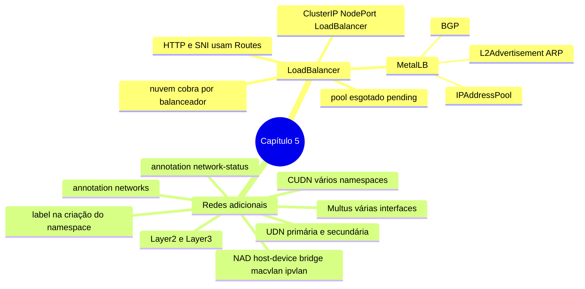

# Resumo — Capítulo 5

Síntese autoral para revisão rápida. Correspondência oficial: seção 5.6 (PDF p. 244).

## Em uma frase por seção

| Seção | Ideia central |
|-------|---------------|
| 5.1 | Protocolos que não são HTTP nem TLS com SNI precisam de IP e porta próprios: Services `LoadBalancer`, implementados pela nuvem ou, em bare metal, pelo MetalLB a partir de um pool finito de IPs |
| 5.3 | Pods podem ter redes além da padrão: UDN/CUDN (isolamento gerenciado pelo OVN-Kubernetes, primária ou secundária, label na criação do namespace) e NAD (CNI para redes físicas, anexada por anotação) |

## Mapa do capítulo

## Tabela de comandos do capítulo

| Tarefa | Comando | Tipo |
|--------|---------|------|
| Service LoadBalancer | `oc expose deployment/<d> --type LoadBalancer [--name] [--port] [--target-port]` | ✏️ |
| IP externo | `oc get svc <s>` · `-o jsonpath='{.status.loadBalancer.ingress[0].ip}'` | 🔍 |
| Testar porta | `nc -vz <ip> <porta>` | 🔍 |
| MetalLB | `oc get metallb,ipaddresspool,l2advertisement -n metallb-system` | 🔍 |
| Namespace para UDN primária | `oc create -f <namespace-com-label>.yaml` | ✏️ |
| UDN / CUDN | `oc apply -f udn.yaml` · `oc get userdefinednetwork -n <ns>` · `oc describe clusteruserdefinednetwork <c>` | ✏️ / 🔍 |
| NADs | `oc get net-attach-def [-A] [-l k8s.ovn.org/user-defined-network]` | 🔍 |
| Redes do Pod | `oc get pod 
 -o jsonpath='{.metadata.annotations.k8s\.v1\.cni\.cncf\.io/network-status}'` | 🔍 |
| Interface no nó | `oc debug node/<nó> -- chroot /host ip addr show <if>` | 🔍 |

## Alertas operacionais

- ⚠️ Prefira Routes; `LoadBalancer` consome um IP por serviço (e custo na nuvem).
- ⚠️ Pool esgotado ⇒ `<pending>`.
- ⚠️ Label de UDN primária só na **criação** do namespace; sem UDN, nenhum Pod sobe.
- ⚠️ Nomes de UDN/CUDN únicos (a CUDN cria NADs com o mesmo nome).
- ⚠️ Anotação de redes no **template** do Pod, sem espaços na lista.
- ⚠️ `host-device`: um Pod por interface; `strategy: Recreate`.
- ⚠️ Em ROSA/ARO/OSD, bridge/MACVLAN/IPVLAN/host-device não são suportados; use UDN Layer2.

## Divergências registradas em relação à apostila

| Ponto | Apostila | Comportamento correto / observação |
|-------|----------|------------------------------------|
| Topologias de UDN (p. 215) | "IP da sub-rede do nó, uma sub-rede por nó" para UDNs em geral | Isso é a topologia Layer3; na Layer2 uma sub-rede serve todos os nós (API do OVN-Kubernetes) |
| Nome da UDN nos exemplos (p. 217–218) | Manifesto cria `my-udn`; o comando seguinte consulta `primary-udn` | Inconsistência de exemplo; use o nome que você criou |

## Ligação com o próximo capítulo

Com identidades, permissões e rede sob controle, o Capítulo 6 (*Enabling Developer
Self-service*) trata de deixar as equipes se servirem com segurança: quotas, limit ranges,
template de projeto e o papel `self-provisioner`.

---
[← Revisão](REVISAO.md) | [Índice do capítulo](README.md) | [Próximo capítulo →](../06-autosservico/README.md)
