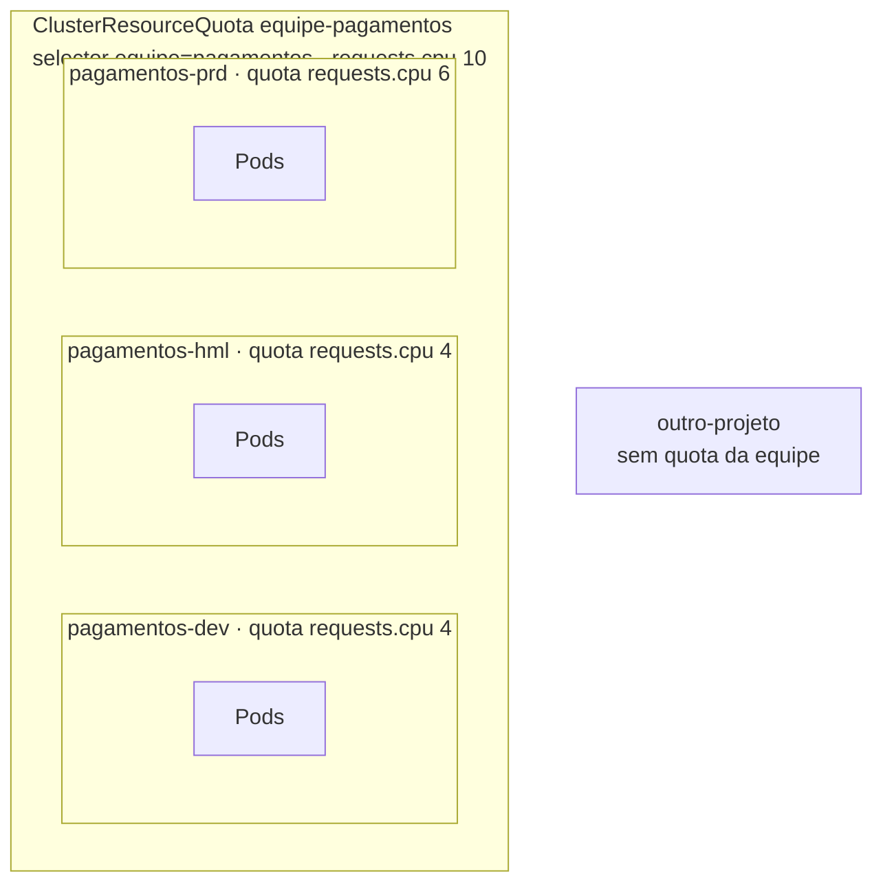
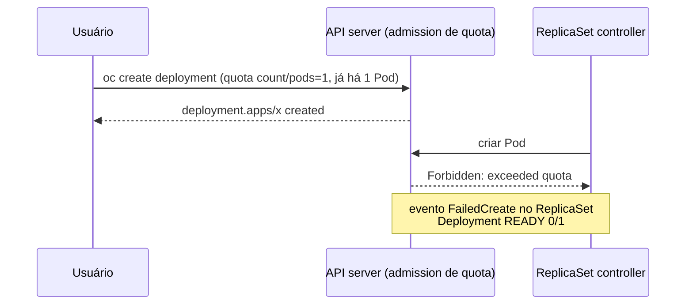

# 6.1 — Quotas de projeto e de cluster

| Campo | Valor |
|-------|-------|
| Curso | DO280 — OpenShift 4.22 |
| Capítulo / seção | Capítulo 6 · Seção 6.1 |
| Título original | Project and Cluster Quotas |
| Título em português | Quotas de projeto e de cluster |
| Objetivo | Configurar quotas de recursos de computação e de contagem de objetos por projeto e para vários projetos |
| Referência | PDF p. 246–255 · Guided Exercise 6.2 p. 256–262 |

## Pré-requisitos e conhecimentos anteriores

No DO180 você aprendeu que **requests** são a reserva usada pelo scheduler para escolher
o nó e que **limits** são o teto de consumo de cada container (memória acima do limit →
`OOMKilled`; CPU acima → throttling). Também viu `FailedScheduling` quando a soma dos
requests não cabe no *allocatable* do nó. Do [Capítulo 3](../03-autenticacao-autorizacao/README.md),
lembre que RBAC decide **o que** cada um pode criar — não **quanto**. Esta lição trata
do "quanto".

| Conceito | Onde revisar |
|----------|--------------|
| Requests, allocatable e `FailedScheduling` | [DO180 · 6.5 — Reservar capacidade de computação](https://github.com/eduardoandradej/openshift-do180-4.22-estudos/blob/main/capitulos/06-confiabilidade/6.5-reservar-capacidade-de-computacao.md) |
| Limits, `OOMKilled`, throttling | [DO180 · 6.7 — Limitar capacidade de computação](https://github.com/eduardoandradej/openshift-do180-4.22-estudos/blob/main/capitulos/06-confiabilidade/6.7-limitar-capacidade-de-computacao.md) |
| `oc api-resources`, grupos de API | [DO180 · 2.3 — Inspecionar recursos](https://github.com/eduardoandradej/openshift-do180-4.22-estudos/blob/main/capitulos/02-cli-e-apis/2.3-inspecionar-recursos-kubernetes.md) |
| Eventos e `oc describe` | [DO180 · 3.5 — Diagnosticar containers e Pods](https://github.com/eduardoandradej/openshift-do180-4.22-estudos/blob/main/capitulos/03-containers-e-pods/3.5-diagnosticar-containers-e-pods.md) |
| RBAC e papéis de projeto | [3.3 — Permissões com RBAC](../03-autenticacao-autorizacao/3.3-permissoes-com-rbac.md) |

## Parte A — Entendendo o conceito

### O problema: requests e limits protegem Pods, não o cluster

Requests e limits fazem cada workload "se comportar": reservam o mínimo e impedem que um
Pod com defeito consuma o nó. Mas eles **não** limitam **quantos** workloads alguém cria.
Um usuário pode, por engano, criar dezenas de réplicas que pedem 1 CPU cada; os requests
delas ocupam o cluster e workloads legítimos de **outros** projetos ficam `Pending` (o
Guided Exercise 6.2 mostra exatamente isso). Em clusters com autoescala, isso ainda vira
**custo**.

### A solução: ResourceQuota por namespace

Uma **ResourceQuota** é um recurso de **namespace** que define tetos para a **soma** do
que os workloads daquele namespace pedem ou criam. Diferentemente de sistemas que aplicam
quota a usuários, no Kubernetes a quota é **do namespace**. Quando existe, o API server
**recusa** criar o que ultrapassaria o teto.

```yaml
apiVersion: v1
kind: ResourceQuota
metadata:
  name: computacao
  namespace: loja
spec:
  hard:                     # tetos por recurso
    requests.cpu: "4"
    requests.memory: 8Gi
    limits.cpu: "8"
    limits.memory: 16Gi
    pods: "20"
```

`spec.scopes` e `spec.scopeSelector` restringem a quota a subconjuntos de objetos; o curso
não os cobre.

### Quotas de computação

| Chave | O que soma |
|-------|-----------|
| `requests.cpu` / `requests.memory` | Os **requests** de todos os containers do namespace (o que eles **reservam**) |
| `limits.cpu` / `limits.memory` | Os **limits** de todos os containers (o máximo que podem **consumir** juntos) |
| `pods` | Quantidade de Pods |

Regra que surpreende: **com uma quota de computação, todo container precisa declarar o
request/limit correspondente.** Com `limits.cpu` na quota, um Pod sem `resources.limits.cpu`
é recusado (`must specify limits.cpu`), porque o cluster não consegue calcular quanto ele
consome da quota. A seção 6.3 mostra como **limit ranges** resolvem isso com valores
padrão.

Quotas generosas demais deixam de proteger; apertadas demais subutilizam o cluster e
travam aplicações. Dimensione com base no uso real.

### Quotas de contagem de objetos

Limitam **quantos objetos** de um tipo podem existir no namespace — por exemplo, no máximo
10 Deployments. Motivos:

- o banco do cluster (etcd) perde desempenho com objetos demais; a Red Hat publica limites
  validados de objetos para dimensionamento;
- processos automáticos com defeito podem criar objetos sem parar;
- alguns objetos têm efeito **externo** (um PVC pode criar um volume no storage; um Service
  `LoadBalancer`, um balanceador cobrado).

Sintaxe:

| Grupo do recurso | Chave | Exemplo |
|------------------|-------|---------|
| core (grupo vazio) | `count/<recurso>` | `count/pods`, `count/secrets`, `count/persistentvolumeclaims` |
| outros grupos | `count/<recurso>.<grupo>` | `count/deployments.apps`, `count/routes.route.openshift.io` |
| forma antiga (alguns tipos) | nome simples | `services`, `secrets`, `persistentvolumeclaims` |

Use `oc api-resources --api-group="" --namespaced=true` para ver os recursos do grupo core
e a coluna `APIVERSION` para descobrir o grupo dos demais.

> ⚠️ **Quotas não são validadas semanticamente.** `count/deployment=1` (singular, sem o
> grupo `apps`) é aceita e **não tem efeito nenhum**. A quota correta é
> `count/deployments.apps`. Sempre confira o `status` da quota: se ela mostra `0` usado
> enquanto existem objetos daquele tipo, a chave está errada.

### Como a quota se manifesta

- **Erro imediato**: criar algo que a quota controla diretamente (ex.: um Deployment
  acima de `count/deployments.apps`) falha na hora com `exceeded quota`.
- **Efeito indireto**: com quota de **Pods** ou de computação, o **Deployment** é criado
  normalmente, mas o **ReplicaSet** não consegue criar os Pods. O sinal está nos
  **eventos** (`FailedCreate ... is forbidden: exceeded quota` ou `failed quota ... must
  specify requests.cpu`), e o Deployment fica com `READY` abaixo do desejado.
- Atualizações (rollout) criam um ReplicaSet novo enquanto o antigo ainda existe: os Pods
  dos **dois** contam na quota; se a soma não couber, o rollout não termina.

Onde observar: `oc get quota`, `oc describe quota`, o `status` (`hard` × `used`), a
console (**Administration › ResourceQuotas** e a página do projeto) e a métrica
`kube_resourcequota` em **Observe › Metrics**, útil para tendência e planejamento.

### ClusterResourceQuota: quota para vários projetos

Uma equipe costuma ter vários projetos. Quotas por namespace limitam cada um, mas não o
**total** da equipe — e a equipe pode simplesmente criar mais projetos. A
**ClusterResourceQuota** (`quota.openshift.io/v1`, recurso do OpenShift, de **cluster**)
aplica um teto à **soma** de vários namespaces escolhidos por **selector** de labels (ou
anotações):

```yaml
apiVersion: quota.openshift.io/v1
kind: ClusterResourceQuota
metadata:
  name: equipe-pagamentos
spec:
  quota:
    hard:                   # aninhado em spec.quota (não direto em spec)
      requests.cpu: "10"
      requests.memory: 20Gi
  selector:
    labels:
      matchLabels:
        equipe: pagamentos
```

O `status` mostra o uso **por namespace** e o **total**. Usuários comuns normalmente não
leem ClusterResourceQuotas; o OpenShift cria em cada namespace afetado um
**AppliedClusterResourceQuota**, que o administrador do projeto pode consultar
(`oc describe AppliedClusterResourceQuota -n <ns>`). Esse tipo **não** funciona com
`--all-namespaces`: consulte namespace por namespace.

Na console, **Administration › ResourceQuotas** **mostra** cluster quotas junto das
quotas de namespace, mas só **cria** ResourceQuotas; ClusterResourceQuotas são criadas pela
CLI ou em **Administration › CustomResourceDefinitions**.

## Parte B — Modelo mental e arquitetura





## Parte C — Aplicação prática

> Legenda: 🔍 somente leitura · ✏️ altera o cluster
>
> Manifestos autorais e validados em
> [exemplos-originais/autosservico](../../exemplos-originais/autosservico/).

### 1. Medir antes de limitar 🔍

```bash
oc adm top node                          # uso real (administrador)
oc describe node <nó>                     # Allocatable e "Allocated resources" (requests e limits somados)
oc adm top pod -n <projeto>
```

### 2. Criar uma quota: `oc create quota` ✏️

```bash
oc create quota computacao -n loja \
  --hard requests.cpu=4,requests.memory=8Gi,limits.cpu=8,limits.memory=16Gi
oc create quota objetos -n loja \
  --hard count/pods=20,count/deployments.apps=10,count/persistentvolumeclaims=5
oc create resourcequota --help             # exemplos; "quota" é nome curto
```

- **Permissões:** criar ResourceQuotas no namespace. Nos papéis padrão do Kubernetes
  (`admin`, `edit`, `view`), quotas são apenas **lidas** (📘 política RBAC de bootstrap do
  Kubernetes): normalmente quem as cria é o administrador do cluster. Confira com
  `oc auth can-i create resourcequota -n <ns>`.
- **Resultado:** `resourcequota/computacao created`.
- **Forma declarativa:** o YAML da Parte A com `oc apply -f`.

### 3. Conferir uso e eficácia 🔍

```bash
oc get quota -n loja                       # REQUEST / LIMIT como usado/teto
oc describe quota computacao -n loja       # tabela Resource · Used · Hard
oc get quota objetos -n loja -o yaml       # spec.hard × status.used
```

Se uma chave aparece com `0` usado enquanto existem objetos daquele tipo, a chave está
errada (ex.: `count/deployment`). Para ter certeza de que uma quota funciona: meça o uso
atual antes de defini-la, teste-a com um valor **artificialmente baixo** em um ambiente de
teste até vê-la barrar algo e confira o `status` depois de aplicá-la.

### 4. Diagnosticar workloads barrados 🔍

```bash
oc get deployment -n loja                  # READY abaixo do desejado
oc events -n loja                          # FailedCreate ... exceeded quota / must specify ...
oc get event -n loja --sort-by .metadata.creationTimestamp
```

### 5. ClusterResourceQuota (administrador do cluster) ✏️

```bash
oc label namespace pagamentos-dev equipe=pagamentos
oc create clusterresourcequota equipe-pagamentos \
  --project-label-selector equipe=pagamentos --hard requests.cpu=10,requests.memory=20Gi
oc get clusterresourcequota equipe-pagamentos -o yaml       # status.namespaces[] e status.total
oc describe AppliedClusterResourceQuota -n pagamentos-dev   # visão do projeto
```

`--project-label-selector` (ou `--project-annotation-selector`) aceita `=` ou espaço
entre a opção e o valor.

### Raciocínio operacional e diagnóstico

| Sintoma | Hipótese | Como confirmar | Correção segura |
|---------|----------|----------------|-----------------|
| Pods `Pending` com `Insufficient cpu`, sem quota | Requests de outro projeto ocupam o nó | `oc describe node` (Allocated resources) | Quota de requests no projeto que exagera; ajustar requests |
| `oc create deployment` falha com `exceeded quota` | Quota de contagem atingida | `oc describe quota` | Remover objetos ou ajustar a quota (administrador) |
| Deployment criado, mas `READY 0/N` | Quota de Pods/computação barrando o ReplicaSet | `oc events` (`FailedCreate`) | Ajustar réplicas/quota |
| `failed quota: ... must specify requests.cpu` | Quota de computação e container sem request/limit | Evento do ReplicaSet | `oc set resources` ou limit range com padrões (6.3) |
| Quota "não funciona" | Chave errada (`count/deployment`), sem efeito | `status.used` em `0` com objetos existentes | `count/deployments.apps` |
| Rollout trava no meio | ReplicaSet novo + antigo excedem a quota | `oc rollout status`; `oc describe quota` | Folga na quota, ou estratégia que reduza sobreposição |
| Usuário não enxerga a cluster quota | Sem permissão de leitura de ClusterResourceQuota | `oc get clusterresourcequota` → `Forbidden` | Ler `AppliedClusterResourceQuota` no namespace |
| `oc get appliedclusterresourcequota -A` não lista nada | Não suportado com `--all-namespaces` | — | Consultar com `-n` |

## Parte D — Relações importantes

| A | B | Diferença essencial |
|---|---|--------------------|
| Request/limit do container | ResourceQuota | Por container × soma do namespace |
| `requests.*` na quota | `limits.*` na quota | Teto do que se **reserva** × teto do que se pode **consumir** |
| Quota de computação | Quota de contagem | CPU/memória somadas × número de objetos |
| `count/pods` | `count/deployments.apps` | Grupo core (sem sufixo) × outros grupos (`.grupo`) |
| ResourceQuota | ClusterResourceQuota | Um namespace × vários namespaces por selector (OpenShift) |
| ClusterResourceQuota | AppliedClusterResourceQuota | Definição (cluster, administrador) × visão por namespace (leitura do projeto) |
| Quota | Limit range (6.3) | Teto do namespace inteiro × regras/padrões por container |
| Quota | RBAC (3.3) | Quanto pode criar × o que pode criar |

## Parte E — Preparação para o laboratório oficial

Atividade associada: **6.2 Guided Exercise — Project and Cluster Quotas**
(`selfservice-quotas`, PDF p. 256–262).

Você deve conseguir, sem consultar a lição:

- reconhecer, pelos eventos e pelo `oc describe node`, que requests de um projeto impedem
  workloads de outro;
- criar uma quota de requests de CPU e prever o que acontece ao escalar e ao criar um
  Deployment sem request;
- comprovar que outros projetos continuam funcionando.

Detalhes e armadilhas em
[PRATICA-OFICIAL.md](PRATICA-OFICIAL.md#62-guided-exercise-project-and-cluster-quotas).

## Parte F — Fixação

1. Por que requests e limits não bastam para proteger o cluster de um projeto descuidado?
2. Um projeto tem quota `limits.memory: 4Gi`. Um Deployment sem `resources` é criado. O que acontece?
3. Qual a chave correta para limitar Deployments a 5 em um namespace? E Routes?
4. A quota `count/deployment: "3"` existe, há 5 Deployments e nada foi barrado. Por quê?
5. Com quota de `pods: "2"`, você cria um Deployment de 3 réplicas. O `oc create` falha? Onde aparece o problema?
6. Para que serve uma ClusterResourceQuota, e como o administrador do projeto vê o uso dela?
7. Por que um rollout pode travar mesmo que a nova versão, sozinha, caiba na quota?

<details>
<summary>Respostas comentadas</summary>

1. Eles limitam cada container, mas não a quantidade de workloads; requests de muitas réplicas podem ocupar o cluster e barrar outros projetos.
2. O Deployment é criado, mas os Pods são recusados (`must specify limits.memory`): com quota de computação, todo container precisa declarar o recurso correspondente (ou receber um padrão de um limit range).
3. `count/deployments.apps: "5"` e `count/routes.route.openshift.io`.
4. A chave está errada (singular, sem grupo); quotas não são validadas semanticamente, então ela é aceita e ignorada. Use `count/deployments.apps`.
5. Não falha: o Deployment é criado e o ReplicaSet só consegue 2 Pods. O problema aparece nos eventos (`FailedCreate ... exceeded quota`) e no `READY 2/3`.
6. Para limitar a soma de vários namespaces (por exemplo, todos de uma equipe), escolhidos por labels. O administrador do projeto consulta `oc describe AppliedClusterResourceQuota -n <ns>`.
7. Durante o rollout, os Pods do ReplicaSet novo e do antigo coexistem e somam na quota.

</details>

## Parte G — Essencial para memorizar

- Quota é do **namespace** (soma de tudo nele); ClusterResourceQuota soma **vários** namespaces (selector).
- Computação: `requests.cpu|memory`, `limits.cpu|memory`, `pods`. Com quota de computação, todo container precisa declarar o recurso.
- Contagem: `count/<recurso>` (core) · `count/<recurso>.<grupo>` (outros). Quota com chave errada é aceita e não faz nada.
- `oc create quota <q> --hard k=v,...` · `oc get|describe quota` · `status.used` × `hard`.
- Barrado direto = erro no comando; barrado indireto = evento `FailedCreate` no ReplicaSet.
- `oc create clusterresourcequota <c> --project-label-selector k=v --hard ...`; projeto vê `AppliedClusterResourceQuota` (sem `-A`).
- Rollout: ReplicaSets novo + antigo somam na quota.

---
[← Índice do capítulo](README.md) | [Índice do capítulo](README.md) | [Próximo: 6.3 Limit ranges →](6.3-limit-ranges.md)
