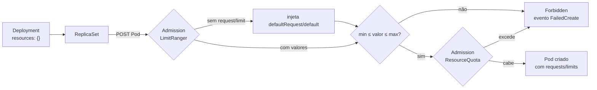

# 6.3 — Restrições de recursos por projeto: limit ranges

| Campo | Valor |
|-------|-------|
| Curso | DO280 — OpenShift 4.22 |
| Capítulo / seção | Capítulo 6 · Seção 6.3 |
| Título original | Per-project Resource Constraints: Limit Ranges |
| Título em português | Restrições de recursos por projeto: limit ranges |
| Objetivo | Configurar requisitos padrão e máximos de recursos de computação dos Pods de cada projeto |
| Referência | PDF p. 263–266 · Guided Exercise 6.4 p. 267–277 |

## Pré-requisitos e conhecimentos anteriores

Requests e limits por container vêm do DO180; a quota por namespace, da
[lição 6.1](6.1-quotas-de-projeto-e-cluster.md). Lembre o problema que ficou aberto lá:
**com quota de computação, um container sem request/limit é recusado.** Limit ranges
resolvem isso e ainda impõem mínimos e máximos.

| Conceito | Onde revisar |
|----------|--------------|
| Requests e unidades (`m`, `Mi`, `Gi`) | [DO180 · 6.5 — Reservar capacidade de computação](https://github.com/eduardoandradej/openshift-do180-4.22-estudos/blob/main/capitulos/06-confiabilidade/6.5-reservar-capacidade-de-computacao.md) |
| Limits e `oc set resources` | [DO180 · 6.7 — Limitar capacidade de computação](https://github.com/eduardoandradej/openshift-do180-4.22-estudos/blob/main/capitulos/06-confiabilidade/6.7-limitar-capacidade-de-computacao.md) |
| Deployment → ReplicaSet → Pod | [DO180 · 4.3 — Workloads de longa e curta duração](https://github.com/eduardoandradej/openshift-do180-4.22-estudos/blob/main/capitulos/04-deploy-e-redes/4.3-workloads-de-longa-e-curta-duracao.md) |
| ResourceQuota | [6.1 — Quotas de projeto e de cluster](6.1-quotas-de-projeto-e-cluster.md) |

## Parte A — Entendendo o conceito

### Quota é do administrador do cluster; o projeto precisa de mais

A quota limita o **total** do namespace. Dentro dele ainda sobram problemas:

- um único workload exagerado pode consumir a quota inteira e impedir os outros;
- desenvolvedores esquecem (ou acham trabalhoso) declarar requests e limits, e com quota os
  Pods são recusados;
- ferramentas de CI criam workloads automaticamente, sem `resources`.

O **LimitRange** é um objeto de **namespace** (`v1`) que define regras **por item**
(container, Pod, PVC etc.) dentro do projeto.

### Os tipos de valor

| Chave | Efeito |
|-------|--------|
| `default` | **Limit** injetado quando o container não declara limit |
| `defaultRequest` | **Request** injetado quando o container não declara request |
| `max` | Teto para request **e** limit de cada item |
| `min` | Piso para request **e** limit de cada item |
| `maxLimitRequestRatio` | Razão máxima limit/request (o curso não cobre) |

`type` diz a que o item se aplica: `Container`, `Pod`, `PersistentVolumeClaim` e, no
OpenShift, também imagens e image streams (`openshift.io/Image`,
`openshift.io/ImageStream`). Os padrões (`default`/`defaultRequest`) só fazem sentido para
`Container`.

```yaml
apiVersion: v1
kind: LimitRange
metadata:
  name: padroes
  namespace: loja
spec:
  limits:
  - type: Container
    default:          # limit padrão
      cpu: 500m
      memory: 512Mi
    defaultRequest:   # request padrão
      cpu: 250m
      memory: 256Mi
    max:
      cpu: "1"
      memory: 1Gi
    min:
      cpu: 100m
      memory: 128Mi
```

### Por que mínimo e máximo

- `max` impede que um workload sozinho esgote a quota; apertado demais, bloqueia workloads
  legítimos.
- `min` evita subdimensionamento (um container com 1 MiB de memória não sobe).

### Padrões: o par natural da quota

Com padrões, o OpenShift **injeta** request e limit nos containers que não os declaram, e
eles passam a ser aceitos pela quota. O lado ruim: um padrão único em um namespace com
workloads muito diferentes pode reservar demais para os pequenos e de menos para os grandes.
Meça o uso real antes de escolher valores (o Guided Exercise 6.4 mostra um Pod usando cerca
de 50 MiB com request padrão de 256 MiB).

### Onde e quando o limit range age

- Ele é aplicado por um **admission controller** do API server **na criação do Pod**. O
  Deployment continua com `resources: {}`; só o **Pod** recebe os valores.
- **Pods existentes não mudam.** Para aplicar os padrões a um Deployment antigo é preciso
  recriar os Pods (novo rollout ou apagar e recriar o Deployment).
- Fora de `min`/`max`, o Pod é **recusado**; como quem cria o Pod é o ReplicaSet, o sinal
  está nos **eventos** (`minimum cpu usage per Container is 125m, but request is 100m`).

### Regras de consistência

Para cada recurso (CPU, memória):

```text
max  ≥  default  ≥  defaultRequest  ≥  min
```

Você pode declarar qualquer combinação das quatro chaves. Se `default` ou `defaultRequest`
faltarem, o Kubernetes os **preenche** a partir de `max`/`min`. Para um comportamento
previsível, declare sempre `default` e `defaultRequest` quando usar `min` ou `max`.

> 📘 **Fonte externa (código do Kubernetes, `SetDefaults_LimitRangeItem`, verificado no
> branch `release-1.35`):** a ordem é `default ← max`; depois `defaultRequest ← default`;
> só então `defaultRequest ← min`. Consequência: com **apenas** `min` e `max`, o
> `defaultRequest` vira o **max**, não o min — todo container sem `resources` reserva o
> máximo. Isso detalha a frase da apostila ("copia de `min` ou de `max`").

Não crie limit ranges **conflitantes** no mesmo namespace (dois `default` de CPU
diferentes): o resultado deixa de ser previsível.

### Rollouts e quota (nota da apostila)

Ao alterar um Deployment (por exemplo, com `oc set resources`), o ReplicaSet novo convive
com o antigo até o fim do rollout. Os Pods dos dois contam na quota: se a soma não couber,
o rollout não termina, mesmo que a versão nova sozinha caiba.

## Parte B — Modelo mental e arquitetura



O limit range age **antes** da conferência de quota: por isso os padrões tornam o Pod
"contável" pela quota.

## Parte C — Aplicação prática

> Legenda: 🔍 somente leitura · ✏️ altera o cluster
>
> Manifestos autorais e validados em
> [exemplos-originais/autosservico](../../exemplos-originais/autosservico/).

### 1. Criar o limit range ✏️

Não há `oc create limitrange`: use um manifesto.

```bash
oc apply -f limitrange-padroes.yaml
```

- **Permissões:** criar LimitRanges no namespace. Nos papéis padrão do Kubernetes
  (`admin`, `edit`, `view`), LimitRanges e ResourceQuotas são apenas **lidos** (📘 política
  RBAC de bootstrap do Kubernetes); quem os cria costuma ser o administrador do cluster ou o
  [template de projeto](6.5-template-de-projeto-e-self-provisioner.md). Confira no seu
  cluster com `oc auth can-i create limitrange -n <ns>`.
- **Console:** **Administration › LimitRanges › Create LimitRange** abre um YAML de
  exemplo (padrões de memória).
- **Resultado:** `limitrange/padroes created`.

### 2. Consultar 🔍

```bash
oc get limitrange -n loja
oc describe limitrange padroes -n loja     # tabela Type · Resource · Min · Max · Default Request · Default Limit
oc get limitrange padroes -n loja -o yaml  # mostra também os campos preenchidos automaticamente
```

### 3. Confirmar a injeção no Pod 🔍

```bash
oc create deployment web --image <imagem> -n loja
oc get deployment web -n loja -o jsonpath='{.spec.template.spec.containers[0].resources}{"\n"}'   # {}
oc describe pod -l app=web -n loja | grep -A6 Limits                                             # valores do limit range
```

### 4. Ajustar recursos de um workload ✏️

```bash
oc set resources deployment web -n loja --requests cpu=300m --limits cpu=800m,memory=600Mi
```

Gera novo rollout. Se o valor violar `min`/`max`, o ReplicaSet novo não cria Pods e o
evento explica o motivo.

### 5. Diagnóstico 🔍

```bash
oc events -n loja           # minimum ... per Container / maximum ... per Container / must specify ...
oc get rs -n loja           # ReplicaSet novo com DESIRED > CURRENT
```

### Raciocínio operacional e diagnóstico

| Sintoma | Hipótese | Como confirmar | Correção segura |
|---------|----------|----------------|-----------------|
| Pods recusados com `must specify limits.cpu` | Quota sem limit range de padrões | `oc events`; `oc get limitrange` vazio | LimitRange com `default`/`defaultRequest` |
| Limit range criado, Pods antigos sem valores | Admission só age na criação | `oc describe pod` | Novo rollout (`oc rollout restart`) ou recriar |
| Deployment com `resources: {}`, Pod com valores | Comportamento normal | Comparar Deployment × Pod | Nada a corrigir |
| `minimum cpu usage per Container is ...` | Valor abaixo de `min` | Evento do ReplicaSet | Ajustar `oc set resources` |
| `maximum memory usage per Container is ...` | Valor acima de `max` | Evento | Reduzir o valor ou rever o `max` |
| Containers sem `resources` reservando demais | `defaultRequest` herdado do `max` | `oc get limitrange -o yaml` | Declarar `defaultRequest` explicitamente |
| Rollout parado após `oc set resources` | RS novo + antigo excedem a quota | `oc describe quota` | Folga na quota |
| Padrões imprevisíveis | Dois limit ranges conflitantes | `oc get limitrange` | Manter um só por tipo/recurso |

## Parte D — Relações importantes

| A | B | Diferença essencial |
|---|---|--------------------|
| ResourceQuota | LimitRange | Soma do namespace × regras por item |
| `default` | `defaultRequest` | Limit injetado × request injetado |
| `min`/`max` | `default`/`defaultRequest` | Valida (recusa) × preenche (injeta) |
| Deployment | Pod | Template sem alteração × objeto que recebe os valores |
| Limit range novo | Pods existentes | Só vale para Pods criados depois |
| Administrador do cluster | Template de projeto (6.5) | Cria quota/limit range em um projeto × em todo projeto novo |

## Parte E — Preparação para o laboratório oficial

Atividade associada: **6.4 Guided Exercise — Per-project Resource Constraints: Limit
Ranges** (`selfservice-ranges`, PDF p. 267–277), feita principalmente pela **console**.

Você deve conseguir, sem consultar a lição:

- comprovar que containers, por padrão, não têm requests nem limits;
- criar um limit range e prever que Pods já existentes não mudam;
- mostrar que o Deployment continua sem `resources` enquanto os Pods novos têm valores;
- comparar o uso real do Pod com o request padrão (aba **Metrics**).

Detalhes e armadilhas em
[PRATICA-OFICIAL.md](PRATICA-OFICIAL.md#64-guided-exercise-per-project-resource-constraints-limit-ranges).

## Parte F — Fixação

1. Qual problema da quota de computação o limit range resolve?
2. Um limit range é criado em um projeto que já tem 5 Pods sem `resources`. O que muda neles?
3. Depois de criar o limit range, você abre o YAML do Deployment e vê `resources: {}`. Está errado?
4. Um limit range tem `min.cpu: 125m`. Você aplica `oc set resources ... --requests cpu=100m`. O que acontece e onde você vê?
5. Um limit range declara só `min` e `max` de memória. Qual request um container sem `resources` recebe?
6. Por que um padrão de 256Mi pode atrapalhar mesmo que todos os Pods subam?
7. Como garantir que **todo** projeto novo já nasça com um limit range?

<details>
<summary>Respostas comentadas</summary>

1. Com quota de computação, containers sem request/limit são recusados; os padrões do limit range os preenchem automaticamente.
2. Nada: o admission controller só age na criação de Pods. Eles recebem valores quando forem recriados.
3. Não. O limit range altera o **Pod**, não o Deployment.
4. O ReplicaSet novo não consegue criar Pods; o evento diz `minimum cpu usage per Container is 125m, but request is 100m`. O rollout não avança.
5. O **max**: `default` herda de `max` e `defaultRequest` herda de `default`. Por isso convém declarar os padrões.
6. Se os workloads usam bem menos, os requests padrão consomem a quota (e a capacidade reservada do nó) sem uso real; novos workloads podem ser barrados.
7. Incluindo o LimitRange no template de projeto (seção 6.5).

</details>

## Parte G — Essencial para memorizar

- LimitRange: objeto de namespace, regras **por item** (`type: Container`, `Pod`, `PersistentVolumeClaim`...).
- `default` = limit padrão · `defaultRequest` = request padrão · `min`/`max` = recusam fora da faixa.
- `max ≥ default ≥ defaultRequest ≥ min`. Sem padrões: `default ← max`, `defaultRequest ← default`, depois `← min`.
- Age no **Pod**, na **criação** (admission). Deployment fica com `resources: {}`; Pods antigos não mudam.
- Erros aparecem nos **eventos** do ReplicaSet.
- Sem `oc create limitrange`: manifesto + `oc apply`; consulta com `oc describe limitrange`.

---
[← 6.1 Quotas de projeto e de cluster](6.1-quotas-de-projeto-e-cluster.md) | [Índice do capítulo](README.md) | [Próximo: 6.5 Template de projeto e self-provisioner →](6.5-template-de-projeto-e-self-provisioner.md)
