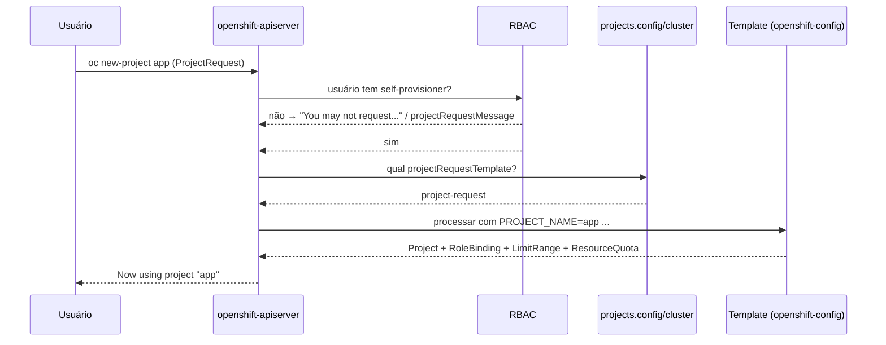
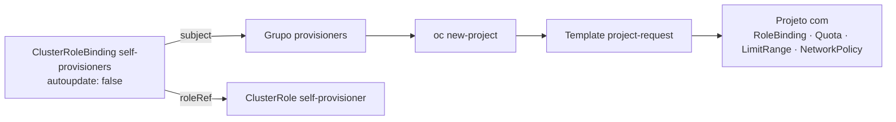

# 6.5 — O template de projeto e o papel self-provisioner

| Campo | Valor |
|-------|-------|
| Curso | DO280 — OpenShift 4.22 |
| Capítulo / seção | Capítulo 6 · Seção 6.5 |
| Título original | The Project Template and the Self-provisioner Role |
| Título em português | O template de projeto e o papel self-provisioner |
| Objetivo | Configurar quotas, limit ranges, role bindings e outras restrições padrão para projetos novos e gerenciar quem pode criar projetos |
| Referência | PDF p. 278–285 · Guided Exercise 6.6 p. 286–293 · Lab 6.7 p. 294–301 |

## Pré-requisitos e conhecimentos anteriores

Você já conhece templates do OpenShift (objetos parametrizados com `${PARAMETRO}`), do
DO180 e da [lição 2.1](../02-aplicacoes-empacotadas/2.1-templates-do-openshift.md). Do
[Capítulo 3](../03-autenticacao-autorizacao/README.md) vêm grupos, ClusterRoles, bindings
e o grupo virtual `system:authenticated:oauth`. As lições [6.1](6.1-quotas-de-projeto-e-cluster.md)
e [6.3](6.3-limit-ranges.md) deram os objetos que agora vão para **todo projeto novo**.

| Conceito | Onde revisar |
|----------|--------------|
| Templates e parâmetros | [DO180 · 4.1 — Implantar a partir de imagem e template](https://github.com/eduardoandradej/openshift-do180-4.22-estudos/blob/main/capitulos/04-deploy-e-redes/4.1-implantar-a-partir-de-imagem-e-template.md) |
| Templates no DO280 | [2.1 — Templates do OpenShift](../02-aplicacoes-empacotadas/2.1-templates-do-openshift.md) |
| ClusterRole, binding, grupos | [3.3 — Permissões com RBAC](../03-autenticacao-autorizacao/3.3-permissoes-com-rbac.md) |
| Grupos de usuários | [3.1 — Provedor de identidade HTPasswd](../03-autenticacao-autorizacao/3.1-provedor-de-identidade-htpasswd.md) |
| Network policies (candidatas ao template) | [4.3 — Network policies](../04-seguranca-de-rede/4.3-network-policies.md) |

## Parte A — Entendendo o conceito

### Por que Project e ProjectRequest existem

Namespaces são recursos **de cluster** e seus metadados têm efeito de segurança (labels
usados por controladores de política, por exemplo). Por isso não é seguro deixar usuários
comuns editarem namespaces. E o RBAC do Kubernetes não filtra listas: quem pode **listar**
namespaces vê **todos**.

O OpenShift resolve com dois tipos de API próprios:

| Recurso | Papel |
|---------|-------|
| `Project` (`project.openshift.io`) | Visão do namespace. `oc get projects` lista só os namespaces que **você** pode ver |
| `ProjectRequest` | Pedido de criação. O API server do OpenShift cria o namespace **a partir de um template** |

Resultado: **autosserviço** — usuários criam projetos sem poder mexer em metadados de
namespace, e o administrador decide o que todo projeto novo recebe. `oc new-project` e
**Create Project** na console usam `ProjectRequest`.

> ⚠️ Quem tem permissão para criar **namespaces** (`oc create namespace`) cria namespaces
> que **não** passam pelo template.

### O template padrão

```bash
oc adm create-bootstrap-project-template -o yaml > template.yaml
```

O resultado reproduz o comportamento padrão: um `Template` chamado `project-request` cujos
`objects` são:

1. o próprio `Project`, com anotações de nome de exibição, descrição e solicitante;
2. um `RoleBinding` `admin` que dá a ClusterRole `admin` ao usuário que pediu o projeto.

Parâmetros que o OpenShift preenche no pedido:

| Parâmetro | Conteúdo |
|-----------|----------|
| `PROJECT_NAME` | Nome do projeto (obrigatório) |
| `PROJECT_DISPLAYNAME` | Nome de exibição (pode ser vazio) |
| `PROJECT_DESCRIPTION` | Descrição (pode ser vazia) |
| `PROJECT_ADMIN_USER` | Usuário que será administrador |
| `PROJECT_REQUESTING_USER` | Usuário que pediu |

### O que acrescentar

Qualquer recurso **de namespace** pode entrar em `objects`:

- **Roles e role bindings** — manter o `admin` do solicitante, trocá-lo por um **grupo**, ou
  acrescentar permissões finas;
- **ResourceQuota e LimitRange** — quota em todo projeto novo; e, como quota exige
  requests/limits, um limit range com padrões para não atrapalhar quem cria workloads;
- **NetworkPolicy** — isolamento padrão da organização.

Mesmo com quota em todo projeto, usuários podem criar **mais projetos**. Se isso preocupa,
combine com **ClusterResourceQuota** (6.1) ou restrinja quem cria projetos (abaixo).

### Montar o template sem errar

Quotas não têm validação estrita: `count/pod` em vez de `count/pods` gera projetos com uma
quota **que não faz nada**. Fluxo recomendado:

1. criar um namespace de teste;
2. criar ali os recursos e **testar** até obter o comportamento desejado;
3. listá-los em YAML (`oc get limitrange,resourcequota -n <ns> -o yaml` — o `items:` da
   lista tem o mesmo formato de `objects:` do template);
4. limpar o que não serve para criação (`status`, `creationTimestamp`, `uid`,
   `resourceVersion`, anotações postas por controladores);
5. trocar o namespace por `${PROJECT_NAME}`;
6. acrescentar os itens ao template gerado pelo `create-bootstrap-project-template`;
7. depois de ativar, **criar um projeto** e confirmar o comportamento.

### Ativar o template

O template precisa estar no namespace **`openshift-config`**:

```bash
oc create -f template.yaml -n openshift-config
```

E a configuração global de projetos (`projects.config.openshift.io`, objeto `cluster`)
precisa apontar para ele:

```yaml
apiVersion: config.openshift.io/v1
kind: Project
metadata:
  name: cluster
spec:
  projectRequestTemplate:
    name: project-request
```

A alteração provoca um **rollout** do Deployment `apiserver` no namespace
`openshift-apiserver`. Só depois dele os projetos novos usam o template; durante o rollout,
requisições à API podem ter resultados inesperados. Para voltar ao padrão, deixe
`spec: {}`. Projetos **já existentes** não são alterados.

### Quem pode criar projetos: `self-provisioner`

Criar projetos exige a ClusterRole **`self-provisioner`**. Por padrão, o ClusterRoleBinding
**`self-provisioners`** a concede ao grupo `system:authenticated:oauth` — na prática, todo
usuário que entrou pelo OAuth (a apostila diz "todos os usuários autenticados"; a nuance
foi vista no [Capítulo 3](../03-autenticacao-autorizacao/3.3-permissoes-com-rbac.md)).

Esse binding tem a anotação `rbac.authorization.kubernetes.io/autoupdate: "true"`: ao
iniciar, o API server **restaura** bindings e papéis protegidos. Uma alteração feita sem
mudar a anotação para `false` dura só até o próximo reinício do API server.

Três formas de agir:

| Objetivo | Como |
|----------|------|
| Desligar o autosserviço | Anotar `autoupdate=false` e esvaziar `subjects` |
| Restringir a um grupo | Anotar `autoupdate=false` e trocar o sujeito para o grupo (ex.: `provisioners`) |
| Mudar a mensagem de recusa | `spec.projectRequestMessage` em `projects.config.openshift.io/cluster` |

> ⚠️ `oc adm policy remove-cluster-role-from-group` **apaga o binding** quando remove o
> último sujeito. Em um binding protegido, o API server o recria no reinício e a remoção
> se perde; recriar depois exige mais trabalho do que editar os sujeitos. Prefira editar.

Mensagem padrão para quem não pode criar projetos: `You may not request a new project via
this API.`

## Parte B — Modelo mental e arquitetura





## Parte C — Aplicação prática

> Legenda: 🔍 somente leitura · ✏️ altera o cluster
>
> ⛔ **Não execute fora dos exercícios:** alterar `projects.config.openshift.io/cluster`
> ou o binding `self-provisioners` afeta **o cluster inteiro** (todos os usuários e todos
> os projetos novos). No ambiente do curso, faça apenas o que o enunciado pede; o
> `lab finish` restaura o estado.
>
> Template autoral validado em
> [exemplos-originais/autosservico](../../exemplos-originais/autosservico/).

### 1. Gerar e editar o template ✏️ (arquivo local)

```bash
oc adm create-bootstrap-project-template -o yaml > template.yaml
oc create namespace rascunho                         # namespace de projeto do template
oc apply -f limitrange-padroes.yaml -n rascunho      # testar até funcionar
oc create quota computacao -n rascunho --hard requests.memory=2Gi,limits.memory=4Gi
oc get limitrange,resourcequota -n rascunho -o yaml  # copiar os itens para objects:
```

### 2. Publicar e ativar ✏️ (administrador do cluster)

```bash
oc create -f template.yaml -n openshift-config
oc edit projects.config.openshift.io cluster          # spec.projectRequestTemplate.name
oc get pod -n openshift-apiserver -w                  # aguardar o Pod novo (AGE recente) Running
```

Alternativa não interativa:

```bash
oc patch projects.config.openshift.io cluster --type merge \
  -p '{"spec":{"projectRequestTemplate":{"name":"project-request"}}}'
```

Ao editar o template depois, use `oc apply`/`oc replace -n openshift-config`; o nome
continua o mesmo, então a configuração global não muda.

### 3. Validar 🔍

```bash
oc new-project validacao
oc get rolebinding,limitrange,resourcequota,networkpolicy -n validacao
oc describe quota -n validacao
oc describe limitrange -n validacao
```

### 4. Restringir o autosserviço ✏️

```bash
oc describe clusterrolebinding.rbac self-provisioners     # 🔍 sujeito e anotação
oc annotate clusterrolebinding/self-provisioners --overwrite \
  rbac.authorization.kubernetes.io/autoupdate=false
# opção A: desligar
oc patch clusterrolebinding.rbac self-provisioners -p '{"subjects": null}'
# opção B: só um grupo
oc edit clusterrolebinding self-provisioners              # subjects: Group provisioners
```

Mensagem personalizada:

```bash
oc patch projects.config.openshift.io cluster --type merge \
  -p '{"spec":{"projectRequestMessage":"Peça projetos pelo chamado na fila Plataforma."}}'
```

### 5. Testar como usuário 🔍

```bash
oc login -u <usuário>                 # entrar como o usuário a testar
oc new-project teste                  # Forbidden + mensagem, se sem permissão
```

Prefira testar com login real, como fazem os exercícios: na personificação
(`--as <usuário>`), os grupos considerados podem não ser os mesmos de um login pelo OAuth
(por exemplo, `system:authenticated:oauth`), e o resultado de `oc auth can-i` pode
enganar.

`oc login` de quem não pode criar projetos já avisa: `Contact your system administrator to
request a project`.

### Raciocínio operacional e diagnóstico

| Sintoma | Hipótese | Como confirmar | Correção segura |
|---------|----------|----------------|-----------------|
| Projeto novo sem a quota do template | Rollout do `openshift-apiserver` não terminou, ou configuração não aponta para o template | `oc get pod -n openshift-apiserver`; `oc get projects.config.openshift.io cluster -o yaml` | Aguardar o rollout; corrigir `projectRequestTemplate.name` |
| Projeto novo sem nada do template | Template em outro namespace ou com outro nome | `oc get template -n openshift-config` | Criar em `openshift-config` com o nome configurado |
| `oc new-project` falha após ativar o template | Objeto inválido no template (campo, tipo, namespace) | Mensagem de erro do comando | Corrigir o template e testar de novo |
| Quota do template "não funciona" | Chave errada (`count/pod`) | `status.used` zerado | Corrigir a chave; projetos já criados precisam ser corrigidos à parte |
| Projetos antigos sem as novas regras | Template só vale para projetos **novos** | `oc get quota -n <antigo>` | Aplicar os objetos aos projetos existentes |
| Usuário cria namespaces fora das regras | Tem permissão em `namespaces` | `oc auth can-i create namespaces --as <u>` | Rever RBAC |
| Restrição do self-provisioner "volta sozinha" | `autoupdate` ainda `true`; API server reiniciou | Anotação do binding | `autoupdate=false` e refazer a alteração |
| Binding `self-provisioners` sumiu | `remove-cluster-role-from-group` removeu o último sujeito | `oc get clusterrolebinding self-provisioners` | Recriar o binding com os sujeitos desejados |
| Membro do grupo não acessa projeto de colega | Template padrão dá `admin` só ao solicitante | `oc get rolebinding -n <p>` | Binding para o grupo no template, ou `oc adm policy add-role-to-user` |

## Parte D — Relações importantes

| A | B | Diferença essencial |
|---|---|--------------------|
| Namespace | Project | Objeto do Kubernetes × visão filtrada do OpenShift |
| `oc create namespace` | `oc new-project` | Cria direto, sem template × `ProjectRequest`, com template |
| Template de projeto | Template de aplicação (2.1) | Mesmo recurso; o de projeto fica em `openshift-config` e é usado pelo API server |
| `projectRequestTemplate` | `projectRequestMessage` | O que o projeto recebe × o que vê quem não pode criar |
| ClusterRole `self-provisioner` | Binding `self-provisioners` | Permissão × a quem ela é concedida |
| `autoupdate: true` | `autoupdate: false` | Restaurado no reinício do API server × alteração permanente |
| Quota no template | ClusterResourceQuota | Limite por projeto × limite da soma de projetos |

## Parte E — Preparação para o laboratório oficial

Atividades associadas:

- **6.6 Guided Exercise — The Project Template and the Self-provisioner Role**
  (`selfservice-projtemplate`, PDF p. 286–293);
- **6.7 Lab — Enable Developer Self-service** (`selfservice-review`, PDF p. 294–301, com
  `lab grade`).

Você deve conseguir, sem consultar a lição:

- restringir a criação de projetos a um grupo e comprovar com usuários de dentro e de fora;
- montar e testar um limit range e uma quota em um namespace de rascunho;
- gerar o template de base, acrescentar os objetos com `${PROJECT_NAME}`, publicá-lo em
  `openshift-config` e ativá-lo;
- aguardar o rollout do `openshift-apiserver` e validar com um projeto novo.

Detalhes e armadilhas em
[PRATICA-OFICIAL.md](PRATICA-OFICIAL.md#66-guided-exercise-the-project-template-and-the-self-provisioner-role).

## Parte F — Fixação

1. Por que o OpenShift cria projetos por `ProjectRequest` em vez de deixar usuários criarem namespaces?
2. Em que namespace o template de projeto deve ficar, e qual objeto aponta para ele?
3. Você ativou o template e, 10 segundos depois, criou um projeto que veio sem a quota. Por quê?
4. Por que o template padrão gerado por `create-bootstrap-project-template` é o melhor ponto de partida?
5. Você troca o sujeito de `self-provisioners` para o grupo `provisioners`, sem mexer na anotação. O que acontece depois de um reinício do API server?
6. Por que `oc adm policy remove-cluster-role-from-group self-provisioner system:authenticated:oauth` é arriscado?
7. Uma quota no template garante que uma equipe não ocupe o cluster inteiro? O que complementa?

<details>
<summary>Respostas comentadas</summary>

1. Namespaces são de cluster e seus metadados afetam segurança; com `ProjectRequest`, o usuário cria projetos sem editar namespaces e o administrador controla o conteúdo pelo template.
2. Em `openshift-config`; `projects.config.openshift.io/cluster`, em `spec.projectRequestTemplate.name`.
3. O rollout do `apiserver` em `openshift-apiserver` ainda não tinha terminado; o projeto foi criado com o comportamento anterior.
4. Ele já contém o `Project`, o `RoleBinding` do solicitante e os parâmetros que o API server preenche; você só acrescenta objetos.
5. Com `autoupdate: true`, o binding é restaurado para `system:authenticated:oauth` e todos voltam a poder criar projetos.
6. Ao remover o último sujeito, o binding é apagado; por ser protegido, ele volta no reinício do API server, e a remoção definitiva fica mais trabalhosa. Melhor anotar `autoupdate=false` e editar os sujeitos.
7. Não: a equipe pode criar mais projetos. Complementa com ClusterResourceQuota (soma por selector) e/ou restringindo o `self-provisioner`.

</details>

## Parte G — Essencial para memorizar

- `oc adm create-bootstrap-project-template -o yaml > t.yaml` → editar `objects:` → `oc create -f t.yaml -n openshift-config`.
- `projects.config.openshift.io/cluster`: `spec.projectRequestTemplate.name` (e `projectRequestMessage`). Voltar ao padrão: `spec: {}`.
- Ativação = rollout do `apiserver` em `openshift-apiserver`; vale só para projetos **novos**.
- Testar quota/limit range em namespace de rascunho; trocar namespace por `${PROJECT_NAME}`; limpar `status`/metadados.
- `self-provisioner` (ClusterRole) via binding `self-provisioners` → `system:authenticated:oauth`.
- Alteração permanente: `autoupdate=false` + editar `subjects` (vazio = ninguém; grupo = só ele).
- `oc create namespace` não passa pelo template.

---
[← 6.3 Limit ranges](6.3-limit-ranges.md) | [Índice do capítulo](README.md) | [Próximo: Prática oficial →](PRATICA-OFICIAL.md)
