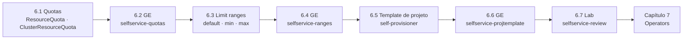

# Capítulo 6 — Enabling Developer Self-service

**Título em português:** Habilitar o autosserviço de desenvolvedores
**Status da documentação:** ✅ concluído e validado
**Referência:** PDF p. 245–302

## Objetivo do capítulo

Configurar clusters para que desenvolvedores criem projetos sozinhos, com limites que
impeçam um projeto ou uma equipe de consumir a capacidade do cluster.

## Por que este capítulo importa

Autosserviço acelera as equipes, mas sem limites um único projeto pode reservar toda a CPU
de um nó. O capítulo combina três camadas: **quotas** (o total de um namespace ou de um
grupo de namespaces), **limit ranges** (regras e padrões por container) e o **template de
projeto** (o que todo projeto novo recebe), além de controlar **quem** pode criar projetos.

## Seções e atividades (ordem oficial)

| Seção | Tipo | Título original | Material | PDF |
|-------|------|-----------------|----------|-----|
| 6.1 | Conceito | Project and Cluster Quotas | [lição](6.1-quotas-de-projeto-e-cluster.md) | p. 246–255 |
| 6.2 | Guided Exercise | Project and Cluster Quotas | [prática](PRATICA-OFICIAL.md#62-guided-exercise-project-and-cluster-quotas) | p. 256–262 |
| 6.3 | Conceito | Per-project Resource Constraints: Limit Ranges | [lição](6.3-limit-ranges.md) | p. 263–266 |
| 6.4 | Guided Exercise | Per-project Resource Constraints: Limit Ranges | [prática](PRATICA-OFICIAL.md#64-guided-exercise-per-project-resource-constraints-limit-ranges) | p. 267–277 |
| 6.5 | Conceito | The Project Template and the Self-provisioner Role | [lição](6.5-template-de-projeto-e-self-provisioner.md) | p. 278–285 |
| 6.6 | Guided Exercise | The Project Template and the Self-provisioner Role | [prática](PRATICA-OFICIAL.md#66-guided-exercise-the-project-template-and-the-self-provisioner-role) | p. 286–293 |
| 6.7 | Lab | Enable Developer Self-service | [prática](PRATICA-OFICIAL.md#67-lab-enable-developer-self-service) | p. 294–301 |
| 6.8 | Summary | Summary | [RESUMO.md](RESUMO.md) | p. 302 |

Abertura do capítulo (meta e seções): PDF p. 245. Não há quiz neste capítulo.

## Arquivos do capítulo

- [PRATICA-OFICIAL.md](PRATICA-OFICIAL.md): ponte com as atividades oficiais e armadilhas do ambiente.
- [REVISAO.md](REVISAO.md): questões autorais integradas.
- [RESUMO.md](RESUMO.md): síntese, comandos e observações sobre o PDF.

## Pré-requisitos recomendados

[DO180 · 6.5 — Reservar capacidade de computação](https://github.com/eduardoandradej/openshift-do180-4.22-estudos/blob/main/capitulos/06-confiabilidade/6.5-reservar-capacidade-de-computacao.md) ·
[DO180 · 6.7 — Limitar capacidade de computação](https://github.com/eduardoandradej/openshift-do180-4.22-estudos/blob/main/capitulos/06-confiabilidade/6.7-limitar-capacidade-de-computacao.md) ·
[2.1 — Templates do OpenShift](../02-aplicacoes-empacotadas/2.1-templates-do-openshift.md) ·
[3.3 — RBAC](../03-autenticacao-autorizacao/3.3-permissoes-com-rbac.md)

## Checklist do aluno

- [ ] 6.1 lida e Parte F respondida
- [ ] 6.2 Guided Exercise `selfservice-quotas` concluído
- [ ] 6.3 lida e Parte F respondida
- [ ] 6.4 Guided Exercise `selfservice-ranges` concluído
- [ ] 6.5 lida e Parte F respondida
- [ ] 6.6 Guided Exercise `selfservice-projtemplate` concluído
- [ ] 6.7 Lab `selfservice-review` com `lab grade` aprovado
- [ ] [REVISAO.md](REVISAO.md) respondida
- [ ] Registro no [diário de laboratórios](../../progresso/diario-de-laboratorios.md)

---
[← Capítulo 5](../05-redes-nao-http/README.md) | [Índice geral](../../README.md) | [Próximo: 6.1 Quotas de projeto e de cluster →](6.1-quotas-de-projeto-e-cluster.md)
