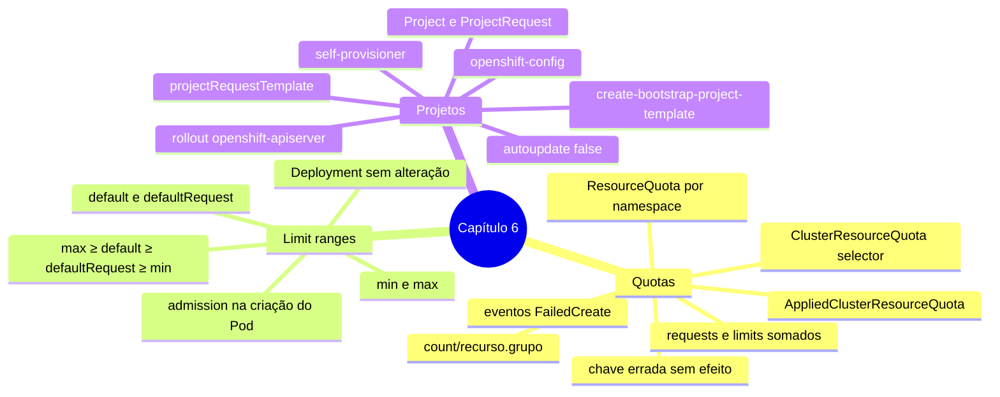

# Resumo — Capítulo 6

Síntese autoral para revisão rápida. Correspondência oficial: seção 6.8 (PDF p. 302).

## Em uma frase por seção

| Seção | Ideia central |
|-------|---------------|
| 6.1 | ResourceQuota limita a soma de computação e a contagem de objetos de um namespace; ClusterResourceQuota soma vários namespaces escolhidos por selector |
| 6.3 | LimitRange define, por container, padrões injetados (que tornam Pods aceitáveis pela quota) e mínimos/máximos que recusam workloads fora da faixa |
| 6.5 | O template de projeto (em `openshift-config`, ativado em `projects.config.openshift.io/cluster`) define o que todo projeto novo recebe; o binding `self-provisioners` define quem pode criar projetos |

## Mapa do capítulo

## Tabela de comandos do capítulo

| Tarefa | Comando | Tipo |
|--------|---------|------|
| Quota | `oc create quota <q> [-n ns] --hard k=v,...` | ✏️ |
| Uso da quota | `oc get quota` · `oc describe quota <q>` · `-o yaml` (`status.used`) | 🔍 |
| Cluster quota | `oc create clusterresourcequota <c> --project-label-selector k=v --hard ...` | ✏️ |
| Visão do projeto | `oc describe AppliedClusterResourceQuota -n <ns>` | 🔍 |
| Limit range | `oc apply -f limitrange.yaml` · `oc describe limitrange` | ✏️ / 🔍 |
| Recursos de um workload | `oc set resources deployment <d> --requests ... --limits ...` | ✏️ |
| Eventos | `oc events` | 🔍 |
| Template inicial | `oc adm create-bootstrap-project-template -o yaml > t.yaml` | 🔍 |
| Publicar template | `oc create -f t.yaml -n openshift-config` | ✏️ |
| Ativar template | `oc edit projects.config.openshift.io cluster` (`spec.projectRequestTemplate.name`) | ✏️ |
| Aguardar ativação | `oc get pod -n openshift-apiserver` | 🔍 |
| Self-provisioner | `oc describe clusterrolebinding.rbac self-provisioners` | 🔍 |
| Tornar alteração permanente | `oc annotate clusterrolebinding/self-provisioners --overwrite rbac.authorization.kubernetes.io/autoupdate=false` | ✏️ |
| Desligar autosserviço | `oc patch clusterrolebinding.rbac self-provisioners -p '{"subjects": null}'` | ✏️ |

## Alertas operacionais

- ⚠️ Com quota de computação, todo container precisa declarar o recurso (ou receber padrão de limit range).
- ⚠️ Quotas não são validadas semanticamente: `count/deployment` e `count/pod` são aceitas e não fazem nada.
- ⚠️ Barramento por quota de Pods/computação aparece nos **eventos** do ReplicaSet, não no `oc create deployment`.
- ⚠️ Rollout: ReplicaSets novo e antigo somam na quota.
- ⚠️ Limit range só afeta Pods **criados depois**.
- ⚠️ Declare `default` e `defaultRequest` sempre que usar `min`/`max`.
- ⚠️ Template de projeto só vale após o rollout do `openshift-apiserver` e só para projetos **novos**.
- ⚠️ `oc create namespace` não usa o template.
- ⛔ Template e `self-provisioners` afetam o cluster inteiro; no curso, só dentro dos exercícios, com `lab finish`.

## Divergências registradas em relação à apostila

Nenhuma imprecisão técnica identificada no capítulo. Complemento:

| Ponto | Apostila | Observação |
|-------|----------|------------|
| Preenchimento automático do limit range (p. 266) | Sem `default`/`defaultRequest`, os valores são copiados "de `min` ou de `max`" | Correto; a ordem exata é `default ← max`, `defaultRequest ← default`, depois `← min` (código do Kubernetes). Com só `min` e `max`, o request padrão vira o **max**, como mostra a própria saída do GE 6.6 |

## Ligação com o próximo capítulo

Com o autosserviço controlado, o Capítulo 7 (*Managing Kubernetes Operators*) trata dos
operadores que estendem o cluster e de como instalá-los e atualizá-los.

---
[← Revisão](REVISAO.md) | [Índice do capítulo](README.md) | [Próximo capítulo →](../07-operadores-kubernetes/README.md)
