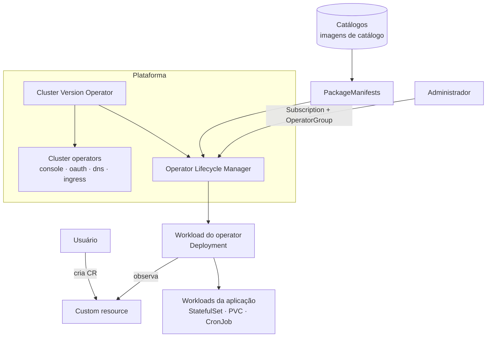

# 7.1 — Operators do Kubernetes e o Operator Lifecycle Manager

| Campo | Valor |
|-------|-------|
| Curso | DO280 — OpenShift 4.22 |
| Capítulo / seção | Capítulo 7 · Seção 7.1 |
| Título original | Kubernetes Operators and the Operator Lifecycle Manager |
| Título em português | Operators do Kubernetes e o Operator Lifecycle Manager |
| Objetivo | Descrever o padrão operator e as formas de instalar e atualizar operators |
| Referência | PDF p. 304–307 · Quiz 7.2 (associação) p. 308–309 |

## Pré-requisitos e conhecimentos anteriores

No DO180 você viu que o próprio OpenShift é feito de operators: o **Cluster Version
Operator (CVO)** cuida dos *cluster operators* (`oc get clusteroperators`) e o **OLM**
cuida dos operators adicionais. Também viu que a API aceita tipos novos por meio de
**CustomResourceDefinitions (CRDs)** e que `oc explain` documenta qualquer tipo. Esta lição
aprofunda o padrão e prepara a instalação de operators adicionais.

| Conceito | Onde revisar |
|----------|--------------|
| Operators, CVO e OLM; `oc get clusteroperators` | [DO180 · 2.5 — Avaliar a saúde do cluster](https://github.com/eduardoandradej/openshift-do180-4.22-estudos/blob/main/capitulos/02-cli-e-apis/2.5-avaliar-a-saude-do-cluster.md) |
| Como a plataforma se gerencia por operators | [DO180 · F3 — Arquitetura OpenShift](https://github.com/eduardoandradej/openshift-do180-4.22-estudos/blob/main/01-fundamentos-essenciais/03-arquitetura-openshift.md) |
| CRDs, `oc api-resources`, `oc explain` | [DO180 · F5 — Kubernetes API e YAML](https://github.com/eduardoandradej/openshift-do180-4.22-estudos/blob/main/01-fundamentos-essenciais/05-kubernetes-api-e-yaml.md) |
| Versão e canal do cluster | [DO180 · 1.3 — Componentes e edições](https://github.com/eduardoandradej/openshift-do180-4.22-estudos/blob/main/capitulos/01-introducao-kubernetes-openshift/1.3-componentes-e-edicoes-do-openshift.md) |
| Charts Helm (outra forma de distribuir software) | [2.3 — Charts do Helm](../02-aplicacoes-empacotadas/2.3-charts-do-helm.md) |

## Parte A — Entendendo o conceito

### O problema: workloads que dão trabalho

Deployments, StatefulSets, DaemonSets, Jobs e CronJobs bastam para muitas aplicações. Mas
uma aplicação complexa pode ter vários componentes (banco, back-end, front-end) e tarefas
de manutenção repetitivas (backup, atualização, troca de certificados). Fazer isso à mão,
com dezenas de objetos, é trabalhoso e sujeito a erro.

### O padrão operator

Um **operator** é software que conhece uma aplicação e a administra pelo cluster:

1. ele define um ou mais **tipos novos** na API (CRDs), por exemplo `Database`;
2. o administrador ou o usuário cria um **custom resource (CR)** desse tipo, dizendo *o
   que* quer (nome, tamanho, agenda de backup);
3. o operator **observa** esses CRs e cria/ajusta os objetos comuns necessários
   (StatefulSet, PVC, CronJob de backup...), mantendo-os no estado pedido.

É o mesmo laço de controle dos controllers do Kubernetes, aplicado a uma aplicação
específica.

> No cluster existem **dois conjuntos de workloads** por operator: o **workload do
> operator** (o controller, gerenciado pelo OLM) e os **workloads criados a partir dos
> CRs** (gerenciados pelo operator).

### Três formas de chegar ao cluster

| Tipo | Quem instala e atualiza | Exemplos | Como ver |
|------|------------------------|----------|----------|
| **Cluster operators** | **CVO**, junto com a instalação e as atualizações do OpenShift | console, OAuth, DNS, ingress | `oc get clusteroperator` |
| **Add-on operators** | **OLM**, a pedido do administrador, independente da versão do cluster | File Integrity, Compliance, MetalLB, LVM Storage | console **Ecosystem › Installed Operators**; `oc get csv -A` |
| **Outros operators** | O fornecedor, por manifestos, Helm charts etc. | operators distribuídos fora de catálogo | Conforme a forma de distribuição |

### Cluster operators e o CVO

O CVO instala e atualiza os cluster operators como parte da versão do OpenShift. Cada um
publica seu estado em um recurso `ClusterOperator`, com as condições `AVAILABLE`,
`PROGRESSING` e `DEGRADED`; a coluna `MESSAGE` traz a mensagem da condição mais recente.
Na console: **Administration › Cluster Settings › ClusterOperators**.

### Add-on operators e o OLM

O **Operator Lifecycle Manager (OLM)** instala, atualiza e remove operators adicionais.
Ele próprio segue o padrão operator: você o comanda criando recursos (`Subscription`,
`OperatorGroup`...) ou pela console em **Ecosystem › Software Catalog**.

O OLM descobre o que existe para instalar em **catálogos de operators**: imagens de
container com a descrição e as versões disponíveis. Catálogos padrão de um cluster
conectado:

| Catálogo | Quem suporta |
|----------|--------------|
| Red Hat | Red Hat (empacota, distribui e suporta) |
| Certified | Fornecedores independentes e parceiros |
| Community | Comunidades open source |

Para cada operator disponível, o OLM cria um recurso **`PackageManifest`** com canais e
versões. Organizações podem criar ou **espelhar** catálogos (clusters desconectados) e
puxar imagens só de registries privados confiáveis, o que protege a cadeia de suprimento
de software (soberania digital). O recurso `ClusterImagePolicy` pode ainda verificar
assinaturas de imagens.

> O ambiente do curso tem **um único catálogo**, hospedado localmente, com apenas os
> operators usados nas atividades: o curso funciona sem internet.

### Ciclo de vida diferente

| | Cluster operators | Add-on operators |
|-|-------------------|------------------|
| Versão | Acompanha a versão do OpenShift | Própria, por canal |
| Atualização | Atualizar o cluster (CVO) | Subscription (automática ou manual) |
| Remoção | Não se remove | Desinstalar pelo OLM (alguns exigem passos extras) |

### Como operators são construídos

Um operator é um conjunto de CRDs + um workload que usa a API do Kubernetes para observar
os CRs. Pode ser escrito em quase qualquer plataforma; SDKs ajudam:

- **Operator SDK** — Go, Ansible e empacotamento de charts Helm como operators;
- **Java Operator SDK** — Java, com extensão para Quarkus.

O curso não cobre o desenvolvimento de operators.

## Parte B — Modelo mental e arquitetura



Leia de cima para baixo: o CVO mantém a plataforma (inclusive o OLM); o OLM instala o
operator escolhido a partir do catálogo; o operator transforma CRs em objetos comuns.

## Parte C — Aplicação prática

> Legenda: 🔍 somente leitura · ✏️ altera o cluster

### 1. Estado dos cluster operators 🔍

```bash
oc get clusteroperator                      # AVAILABLE / PROGRESSING / DEGRADED / MESSAGE
oc describe clusteroperator authentication  # conditions completas e relatedObjects
oc get clusterversion                       # versão que o CVO aplica
```

Saudável: `True / False / False`. Permissão: administrador (ou papel de leitura do
cluster).

### 2. O que o OLM oferece e o que já está instalado 🔍

```bash
oc get catalogsource -n openshift-marketplace   # catálogos disponíveis
oc get packagemanifests                         # operators instaláveis (e de qual catálogo)
oc get csv -A                                   # operators instalados (um CSV por versão)
oc get operators                                # resumo do OLM por operator instalado
```

### 3. Descobrir os tipos que um operator trouxe 🔍

```bash
oc get crd | grep <domínio>                     # CRDs registradas
oc api-resources --api-group=<grupo>            # tipos e se são de namespace
oc explain <tipo>.spec                           # documentação do CR
```

### Raciocínio operacional e diagnóstico

| Sintoma | Hipótese | Como confirmar | Correção segura |
|---------|----------|----------------|-----------------|
| Funcionalidade da plataforma falhando (login, console) | Cluster operator degradado | `oc get co` (DEGRADED=True), `oc describe co <nome>` | Seguir a mensagem; namespaces em `relatedObjects` |
| `oc get co` com PROGRESSING=True por muito tempo | Atualização do cluster em andamento ou travada | `oc get clusterversion` | Aguardar ou investigar o operator citado |
| Operator não aparece no catálogo | Catálogo ausente/indisponível ou operator fora dele | `oc get catalogsource -n openshift-marketplace`; `oc get packagemanifests` | Verificar o catálogo (em ambiente desconectado, o espelho) |
| `error: the server doesn't have a resource type "X"` | CRD do operator não instalada | `oc get crd`; `oc api-resources` | Instalar o operator correspondente |
| CR criado, nada acontece | Operator parado ou não observa aquele namespace | Pods do operator; logs; OperatorGroup (7.5) | Corrigir o operator ou o escopo |

## Parte D — Relações importantes

| A | B | Diferença essencial |
|---|---|--------------------|
| Operator | Controller do Kubernetes | Mesmo laço de controle; o operator é específico de uma aplicação |
| CRD | Custom resource (CR) | Define o tipo × instância do tipo |
| Cluster operator | Add-on operator | Plataforma, via CVO × adicional, via OLM |
| CVO | OLM | Atualiza com o cluster × instala/atualiza independente do cluster |
| Catálogo | PackageManifest | Imagem com o conteúdo × recurso por operator disponível |
| Workload do operator | Workloads dos CRs | Gerenciado pelo OLM × gerenciado pelo operator |
| Operator | Helm chart | Controller contínuo × pacote de manifestos aplicados uma vez por release |

## Parte E — Preparação para o laboratório oficial

A seção 7.2 é um **quiz de associação** (PDF p. 308–309), sem `lab`. Responda pela
apostila sem olhar a solução e confira depois; este repositório não reproduz o gabarito.

Você deve conseguir, sem consultar a lição, explicar com suas palavras: padrão operator,
cluster operator, add-on operator, catálogo, `PackageManifest`, custom resource, CVO,
OLM e Operator SDK.

## Parte F — Fixação

1. Que problema o padrão operator resolve que Deployments e CronJobs sozinhos não resolvem bem?
2. Qual a relação entre CRD, CR e operator?
3. Por que um cluster operator não aparece em **Installed Operators**?
4. Como o OLM sabe quais operators podem ser instalados?
5. Por que espelhar catálogos e usar registries privados interessa à segurança?
6. Quais são os dois conjuntos de workloads de um operator, e quem gerencia cada um?
7. Um operator adicional precisa ser atualizado. É preciso atualizar o OpenShift?

<details>
<summary>Respostas comentadas</summary>

1. Aplicações complexas com vários componentes e tarefas de manutenção; o operator concentra esse conhecimento e mantém tudo no estado declarado em um CR.
2. A CRD cria o tipo na API; o CR é uma instância desse tipo; o operator observa os CRs e cria os objetos comuns.
3. Cluster operators são instalados e atualizados pelo CVO; **Installed Operators** mostra os operators gerenciados pelo OLM.
4. Pelos catálogos (CatalogSources): o OLM lê as imagens de catálogo e cria um `PackageManifest` por operator.
5. Garante que só software curado e verificado chega ao cluster, de origem confiável, inclusive em ambientes desconectados.
6. O workload do operator (gerenciado pelo OLM) e os workloads criados a partir dos CRs (gerenciados pelo operator).
7. Não: add-on operators têm ciclo próprio, controlado pela Subscription.

</details>

## Parte G — Essencial para memorizar

- Operator = CRDs + controller que transforma CRs em objetos comuns.
- CVO → cluster operators (`oc get co`, `True/False/False`). OLM → add-on operators.
- Catálogo (CatalogSource, `openshift-marketplace`) → `PackageManifest` por operator.
- Console: **Ecosystem › Software Catalog** (instalar) e **Ecosystem › Installed Operators** (gerenciar).
- Add-on operators atualizam independente do cluster.
- Dois conjuntos de workloads: o do operator (OLM) e os dos CRs (operator).

---
[← Índice do capítulo](README.md) | [Índice do capítulo](README.md) | [Próximo: 7.3 Instalar operators pela console →](7.3-instalar-operators-pela-console.md)
