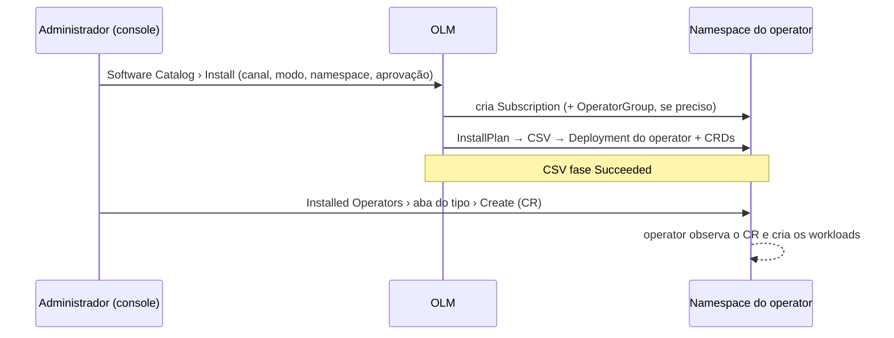

# 7.3 — Instalar operators pela web console

| Campo | Valor |
|-------|-------|
| Curso | DO280 — OpenShift 4.22 |
| Capítulo / seção | Capítulo 7 · Seção 7.3 |
| Título original | Installing Operators by Using the Web Console |
| Título em português | Instalar operators pela web console |
| Objetivo | Instalar e atualizar operators pela web console e pelo OLM |
| Referência | PDF p. 310–313 · Guided Exercise 7.4 p. 314–325 |

## Pré-requisitos e conhecimentos anteriores

A [lição 7.1](7.1-operators-e-olm.md) explicou o padrão operator, o OLM e os catálogos.
Da console, você já sabe trocar de projeto, usar o editor YAML e alternar entre
**Form view** e **YAML view**. Do DO180, lembre como diagnosticar Deployments, Pods e
eventos — operators são diagnosticados do mesmo jeito.

| Conceito | Onde revisar |
|----------|--------------|
| Navegar na web console | [DO180 · 1.5 — Navegar na web console](https://github.com/eduardoandradej/openshift-do180-4.22-estudos/blob/main/capitulos/01-introducao-kubernetes-openshift/1.5-navegar-na-web-console.md) |
| Diagnóstico de Pods, logs e eventos | [DO180 · 3.5 — Diagnosticar containers e Pods](https://github.com/eduardoandradej/openshift-do180-4.22-estudos/blob/main/capitulos/03-containers-e-pods/3.5-diagnosticar-containers-e-pods.md) |
| Operators e OLM | [7.1 — Operators e OLM](7.1-operators-e-olm.md) |
| Network policies e RBAC por namespace | [4.3](../04-seguranca-de-rede/4.3-network-policies.md) · [3.3](../03-autenticacao-autorizacao/3.3-permissoes-com-rbac.md) |

## Parte A — Entendendo o conceito

### Onde fica cada coisa na console

| Página | Uso |
|--------|-----|
| **Ecosystem › Software Catalog** | Ver operators disponíveis (com filtros) e iniciar a instalação |
| **Ecosystem › Installed Operators** | Ver, inspecionar, atualizar e desinstalar operators instalados |

> Antes de instalar, **leia a descrição e a documentação do operator**: requisitos,
> namespace recomendado, modos suportados e passos especiais de instalação ou remoção.

### As opções do assistente de instalação

| Opção | O que decide |
|-------|--------------|
| **Update channel** | A sequência de versões que a assinatura acompanha (ex.: `stable`, `fast`) |
| **Installation mode** | Em quais namespaces o operator **observa** CRs. O padrão *All namespaces on the cluster* serve para a maioria |
| **Installed Namespace** | Onde fica o **workload do operator** (muitos usam `openshift-operators`; outros pedem um namespace próprio) |
| **Update approval** | `Automatic` (o OLM atualiza sozinho) ou `Manual` (o administrador aprova cada atualização) |
| Monitoramento (alguns operators) | Habilita coleta de métricas; não é suportado para operators que não sejam da Red Hat |

**Installation mode ≠ Installed Namespace.** O primeiro diz *onde o operator trabalha*; o
segundo, *onde ele mora*. As duas opções são ligadas: o operator documenta quais
combinações aceita.

Com *All namespaces*, usuários criam CRs nos próprios projetos e o operator cria os
workloads ali, ao lado das aplicações. O administrador combina isso com o que já conhece
— RBAC, quotas, network policies — para controlar quem usa o operator e como.

Ao clicar **Install**, a console cria por você uma **Subscription** e, se preciso, um
**OperatorGroup** (detalhes na [lição 7.5](7.5-instalar-operators-pela-cli.md)) e mostra
o progresso.

### ClusterServiceVersion (CSV): a "ficha" de cada versão

Cada versão de um operator tem um **CSV**, que o OLM usa para instalar (Deployments,
permissões, CRDs que o operator possui) e cujo `status` reflete o andamento (fase
`Succeeded` quando tudo deu certo). CSVs são **de namespace**: operators que observam
vários namespaces aparecem com um CSV em cada um, por isso **Installed Operators** tem
filtro de projeto.

### A página de detalhes do operator

| Aba | Conteúdo |
|-----|----------|
| **Details** | Informações do CSV e suas *Conditions* (histórico da instalação) |
| **YAML** | O CSV em YAML |
| **Subscription** | Canal, aprovação, link para os **install plans**; com aprovação manual, é aqui que se aprova a atualização |
| **Events** | Eventos do operator |
| Uma aba por tipo de CR | Lista e cria instâncias daquele tipo |
| **All instances** | Todas as instâncias de todos os tipos do operator |

### Usar o operator: criar CRs

O uso normal é **criar custom resources** na aba do tipo desejado, por:

- **YAML view** — editor com um exemplo inicial e a documentação do esquema (a mesma de
  `oc explain`);
- **Form view** — campos guiados (listas, textos de ajuda), mas nem sempre com todas as
  opções do CR.

### Atualizar e desinstalar

- **Atualizar:** com aprovação automática, nada a fazer; com manual, aprovar o install
  plan pendente na aba **Subscription**. Trocar de canal também é feito nessa aba.
- **Desinstalar:** em **Installed Operators**, **Actions › Uninstall Operator**. A opção de
  apagar todas as instâncias de operandos remove também os CRs. Namespaces criados para o
  operator e CRDs podem continuar existindo: siga a documentação do operator.

### Diagnóstico

- **Instalação ou atualização falhando:** status e condições do **CSV**, da
  **Subscription** e do **install plan**.
- **Operator instalado, mas sem funcionar:** identifique o workload (lista de Deployments
  no fim da página de detalhes) e diagnostique como qualquer workload: status do
  Deployment/StatefulSet, Pods, logs e eventos.
- Problemas são específicos de cada operator: consulte a documentação dele para opções
  de suporte.

## Parte B — Modelo mental e arquitetura



## Parte C — Aplicação prática

> Legenda: 🔍 somente leitura · ✏️ altera o cluster · 🖥️ console
>
> Instalar e desinstalar operators exige **administrador do cluster**.

### 1. Instalar 🖥️ ✏️

**Ecosystem › Software Catalog** → filtrar pelo nome → abrir o operator → ler → **Install**
→ escolher canal, modo, namespace e aprovação → **Install** → aguardar → **View
Operator**.

A console pode exibir **View Operator** (ou até erros) por instantes antes de o OLM
terminar: espere a fase estabilizar.

### 2. Conferir pela CLI o que a console criou 🔍

```bash
oc get subscription,operatorgroup,installplan,csv -n <namespace-do-operator>
oc get deployment,pod -n <namespace-do-operator>          # workload do operator
```

### 3. Criar e acompanhar um CR 🖥️ ✏️

Aba do tipo → **Create** → YAML ou formulário → **Create**. Depois:

```bash
oc get <tipo> -n <ns>
oc describe <tipo> <nome> -n <ns>                         # status e eventos do CR
oc get all -n <ns>                                        # workloads criados pelo operator
```

### 4. Desinstalar 🖥️ ✏️

**Installed Operators** → operator → **Actions › Uninstall Operator** → (opcional) apagar
instâncias → **Uninstall**. Depois, conforme a documentação, apague o namespace criado para
ele (**Home › Projects › Actions › Delete Project**).

### Raciocínio operacional e diagnóstico

| Sintoma | Hipótese | Como confirmar | Correção segura |
|---------|----------|----------------|-----------------|
| Instalação ou atualização parada, aguardando aprovação | Aprovação manual | Aba **Subscription** (install plan não aprovado) | Aprovar o install plan |
| CSV em `Failed` | Requisito não atendido (namespace, modo, permissões) | **Details › Conditions**; `oc describe csv` | Seguir a mensagem e a documentação |
| Operator `Succeeded`, CR sem efeito | Operator não observa aquele namespace ou falhou | Pods/logs do operator; modo de instalação | Ajustar o modo/escopo; corrigir o workload |
| CR criado pelo formulário sem a opção desejada | Formulário não expõe todos os campos | **YAML view**; `oc explain` | Editar em YAML |
| Workloads do CR com erro | Problema na aplicação gerenciada | Pods, logs, eventos no namespace do CR | Corrigir conforme o operator |
| Após desinstalar, ainda há recursos | Namespace/CRDs não são removidos sempre | `oc get ns`; `oc get crd` | Remover conforme a documentação |

## Parte D — Relações importantes

| A | B | Diferença essencial |
|---|---|--------------------|
| Software Catalog | Installed Operators | Disponíveis (instalar) × instalados (gerenciar) |
| Installation mode | Installed Namespace | Onde observa CRs × onde roda o operator |
| `Automatic` | `Manual` | Atualiza sozinho × espera aprovação do install plan |
| CSV | Subscription | Uma versão instalada × a intenção (pacote, canal, aprovação) |
| Form view | YAML view | Guiado, possivelmente incompleto × tudo, com documentação do esquema |
| Uninstall Operator | Apagar namespace/CRDs | Remove operator (e, se marcado, CRs) × limpeza conforme a documentação |

## Parte E — Preparação para o laboratório oficial

Atividade associada: **7.4 Guided Exercise — Install Operators by Using the Web Console**
(`operators-web`, PDF p. 314–325).

Você deve conseguir, sem consultar a lição:

- encontrar e instalar um operator pelo catálogo com as opções padrão;
- ler as condições do CSV, o YAML e a assinatura na página de detalhes;
- criar um CR e localizar o que o operator produziu (incluindo os resultados);
- distinguir o Deployment do operator do workload criado pelo CR;
- desinstalar o operator e limpar o namespace criado na instalação.

Detalhes e armadilhas em
[PRATICA-OFICIAL.md](PRATICA-OFICIAL.md#74-guided-exercise-install-operators-by-using-the-web-console).

## Parte F — Fixação

1. Qual a diferença entre *Installation mode* e *Installed Namespace*?
2. Que objetos a console cria quando você clica em **Install**?
3. Onde você aprova uma atualização de um operator com aprovação manual?
4. Por que **Installed Operators** tem filtro de projeto?
5. Quando usar **YAML view** em vez de **Form view**?
6. O operator está `Succeeded`, mas o CR não produz nada. Por onde começar?
7. Por que, depois de desinstalar um operator, convém ler a documentação dele?

<details>
<summary>Respostas comentadas</summary>

1. O modo define em quais namespaces o operator observa CRs; o namespace instalado é onde roda o workload do operator.
2. Uma Subscription e, se necessário, um OperatorGroup; o OLM então cria install plan, CSV e o workload.
3. Na aba **Subscription** da página de detalhes (install plan pendente).
4. CSVs são de namespace; operators que observam vários namespaces têm um CSV em cada um.
5. Quando o formulário não oferece todos os campos do CR, ou para revisar o esquema completo.
6. Pelo workload do operator: Deployment, Pods, logs e eventos; e conferir se ele observa o namespace do CR.
7. A remoção pode deixar namespace, CRDs ou outros recursos, e alguns operators exigem passos específicos.

</details>

## Parte G — Essencial para memorizar

- **Ecosystem › Software Catalog** instala; **Ecosystem › Installed Operators** gerencia.
- Opções: canal · modo de instalação (onde observa) · namespace (onde roda) · aprovação.
- Install → Subscription (+ OperatorGroup) → InstallPlan → CSV `Succeeded` → Deployment do operator.
- CSV é de namespace; uma versão = um CSV.
- Uso = criar CRs (YAML ou formulário). Diagnóstico = CSV/Subscription/InstallPlan e depois workloads.
- Desinstalar não garante remover namespace e CRDs.

---
[← 7.1 Operators e OLM](7.1-operators-e-olm.md) | [Índice do capítulo](README.md) | [Próximo: 7.5 Instalar operators pela CLI →](7.5-instalar-operators-pela-cli.md)
