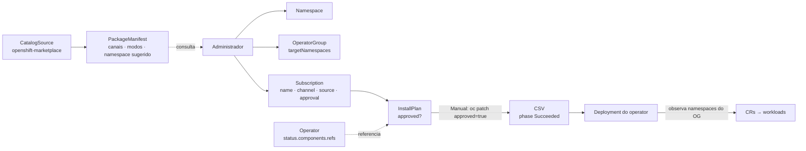

# 7.5 — Instalar operators pela CLI

| Campo | Valor |
|-------|-------|
| Curso | DO280 — OpenShift 4.22 |
| Capítulo / seção | Capítulo 7 · Seção 7.5 |
| Título original | Installing Operators with the CLI |
| Título em português | Instalar operators pela CLI |
| Objetivo | Instalar e atualizar operators usando as APIs do Operator Lifecycle Manager |
| Referência | PDF p. 326–332 · Guided Exercise 7.6 p. 333–340 · Lab 7.7 p. 341–349 |

## Pré-requisitos e conhecimentos anteriores

As lições [7.1](7.1-operators-e-olm.md) e [7.3](7.3-instalar-operators-pela-console.md)
mostraram o OLM e o que a console faz ao instalar. Agora você faz o mesmo com manifestos.
Do [Capítulo 1](../01-gerenciamento-declarativo/1.1-manifestos-de-recursos.md) vem o
`oc patch --type merge`; do DO180, JSONPath e `oc explain`.

| Conceito | Onde revisar |
|----------|--------------|
| Manifestos, `oc create`/`oc apply`, `oc patch` | [1.1 — Manifestos de recursos](../01-gerenciamento-declarativo/1.1-manifestos-de-recursos.md) |
| `oc explain`, `oc api-resources`, CRDs | [DO180 · F5 — Kubernetes API e YAML](https://github.com/eduardoandradej/openshift-do180-4.22-estudos/blob/main/01-fundamentos-essenciais/05-kubernetes-api-e-yaml.md) |
| JSONPath e inspeção de recursos | [DO180 · 2.3 — Inspecionar recursos](https://github.com/eduardoandradej/openshift-do180-4.22-estudos/blob/main/capitulos/02-cli-e-apis/2.3-inspecionar-recursos-kubernetes.md) |

## Parte A — Entendendo o conceito

### Roteiro de uma instalação

1. Localizar o operator no catálogo.
2. Ler o operator e sua documentação (requisitos, namespace, passos especiais).
3. Escolher o **canal** de atualização.
4. Escolher o **modo de instalação** (para a maioria: todos os namespaces).
5. Escolher o **namespace** do workload do operator (novo ou existente).
6. Escolher a **aprovação** de atualizações: automática ou manual.
7. Criar o namespace, se necessário.
8. Criar o **OperatorGroup**, se necessário.
9. Criar a **Subscription**.
10. Revisar e testar a instalação.

### Os recursos do OLM

| Recurso | Quem cria | Papel |
|---------|-----------|-------|
| `CatalogSource` | Cluster / administrador | Aponta um repositório (imagem de catálogo); o OLM o consulta periodicamente |
| `PackageManifest` | OLM | Um por operator disponível: canais, versões, modos suportados, namespace sugerido |
| `OperatorGroup` | **Administrador** | Define os namespaces que os operators daquele namespace observam |
| `Subscription` | **Administrador** | Pede a instalação: pacote, catálogo, canal e aprovação |
| `InstallPlan` | OLM | O plano de instalação/atualização; com aprovação manual, precisa ser aprovado |
| `ClusterServiceVersion` (CSV) | OLM | Uma versão do operator: Deployments, permissões, CRDs; `status.phase` |
| `Operator` | OLM | Resumo de um operator instalado e dos seus componentes (recurso de cluster) |

> Para instalar, o administrador cria **só a Subscription e o OperatorGroup** (e o
> namespace, quando necessário). O OLM gera o resto.

### Descobrir o operator

Catálogos ficam em `openshift-marketplace`. O `oc describe packagemanifest` traz o que a
Subscription precisa:

| Informação | Campo do PackageManifest | Vai para |
|------------|--------------------------|----------|
| Catálogo e namespace dele | `Catalog Source`, `Catalog Source Namespace` | `spec.source`, `spec.sourceNamespace` |
| Nome do pacote | `Package Name` | `spec.name` |
| Canais e canal padrão | `Channels`, `Default Channel` | `spec.channel` |
| Versão atual do canal | `Current Csv` | (referência; `spec.startingCSV` opcional) |
| Modos suportados | `Install Modes` | Decide o OperatorGroup |
| Namespace sugerido | anotação `operatorframework.io/suggested-namespace` | Namespace do operator |
| Descrição, links, CRDs que o operator possui | `Description`, `Links`, `Customresourcedefinitions` | Leitura e uso |

Confira também a **origem** das imagens do operator (registries confiáveis), ponto
importante para soberania digital.

### OperatorGroup: onde o operator observa

Um operator usa o OperatorGroup **do namespace em que está instalado**. O OperatorGroup
lista os namespaces-alvo (`spec.targetNamespaces`) ou os seleciona por labels
(`spec.selector`).

| Modo de instalação | OperatorGroup no namespace do operator |
|--------------------|----------------------------------------|
| `OwnNamespace` | `targetNamespaces: [<o próprio namespace>]` |
| `SingleNamespace` | `targetNamespaces: [<outro namespace>]` |
| `MultiNamespace` | `targetNamespaces: [ns-a, ns-b, ...]` |
| `AllNamespaces` | sem alvo (`spec: {}`) — é o caso do `global-operators` em `openshift-operators` |

```yaml
apiVersion: operators.coreos.com/v1
kind: OperatorGroup
metadata:
  name: auditoria
  namespace: auditoria-operator
spec:
  targetNamespaces:
  - auditoria-operator        # OwnNamespace
```

O namespace `openshift-operators` já tem o OperatorGroup `global-operators` (todos os
namespaces): operators instalados ali não precisam de outro. Use um namespace e um
OperatorGroup próprios quando o operator pedir.

> 📘 **Fonte externa (API `operators.coreos.com`, `operator-framework/api` v0.45.0):** o
> CSV indica problemas de OperatorGroup pelas razões `NoOperatorGroup`,
> `TooManyOperatorGroups` (mais de um no mesmo namespace) e `UnsupportedOperatorGroup`
> (modo que o operator não suporta).

### Subscription: o pedido de instalação

```yaml
apiVersion: operators.coreos.com/v1alpha1
kind: Subscription
metadata:
  name: auditoria-operator
  namespace: auditoria-operator   # namespace do workload do operator
spec:
  name: auditoria-operator        # pacote (Package Name)
  channel: stable                 # canal
  source: catalogo-interno        # CatalogSource
  sourceNamespace: openshift-marketplace
  installPlanApproval: Manual     # ou Automatic
```

### Install plans e aprovação

O OLM cria um `InstallPlan` para cada instalação ou atualização e o referencia no recurso
`Operator` (`status.components.refs`) — por isso `oc describe operator <pacote>` mostra o
nome do plano e condições como `InstallPlanPending` (razão `RequiresApproval`).

| `installPlanApproval` | Comportamento |
|-----------------------|---------------|
| `Automatic` | O OLM aplica as atualizações do canal assim que surgem |
| `Manual` | O OLM cria o `InstallPlan` com `spec.approved: false`; nada acontece até o administrador aprovar |

Aprovar = mudar `spec.approved` para `true` no install plan (o **novo** plano, a cada
atualização). Pendentes aparecem com `APPROVED false` em `oc get installplan`.

> 📘 **Fonte externa (documentação do OpenShift sobre atualizações manuais):** o OLM
> resolve as assinaturas de um mesmo namespace em conjunto; se uma delas for `Manual`, as
> atualizações das outras no mesmo namespace também podem ficar aguardando aprovação.
> Agrupe operators com políticas diferentes em namespaces diferentes.

### Trocar de canal

Patch em `spec.channel` da Subscription (canais disponíveis no `PackageManifest`). Com
`Automatic`, pode disparar atualização imediata; com `Manual`, pode gerar um install plan
para aprovar.

### Usar o operator

Crie instâncias das CRDs que ele traz. Descubra-as por:

- `spec.customresourcedefinitions.owned` do CSV;
- a anotação `alm-examples` do CSV (exemplos prontos em JSON — os mesmos que a console
  carrega no editor YAML);
- `oc explain <tipo>`.

### Diagnóstico

- **Instalação/atualização:** status do `Operator`, do `InstallPlan` e do CSV.
- **Funcionamento:** o operator costuma ter dois tipos de workload — o próprio operator e
  os workloads de cada CR. `spec.install.spec.deployments` do CSV lista os Deployments que
  o **OLM** cria (em geral o do operator); outros Deployments podem ser criados pelo
  próprio operator.

## Parte B — Modelo mental e arquitetura



## Parte C — Aplicação prática

> Legenda: 🔍 somente leitura · ✏️ altera o cluster
>
> Requer **administrador do cluster**. Manifestos autorais em
> [exemplos-originais/operators](../../exemplos-originais/operators/).

### 1. Descobrir 🔍

```bash
oc get catalogsource -n openshift-marketplace
oc get packagemanifests                                   # NAME e CATALOG
oc describe packagemanifest <pacote> -n openshift-marketplace
oc get packagemanifest <pacote> -o jsonpath='{.status.defaultChannel}{"\n"}'
oc get packagemanifest <pacote> -o jsonpath='{range .status.channels[*]}{.name}{"  "}{.currentCSV}{"\n"}{end}'
```

### 2. Preparar namespace e OperatorGroup ✏️

```bash
oc create namespace <ns>                                  # ou oc create -f namespace.yaml (labels exigidas)
oc create -f operator-group.yaml
oc get operatorgroup -n <ns>                              # exatamente um
```

Alguns operators exigem labels no namespace (ex.: `openshift.io/cluster-monitoring` ou
labels de Pod Security): use o YAML da documentação do operator.

### 3. Assinar ✏️

```bash
oc create -f subscription.yaml
oc get subscription -n <ns>                               # PACKAGE, SOURCE, CHANNEL
```

### 4. Aprovar (aprovação manual) ✏️

```bash
oc describe operator <pacote>                             # Refs → InstallPlan; InstallPlanPending
oc get installplan -n <ns>                                # APPROVED false
oc get installplan <plano> -n <ns> -o jsonpath='{.spec}{"\n"}'
oc patch installplan <plano> -n <ns> --type merge -p '{"spec":{"approved":true}}'
```

`oc describe operator <pacote>` funciona porque o recurso se chama `<pacote>.<namespace>`
e o `describe` aceita o prefixo do nome. O install plan pode demorar alguns instantes para
aparecer.

### 5. Verificar 🔍

```bash
oc get csv -n <ns>                                        # PHASE Succeeded
oc describe operator <pacote> | grep -C4 InstallSucceeded
oc get csv <csv> -n <ns> -o jsonpath='{.spec.install.spec.deployments[*].name}{"\n"}'
oc get deployment,pod -n <ns>
oc get csv <csv> -n <ns> -o jsonpath='{.spec.customresourcedefinitions.owned[*].name}{"\n"}'
oc get csv <csv> -n <ns> -o jsonpath='{.metadata.annotations.alm-examples}' | jq
```

### 6. Atualizações e canal ✏️

```bash
oc patch subscription <sub> -n <ns> --type merge -p '{"spec":{"installPlanApproval":"Manual"}}'
oc patch subscription <sub> -n <ns> --type merge -p '{"spec":{"channel":"<novo-canal>"}}'
oc get installplan -n <ns>                                # novo plano pendente?
```

### 7. Desinstalar pela CLI ✏️

> 📘 **Fonte externa (documentação do OpenShift, remoção de operators pela CLI):** a
> apostila mostra a remoção só pela console.

```bash
oc get subscription <sub> -n <ns> -o jsonpath='{.status.installedCSV}{"\n"}'   # anote o CSV
oc delete subscription <sub> -n <ns>
oc delete csv <csv> -n <ns>
# conforme a documentação do operator: apagar CRs, CRDs e o namespace
```

### Raciocínio operacional e diagnóstico

| Sintoma | Hipótese | Como confirmar | Correção segura |
|---------|----------|----------------|-----------------|
| Subscription criada, nenhum CSV | Install plan aguardando aprovação | `oc describe operator <p>` (`InstallPlanPending`); `oc get installplan` | `oc patch installplan ... approved=true` |
| Subscription sem install plan | Pacote, canal ou catálogo errados | `oc describe subscription` (condições de resolução); `oc get packagemanifest` | Corrigir `name`/`channel`/`source`/`sourceNamespace` |
| CSV com `NoOperatorGroup` / `TooManyOperatorGroups` | Sem OperatorGroup ou mais de um | `oc get operatorgroup -n <ns>` | Deixar exatamente um |
| CSV com `UnsupportedOperatorGroup` | Modo do OperatorGroup não suportado pelo operator | `Install Modes` do PackageManifest | Ajustar `targetNamespaces` |
| Pods do operator não sobem | Labels de namespace exigidas (Pod Security), imagem inacessível | Eventos; `oc get ns <ns> --show-labels` | Recriar o namespace conforme a documentação |
| Atualização não aplicada | Aprovação manual (talvez de outra assinatura no namespace) | `oc get installplan -n <ns>` | Aprovar o plano novo |
| Operator `Succeeded`, CR sem efeito | Operator não observa o namespace do CR | `oc get operatorgroup -o yaml` (`status.namespaces`) | Criar o CR em namespace observado |
| Deployments a mais no namespace | Criados pelo operator, não pelo OLM | Comparar com `spec.install.spec.deployments` do CSV | Normal; diagnosticar como workload |

## Parte D — Relações importantes

| A | B | Diferença essencial |
|---|---|--------------------|
| CatalogSource | PackageManifest | Repositório × entrada de um operator nele |
| Subscription | CSV | Intenção (pacote, canal, aprovação) × versão instalada |
| Subscription | InstallPlan | Pedido × passos concretos para cumprir o pedido |
| `Automatic` | `Manual` | Plano aprovado sozinho × `spec.approved: true` pelo administrador |
| OperatorGroup | Namespace do operator | Onde observa × onde roda |
| `openshift-operators` | Namespace próprio | `global-operators` já pronto (todos) × OperatorGroup criado por você |
| `spec.install.spec.deployments` | Deployments do namespace | Criados pelo OLM × também os criados pelo operator |
| `alm-examples` | `oc explain` | Exemplos prontos × documentação do esquema |

## Parte E — Preparação para o laboratório oficial

Atividades associadas:

- **7.6 Guided Exercise — Install Operators with the CLI** (`operators-cli`, PDF p. 333–340);
- **7.7 Lab — Manage Kubernetes Operators** (`operators-review`, PDF p. 341–349, com
  `lab grade`).

Você deve conseguir, sem consultar a lição:

- tirar do `PackageManifest` catálogo, namespace do catálogo, pacote, canal e namespace
  sugerido;
- criar namespace (com labels quando exigido), OperatorGroup restrito ao próprio namespace
  e Subscription;
- localizar e aprovar um install plan manual;
- confirmar `Succeeded` e os Deployments; testar o operator com um CR (inclusive a partir
  de `alm-examples`) e ler o resultado.

Detalhes e armadilhas em
[PRATICA-OFICIAL.md](PRATICA-OFICIAL.md#76-guided-exercise-install-operators-with-the-cli).

## Parte F — Fixação

1. Quais recursos o administrador cria para instalar um operator, e quais o OLM cria?
2. De onde saem os valores de `spec.name`, `spec.channel`, `spec.source` e `spec.sourceNamespace`?
3. Escreva o OperatorGroup para um operator que deve observar só o próprio namespace `cofre`.
4. Por que um operator instalado em `openshift-operators` não precisa de OperatorGroup novo?
5. A Subscription tem `installPlanApproval: Manual`. Como encontrar e aprovar a instalação?
6. Você criou um segundo OperatorGroup no namespace e o CSV falhou. Qual a razão e a correção?
7. O CSV lista um Deployment, mas o namespace tem três. Isso é erro?

<details>
<summary>Respostas comentadas</summary>

1. Administrador: namespace (se preciso), OperatorGroup e Subscription. OLM: InstallPlan, CSV, Operator, workload do operator e CRDs.
2. Do `oc describe packagemanifest`: `Package Name`, um dos `Channels` (ou `Default Channel`), `Catalog Source` e `Catalog Source Namespace`.
3. `apiVersion: operators.coreos.com/v1`, `kind: OperatorGroup`, `metadata: {name: cofre, namespace: cofre}`, `spec: {targetNamespaces: [cofre]}`.
4. O namespace já tem o OperatorGroup `global-operators`, que observa todos os namespaces.
5. `oc describe operator <pacote>` (ou `oc get installplan -n <ns>`) mostra o plano; aprove com `oc patch installplan <plano> -n <ns> --type merge -p '{"spec":{"approved":true}}'`.
6. `TooManyOperatorGroups`: deve haver um só por namespace; apague o excedente.
7. Não: o CSV lista o que o OLM cria; o operator pode criar outros Deployments (como faz o operator do Lab 7.7).

</details>

## Parte G — Essencial para memorizar

- `oc get packagemanifests` · `oc describe packagemanifest <p>` → source, sourceNamespace, name, channel, modos, namespace sugerido.
- Administrador cria: Namespace + **OperatorGroup** + **Subscription**. OLM cria: InstallPlan, CSV, Operator.
- OperatorGroup: `targetNamespaces` (ou `selector`); vazio = todos; **um** por namespace; `openshift-operators` já tem `global-operators`.
- `installPlanApproval: Manual` → `oc patch installplan <p> --type merge -p '{"spec":{"approved":true}}'` (a cada atualização).
- `oc describe operator <pacote>` mostra o install plan e as condições.
- Verificar: `oc get csv` (`Succeeded`), `spec.install.spec.deployments`, `alm-examples`, `oc explain`.
- Trocar canal: patch em `spec.channel` da Subscription.

---
[← 7.3 Instalar operators pela console](7.3-instalar-operators-pela-console.md) | [Índice do capítulo](README.md) | [Próximo: Prática oficial →](PRATICA-OFICIAL.md)
