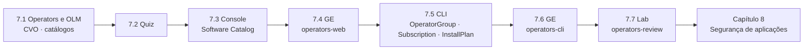

# Capítulo 7 — Managing Kubernetes Operators

**Título em português:** Gerenciar Operators do Kubernetes
**Status da documentação:** ✅ concluído e validado
**Referência:** PDF p. 303–350

## Objetivo do capítulo

Instalar e atualizar operators gerenciados pelo Operator Lifecycle Manager e pelo Cluster
Version Operator.

## Por que este capítulo importa

Boa parte das capacidades extras de um cluster (storage local, conformidade, integridade de
arquivos, balanceadores) chega como **operator**. O administrador precisa saber escolher
canal, escopo e política de atualização, instalar pela console e pela CLI, aprovar
atualizações e diagnosticar quando a instalação ou o operator falham.

## Seções e atividades (ordem oficial)

| Seção | Tipo | Título original | Material | PDF |
|-------|------|-----------------|----------|-----|
| 7.1 | Conceito | Kubernetes Operators and the Operator Lifecycle Manager | [lição](7.1-operators-e-olm.md) | p. 304–307 |
| 7.2 | Quiz (associação) | Kubernetes Operators and the Operator Lifecycle Manager | [prática](PRATICA-OFICIAL.md#72-quiz-kubernetes-operators-and-the-operator-lifecycle-manager) | p. 308–309 |
| 7.3 | Conceito | Installing Operators by Using the Web Console | [lição](7.3-instalar-operators-pela-console.md) | p. 310–313 |
| 7.4 | Guided Exercise | Install Operators by Using the Web Console | [prática](PRATICA-OFICIAL.md#74-guided-exercise-install-operators-by-using-the-web-console) | p. 314–325 |
| 7.5 | Conceito | Installing Operators with the CLI | [lição](7.5-instalar-operators-pela-cli.md) | p. 326–332 |
| 7.6 | Guided Exercise | Install Operators with the CLI | [prática](PRATICA-OFICIAL.md#76-guided-exercise-install-operators-with-the-cli) | p. 333–340 |
| 7.7 | Lab | Manage Kubernetes Operators | [prática](PRATICA-OFICIAL.md#77-lab-manage-kubernetes-operators) | p. 341–349 |
| 7.8 | Summary | Summary | [RESUMO.md](RESUMO.md) | p. 350 |

Abertura do capítulo (meta e seções): PDF p. 303.

## Arquivos do capítulo

- [PRATICA-OFICIAL.md](PRATICA-OFICIAL.md): ponte com as atividades oficiais e armadilhas do ambiente.
- [REVISAO.md](REVISAO.md): questões autorais integradas.
- [RESUMO.md](RESUMO.md): síntese, comandos e observações sobre o PDF.

## Pré-requisitos recomendados

[DO180 · 2.5 — Avaliar a saúde do cluster](https://github.com/eduardoandradej/openshift-do180-4.22-estudos/blob/main/capitulos/02-cli-e-apis/2.5-avaliar-a-saude-do-cluster.md) ·
[DO180 · F3 — Arquitetura OpenShift](https://github.com/eduardoandradej/openshift-do180-4.22-estudos/blob/main/01-fundamentos-essenciais/03-arquitetura-openshift.md) ·
[DO180 · F5 — Kubernetes API e YAML](https://github.com/eduardoandradej/openshift-do180-4.22-estudos/blob/main/01-fundamentos-essenciais/05-kubernetes-api-e-yaml.md) ·
[1.1 — Manifestos de recursos](../01-gerenciamento-declarativo/1.1-manifestos-de-recursos.md)

## Checklist do aluno

- [ ] 7.1 lida e Parte F respondida
- [ ] 7.2 Quiz respondido (sem olhar a solução antes)
- [ ] 7.3 lida e Parte F respondida
- [ ] 7.4 Guided Exercise `operators-web` concluído
- [ ] 7.5 lida e Parte F respondida
- [ ] 7.6 Guided Exercise `operators-cli` concluído
- [ ] 7.7 Lab `operators-review` com `lab grade` aprovado
- [ ] [REVISAO.md](REVISAO.md) respondida
- [ ] Registro no [diário de laboratórios](../../progresso/diario-de-laboratorios.md)

---
[← Capítulo 6](../06-autosservico/README.md) | [Índice geral](../../README.md) | [Próximo: 7.1 Operators e OLM →](7.1-operators-e-olm.md)
