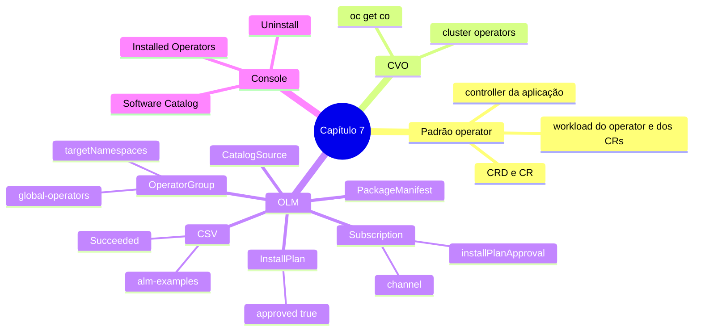

# Resumo — Capítulo 7

Síntese autoral para revisão rápida. Correspondência oficial: seção 7.8 (PDF p. 350).

## Em uma frase por seção

| Seção | Ideia central |
|-------|---------------|
| 7.1 | Operators são controllers específicos de uma aplicação: definem CRDs e transformam CRs em objetos comuns; o CVO cuida dos cluster operators e o OLM dos add-on operators, descobertos em catálogos |
| 7.3 | Pela console (**Software Catalog** e **Installed Operators**), instala-se escolhendo canal, modo, namespace e aprovação; usa-se criando CRs; diagnostica-se pelo CSV, pela assinatura e pelos workloads |
| 7.5 | Pela CLI, o administrador lê o `PackageManifest` e cria namespace, `OperatorGroup` e `Subscription`; o OLM gera `InstallPlan` e CSV; com aprovação manual, aprova-se o install plan |

## Mapa do capítulo

## Tabela de comandos do capítulo

| Tarefa | Comando | Tipo |
|--------|---------|------|
| Cluster operators | `oc get clusteroperator` · `oc describe clusteroperator <co>` | 🔍 |
| Catálogos | `oc get catalogsource -n openshift-marketplace` | 🔍 |
| Operators disponíveis | `oc get packagemanifests` · `oc describe packagemanifest 
` | 🔍 |
| Instalar | `oc create -f operator-group.yaml` · `oc create -f subscription.yaml` | ✏️ |
| Estado da instalação | `oc describe operator <pacote>` · `oc get installplan,csv -n <ns>` | 🔍 |
| Aprovar | `oc patch installplan <ip> -n <ns> --type merge -p '{"spec":{"approved":true}}'` | ✏️ |
| Trocar canal | `oc patch subscription <s> -n <ns> --type merge -p '{"spec":{"channel":"<c>"}}'` | ✏️ |
| CRDs do operator | `oc get csv <csv> -o jsonpath='{.spec.customresourcedefinitions.owned[*].name}'` | 🔍 |
| Exemplos de CR | `oc get csv <csv> -o jsonpath='{.metadata.annotations.alm-examples}' \| jq` | 🔍 |
| Deployments do OLM | `oc get csv <csv> -o jsonpath='{.spec.install.spec.deployments}'` | 🔍 |
| Remover (📘) | `oc delete subscription <s> -n <ns>` · `oc delete csv <csv> -n <ns>` | ✏️ |

## Alertas operacionais

- ⚠️ Leia a documentação do operator antes de instalar e antes de remover.
- ⚠️ Modo de instalação (onde observa) ≠ namespace instalado (onde roda).
- ⚠️ Exatamente **um** OperatorGroup por namespace; `openshift-operators` já tem `global-operators`.
- ⚠️ Com `Manual`, cada atualização gera um install plan novo a aprovar.
- ⚠️ CR só depois do CSV `Succeeded` (antes disso o tipo pode não existir).
- ⚠️ Desinstalar não garante remover namespace e CRDs.
- ⛔ Não altere arquivos dos nós fora dos exercícios.

## Divergências registradas em relação à apostila

Nenhuma imprecisão técnica identificada. Observações:

| Ponto | Apostila | Observação |
|-------|----------|------------|
| Namespace do exemplo de Subscription (p. 328 e 330) | O `PackageManifest` sugere um namespace e o exemplo de Subscription usa outro | Inconsistência de exemplo; na prática, use o namespace da documentação do operator / `suggested-namespace` |
| Nome do catálogo no resumo (p. 350) | "catálogos como o OperatorHub" | Na console 4.22 a página se chama **Ecosystem › Software Catalog**, como o próprio capítulo usa |
| Papel do OperatorGroup no resumo (p. 350) | "define se o operator é instalado em todo o cluster ou restrito" | Mais preciso: define os namespaces que o operator **observa**; o workload continua no namespace dele (nota da p. 311) |

## Ligação com o próximo capítulo

Com operators instalados e atualizados com controle, o Capítulo 8 (*Application
Security*) trata das permissões das próprias aplicações: SCCs, acesso à API por service
accounts e CronJobs de manutenção.

---
[← Revisão](REVISAO.md) | [Índice do capítulo](README.md) | [Próximo capítulo →](../08-seguranca-aplicacoes/README.md)
