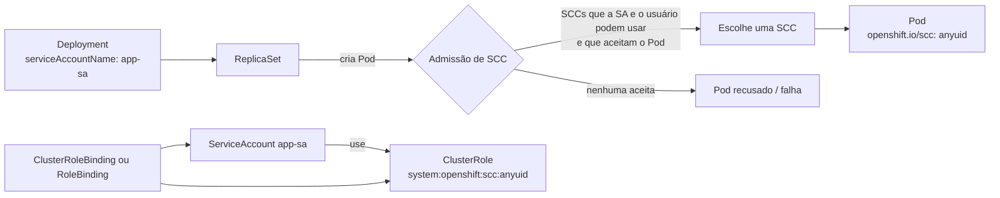

# 8.1 — Controlar as permissões de aplicações com security context constraints

| Campo | Valor |
|-------|-------|
| Curso | DO280 — OpenShift 4.22 |
| Capítulo / seção | Capítulo 8 · Seção 8.1 |
| Título original | Controlling Application Permissions with Security Context Constraints |
| Título em português | Controlar as permissões de aplicações com security context constraints |
| Objetivo | Criar service accounts, aplicar permissões e gerenciar security context constraints |
| Referência | PDF p. 352–355 · Guided Exercise 8.2 p. 356–361 |

## Pré-requisitos e conhecimentos anteriores

No DO180 você viu que cada projeto recebe uma faixa de UIDs e que o OpenShift roda os
containers com um **UID aleatório** dessa faixa, por causa da SCC `restricted-v2` e da
Pod Security Admission. Também viu que imagens feitas para rodar como `root` falham nesse
modelo. No [Capítulo 3](../03-autenticacao-autorizacao/3.3-permissoes-com-rbac.md) você
aprendeu Roles, ClusterRoles, bindings e service accounts como sujeitos de RBAC.

| Conceito | Onde revisar |
|----------|--------------|
| UIDs por projeto, PSA e SCC (visão inicial) | [DO180 · 3.1 — Criar containers e Pods](https://github.com/eduardoandradej/openshift-do180-4.22-estudos/blob/main/capitulos/03-containers-e-pods/3.1-criar-containers-e-pods.md) |
| Diagnóstico de Pods (`Error`, `CrashLoopBackOff`, logs) | [DO180 · 3.5 — Diagnosticar containers e Pods](https://github.com/eduardoandradej/openshift-do180-4.22-estudos/blob/main/capitulos/03-containers-e-pods/3.5-diagnosticar-containers-e-pods.md) |
| RBAC, service accounts, `oc adm policy` | [3.3 — Permissões com RBAC](../03-autenticacao-autorizacao/3.3-permissoes-com-rbac.md) |

## Parte A — Entendendo o conceito

### O que é uma SCC

**Security context constraints (SCCs)** são um mecanismo do OpenShift que limita o que um
Pod pode fazer **no host**. Assim como o RBAC controla o que um usuário pode fazer na API, a
SCC controla com que **privilégios** um Pod pode rodar. Uma SCC é um conjunto de condições:
o Pod só é aceito se cumprir as condições de alguma SCC que ele tenha permissão de usar.

O que uma SCC controla:

- containers **privilegiados**;
- **capabilities** extras do Linux;
- diretórios do host como volumes;
- contexto **SELinux**;
- **UID** com que o container roda;
- namespaces e rede do host.

É o princípio do menor privilégio aplicado ao nó: se um workload for comprometido, o
estrago fica contido.

### SCCs padrão

`oc get scc` lista as SCCs. As mais importantes no dia a dia:

| SCC | Em resumo |
|-----|-----------|
| `restricted-v2` | Padrão para a maioria dos Pods: UID aleatório da faixa do projeto, sem root, sem acesso ao host. Disponível a todos os usuários autenticados |
| `restricted-v3` | Variante mais nova da família restricted |
| `nonroot-v2` | Qualquer UID **diferente de 0** (útil para imagens com UID fixo não-root) |
| `anyuid` | Qualquer UID, **inclusive root**; o relaxamento mais comum |
| `hostnetwork-v2`, `hostmount-anyuid-v2`, `hostaccess` | Acesso pontual a rede, diretórios ou namespaces do host |
| `privileged` | Remove quase todas as restrições; acesso total ao nó |

Operators podem instalar SCCs próprias (o LVM Storage instala `lvms-vgmanager`, por
exemplo).

> ⛔ **Não altere as SCCs padrão.** Mudanças podem quebrar Pods da plataforma e algumas
> atualizações do cluster as restauram. Se precisar de algo diferente, crie uma SCC nova.

### Qual SCC o Pod recebeu

Cada Pod tem anotações:

| Anotação | Significado |
|----------|-------------|
| `openshift.io/scc` | A SCC **aplicada** ao Pod |
| `openshift.io/required-scc` | A SCC **exigida** pelo workload (quando definida) |

### Por que imagens da internet falham

Imagens feitas para Docker Hub costumam presumir `root`:

- precisam de um UID específico (o `restricted-v2` usa um aleatório);
- escrevem em diretórios do sistema (`/etc`, `/var`) sem permissão para o UID aleatório;
- escutam em portas privilegiadas (< 1024), o que o UID aleatório não pode fazer.

Sintomas: Pod em `Error` ou `CrashLoopBackOff` e log com *permission denied* ou falha ao
abrir a porta.

### Como dar uma SCC a um workload

A SCC não é dada ao Pod nem ao Deployment, e sim à **service account** com que o Pod roda:

1. descobrir qual SCC resolve: `oc adm policy scc-subject-review`;
2. criar uma service account para a aplicação;
3. dar à service account o direito de **usar** a SCC (administrador do cluster);
4. associar a service account ao workload (`oc set serviceaccount`), o que recria os Pods.

Duas formas de conceder o uso (passo 3):

| Forma | Comando | Escopo do binding |
|-------|---------|-------------------|
| `oc adm policy add-scc-to-user <scc> -z <sa>` | Cria (se faltar) a ClusterRole `system:openshift:scc:<scc>` e um **ClusterRoleBinding** com esse nome | Cluster |
| RBAC manual | `oc create role ... --verb use --resource scc --resource-name <scc>` + `oc create rolebinding ...` | **Só o projeto** |

> 📘 **Fonte externa (código do `oc`, `pkg/cli/admin/policy/modify_scc.go`, branch
> `release-4.22`):** quando você passa `-n <projeto>` **explicitamente**, o
> `add-scc-to-user` cria um **RoleBinding** naquele projeto em vez do ClusterRoleBinding.
> Sem `-n`, vale o ClusterRoleBinding, como diz a apostila.

> ⚠️ Conceder uma SCC menos restritiva reduz a segurança do cluster. Prefira a SCC menos
> permissiva que resolve (por exemplo, `nonroot-v2` antes de `anyuid`, `anyuid` antes de
> `privileged`) e, quando possível, corrija a imagem.

### Fixar a SCC: `openshift.io/required-scc`

Quando várias SCCs servem, o OpenShift escolhe por prioridade e restrição. Para **fixar** a
SCC, anote o **template de Pod** do Deployment:

```yaml
spec:
  template:
    metadata:
      annotations:
        openshift.io/required-scc: "anyuid"
```

A SCC precisa existir e a service account precisa ter permissão de usá-la; senão a
admissão do Pod falha. Não altere essa anotação diretamente em um Pod em execução: altere o
Deployment, que recria os Pods.

### Containers privilegiados

`anyuid` resolve a maioria das imagens "root". Agentes de monitoramento e coletores de log
podem precisar de diretórios, rede ou processos do host: usam `privileged`. Conceda
`privileged` só quando for realmente necessário — o Pod pode acessar qualquer recurso do
nó.

## Parte B — Modelo mental e arquitetura



## Parte C — Aplicação prática

> Legenda: 🔍 somente leitura · ✏️ altera o cluster
>
> Manifestos autorais em [exemplos-originais/seguranca-aplicacoes](../../exemplos-originais/seguranca-aplicacoes/).

### 1. Investigar 🔍

```bash
oc get scc                                         # SCCs do cluster (administrador)
oc describe scc anyuid                             # prioridade, quem pode usar, estratégias
oc describe pod <p> | grep scc                     # SCC aplicada / exigida
oc get pod <p> -o jsonpath='{.metadata.annotations.openshift\.io/scc}{"\n"}'
oc logs <p>                                        # permission denied? porta?
```

### 2. Descobrir a SCC que resolve 🔍

```bash
oc get deployment <d> -o yaml | oc adm policy scc-subject-review -f -
oc adm policy scc-subject-review -f deployment.yaml
```

A coluna `ALLOWED BY` mostra a SCC que permitiria o workload.

### 3. Conceder pelo atalho (cluster) ✏️

```bash
oc create serviceaccount app-sa
oc adm policy add-scc-to-user anyuid -z app-sa                # administrador do cluster
oc set serviceaccount deployment/app app-sa                   # recria os Pods
```

- **Permissões:** criar a service account e alterar o Deployment pode ser feito pelo
  administrador do projeto; **conceder SCC só o administrador do cluster**.
- **Resultado:** `clusterrole.rbac.authorization.k8s.io/system:openshift:scc:anyuid added: "app-sa"`.
- **Remover:** `oc adm policy remove-scc-from-user anyuid -z app-sa`.

### 4. Conceder só no projeto (RBAC) ✏️

```bash
oc create role usa-anyuid --verb use --resource scc --resource-name anyuid -n loja
oc create rolebinding usa-anyuid --role usa-anyuid --serviceaccount loja:app-sa -n loja
oc set serviceaccount deployment/app app-sa -n loja
```

### 5. Verificar 🔍

```bash
oc get pods -w                                     # novo Pod Running
oc describe pod <novo> | grep scc                  # openshift.io/scc: anyuid
oc get clusterrolebinding system:openshift:scc:anyuid -o yaml   # sujeitos (se usou o atalho)
```

### Raciocínio operacional e diagnóstico

| Sintoma | Hipótese | Como confirmar | Correção segura |
|---------|----------|----------------|-----------------|
| `CrashLoopBackOff`, log com *permission denied* | Imagem espera root/UID fixo | `oc logs`; `openshift.io/scc: restricted-v2` | SA com a SCC mínima necessária |
| Log com falha ao abrir a porta 80/443 | Porta privilegiada com UID aleatório | `oc logs` | `anyuid` para a SA, ou imagem/porta não privilegiada |
| Deployment sem Pods; evento `unable to validate against any security context constraint` | Pod pede algo que nenhuma SCC permitida aceita | `oc describe rs` / eventos | Conceder a SCC adequada à SA usada pelo Pod |
| SCC concedida, Pod continua com `restricted-v2` | SCC dada a outra SA, ou Deployment sem `serviceAccountName` | `oc get deploy -o jsonpath='{..serviceAccountName}'` | `oc set serviceaccount` |
| `add-scc-to-user` falha com Forbidden | Usuário não é administrador do cluster | `oc whoami` | Pedir ao administrador |
| Admissão falha com `required-scc` | SCC inexistente ou SA sem permissão de uso | Eventos do ReplicaSet | Corrigir o nome ou conceder o uso |
| SCC concedida a mais projetos do que deveria | Atalho criou ClusterRoleBinding | `oc get clusterrolebinding system:openshift:scc:<scc> -o yaml` | Usar Role + RoleBinding no projeto |

## Parte D — Relações importantes

| A | B | Diferença essencial |
|---|---|--------------------|
| RBAC | SCC | O que pode fazer na **API** × com que privilégios o Pod roda no **host** |
| SCC | Pod Security Admission | Mecanismo do OpenShift × padrão do Kubernetes por labels de namespace; os dois atuam |
| `restricted-v2` | `anyuid` | UID aleatório, sem root × qualquer UID, inclusive root |
| `anyuid` | `privileged` | Só o UID × praticamente sem restrição |
| `add-scc-to-user` | Role + RoleBinding | ClusterRoleBinding (cluster) × uso da SCC só no projeto |
| `openshift.io/scc` | `openshift.io/required-scc` | SCC aplicada × SCC exigida |
| Service account | Usuário | Identidade do Pod × identidade de pessoa |

## Parte E — Preparação para o laboratório oficial

Atividade associada: **8.2 Guided Exercise — Control Application Permissions with Security
Context Constraints** (`appsec-scc`, PDF p. 356–361).

Você deve conseguir, sem consultar a lição:

- reconhecer pelo log que uma imagem precisa de root;
- descobrir a SCC com `scc-subject-review`;
- criar a service account, conceder a SCC pelo atalho e, depois, só no projeto por RBAC;
- associar a service account ao Deployment e confirmar a SCC no Pod.

Detalhes e armadilhas em
[PRATICA-OFICIAL.md](PRATICA-OFICIAL.md#82-guided-exercise-control-application-permissions-with-security-context-constraints).

## Parte F — Fixação

1. Qual a diferença entre o que o RBAC e a SCC controlam?
2. Por que uma imagem que escuta na porta 80 falha com `restricted-v2`?
3. A quem se concede uma SCC: ao usuário, ao Deployment ou à service account? Por quê?
4. O que `oc adm policy scc-subject-review` informa?
5. Por que `add-scc-to-user` pode conceder mais do que você queria, e qual a alternativa?
6. Você concedeu `anyuid` à SA `app-sa`, mas o Pod continua com `restricted-v2`. O que faltou?
7. Por que não editar a SCC `restricted-v2` para permitir root?

<details>
<summary>Respostas comentadas</summary>

1. RBAC controla ações na API; SCC controla privilégios do Pod no host (UID, capabilities, SELinux, volumes e rede do host).
2. O UID aleatório não pode abrir portas abaixo de 1024.
3. À service account, porque é a identidade com que o Pod é admitido; todo Pod que usar aquela SA ganha a SCC.
4. Quais SCCs permitiriam o workload (coluna `ALLOWED BY`).
5. Sem `-n` explícito ele cria um ClusterRoleBinding; a alternativa é Role com verbo `use` na SCC + RoleBinding no projeto.
6. Associar a SA ao Deployment (`oc set serviceaccount deployment/<d> app-sa`), que recria os Pods.
7. Afeta todos os Pods do cluster, pode quebrar a plataforma e pode ser desfeita por atualizações; crie uma SCC nova ou conceda uma existente só à SA necessária.

</details>

## Parte G — Essencial para memorizar

- SCC = privilégios do Pod no host; padrão `restricted-v2` (UID aleatório, sem root).
- Fluxo: `scc-subject-review` → `oc create sa` → `oc adm policy add-scc-to-user <scc> -z <sa>` → `oc set serviceaccount deployment/<d> <sa>`.
- Só no projeto: `oc create role --verb use --resource scc --resource-name <scc>` + `oc create rolebinding --serviceaccount ns:sa`.
- Conferir: anotação `openshift.io/scc` do Pod.
- `openshift.io/required-scc` no template fixa a SCC.
- Nunca altere as SCCs padrão; `privileged` só em último caso.

---
[← Índice do capítulo](README.md) | [Índice do capítulo](README.md) | [Próximo: 8.3 Acesso de aplicações às APIs →](8.3-acesso-de-aplicacoes-a-api.md)
