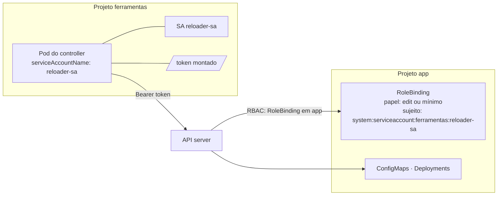

# 8.3 — Permitir o acesso de aplicações às APIs do Kubernetes

| Campo | Valor |
|-------|-------|
| Curso | DO280 — OpenShift 4.22 |
| Capítulo / seção | Capítulo 8 · Seção 8.3 |
| Título original | Allowing Application Access to Kubernetes APIs |
| Título em português | Permitir o acesso de aplicações às APIs do Kubernetes |
| Objetivo | Permitir que uma aplicação acesse as APIs do Kubernetes do próprio cluster |
| Referência | PDF p. 362–366 · Guided Exercise 8.4 p. 367–371 |

## Pré-requisitos e conhecimentos anteriores

O [Capítulo 3](../03-autenticacao-autorizacao/3.3-permissoes-com-rbac.md) cobriu Roles,
ClusterRoles, RoleBindings e ClusterRoleBindings, `oc adm policy` e service accounts como
sujeitos. A [lição 8.1](8.1-security-context-constraints.md) usou service accounts para
dar **privilégios no host**; aqui elas recebem **permissões na API**. Os operators do
[Capítulo 7](../07-operadores-kubernetes/7.1-operators-e-olm.md) são o exemplo típico de
aplicação que conversa com a API.

| Conceito | Onde revisar |
|----------|--------------|
| RBAC, papéis padrão, `oc adm policy`, `-z` | [3.3 — Permissões com RBAC](../03-autenticacao-autorizacao/3.3-permissoes-com-rbac.md) |
| Autenticação por token | [3.1 — Provedor de identidade HTPasswd](../03-autenticacao-autorizacao/3.1-provedor-de-identidade-htpasswd.md) |
| Configuração montada de ConfigMaps | [DO180 · 5.1 — Externalizar configuração](https://github.com/eduardoandradej/openshift-do180-4.22-estudos/blob/main/capitulos/05-configuracao-e-storage/5.1-externalizar-configuracao.md) |
| Operators | [7.1 — Operators e OLM](../07-operadores-kubernetes/7.1-operators-e-olm.md) |

## Parte A — Entendendo o conceito

### Aplicações também são sujeitos de RBAC

A API do Kubernetes consulta e altera o estado do cluster; o RBAC já vem ativado e
nenhuma aplicação acessa recursos protegidos sem autorização explícita. A identidade de uma
aplicação é a **service account** (SA) com que seus Pods rodam: um objeto do projeto.

Três passos:

1. criar uma SA para a aplicação;
2. conceder à SA o acesso às APIs necessárias (Role/ClusterRole + binding);
3. fazer os Pods da aplicação usarem a SA (`spec.serviceAccountName`).

### A service account `default`

Pod sem `serviceAccountName` usa a SA `default` do projeto. Ela não recebe permissões
especiais, e isso basta para aplicações de negócio, que não falam com a API do cluster.

> Precisão: toda SA também pertence a grupos como `system:serviceaccounts` e
> `system:authenticated`, que têm permissões básicas (descoberta da API, por exemplo); "sem
> permissões" significa "sem permissões além das básicas".

**Não dê permissões à SA `default`:** todo Pod do projeto as herdaria. Crie uma SA por
aplicação que precise de acesso.

### Quem precisa de acesso à API

| Caso | Exemplo | Tipo de acesso |
|------|---------|----------------|
| Monitoramento / segurança | Scanner de vulnerabilidades | Leitura |
| Controllers | Ferramenta de GitOps que sincroniza o cluster com um repositório; o Reloader do GE 8.4 | Leitura e escrita |
| Operators | Operator de banco que cria Deployments a partir de CRs | Leitura e escrita amplas |

### Papéis sob medida ou padrão

Crie uma Role/ClusterRole com **só** o necessário:

```yaml
apiVersion: rbac.authorization.k8s.io/v1
kind: ClusterRole
metadata:
  name: leitor-configmaps
rules:
- apiGroups: [""]               # "" = grupo core
  resources: ["configmaps"]
  verbs: ["get", "list", "watch"]
```

Papéis padrão (`view`, `edit`, `admin`) funcionam, mas são mais amplos: `edit` lê
Secrets **e** cria ou altera quase todos os objetos do projeto. Em produção, prefira o
papel mínimo.

### Ligar o papel à SA

| Comando | Cria | Alcance |
|---------|------|---------|
| `oc adm policy add-role-to-user <papel> -z <sa>` | RoleBinding no projeto atual | Recursos do projeto |
| `oc adm policy add-role-to-user <papel> system:serviceaccount:<proj>:<sa> -n <outro>` | RoleBinding em `<outro>` | Recursos de `<outro>` para a SA de `<proj>` |
| `oc adm policy add-cluster-role-to-user <papel> -z <sa>` | ClusterRoleBinding | Todos os namespaces |

`-z <sa>` é atalho para `system:serviceaccount:<projeto atual>:<sa>`. Para uma SA de
**outro** projeto, use o nome completo. `--rolebinding-name` escolhe o nome do binding.

### O escopo é dado pelo **binding**

| Precisa de acesso a | Faça |
|---------------------|------|
| Recursos do próprio namespace | Role ou ClusterRole + **RoleBinding** no próprio namespace |
| Recursos de **outro** namespace | RoleBinding **no namespace dos recursos**, com sujeito `system:serviceaccount:<proj-da-app>:<sa>` |
| Recursos de todos os namespaces | ClusterRole + **ClusterRoleBinding** |

Uma ClusterRole ligada por **RoleBinding** só vale naquele namespace: é assim que se
reaproveita uma ClusterRole com escopo limitado.

### Tokens

A aplicação se autentica na API com um **token da SA**:

- **Dentro do cluster:** o kubelet pede um token para a SA do Pod pela API
  **TokenRequest** e o monta em `/var/run/secrets/kubernetes.io/serviceaccount/token`
  (com o certificado da CA e o namespace ao lado). Clientes do Kubernetes leem esse
  caminho automaticamente. O token tem validade limitada e é renovado.
- **Fora do cluster** (pipelines de CI/CD, scripts): `oc create token <sa>` gera um token
  de curta duração (1 hora por padrão; `--duration` muda).

Em nuvens gerenciadas (ROSA, ARO, OSD), Pods também podem trocar o token projetado por
credenciais temporárias do provedor (IRSA, Workload Identity, WIF), sem credenciais fixas.

## Parte B — Modelo mental e arquitetura



## Parte C — Aplicação prática

> Legenda: 🔍 somente leitura · ✏️ altera o cluster
>
> Manifestos autorais em [exemplos-originais/seguranca-aplicacoes](../../exemplos-originais/seguranca-aplicacoes/).

### 1. Criar a SA e usá-la no workload ✏️

```bash
oc create serviceaccount reloader-sa -n ferramentas
oc set serviceaccount deployment/reloader reloader-sa -n ferramentas
# ou no manifesto: spec.template.spec.serviceAccountName: reloader-sa
```

### 2. Conceder acesso ✏️

```bash
# mesmo projeto
oc adm policy add-role-to-user view -z reloader-sa -n ferramentas
# outro projeto (o binding fica no projeto dos recursos)
oc adm policy add-role-to-user edit \
  system:serviceaccount:ferramentas:reloader-sa \
  --rolebinding-name reloader-edit -n app
# todo o cluster (administrador do cluster)
oc adm policy add-cluster-role-to-user leitor-configmaps -z reloader-sa -n ferramentas
```

Forma declarativa equivalente (outro projeto):

```bash
oc create rolebinding reloader-edit --clusterrole edit \
  --serviceaccount ferramentas:reloader-sa -n app
```

- **Permissões:** quem cria o RoleBinding precisa poder gerenciar bindings no projeto
  (papel `admin`) e possuir as permissões que concede; ClusterRoleBinding exige
  administrador do cluster.

### 3. Verificar 🔍

```bash
oc auth can-i list configmaps -n app --as system:serviceaccount:ferramentas:reloader-sa
oc auth can-i update deployments -n app --as system:serviceaccount:ferramentas:reloader-sa
oc get rolebinding -n app -o wide                     # papel e sujeitos
oc policy who-can update deployments -n app           # quem pode
```

### 4. Tokens 🔍 ✏️

```bash
oc create token reloader-sa -n ferramentas                  # 1 h por padrão
oc create token reloader-sa -n ferramentas --duration 10m
oc exec deploy/reloader -n ferramentas -- ls /var/run/secrets/kubernetes.io/serviceaccount
```

Trate tokens como senhas: não versione, não registre em logs.

### Raciocínio operacional e diagnóstico

| Sintoma | Hipótese | Como confirmar | Correção segura |
|---------|----------|----------------|-----------------|
| Log: `User "system:serviceaccount:ns:default" cannot list ...` | Pod rodando com a SA `default` | Nome da SA na mensagem; `serviceAccountName` | `oc set serviceaccount` para a SA com permissões |
| `... cannot list resource "x" in API group "" in the namespace "y"` | Falta RoleBinding em `y` | `oc auth can-i ... --as system:serviceaccount:...` | RoleBinding em `y` |
| `... at the cluster scope` | Recurso de cluster (ex.: `nodes`) ou listagem em todos os namespaces | Mensagem | ClusterRole + ClusterRoleBinding mínimos |
| Binding criado, ainda Forbidden | Binding no namespace errado ou sujeito com projeto errado | `oc get rolebinding -n <ns> -o wide` | Binding no namespace dos recursos, sujeito completo |
| `-z` concedeu à SA errada | `-z` usa o projeto **atual** | `oc project` | Nome completo `system:serviceaccount:<proj>:<sa>` |
| Script externo deixou de autenticar | Token de curta duração expirou | Erro 401 | Novo `oc create token` (ou `--duration`) |

## Parte D — Relações importantes

| A | B | Diferença essencial |
|---|---|--------------------|
| Usuário | Service account | Pessoa (OAuth) × aplicação (token de SA) |
| SCC na SA (8.1) | Papel RBAC na SA (8.3) | Privilégios no host × permissões na API |
| Role | ClusterRole | Definida no namespace × definida no cluster (reutilizável) |
| RoleBinding | ClusterRoleBinding | Vale no namespace do binding × vale em todos |
| `-z sa` | `system:serviceaccount:proj:sa` | SA do projeto atual × SA de qualquer projeto |
| Token montado | `oc create token` | Dentro do Pod, automático × fora do cluster, sob demanda |
| `edit` | Papel mínimo | Amplo (inclui Secrets e escrita) × só o necessário |

## Parte E — Preparação para o laboratório oficial

Atividade associada: **8.4 Guided Exercise — Allow Application Access to Kubernetes APIs**
(`appsec-api`, PDF p. 367–371).

Você deve conseguir, sem consultar a lição:

- criar uma SA e referenciá-la no manifesto de um Deployment;
- conceder a uma SA de um projeto um papel em **outro** projeto, com nome de binding
  escolhido;
- comprovar que o controller age no outro projeto (a mudança de configuração aparece na
  aplicação).

Detalhes e armadilhas em
[PRATICA-OFICIAL.md](PRATICA-OFICIAL.md#84-guided-exercise-allow-application-access-to-kubernetes-apis).

## Parte F — Fixação

1. Por que não dar permissões à SA `default`?
2. Onde fica o RoleBinding quando a SA está em `ferramentas` e os recursos em `app`?
3. Escreva o sujeito completo da SA `coletor` do projeto `observa`.
4. Uma ClusterRole ligada por RoleBinding vale em quais namespaces?
5. Um log diz `cannot list resource "nodes" ... at the cluster scope`. Que tipo de binding resolve?
6. Como um Pod obtém seu token? E um pipeline fora do cluster?
7. Por que `edit` não é a melhor escolha em produção para um controller que só lê ConfigMaps e reinicia Deployments?

<details>
<summary>Respostas comentadas</summary>

1. Todo Pod do projeto que não declara SA usa a `default` e herdaria as permissões.
2. Em `app`, o namespace dos recursos, com sujeito `system:serviceaccount:ferramentas:<sa>`.
3. `system:serviceaccount:observa:coletor`.
4. Só no namespace do RoleBinding.
5. ClusterRoleBinding com uma ClusterRole que permita listar `nodes` (recurso de cluster).
6. O kubelet pede o token via TokenRequest e o monta em `/var/run/secrets/kubernetes.io/serviceaccount/token`; fora do cluster, `oc create token <sa>`.
7. Concede muito mais (Secrets, criação e alteração de quase tudo); um papel com `get/list/watch` em ConfigMaps e `get/patch` em Deployments basta.

</details>

## Parte G — Essencial para memorizar

- Identidade de aplicação = service account; Pod sem SA usa `default` (não dê permissões a ela).
- `oc adm policy add-role-to-user <papel> -z <sa>` (projeto atual) · `system:serviceaccount:<proj>:<sa> -n <outro>` (outro projeto) · `add-cluster-role-to-user` (cluster).
- O escopo vem do **binding**; RoleBinding fica no namespace dos **recursos**.
- Verificar: `oc auth can-i <verbo> <recurso> -n <ns> --as system:serviceaccount:<proj>:<sa>`.
- Token no Pod: `/var/run/secrets/kubernetes.io/serviceaccount/token`; fora: `oc create token <sa> [--duration]`.

---
[← 8.1 Security context constraints](8.1-security-context-constraints.md) | [Índice do capítulo](README.md) | [Próximo: 8.5 Manutenção com cron jobs →](8.5-manutencao-com-cron-jobs.md)
