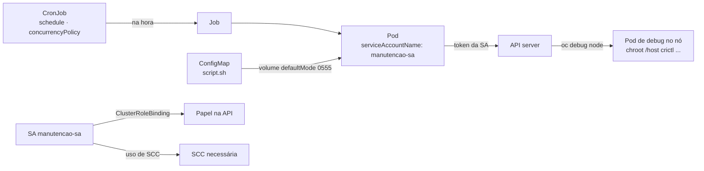

# 8.5 — Manutenção do cluster e dos nós com cron jobs do Kubernetes

| Campo | Valor |
|-------|-------|
| Curso | DO280 — OpenShift 4.22 |
| Capítulo / seção | Capítulo 8 · Seção 8.5 |
| Título original | Cluster and Node Maintenance with Kubernetes Cron Jobs |
| Título em português | Manutenção do cluster e dos nós com cron jobs do Kubernetes |
| Objetivo | Automatizar tarefas regulares de gerenciamento do cluster e das aplicações com cron jobs |
| Referência | PDF p. 372–377 · Guided Exercise 8.6 p. 378–384 · Lab 8.7 p. 385–392 |

## Pré-requisitos e conhecimentos anteriores

Jobs e CronJobs apareceram no DO180 como workloads de curta duração. `oc debug node/<nó>`
com `chroot /host` e o `crictl` também vêm de lá. Desta vez o foco é **automação de
manutenção** e as **permissões** que ela exige — junte as lições
[8.1](8.1-security-context-constraints.md) (SCC na service account) e
[8.3](8.3-acesso-de-aplicacoes-a-api.md) (papéis RBAC na service account).

| Conceito | Onde revisar |
|----------|--------------|
| Jobs e CronJobs | [DO180 · 4.3 — Workloads de longa e curta duração](https://github.com/eduardoandradej/openshift-do180-4.22-estudos/blob/main/capitulos/04-deploy-e-redes/4.3-workloads-de-longa-e-curta-duracao.md) |
| `crictl` e o container visto do nó | [DO180 · 3.1 — Criar containers e Pods](https://github.com/eduardoandradej/openshift-do180-4.22-estudos/blob/main/capitulos/03-containers-e-pods/3.1-criar-containers-e-pods.md) |
| `oc debug node` | [DO180 · 2.5 — Avaliar a saúde do cluster](https://github.com/eduardoandradej/openshift-do180-4.22-estudos/blob/main/capitulos/02-cli-e-apis/2.5-avaliar-a-saude-do-cluster.md) |
| ConfigMap montado como volume | [DO180 · 5.1 — Externalizar configuração](https://github.com/eduardoandradej/openshift-do180-4.22-estudos/blob/main/capitulos/05-configuracao-e-storage/5.1-externalizar-configuracao.md) |

## Parte A — Entendendo o conceito

### Tarefas de manutenção e privilégios

Administradores automatizam manutenção **do cluster** (limpar imagens dos nós, remover
projetos vencidos); desenvolvedores automatizam manutenção **das aplicações** (backups,
relatórios). A diferença está nos privilégios: tarefas de cluster costumam exigir Pods
privilegiados e acesso amplo à API; tarefas de aplicação normalmente não.

### Job e CronJob (`batch/v1`)

| Recurso | Executa | Contém |
|---------|---------|--------|
| **Job** | Uma vez (até concluir) | Template de Pod (`spec.template`) com ao menos um container e `restartPolicy` `Never` ou `OnFailure` |
| **CronJob** | Conforme `spec.schedule` | `spec.jobTemplate` — um Job inteiro — e o agendamento |

Quando chega a hora, o CronJob cria um **Job**, que cria o **Pod**. Fora essa relação,
são recursos comuns. Gere o esqueleto sem decorar o YAML:

```bash
oc create job teste --image <imagem> --dry-run=client -o yaml -- <comando> <args>
oc create cronjob teste --image <imagem> --schedule '0 0 * * *' --dry-run=client -o yaml -- <comando>
```

Estrutura (aninhamento é o erro mais comum):

```text
CronJob.spec
├── schedule / timeZone
└── jobTemplate.spec            ← um Job
    └── template.spec           ← um Pod
        ├── serviceAccountName
        ├── restartPolicy
        └── containers[]
```

`spec.timeZone` (ex.: `Etc/UTC`) é opcional; sem ele, o horário é interpretado no fuso do
controller manager.

### Sintaxe de agendamento (cron)

Cinco campos: **minuto hora dia-do-mês mês dia-da-semana** (domingo = 0 ou 7).

| Expressão | Quando |
|-----------|--------|
| `0 0 * * *` | Todo dia à meia-noite |
| `0 0 * * 0` | Todo domingo à meia-noite |
| `0 * * * *` | A cada hora, no minuto 0 |
| `0 */4 * * *` | A cada 4 horas |
| `*/4 * * * *` | A cada 4 minutos |
| `*/1 * * * *` | A cada minuto (o mesmo que `* * * * *`) |
| `30 2 * * 1-5` | 02:30 de segunda a sexta |

Coloque a expressão **entre aspas** no YAML quando começar com `*` (senão o YAML a lê como
alias). Referência: `man 5 crontab`.

> 📘 **Fonte externa (API `batch/v1`, k8s.io/api v0.37.1):** campos úteis do CronJob —
> `concurrencyPolicy` (`Allow` padrão, `Forbid` não inicia se a execução anterior não
> terminou, `Replace` substitui), `suspend`, `successfulJobsHistoryLimit` (padrão 3) e
> `failedJobsHistoryLimit` (padrão 1). No Job, `backoffLimit` (padrão 6 tentativas).

### Manutenção de aplicações

Exemplo típico: um backup semanal que ativa o modo de manutenção, exporta o banco,
desativa o modo, copia o arquivo para fora e o apaga. Vários comandos em um container:

```yaml
command: ["bash", "-xc"]
args:
- >
  app maintenance on ;
  app db-export | gzip > db.sql.gz ;
  app maintenance off ;
```

O `>` (estilo *folded* do YAML) junta as linhas com espaços; por isso os comandos são
separados por `;` — o texto chega como **um único argumento** ao `bash -c`.

### Manutenção do cluster

Para tarefas complexas, coloque o **script em um ConfigMap**, monte-o no Pod e execute-o.
Exemplo da apostila: nós acumulam imagens não usadas; `crictl rmi --prune` em cada nó libera
espaço. O script lista os nós e, para cada um, roda `oc debug node/... -- chroot /host
crictl rmi --prune`. A imagem do container precisa ter o `oc` (ex.: `origin-cli`).

Isso exige permissões fortes na service account do CronJob:

- **API:** listar nós e criar Pods de debug (o GE usa `cluster-admin`);
- **host:** os Pods de debug são privilegiados (o GE concede a SCC `privileged`).

Sem isso, o Job falha com `Forbidden`, citando `system:serviceaccount:<projeto>:default`.

> ⛔ Conceder `cluster-admin` e `privileged` a uma service account dá controle total do
> cluster a quem puder usar essa SA (ou criar Pods no projeto dela). Em produção, use um
> projeto dedicado com acesso restrito, papéis mínimos e prefira os mecanismos nativos
> (a apostila remete a limpeza de imagens ao curso DO380). Não rode limpezas de nós fora
> dos exercícios no ambiente do curso.

## Parte B — Modelo mental e arquitetura



## Parte C — Aplicação prática

> Legenda: 🔍 somente leitura · ✏️ altera o cluster
>
> Manifestos autorais em [exemplos-originais/seguranca-aplicacoes](../../exemplos-originais/seguranca-aplicacoes/).

### 1. Criar e acompanhar ✏️ 🔍

```bash
oc apply -f configmap-script.yaml
oc apply -f cronjob.yaml
oc get cronjobs,jobs,pods                       # SCHEDULE, LAST SCHEDULE, COMPLETIONS
watch oc get cronjobs,jobs,pods
oc logs job/<job>                               # ou pod/<pod>
oc describe cronjob <cj>                        # eventos (SuccessfulCreate, SawCompletedJob)
```

### 2. Testar sem esperar o horário ✏️

```bash
oc create job teste-manual --from cronjob/<cj>  # executa já, com o mesmo template
```

### 3. Dar permissões ✏️ (administrador do cluster para papéis de cluster e SCC)

```bash
oc create sa manutencao-sa
oc adm policy add-cluster-role-to-user <papel> -z manutencao-sa
oc adm policy add-scc-to-user <scc> -z manutencao-sa          # se o Pod precisar
oc set serviceaccount cronjob/<cj> manutencao-sa              # ou serviceAccountName no YAML
```

### 4. Pausar, retomar, remover ✏️

```bash
oc patch cronjob <cj> --type merge -p '{"spec":{"suspend":true}}'
oc patch cronjob <cj> --type merge -p '{"spec":{"suspend":false}}'
oc delete cronjob <cj>                           # apaga também os Jobs e Pods dele
```

### Raciocínio operacional e diagnóstico

| Sintoma | Hipótese | Como confirmar | Correção segura |
|---------|----------|----------------|-----------------|
| Job `Failed`, log `Forbidden ... system:serviceaccount:<ns>:default` | CronJob sem SA própria | `oc logs`; `serviceAccountName` | SA com papel mínimo + `serviceAccountName` |
| `cannot list resource "nodes" ... at the cluster scope` | Falta ClusterRoleBinding | `oc auth can-i list nodes --as system:serviceaccount:<ns>:<sa>` | Papel de cluster adequado |
| Pod de debug não criado / admissão de SCC | SA sem SCC privilegiada | Eventos; log do Job | Conceder a SCC necessária |
| Script `permission denied` | ConfigMap montado sem execução | `defaultMode` | `defaultMode: 0555` |
| Script não encontrado | `mountPath` × `command` diferentes | `oc describe pod` | Alinhar caminhos |
| Nunca executa | Expressão errada, `suspend: true` ou fuso | `oc get cronjob` (SCHEDULE, SUSPEND, LAST SCHEDULE) | Corrigir `schedule`/`timeZone` |
| Execuções se acumulam | Execução mais longa que o intervalo | `oc get jobs` | `concurrencyPolicy: Forbid` |
| `unknown field` ao aplicar | Campo no nível errado (ex.: label direto em `metadata`) | Mensagem do `oc apply` | Corrigir o aninhamento |
| Log da última execução vazio | Ação ocorreu na execução anterior | `oc get pods` (mais de um Pod concluído) | Ler o log do Pod anterior |

## Parte D — Relações importantes

| A | B | Diferença essencial |
|---|---|--------------------|
| Job | CronJob | Uma execução × execuções agendadas (cria Jobs) |
| `spec.template` (Job) | `spec.jobTemplate` (CronJob) | Template de Pod × template de Job |
| `restartPolicy: Never` | `OnFailure` | Nova tentativa em Pod novo × no mesmo Pod |
| `command` | `args` | Executável × argumentos |
| Manutenção de aplicação | Manutenção de cluster | Permissões do projeto × papéis de cluster e SCC privilegiada |
| `*/4 * * * *` | `0 */4 * * *` | A cada 4 minutos × a cada 4 horas |
| `oc create job --from cronjob/` | Esperar o agendamento | Teste imediato × execução normal |

## Parte E — Preparação para o laboratório oficial

Atividades associadas:

- **8.6 Guided Exercise — Cluster and Node Maintenance with Kubernetes Cron Jobs**
  (`appsec-prune`, PDF p. 378–384);
- **8.7 Lab — Manage Application Security** (`appsec-review`, PDF p. 385–392, com
  `lab grade`), que junta as três lições.

Você deve conseguir, sem consultar a lição:

- limpar imagens de um nó manualmente e entender o que `crictl rmi --prune` remove;
- montar ConfigMap + CronJob, ver o primeiro Job falhar por permissão e corrigir com SA,
  papel de cluster e SCC;
- transformar o `spec` de um Pod em `jobTemplate` de CronJob com o agendamento pedido;
- localizar o log da execução que fez o trabalho.

Detalhes e armadilhas em
[PRATICA-OFICIAL.md](PRATICA-OFICIAL.md#86-guided-exercise-cluster-and-node-maintenance-with-kubernetes-cron-jobs).

## Parte F — Fixação

1. Qual a relação entre CronJob, Job e Pod?
2. Escreva o agendamento para "toda segunda-feira às 06:15".
3. Qual a diferença entre `*/5 * * * *` e `0 */5 * * *`?
4. Por que os comandos de um `args` com `>` precisam de `;`?
5. Um CronJob de limpeza falha com `Forbidden` citando a SA `default`. Quais as duas mudanças?
6. Para que serve `defaultMode: 0555` no volume do ConfigMap?
7. Como testar um CronJob sem esperar o próximo horário?

<details>
<summary>Respostas comentadas</summary>

1. O CronJob cria um Job a cada horário; o Job cria o Pod que executa a tarefa.
2. `15 6 * * 1`.
3. A cada 5 minutos × a cada 5 horas (no minuto 0).
4. O estilo folded junta as linhas em uma só string, entregue como um argumento ao `bash -c`; o `;` separa os comandos.
5. Criar uma SA com as permissões necessárias (papel e, se preciso, SCC) e defini-la em `serviceAccountName` do template.
6. Torna o script montado executável.
7. `oc create job <nome> --from cronjob/<cj>`.

</details>

## Parte G — Essencial para memorizar

- CronJob → Job → Pod. `spec.jobTemplate.spec.template.spec` é onde ficam SA, `restartPolicy` e containers.
- `oc create cronjob <n> --image <i> --schedule '<cron>' --dry-run=client -o yaml -- <cmd>`.
- Cron: minuto hora dia mês dia-da-semana; aspas no YAML.
- Script em ConfigMap + volume `defaultMode: 0555`.
- Manutenção de cluster = SA com papel de cluster e SCC; sem SA, roda como `default` e falha.
- Teste imediato: `oc create job x --from cronjob/<cj>`.

---
[← 8.3 Acesso de aplicações às APIs](8.3-acesso-de-aplicacoes-a-api.md) | [Índice do capítulo](README.md) | [Próximo: Prática oficial →](PRATICA-OFICIAL.md)
