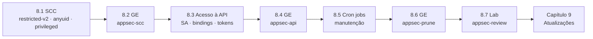

# Capítulo 8 — Application Security

**Título em português:** Segurança de aplicações
**Status da documentação:** ✅ concluído e validado
**Referência:** PDF p. 351–393

## Objetivo do capítulo

Executar aplicações que precisam de privilégios elevados ou especiais do sistema
operacional do host ou do Kubernetes.

## Por que este capítulo importa

O OpenShift roda tudo com o mínimo de privilégio por padrão. Imagens legadas, agentes de
monitoramento, controllers e tarefas de manutenção precisam de mais — e cada exceção é um
risco. O capítulo ensina a conceder **exatamente** o necessário: SCCs para privilégios no
host, papéis RBAC para acesso à API, ambos por meio de **service accounts**, e a
automatizar manutenção com CronJobs que usam essas identidades.

## Seções e atividades (ordem oficial)

| Seção | Tipo | Título original | Material | PDF |
|-------|------|-----------------|----------|-----|
| 8.1 | Conceito | Controlling Application Permissions with Security Context Constraints | [lição](8.1-security-context-constraints.md) | p. 352–355 |
| 8.2 | Guided Exercise | Control Application Permissions with Security Context Constraints | [prática](PRATICA-OFICIAL.md#82-guided-exercise-control-application-permissions-with-security-context-constraints) | p. 356–361 |
| 8.3 | Conceito | Allowing Application Access to Kubernetes APIs | [lição](8.3-acesso-de-aplicacoes-a-api.md) | p. 362–366 |
| 8.4 | Guided Exercise | Allow Application Access to Kubernetes APIs | [prática](PRATICA-OFICIAL.md#84-guided-exercise-allow-application-access-to-kubernetes-apis) | p. 367–371 |
| 8.5 | Conceito | Cluster and Node Maintenance with Kubernetes Cron Jobs | [lição](8.5-manutencao-com-cron-jobs.md) | p. 372–377 |
| 8.6 | Guided Exercise | Cluster and Node Maintenance with Kubernetes Cron Jobs | [prática](PRATICA-OFICIAL.md#86-guided-exercise-cluster-and-node-maintenance-with-kubernetes-cron-jobs) | p. 378–384 |
| 8.7 | Lab | Manage Application Security | [prática](PRATICA-OFICIAL.md#87-lab-manage-application-security) | p. 385–392 |
| 8.8 | Summary | Summary | [RESUMO.md](RESUMO.md) | p. 393 |

Abertura do capítulo (meta e seções): PDF p. 351. Não há quiz neste capítulo.

## Arquivos do capítulo

- [PRATICA-OFICIAL.md](PRATICA-OFICIAL.md): ponte com as atividades oficiais e armadilhas do ambiente.
- [REVISAO.md](REVISAO.md): questões autorais integradas.
- [RESUMO.md](RESUMO.md): síntese, comandos e divergências do PDF.

## Pré-requisitos recomendados

[DO180 · 3.1 — Criar containers e Pods](https://github.com/eduardoandradej/openshift-do180-4.22-estudos/blob/main/capitulos/03-containers-e-pods/3.1-criar-containers-e-pods.md) ·
[DO180 · 4.3 — Workloads de longa e curta duração](https://github.com/eduardoandradej/openshift-do180-4.22-estudos/blob/main/capitulos/04-deploy-e-redes/4.3-workloads-de-longa-e-curta-duracao.md) ·
[3.3 — RBAC](../03-autenticacao-autorizacao/3.3-permissoes-com-rbac.md) ·
[7.1 — Operators e OLM](../07-operadores-kubernetes/7.1-operators-e-olm.md)

## Checklist do aluno

- [ ] 8.1 lida e Parte F respondida
- [ ] 8.2 Guided Exercise `appsec-scc` concluído
- [ ] 8.3 lida e Parte F respondida
- [ ] 8.4 Guided Exercise `appsec-api` concluído
- [ ] 8.5 lida e Parte F respondida
- [ ] 8.6 Guided Exercise `appsec-prune` concluído
- [ ] 8.7 Lab `appsec-review` com `lab grade` aprovado
- [ ] [REVISAO.md](REVISAO.md) respondida
- [ ] Registro no [diário de laboratórios](../../progresso/diario-de-laboratorios.md)

---
[← Capítulo 7](../07-operadores-kubernetes/README.md) | [Índice geral](../../README.md) | [Próximo: 8.1 Security context constraints →](8.1-security-context-constraints.md)
