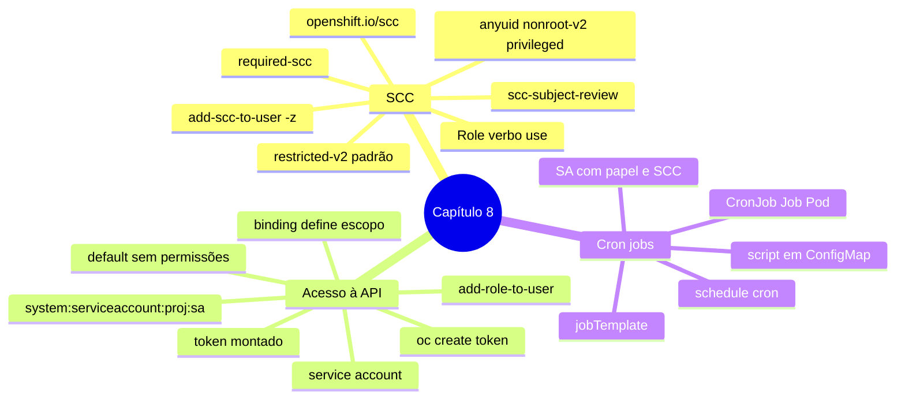

# Resumo — Capítulo 8

Síntese autoral para revisão rápida. Correspondência oficial: seção 8.8 (PDF p. 393).

## Em uma frase por seção

| Seção | Ideia central |
|-------|---------------|
| 8.1 | SCCs limitam os privilégios dos Pods no host; para rodar uma imagem que precisa de mais (root, UID fixo, host), concede-se a SCC mínima a uma service account e associa-se a SA ao workload |
| 8.3 | Aplicações acessam a API com o token da sua service account; o acesso vem de Roles/ClusterRoles e o **binding** define o escopo (projeto, outro projeto ou cluster) |
| 8.5 | Jobs e CronJobs automatizam manutenção; tarefas de cluster precisam de SA com papel de cluster e SCC adequados, e scripts podem vir de ConfigMaps |

## Mapa do capítulo

## Tabela de comandos do capítulo

| Tarefa | Comando | Tipo |
|--------|---------|------|
| SCCs | `oc get scc` · `oc describe scc <scc>` | 🔍 |
| SCC do Pod | `oc describe pod 
 \| grep scc` | 🔍 |
| SCC que resolve | `oc get deploy <d> -o yaml \| oc adm policy scc-subject-review -f -` | 🔍 |
| Service account | `oc create sa <sa>` · `oc set serviceaccount deployment/<d> <sa>` | ✏️ |
| Conceder SCC (cluster) | `oc adm policy add-scc-to-user <scc> -z <sa>` | ✏️ |
| Conceder SCC (projeto) | `oc create role <r> --verb use --resource scc --resource-name <scc>` + `oc create rolebinding <rb> --role <r> --serviceaccount <ns>:<sa>` | ✏️ |
| Papel no projeto | `oc adm policy add-role-to-user <papel> -z <sa>` | ✏️ |
| Papel em outro projeto | `oc adm policy add-role-to-user <papel> system:serviceaccount:<proj>:<sa> [--rolebinding-name <n>] -n <outro>` | ✏️ |
| Papel no cluster | `oc adm policy add-cluster-role-to-user <papel> -z <sa>` | ✏️ |
| Testar permissão | `oc auth can-i <verbo> <recurso> -n <ns> --as system:serviceaccount:<proj>:<sa>` | 🔍 |
| Token | `oc create token <sa> [--duration 30m]` | ✏️ |
| Job / CronJob | `oc create job\|cronjob ... --dry-run=client -o yaml -- <cmd>` | 🔍 |
| Execução imediata | `oc create job <j> --from cronjob/<cj>` | ✏️ |
| Imagens do nó | `oc debug node/<nó> -- chroot /host crictl images` | 🔍 |

## Alertas operacionais

- ⛔ Não altere as SCCs padrão; crie novas se preciso.
- ⚠️ Conceda a SCC **mínima**; `privileged` só em último caso.
- ⚠️ `-z` usa o projeto atual; confira `oc project` após trocar de usuário.
- ⚠️ Não dê permissões à SA `default`.
- ⚠️ O escopo vem do binding: RoleBinding no namespace dos **recursos**.
- ⚠️ Tokens são credenciais: nunca versione nem registre em logs.
- ⛔ `cluster-admin` + `privileged` em uma SA só no exercício; nada de limpeza de nós fora dele.

## Divergências registradas em relação à apostila

| Ponto | Apostila | Comportamento correto / observação |
|-------|----------|------------------------------------|
| ConfigMap de exemplo (p. 376) | `app: crictl` direto em `metadata` | Campo inexistente em `metadata` (a decodificação estrita da API o rejeita); o correto é `metadata.labels`, como no GE 8.6 |
| Escopo de ClusterRoles no resumo (p. 393) | "ClusterRoles concedem permissões em todo o cluster" | Depende do binding: ligada por RoleBinding, vale só naquele namespace (a própria p. 364 explica) |
| SA `default` (p. 362) | "O OpenShift não concede permissões à SA `default`" | Não recebe permissões **especiais**; como toda SA, tem as permissões básicas dos grupos a que pertence |
| `add-scc-to-user` (p. 353 e 393) | Cria ClusterRoleBinding; `-n` "se a SA estiver em outro namespace" | 📘 Com `-n` explícito, o `oc` cria um RoleBinding naquele projeto (código do `oc` 4.22) |
| Texto do GE 8.4 (p. 368) | Cita a SA sem o sufixo `-sa` | O comando e o manifesto usam o nome com sufixo; siga o comando |

## Ligação com o próximo capítulo

Com aplicações rodando com o mínimo de privilégio, o Capítulo 9 (*OpenShift Updates*)
trata de atualizar o cluster e os operators e de lidar com APIs obsoletas.

---
[← Revisão](REVISAO.md) | [Índice do capítulo](README.md) | [Próximo capítulo →](../09-atualizacoes-openshift/README.md)
