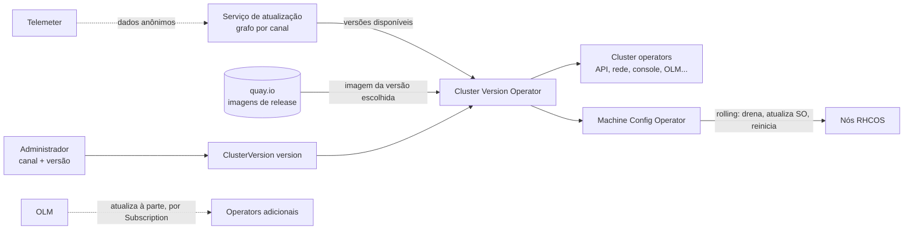

# 9.1 — Atualizar clusters

| Campo | Valor |
|-------|-------|
| Curso | DO280 — OpenShift 4.22 |
| Capítulo / seção | Capítulo 9 · Seção 9.1 |
| Título original | Updating Clusters |
| Título em português | Atualizar clusters |
| Objetivo | Descrever o processo de atualização do cluster |
| Referência | PDF p. 395–407 · Quiz 9.2 p. 408–411 |

## Pré-requisitos e conhecimentos anteriores

No DO180 você viu `oc get clusterversion`, o conceito de **canal de atualização** e o ciclo
de vida das versões do OpenShift; também viu os cluster operators e suas condições. No
[Capítulo 7](../07-operadores-kubernetes/7.1-operators-e-olm.md) você distinguiu o **CVO**
(plataforma) do **OLM** (operators adicionais). Esta lição mostra como o CVO leva o cluster
a uma versão nova.

| Conceito | Onde revisar |
|----------|--------------|
| `oc get clusterversion`, canal, ciclo de vida | [DO180 · 1.3 — Componentes e edições](https://github.com/eduardoandradej/openshift-do180-4.22-estudos/blob/main/capitulos/01-introducao-kubernetes-openshift/1.3-componentes-e-edicoes-do-openshift.md) |
| Cluster operators e condições | [DO180 · 2.5 — Avaliar a saúde do cluster](https://github.com/eduardoandradej/openshift-do180-4.22-estudos/blob/main/capitulos/02-cli-e-apis/2.5-avaliar-a-saude-do-cluster.md) |
| CVO × OLM | [7.1 — Operators e OLM](../07-operadores-kubernetes/7.1-operators-e-olm.md) |
| `oc patch --type merge` | [1.1 — Manifestos de recursos](../01-gerenciamento-declarativo/1.1-manifestos-de-recursos.md) |

## Parte A — Entendendo o conceito

### Atualização over-the-air (OTA)

O OpenShift 4 é atualizado **pela rede** (*over-the-air*): a Red Hat publica, para cada
versão, uma imagem de release (em `quay.io`) com os manifestos de todos os componentes; o
**Cluster Version Operator (CVO)** aplica essa imagem e atualiza a plataforma **e o sistema
operacional dos nós** (RHEL CoreOS), em **rolling update**, mantendo o cluster operando.

- A Red Hat mantém um **serviço de atualização** que calcula os caminhos (*update graph*)
  válidos para cada cluster; o hybrid cloud console (`console.redhat.com/openshift`) mostra
  todos os clusters registrados.
- É possível **pular versões intermediárias** quando o grafo oferece a aresta (ex.: de
  `4.22.1` direto para `4.22.3`).
- A **telemetria** (componente Telemeter, baseado em Prometheus) envia dados anônimos do
  estado dos cluster operators, que ajudam a Red Hat a recomendar ou bloquear caminhos.
- Clusters **desconectados** não usam o serviço on-line: atualizam a partir de um registry
  espelhado (útil para soberania digital e conformidade).

### Canais

O canal define **quais versões** o cluster enxerga e com que **cadência/estabilidade**. Nome:
`<nível>-<major>.<minor>`, por exemplo `stable-4.22`.

| Canal | Recebe | Suporte | Uso típico |
|-------|--------|---------|-----------|
| `candidate-4.22` | Release candidates e todos os z-streams, para testes | **Só** se a versão também estiver em `fast` ou `stable` | Testes de aceitação, pré-produção |
| `fast-4.22` | Versões assim que viram GA | Sim | Desenvolvimento, QA (e produção, se desejado) |
| `stable-4.22` | Versões GA que já passaram por validação adicional em clusters reais; versões com problema são **puladas** | Sim | **Produção** |
| `eus-4.22` | Em versões **pares** (EUS): só correções críticas e de segurança, com ciclo estendido | Sim | Produção com ciclo longo |

Exemplo da apostila: se `4.22.3` tem defeito, `stable` e `fast` oferecem `4.22.1` e
`4.22.4`, mas não `4.22.3`; `candidate` oferece todas.

Regras práticas:

- Troque de `stable` para `fast` se precisar; **evite** ir para `candidate`.
- Para mudar de **versão menor**, troque para o canal da versão de destino (o canal
  `*-4.22` só oferece `4.22.z`).
- Versões menores **pares** (4.8, 4.10, ..., 4.22) são EUS; `stable-4.x` e `eus-4.x` são
  iguais até a versão entrar na fase EUS.

### Componentes da atualização

| Componente | Papel |
|------------|-------|
| **CVO** | Orquestra a atualização: busca a imagem de release e atualiza os cluster operators (inclusive o próprio OLM) |
| **Machine Config Operator (MCO)** | Leva cada nó ao estado desejado (configuração e SO via `rpm-ostree`, formato Ignition) e faz o rolling reboot dos nós |
| **OLM** | Atualiza os operators **adicionais**, conforme as Subscriptions (lição [9.5](9.5-atualizar-operators-com-olm.md)) — não junto com o cluster |

O SO é atualizado de forma **transacional**: o nó baixa a imagem, grava a nova árvore,
ajusta o bootloader e reinicia na versão nova, um nó por vez.

### Antes de atualizar

1. **Operators adicionais compatíveis** com a versão de destino (o CVO bloqueia a
   atualização se algum for incompatível — lição 9.5).
2. **APIs removidas** na versão de destino fora de uso (lição [9.3](9.3-apis-obsoletas.md)).
   Se a próxima versão menor remove APIs em uso, a console avisa que o cluster não deve ser
   atualizado para ela.
3. **Pausar os MachineHealthChecks** (exceto em nó único): durante a atualização, nós
   ficam indisponíveis por instantes e o MHC poderia tratá-los como defeituosos e
   reiniciá-los. Pausa = anotação `cluster.x-k8s.io/paused`; remova-a depois.
4. Em clusters críticos, abrir um caso de suporte preventivo.

### Boot image skew (novidade da 4.22)

O MCO cria nós novos a partir de uma **boot image**, que por padrão não é atualizada com o
cluster. Na 4.22, se a boot image estiver abaixo do mínimo suportado (4.13.0, a primeira
com RHEL 9), o MCO marca o cluster operator `machine-config` com `Upgradeable=False` e
**bloqueia** atualizações.

| Modo | Comportamento |
|------|---------------|
| `Automatic` | O MCO gerencia as boot images (padrão em AWS, GCP, Azure e vSphere) |
| `Manual` | O administrador atualiza e declara a versão; o MCO só confere |
| `None` | Sem verificação; `Upgradeable` sempre `True` |

Nó único (não escala) e bare metal (o MCO não gerencia boot images ali) não aplicam essa
verificação — é o caso do cluster do curso.

### Serviços gerenciados

ARO usa os mecanismos padrão com supervisão de SRE; ROSA e OSD são atualizados pelo hybrid
cloud console ou pelas CLIs `rosa`/`ocm` (o `oc adm upgrade` é bloqueado); ROSA com
Hosted Control Planes atualiza control plane e nós separadamente.

### Sem volta

**Rollback não é suportado.** Se a atualização não termina, o CVO informa os componentes
que a bloqueiam e continua tentando reconciliar; o caminho é o suporte da Red Hat.

## Parte B — Modelo mental e arquitetura



## Parte C — Aplicação prática

> Legenda: 🔍 somente leitura · ✏️ altera o cluster
>
> ⛔ **Não execute no ambiente do curso** os comandos ✏️ desta lição (trocar canal,
> pausar MHC, `oc adm upgrade --to...`). O capítulo não tem exercício prático; atualizar o
> cluster do curso o deixaria fora do estado esperado pelas atividades. Os comandos 🔍 são
> seguros.

### 1. Estado atual 🔍

```bash
oc get clusterversion                                        # VERSION, PROGRESSING, STATUS
oc get clusterversion -o jsonpath='{.items[0].spec.channel}{"\n"}'
oc adm upgrade                                               # versão, canal, canais disponíveis, atualizações recomendadas
oc get clusteroperators                                      # todos True/False/False antes de começar
oc describe clusterversion                                   # condições e History (Completed/Partial)
```

### 2. Trocar o canal ✏️

```bash
oc patch clusterversion version --type merge -p '{"spec":{"channel":"stable-4.22"}}'
oc adm upgrade channel stable-4.22                           # 📘 subcomando equivalente do oc
```

Console: **Administration › Cluster Settings › Details**, ícone de lápis no canal.

### 3. Pausar e retomar MachineHealthChecks ✏️

```bash
oc get machinehealthcheck -n openshift-machine-api
oc annotate machinehealthcheck <mhc> -n openshift-machine-api cluster.x-k8s.io/paused=""
# ... depois da atualização:
oc annotate machinehealthcheck <mhc> -n openshift-machine-api cluster.x-k8s.io/paused-
```

O `-` no fim do nome da anotação a **remove**.

### 4. Verificar boot image skew 🔍

```bash
oc get machineconfiguration cluster -o jsonpath='{.status.bootImageSkewEnforcementStatus}{"\n"}'
oc get co machine-config                                     # Upgradeable=False bloqueia
```

### 5. Atualizar ✏️

```bash
oc adm upgrade --to-latest=true                              # última recomendada no canal
oc adm upgrade --to=4.22.8                                   # versão específica listada
watch oc get clusterversion,clusteroperators                 # acompanhar
```

Console: **Administration › Cluster Settings › Select a version › Update**.

Durante a atualização, a API pode ficar inacessível por alguns segundos (talvez seja
preciso fazer login de novo). Termina quando `oc get clusterversion` mostra a versão nova
com `PROGRESSING False`, e o `History` registra `Completed`.

### Raciocínio operacional e diagnóstico

| Sintoma | Hipótese | Como confirmar | Correção segura |
|---------|----------|----------------|-----------------|
| `oc adm upgrade` não lista atualizações | Canal sem versões novas, cluster desconectado ou caminho bloqueado | `oc adm upgrade`; `spec.channel` | Conferir canal; em desconectado, usar o espelho |
| Versão menor seguinte não aparece | Canal da versão atual | Canal `*-4.22` | Canal da versão de destino (após checar compatibilidade) |
| Atualização bloqueada, `Upgradeable=False` | Operator incompatível, APIs removidas em uso ou boot image antiga | `oc describe clusterversion`; `oc get co` (condições) | Tratar a causa indicada na condição |
| `PROGRESSING True` por muito tempo | Operator ou nó travado | `oc get co`; `oc get mcp`; `oc get nodes` | Investigar o componente citado; acionar suporte |
| History com `Partial` | Atualização não concluída | `oc describe clusterversion` | Suporte; rollback não é suportado |
| Nós reiniciados inesperadamente na atualização | MHC não pausado | `oc get machinehealthcheck -o yaml` | Pausar antes; retomar depois |
| Desconexão da CLI durante a atualização | API server em rolling | — | Aguardar e fazer login de novo |

## Parte D — Relações importantes

| A | B | Diferença essencial |
|---|---|--------------------|
| `stable` | `fast` | Validação adicional em clusters reais × assim que vira GA |
| `fast`/`stable` | `candidate` | Suportados × só testes (suporte só se também em fast/stable) |
| `stable-4.22` | `eus-4.22` | Iguais até a fase EUS × depois só correções críticas, ciclo longo |
| CVO | MCO | Orquestra a release × aplica configuração e SO nos nós |
| CVO | OLM | Plataforma (inclui o OLM) × operators adicionais |
| `--to-latest` | `--to=<versão>` | Última recomendada × versão escolhida |
| `Completed` | `Partial` | Atualização concluída × falhou ou não terminou |

## Parte E — Preparação para o laboratório oficial

O capítulo **não tem** guided exercise nem lab: a seção 9.2 é um **quiz** (PDF p. 408–409;
solução p. 410–411). Responda antes de ver a solução; este repositório não reproduz o
gabarito. Detalhes em [PRATICA-OFICIAL.md](PRATICA-OFICIAL.md#92-quiz-the-cluster-update-process).

## Parte F — Fixação

1. O que significa "over-the-air" e quem aplica a atualização no cluster?
2. Que canal você usaria em produção, e por quê?
3. Seu cluster está em `stable-4.22`. Por que a versão menor seguinte não aparece em `oc adm upgrade`?
4. O que o MCO faz durante a atualização?
5. Por que pausar MachineHealthChecks, e quando isso não é necessário?
6. O que pode marcar o cluster como `Upgradeable=False`? Cite três causas.
7. A atualização falhou na metade. Você pode voltar à versão anterior?

<details>
<summary>Respostas comentadas</summary>

1. Atualização pela rede a partir de imagens de release publicadas pela Red Hat, com caminhos calculados pelo serviço de atualização; o CVO a aplica.
2. `stable` (ou `eus` em versões pares, para ciclo longo): as versões passam por validação adicional e versões problemáticas são puladas.
3. O canal `*-4.22` só oferece `4.22.z`; é preciso trocar para o canal da versão de destino.
4. Aplica a configuração e o novo SO (rpm-ostree) em cada nó e os reinicia em rolling update.
5. Para o MHC não reiniciar nós que ficam indisponíveis temporariamente na atualização; não é necessário em instalações de nó único.
6. Operator adicional incompatível, APIs removidas em uso e boot image abaixo do mínimo (na 4.22).
7. Não: rollback não é suportado; o CVO tenta reconciliar e o caminho é o suporte.

</details>

## Parte G — Essencial para memorizar

- CVO aplica a release (plataforma + SO); MCO atualiza os nós em rolling; OLM cuida dos operators adicionais à parte.
- Canais: `candidate` (testes) · `fast` (GA imediato) · `stable` (produção) · `eus` (pares, ciclo longo).
- `oc get clusterversion` · `oc adm upgrade` · `oc patch clusterversion version --type merge -p '{"spec":{"channel":"..."}}'`.
- `oc adm upgrade --to-latest=true` ou `--to=<versão>`; acompanhar com `oc get clusterversion,co`.
- Antes: operators compatíveis, APIs removidas fora de uso, MHC pausado (`cluster.x-k8s.io/paused`).
- Sem rollback.

---
[← Índice do capítulo](README.md) | [Índice do capítulo](README.md) | [Próximo: 9.3 APIs obsoletas →](9.3-apis-obsoletas.md)
