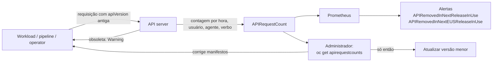

# 9.3 — Detectar o uso de APIs obsoletas do Kubernetes

| Campo | Valor |
|-------|-------|
| Curso | DO280 — OpenShift 4.22 |
| Capítulo / seção | Capítulo 9 · Seção 9.3 |
| Título original | Detecting Deprecated Kubernetes API Usage |
| Título em português | Detectar o uso de APIs obsoletas do Kubernetes |
| Objetivo | Identificar aplicações que usam APIs obsoletas do Kubernetes |
| Referência | PDF p. 412–416 · Quiz 9.4 p. 417–418 |

## Pré-requisitos e conhecimentos anteriores

Do DO180: todo recurso tem `apiVersion` (grupo/versão), `oc api-resources` lista tipos e
versões, `oc explain` documenta campos, e alertas aparecem em **Observe › Alerting**. A
[lição 9.1](9.1-atualizar-clusters.md) mostrou que APIs removidas em uso podem bloquear a
atualização para a versão menor seguinte.

| Conceito | Onde revisar |
|----------|--------------|
| `apiVersion`, grupos, `oc api-resources` | [DO180 · F5 — Kubernetes API e YAML](https://github.com/eduardoandradej/openshift-do180-4.22-estudos/blob/main/01-fundamentos-essenciais/05-kubernetes-api-e-yaml.md) |
| Alertas e monitoramento | [DO180 · 1.7 — Monitorar um cluster OpenShift](https://github.com/eduardoandradej/openshift-do180-4.22-estudos/blob/main/capitulos/01-introducao-kubernetes-openshift/1.7-monitorar-um-cluster-openshift.md) |
| Atualização do cluster | [9.1 — Atualizar clusters](9.1-atualizar-clusters.md) |

## Parte A — Entendendo o conceito

### OpenShift acompanha o Kubernetes

| OpenShift | Kubernetes |
|-----------|-----------|
| 4.19 | 1.32 |
| 4.20 | 1.33 |
| 4.21 | 1.34 |
| **4.22** | **1.35** |

Quando o Kubernetes remove uma versão de API, a versão correspondente do OpenShift também a
remove. Atualizar o cluster pode, portanto, quebrar manifestos, charts, pipelines e
operators que ainda usam a versão antiga.

### Maturidade das versões de API

| Versão | Categoria | Significado |
|--------|-----------|-------------|
| `v1alpha1` | Alpha | Experimental |
| `v1beta1` | Beta | Pré-lançamento |
| `v1` | Stable | Estável, GA |

Quando a versão estável de um recurso sai, as versões beta são marcadas como **obsoletas
(deprecated)** e removidas depois de, no mínimo, **três versões** do Kubernetes; o prazo
exato varia por API.

> 📘 **Fonte externa (Kubernetes API Deprecation Policy):** versões beta continuam
> disponíveis por pelo menos 9 meses ou 3 versões menores (o que for maior) depois de
> marcadas como obsoletas.

### Obsoleta × removida

| Situação | O que acontece |
|----------|----------------|
| Versão **obsoleta** | Funciona, mas o API server devolve um `Warning: ... is deprecated in v1.X+, unavailable in v1.Y+; use <versão nova>` |
| Versão **removida** | Erro: `no matches for kind "X" in version "grupo/versão"` (o cliente não encontra o tipo) |

Exemplo: `flowcontrol.apiserver.k8s.io/v1beta3` (PriorityLevelConfiguration, FlowSchema)
foi removida no Kubernetes 1.32 (OpenShift 4.19); use `flowcontrol.apiserver.k8s.io/v1`.
Os plug-ins de volume *in-tree* `kubernetes.io/cephfs` e `kubernetes.io/rbd` também
saíram, substituídos pelos drivers CSI. Segundo a apostila, as versões 1.33, 1.34 e 1.35
não removeram grupos/versões de API.

### Detectar o uso: `APIRequestCount`

O OpenShift contabiliza as requisições por recurso e versão no recurso de cluster
**`APIRequestCount`**:

- `oc get apirequestcounts` lista os recursos que receberam requisições; a coluna
  `REMOVEDINRELEASE` só é preenchida nas APIs obsoletas e mostra em que versão do
  Kubernetes serão removidas;
- o `status` registra, por hora, **quem** (usuário/SA), **com que cliente** (`userAgent`) e
  **com que verbo** usou aquela versão — isso identifica o workload a corrigir.

### Alertas

| Alerta | Dispara quando |
|--------|----------------|
| `APIRemovedInNextReleaseInUse` | Uma API que a **próxima versão** do OpenShift remove está em uso |
| `APIRemovedInNextEUSReleaseInUse` | Uma API que a **próxima versão EUS** remove está em uso |

Aparecem em **Observe › Alerting**; também podem ser lidos pela API do Prometheus.

### Recursos obsoletos do próprio OpenShift

Além das APIs do Kubernetes, o OpenShift marca **recursos** como obsoletos (não recomendados
para novas implantações; serão removidos). Exemplos da apostila para 4.22:

| Recurso | Situação |
|---------|----------|
| `DeploymentConfig` | Obsoleto (use `Deployment`) |
| Runtime `runC` | Obsoleto; `crun` é o padrão |
| Builds v1 / `BuildConfig` | Obsoleto (migrar para Builds v2 / Shipwright) |
| Red Hat Marketplace | Removido |

Por isso o `oc get all` mostra o aviso sobre `DeploymentConfig`. A lista completa está nas
release notes da 4.22.

## Parte B — Modelo mental e arquitetura



## Parte C — Aplicação prática

> Legenda: 🔍 somente leitura · ✏️ altera o cluster
>
> Todos os comandos desta lição são de leitura e podem ser usados com segurança.

### 1. Versões atuais de um recurso 🔍

```bash
oc api-resources | grep -E '^NAME|cronjobs'          # APIVERSION atual
oc api-versions | grep flowcontrol                    # versões servidas de um grupo
oc explain cronjob --api-version=batch/v1             # documentação da versão
```

### 2. APIs obsoletas em uso 🔍

```bash
oc get apirequestcounts                               # REMOVEDINRELEASE preenchido = obsoleta em uso
oc get apirequestcounts -o jsonpath='{range .items[?(@.status.removedInRelease!="")]}{.status.removedInRelease}{"\t"}{.metadata.name}{"\n"}{end}'
```

> 📘 **Fonte externa (documentação do OpenShift sobre `APIRequestCount`):** a lista traz
> todos os recursos que receberam requisições (colunas de contagem na hora atual e nas
> últimas 24 h); só os obsoletos têm `REMOVEDINRELEASE` preenchido. O filtro JSONPath acima
> mostra apenas esses.

### 3. Quem usa 🔍

```bash
TYPE=<recurso>.<versão>.<grupo>
FILTER='{range .status.currentHour..byUser[*]}{..byVerb[*].verb}{","}{.username}{","}{.userAgent}{"\n"}{end}'
oc get apirequestcount ${TYPE} -o jsonpath="${FILTER}" | column -t -s ',' -N "Verbs,Username,UserAgent"
```

O nome do `APIRequestCount` é `<recurso>.<versão>.<grupo>` (ex.:
`prioritylevelconfigurations.v1beta3.flowcontrol.apiserver.k8s.io`).

### 4. Alertas 🔍

Console: **Observe › Alerting**, filtrando por `APIRemoved`. Pela CLI, como na apostila,
consultando a API do Prometheus de dentro do Pod:

```bash
oc exec -it statefulset/prometheus-k8s -c prometheus -n openshift-monitoring -- \
  curl -fsSL 'http://localhost:9090/api/v1/alerts' | jq . > alerts.json
jq '[.data.alerts[] | select(.labels.alertname=="APIRemovedInNextReleaseInUse" or .labels.alertname=="APIRemovedInNextEUSReleaseInUse")]' < alerts.json
```

`[]` vazio = nenhum alerta disparado.

### 5. Corrigir ✏️ (no repositório da aplicação)

Atualize `apiVersion` (e campos que mudaram) nos manifestos, charts e templates; reaplique;
confirme que o `userAgent`/usuário deixou de aparecer nas horas seguintes do
`APIRequestCount`.

### Raciocínio operacional e diagnóstico

| Sintoma | Hipótese | Como confirmar | Correção segura |
|---------|----------|----------------|-----------------|
| `Warning: ... is deprecated in v1.X+, unavailable in v1.Y+` | Manifesto com versão obsoleta | Mensagem (traz a versão nova) | Trocar `apiVersion` antes da versão `Y` |
| `no matches for kind "X" in version "..."` | Versão já removida no cluster | `oc api-versions` | Migrar o manifesto para a versão atual |
| Console avisa que o cluster não deve ir para a próxima versão menor | APIs a remover ainda em uso | `oc get apirequestcounts` | Corrigir os workloads antes de atualizar |
| Alerta `APIRemovedInNextReleaseInUse` | Algum cliente usa a API a ser removida | Filtro `byUser` do `APIRequestCount` | Corrigir o cliente identificado |
| Uso vem de um operator | Operator antigo | `userAgent`/usuário da SA do operator | Atualizar o operator (9.5) |
| `oc get all` com aviso de `DeploymentConfig` | Recurso obsoleto do OpenShift listado | — | Planejar migração para `Deployment` |

## Parte D — Relações importantes

| A | B | Diferença essencial |
|---|---|--------------------|
| Obsoleta (deprecated) | Removida | Funciona com aviso × deixa de existir |
| Alpha | Beta | Experimental × pré-lançamento |
| `REMOVEDINRELEASE` | Versão do OpenShift | Versão do **Kubernetes** que remove × use a tabela de correspondência |
| `APIRemovedInNextReleaseInUse` | `APIRemovedInNextEUSReleaseInUse` | Próxima versão × próxima EUS |
| API obsoleta do Kubernetes | Recurso obsoleto do OpenShift | Versão de API × funcionalidade (DeploymentConfig, BuildConfig) |
| `oc api-resources` | `oc get apirequestcounts` | O que o cluster serve × o que está sendo **usado** |

## Parte E — Preparação para o laboratório oficial

Sem atividade prática: a seção 9.4 é um **quiz** (PDF p. 417; solução p. 418). Detalhes em
[PRATICA-OFICIAL.md](PRATICA-OFICIAL.md#94-quiz-detecting-deprecated-kubernetes-api-usage).

## Parte F — Fixação

1. Um cluster vai de 4.21 para 4.22. De qual para qual versão do Kubernetes ele passa?
2. Qual a diferença prática entre uma API obsoleta e uma removida?
3. O que a coluna `REMOVEDINRELEASE` indica?
4. Como descobrir qual usuário ou cliente ainda usa uma versão obsoleta?
5. Qual alerta interessa a quem pula de uma EUS para a próxima EUS?
6. Um `oc apply` falha com `no matches for kind ... in version ...v1beta3`. O que aconteceu?
7. `DeploymentConfig` é uma API obsoleta do Kubernetes? Explique.

<details>
<summary>Respostas comentadas</summary>

1. De Kubernetes 1.34 para 1.35.
2. A obsoleta ainda funciona, com aviso; a removida gera erro, porque o cluster não serve mais aquela versão.
3. A versão do Kubernetes que removerá a API obsoleta que está em uso.
4. Pelo `status` do `APIRequestCount` daquele recurso/versão (`byUser`: usuário, `userAgent` e verbos).
5. `APIRemovedInNextEUSReleaseInUse`.
6. A versão foi removida no cluster; o manifesto precisa da versão atual (por exemplo, `v1`).
7. Não: é um recurso do próprio OpenShift marcado como obsoleto; a recomendação é usar `Deployment`.

</details>

## Parte G — Essencial para memorizar

- OpenShift 4.22 = Kubernetes 1.35.
- Alpha (experimental) → beta (pré-lançamento) → v1 (estável). Beta removida no mínimo 3 versões depois de obsoleta.
- Obsoleta = `Warning`; removida = `no matches for kind`.
- `oc get apirequestcounts` (coluna `REMOVEDINRELEASE`) + filtro `byUser` para achar quem usa.
- Alertas: `APIRemovedInNextReleaseInUse` e `APIRemovedInNextEUSReleaseInUse`.
- Corrigir os workloads **antes** de atualizar a versão menor.

---
[← 9.1 Atualizar clusters](9.1-atualizar-clusters.md) | [Índice do capítulo](README.md) | [Próximo: 9.5 Atualizar operators com o OLM →](9.5-atualizar-operators-com-olm.md)
