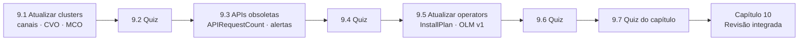

# Capítulo 9 — OpenShift Updates

**Título em português:** Atualizações do OpenShift
**Status da documentação:** ✅ concluído e validado
**Referência:** PDF p. 394–433

## Objetivo do capítulo

Atualizar um cluster OpenShift minimizando a interrupção das aplicações implantadas.

## Por que este capítulo importa

Manter o cluster atualizado traz correções de segurança e recursos novos, mas uma
atualização mal preparada pode quebrar workloads (APIs removidas), ficar bloqueada
(operators incompatíveis) ou reiniciar nós fora de hora. O capítulo cobre o processo
over-the-air, os canais, a detecção de APIs obsoletas e a atualização de operators — e a
ordem correta entre essas peças. **Não tem atividades práticas**, só quizzes.

## Seções e atividades (ordem oficial)

| Seção | Tipo | Título original | Material | PDF |
|-------|------|-----------------|----------|-----|
| 9.1 | Conceito | Updating Clusters | [lição](9.1-atualizar-clusters.md) | p. 395–407 |
| 9.2 | Quiz | The Cluster Update Process | [prática](PRATICA-OFICIAL.md#92-quiz-the-cluster-update-process) | p. 408–411 |
| 9.3 | Conceito | Detecting Deprecated Kubernetes API Usage | [lição](9.3-apis-obsoletas.md) | p. 412–416 |
| 9.4 | Quiz | Detecting Deprecated Kubernetes API Usage | [prática](PRATICA-OFICIAL.md#94-quiz-detecting-deprecated-kubernetes-api-usage) | p. 417–418 |
| 9.5 | Conceito | Updating Operators with the OLM | [lição](9.5-atualizar-operators-com-olm.md) | p. 419–424 |
| 9.6 | Quiz | Updating Operators with the OLM | [prática](PRATICA-OFICIAL.md#96-quiz-updating-operators-with-the-olm) | p. 425–428 |
| 9.7 | Quiz | OpenShift Updates | [prática](PRATICA-OFICIAL.md#97-quiz-openshift-updates) | p. 429–432 |
| 9.8 | Summary | Summary | [RESUMO.md](RESUMO.md) | p. 433 |

Abertura do capítulo (meta e seções): PDF p. 394. Nenhuma atividade usa o comando `lab`.

## Arquivos do capítulo

- [PRATICA-OFICIAL.md](PRATICA-OFICIAL.md): roteiro dos quizzes e exploração segura (só leitura).
- [REVISAO.md](REVISAO.md): questões autorais integradas.
- [RESUMO.md](RESUMO.md): síntese, comandos e divergências do PDF.

## Pré-requisitos recomendados

[DO180 · 1.3 — Componentes e edições](https://github.com/eduardoandradej/openshift-do180-4.22-estudos/blob/main/capitulos/01-introducao-kubernetes-openshift/1.3-componentes-e-edicoes-do-openshift.md) ·
[DO180 · 2.5 — Avaliar a saúde do cluster](https://github.com/eduardoandradej/openshift-do180-4.22-estudos/blob/main/capitulos/02-cli-e-apis/2.5-avaliar-a-saude-do-cluster.md) ·
[7.5 — Instalar operators pela CLI](../07-operadores-kubernetes/7.5-instalar-operators-pela-cli.md)

## Checklist do aluno

- [ ] 9.1 lida e Parte F respondida
- [ ] 9.2 Quiz respondido (sem olhar a solução antes)
- [ ] 9.3 lida e Parte F respondida
- [ ] 9.4 Quiz respondido
- [ ] 9.5 lida e Parte F respondida
- [ ] 9.6 Quiz respondido
- [ ] 9.7 Quiz do capítulo respondido
- [ ] [REVISAO.md](REVISAO.md) respondida

---
[← Capítulo 8](../08-seguranca-aplicacoes/README.md) | [Índice geral](../../README.md) | [Próximo: 9.1 Atualizar clusters →](9.1-atualizar-clusters.md)
