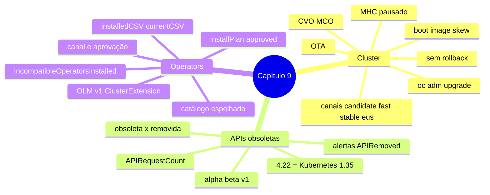

# Resumo — Capítulo 9

Síntese autoral para revisão rápida. Correspondência oficial: seção 9.8 (PDF p. 433).

## Em uma frase por seção

| Seção | Ideia central |
|-------|---------------|
| 9.1 | O CVO atualiza o cluster over-the-air (plataforma e SO, via MCO) dentro do canal escolhido; antes, garantir operators compatíveis, APIs em dia e MHC pausados; não há rollback |
| 9.3 | APIs beta são removidas algumas versões depois de obsoletas; `APIRequestCount` e os alertas `APIRemoved...` mostram quem ainda as usa antes da atualização |
| 9.5 | O OLM atualiza operators adicionais conforme canal e aprovação (InstallPlan); operators incompatíveis bloqueiam a atualização do cluster; OLM v1 usa `ClusterExtension` |

## Mapa do capítulo

## Tabela de comandos do capítulo

| Tarefa | Comando | Tipo |
|--------|---------|------|
| Versão e atualizações | `oc get clusterversion` · `oc adm upgrade` · `oc describe clusterversion` | 🔍 |
| Trocar canal | `oc patch clusterversion version --type merge -p '{"spec":{"channel":"<c>"}}'` · `oc adm upgrade channel <c>` | ✏️ ⛔ |
| Pausar / retomar MHC | `oc annotate machinehealthcheck <m> -n openshift-machine-api cluster.x-k8s.io/paused=""` · `...paused-` | ✏️ ⛔ |
| Boot image skew | `oc get machineconfiguration cluster -o jsonpath='{.status.bootImageSkewEnforcementStatus}'` | 🔍 |
| Atualizar | `oc adm upgrade --to-latest=true` · `oc adm upgrade --to=<v>` | ✏️ ⛔ |
| Acompanhar | `watch oc get clusterversion,clusteroperators` | 🔍 |
| APIs obsoletas | `oc get apirequestcounts` · `oc get apirequestcount <r.v.g> -o jsonpath=...byUser...` | 🔍 |
| Operators | `oc get csv -A` · `oc get sub <s> -o yaml` · `oc get installplan -n <ns>` | 🔍 |
| Aprovar | `oc patch installplan <ip> -n <ns> --type merge -p '{"spec":{"approved":true}}'` | ✏️ |
| OLM v1 | `oc get clusterextension` · `oc explain clusterextension.spec` | 🔍 |

⛔ = não executar no ambiente do curso (o capítulo não tem atividade prática).

## Alertas operacionais

- ⚠️ Produção em `stable` (ou `eus`); `candidate` só para testes.
- ⚠️ Operators compatíveis **antes** da atualização do cluster.
- ⚠️ Corrija APIs obsoletas antes de trocar de versão menor.
- ⚠️ Pause os MHC (exceto nó único) e retome depois.
- ⚠️ Não há rollback; em clusters críticos, abra um caso de suporte antes.
- ⛔ Não atualize o cluster do curso.

## Divergências registradas em relação à apostila

| Ponto | Apostila | Comportamento correto / observação |
|-------|----------|------------------------------------|
| Arquitetura de atualização (p. 401) | "O CVO atualiza os componentes e depois os componentes que o OLM gerencia" | O CVO atualiza os cluster operators (inclusive o OLM); os operators adicionais são atualizados pelo **OLM**, por Subscription, e devem estar compatíveis antes (a própria p. 405 e a seção 9.5 dizem isso) |
| Acompanhar a atualização (p. 406) | "A *cluster service version* mostra que a atualização progride" | Trata-se do recurso **ClusterVersion**; *cluster service version* (CSV) é o recurso do OLM |
| Troca de versão menor (p. 398) | "Escolher outro canal de versão menor, como `fast-4.22`" | O canal deve ser o da versão de **destino**; `*-4.22` só oferece `4.22.z` |
| `oc get apirequestcounts` (p. 413) | "Sem APIs obsoletas em uso, o comando retorna vazio" | 📘 O comando lista todos os recursos com requisições; as obsoletas são as que têm `REMOVEDINRELEASE`; filtrar com JSONPath |

## Ligação com o próximo capítulo

O Capítulo 10 (*Comprehensive Review*) integra todos os capítulos em atividades de
revisão.

---
[← Revisão](REVISAO.md) | [Índice do capítulo](README.md) | [Próximo capítulo →](../10-revisao-integrada/README.md)
