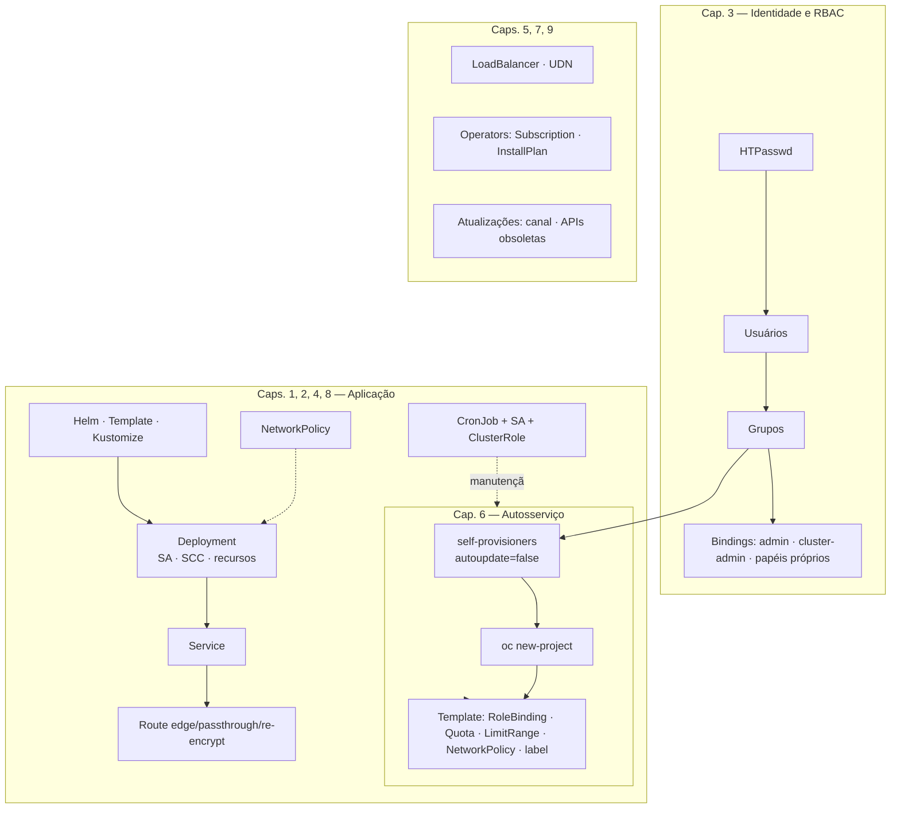

# 10.1 — Resumo dos objetivos de aprendizagem

| Campo | Valor |
|-------|-------|
| Curso | DO280 — OpenShift 4.22 |
| Capítulo / seção | Capítulo 10 · Seção 10.1 |
| Título original | Summary of Learning Objectives |
| Título em português | Resumo dos objetivos de aprendizagem |
| Objetivo | Revisar, de forma integrada, os conhecimentos e habilidades dos capítulos 1 a 9 antes dos laboratórios de revisão |
| Pré-requisitos | Capítulos 1 a 9 concluídos |
| Referência | PDF p. 435–436 · Labs 10.2 (p. 437–445), 10.3 (p. 446–458) e 10.4 (p. 459–467) |

> O curso apresenta o Capítulo 10 como apoio para quem se prepara para o exame **EX280**.
> Esta lição é um **roteiro autoral** de revisão integrada, não uma cópia da lista oficial.

## Pré-requisitos e conhecimentos anteriores

Toda a base do DO180 (Pods, Deployments, Services, Routes, ConfigMaps, Secrets, PVCs,
probes, requests e limits) é usada sem ser reexplicada nos labs. O roteiro integrado do
DO180 continua valendo para essa parte.

| Conceito | Onde revisar |
|----------|--------------|
| Roteiro integrado do DO180 | [DO180 · 8.1 — Resumo dos objetivos de aprendizagem](https://github.com/eduardoandradej/openshift-do180-4.22-estudos/blob/main/capitulos/08-revisao-geral/8.1-resumo-dos-objetivos-de-aprendizagem.md) |
| Resumos dos capítulos 1 a 9 | `RESUMO.md` de cada capítulo (links na Parte A) |

## Parte A — Entendendo o conceito

### O que o DO280 ensina, em uma frase por fase

O DO180 ensinou a **usar** o cluster. O DO280 ensina a **prepará-lo para produção**:
implantar de forma reprodutível, controlar **quem** entra e **o que** pode fazer, proteger
o **tráfego**, expor o que não é HTTP, deixar as equipes se **servirem com limites**,
estender o cluster com **operators**, dar às aplicações **só os privilégios necessários**
e **atualizar** sem sustos.

| Fase | Capítulo | Você precisa saber... | Lições |
|------|----------|-----------------------|--------|
| Implantar de forma declarativa | 1 | Manifestos, `oc apply`/`diff`/`patch`, Kustomize (base, overlays, patches, generators) | [1.1](../01-gerenciamento-declarativo/1.1-manifestos-de-recursos.md) · [1.3](../01-gerenciamento-declarativo/1.3-overlays-do-kustomize.md) |
| Implantar pacotes | 2 | Templates (`oc process`, parâmetros) e Helm (repo, install, upgrade, values) | [2.1](../02-aplicacoes-empacotadas/2.1-templates-do-openshift.md) · [2.3](../02-aplicacoes-empacotadas/2.3-charts-do-helm.md) |
| Controlar acesso | 3 | HTPasswd, usuários, grupos, RBAC, `kubeadmin` | [3.1](../03-autenticacao-autorizacao/3.1-provedor-de-identidade-htpasswd.md) · [3.3](../03-autenticacao-autorizacao/3.3-permissoes-com-rbac.md) |
| Proteger o tráfego | 4 | Routes edge/passthrough/re-encrypt, NetworkPolicies, certificados de serviço | [4.1](../04-seguranca-de-rede/4.1-tls-no-trafego-externo.md) · [4.3](../04-seguranca-de-rede/4.3-network-policies.md) · [4.5](../04-seguranca-de-rede/4.5-tls-no-trafego-interno.md) |
| Expor sem ingress | 5 | Services `LoadBalancer`/MetalLB, UDN/CUDN, NAD | [5.1](../05-redes-nao-http/5.1-servicos-load-balancer.md) · [5.3](../05-redes-nao-http/5.3-redes-adicionais-de-pods.md) |
| Autosserviço com limites | 6 | Quotas, ClusterResourceQuota, LimitRange, template de projeto, `self-provisioner` | [6.1](../06-autosservico/6.1-quotas-de-projeto-e-cluster.md) · [6.3](../06-autosservico/6.3-limit-ranges.md) · [6.5](../06-autosservico/6.5-template-de-projeto-e-self-provisioner.md) |
| Estender com operators | 7 | OLM, catálogo, OperatorGroup, Subscription, InstallPlan | [7.1](../07-operadores-kubernetes/7.1-operators-e-olm.md) · [7.3](../07-operadores-kubernetes/7.3-instalar-operators-pela-console.md) · [7.5](../07-operadores-kubernetes/7.5-instalar-operators-pela-cli.md) |
| Privilégio mínimo para aplicações | 8 | SCC, service accounts, acesso à API, CronJobs de manutenção | [8.1](../08-seguranca-aplicacoes/8.1-security-context-constraints.md) · [8.3](../08-seguranca-aplicacoes/8.3-acesso-de-aplicacoes-a-api.md) · [8.5](../08-seguranca-aplicacoes/8.5-manutencao-com-cron-jobs.md) |
| Atualizar | 9 | Canais, `oc adm upgrade`, APIs obsoletas, atualização de operators | [9.1](../09-atualizacoes-openshift/9.1-atualizar-clusters.md) · [9.3](../09-atualizacoes-openshift/9.3-apis-obsoletas.md) · [9.5](../09-atualizacoes-openshift/9.5-atualizar-operators-com-olm.md) |

### O que cada lab de revisão cobra

| Lab | Tema | Tempo de referência | Capítulos mais cobrados |
|-----|------|---------------------|-------------------------|
| 10.2 | Autosserviço do cluster: grupos, RBAC, `self-provisioner` permanente, template com quota, limit range e network policy | 60 min | 3, 4, 6 |
| 10.3 | Segurança de aplicações: namespace de suporte com quota e limit range, CronJob com SA e papel de cluster, TLS passthrough com certificado próprio, network policies | 45 min | 4, 6, 8 |
| 10.4 | Aplicações empacotadas: Helm em dois ambientes, template de banco, overlay Kustomize de produção | 45 min | 1, 2 |

Os labs são escritos como **especificação**: nomes, valores e comportamentos esperados, sem
passos. A solução da apostila também é resumida (lista de tarefas, quase sem comandos).

### Como trabalhar por especificação

1. **Leia tudo antes de começar.** Liste os objetos que precisam existir, com nome exato.
2. **Separe por identidade.** O que é do administrador do cluster (grupos, bindings de
   cluster, template, configuração global, SCC) e o que é do usuário comum.
3. **Ordene pelas dependências:** grupos/usuários → bindings → namespace (com labels) →
   quota/limit range → service accounts e papéis → Secrets → workloads → Services →
   Routes → network policies → agendamentos.
4. **Teste no rascunho antes de generalizar** (template de projeto: namespace de teste,
   como no Capítulo 6).
5. **Verifique cada item** contra a especificação: nome, valor, label, quem pode o quê
   (`oc auth can-i --as`).
6. **Rode o `lab grade`** e use as dicas de correção que ele dá.

## Parte B — Modelo mental



## Parte C — Funcionamento na prática

### Sequência genérica por fase (administrador)

```bash
# 0. Contexto e identidade
oc login -u <ADMIN> https://api.<DOMINIO>:6443
oc adm groups new <GRUPO> <USUARIO>
oc adm policy add-cluster-role-to-group <PAPEL> <GRUPO>
oc apply -f papel-proprio.yaml                       # ClusterRole sob medida

# 1. Autosserviço permanente
oc annotate clusterrolebinding/self-provisioners --overwrite rbac.authorization.kubernetes.io/autoupdate=false
oc edit clusterrolebinding self-provisioners         # sujeitos = grupos autorizados

# 2. Template (testar antes num namespace de rascunho)
oc create namespace rascunho
oc create quota <Q> -n rascunho --hard requests.cpu=...,limits.memory=...
oc apply -n rascunho -f limitrange.yaml -f networkpolicy.yaml
oc adm create-bootstrap-project-template -o yaml > template.yaml   # + objects, ${PROJECT_NAME}
oc create -f template.yaml -n openshift-config
oc edit projects.config.openshift.io cluster         # projectRequestTemplate
oc get pod -n openshift-apiserver -w                 # aguardar rollout

# 3. Aplicação com privilégios e acesso controlados
oc create namespace <NS>; oc label namespace <NS> <k>=<v>
oc create sa <SA> -n <NS>
oc adm policy add-cluster-role-to-user <CR> -z <SA> -n <NS>
oc create secret tls <S> --cert <crt> --key <key> -n <NS>
oc expose deployment/<D> --port 443 --target-port 8080 -n <NS>
oc create route passthrough <R> --service <SVC> --hostname <HOST> -n <NS>
oc apply -f networkpolicy.yaml -n <NS>

# 4. Pacotes
helm repo add <REPO> <URL>; helm install <REL> <REPO>/<CHART> --version <V> -f values.yaml -n <NS>
oc process -n openshift <TEMPLATE> -p PARAM=valor | oc apply -n <NS> -f -
oc apply -k overlays/<AMBIENTE>
```

### Roteiro de diagnóstico integrado

| Pergunta | Comando | Capítulo |
|----------|---------|----------|
| Quem sou eu e onde estou? | `oc whoami` · `oc project` | 3 |
| Fulano pode fazer isso? | `oc auth can-i <verbo> <recurso> -n <ns> --as <usuário> [--as-group <g>]` | 3, 8 |
| Quem pode fazer isso? | `oc adm policy who-can <verbo> <recurso> -n <ns>` | 3 |
| Por que o Pod não foi criado? | `oc events` (quota, limit range, SCC, SA inexistente) | 6, 8 |
| Por que a Route não responde? | `oc get route,svc,endpoints`; terminação TLS; network policy para o router | 4 |
| O projeto novo veio com o template? | `oc get quota,limitrange,networkpolicy,rolebinding -n <p>` · `oc get ns <p> --show-labels` | 6 |
| O operator instalou? | `oc get sub,installplan,csv -n <ns>` | 7, 9 |
| O CronJob funcionou? | `oc get cronjob,jobs,pods` · `oc logs` | 8 |

## Parte D — Relações importantes (as confusões mais caras em prova)

| Confusão | Como não errar |
|----------|----------------|
| `add-role-to-user` × `add-cluster-role-to-user` | O primeiro cria RoleBinding (projeto); o segundo, ClusterRoleBinding (cluster) |
| Alteração no `self-provisioners` "some" | Faltou `autoupdate=false` |
| Template sem efeito | Fora de `openshift-config`, nome errado em `projects.config` ou projeto criado antes do rollout |
| `oc create namespace` × `oc new-project` | Só o segundo usa o template |
| Pod recusado após quota | Faltam requests/limits ou limit range com padrões |
| Label no Project do template | `metadata.labels` no objeto `Project` do template, com `${PROJECT_NAME}` |
| Route passthrough sem resposta | TLS precisa terminar no Pod (certificado montado, app em HTTPS) e a network policy precisa liberar o router |
| `namespaceSelector` + `podSelector` | No mesmo item = E; em itens separados = OU |
| SCC concedida e nada muda | SA não associada ao workload |
| `-z <sa>` | Usa o projeto atual (`-n` para outro) |
| Kustomize sobre release do Helm | Um `helm upgrade` posterior reaplica os valores do chart nos campos que ele gerencia |
| Valores do Helm | `--set`/`-f` substituem; `--reuse-values` reaproveita |

## Parte E — Preparação para o laboratório oficial

- Releia os `RESUMO.md` dos capítulos 1 a 9.
- Faça os **simulados autorais** da [REVISAO.md](REVISAO.md) em cluster próprio,
  cronometrando.
- Faça os três labs oficiais (ver [PRATICA-OFICIAL.md](PRATICA-OFICIAL.md)) e compare seu
  tempo com o de referência.

## Parte F — Fixação

1. Em que ordem você criaria grupos, bindings, template e projeto de teste em um lab de autosserviço? Por quê?
2. Como garantir que a restrição do `self-provisioner` sobreviva a um reinício do API server?
3. Um projeto criado pelo template precisa de um label com o próprio nome. Onde e como declarar?
4. Uma network policy deve aceitar tráfego do próprio projeto e do router. Quantos itens `from` ela precisa?
5. Para que serve criar o namespace de suporte com `oc create namespace` em vez de `oc new-project`?
6. Um CronJob precisa apagar namespaces. Que objetos de RBAC e de identidade você cria?
7. Depois de aplicar um overlay Kustomize sobre um Deployment criado pelo Helm, o que pode desfazer suas mudanças?

<details>
<summary>Respostas comentadas</summary>

1. Grupos → bindings (inclusive `self-provisioners`) → recursos testados em namespace de rascunho → template → configuração global e rollout → projeto de teste com o usuário certo. Cada etapa depende da anterior e o teste final valida tudo.
2. Anotando `rbac.authorization.kubernetes.io/autoupdate=false` no binding e só então editando os sujeitos.
3. Em `metadata.labels` do objeto `Project` dentro de `objects:` do template, com valor `${PROJECT_NAME}`.
4. Dois itens: um com `podSelector`/`namespaceSelector` do próprio projeto e outro com `namespaceSelector` do label de ingress (são condições OU).
5. Para não aplicar o template de projeto (quota, limit range e policies dos workshops) a um namespace que tem requisitos próprios.
6. Uma service account no namespace do CronJob, uma ClusterRole com `get/list/delete` em `namespaces` e um ClusterRoleBinding para a SA; e `serviceAccountName` no template do Job.
7. Um `helm upgrade` (ou reinstalação) da release, que reaplica os valores do chart nos campos que ele gerencia.

</details>

## Parte G — Essencial para memorizar

- Ler a especificação inteira → separar admin × usuário → ordenar por dependências → testar → `lab grade`.
- Autosserviço: grupos + `self-provisioners` (`autoupdate=false`) + template em `openshift-config` + `projects.config` + rollout.
- Aplicação segura: namespace com labels → quota/limit range → SA + SCC/papéis → Secret TLS → Route → network policy.
- Pacotes: `helm install --version -f`, `oc process ... | oc apply -f -`, `oc apply -k`.
- Diagnóstico: `oc events`, `oc auth can-i --as`, `oc get quota,limitrange,networkpolicy`.

---
[← Índice do capítulo](README.md) | [Índice do capítulo](README.md) | [Próximo: Prática oficial →](PRATICA-OFICIAL.md)
