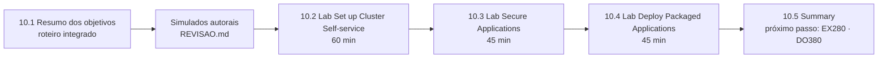

# Capítulo 10 — Comprehensive Review

**Título em português:** Revisão integrada
**Status da documentação:** ✅ concluído e validado
**Referência:** PDF p. 434–468

## Objetivo do capítulo

Validar o conhecimento adquirido no DO280. O curso apresenta esta revisão como apoio
para quem se prepara para o exame **EX280**.

## Por que este capítulo importa

Os capítulos anteriores ensinaram cada peça. Aqui elas são cobradas **juntas**, por
**especificação**, **sem passos** e **com tempo**: identidade, autosserviço, rede,
segurança de aplicações e pacotes no mesmo cenário. É o formato mais próximo de um exame
prático.

## Seções e atividades (ordem oficial)

| Seção | Tipo | Título original | Material | PDF |
|-------|------|-----------------|----------|-----|
| 10.1 | Revisão | Summary of Learning Objectives | [lição](10.1-resumo-dos-objetivos-de-aprendizagem.md) | p. 435–436 |
| 10.2 | Lab | Set up Cluster Self-service | [prática](PRATICA-OFICIAL.md#102-lab-set-up-cluster-self-service) | p. 437–445 |
| 10.3 | Lab | Secure Applications | [prática](PRATICA-OFICIAL.md#103-lab-secure-applications) | p. 446–458 |
| 10.4 | Lab | Deploy Packaged Applications | [prática](PRATICA-OFICIAL.md#104-lab-deploy-packaged-applications) | p. 459–467 |
| 10.5 | Summary | Summary | [RESUMO.md](RESUMO.md) | p. 468 |

Abertura do capítulo (meta e seções): PDF p. 434.

## Arquivos do capítulo

- [10.1 — Resumo dos objetivos](10.1-resumo-dos-objetivos-de-aprendizagem.md): roteiro integrado dos capítulos 1 a 9.
- [PRATICA-OFICIAL.md](PRATICA-OFICIAL.md): ponte com os três labs de revisão.
- [REVISAO.md](REVISAO.md): **dois simulados autorais cronometrados** (cluster próprio) e questões integradas.
- [RESUMO.md](RESUMO.md): síntese final do curso, 25 comandos essenciais e próximos passos.

## Como usar

1. Releia os `RESUMO.md` dos capítulos 1 a 9.
2. Estude a lição 10.1.
3. Faça os **simulados** da [REVISAO.md](REVISAO.md) em cluster próprio, cronometrando.
4. Faça os labs oficiais 10.2, 10.3 e 10.4, na ordem, e compare seu tempo com o de referência.
5. Registre resultados e dicas do `lab grade` no diário.

## Checklist do aluno

- [ ] Todos os `RESUMO.md` dos capítulos 1 a 9 relidos
- [ ] 10.1 lida e Parte F respondida
- [ ] Simulado A concluído em até 60 min
- [ ] Simulado B concluído em até 45 min
- [ ] 10.2 Lab `compreview-review` aprovado (referência: 60 min)
- [ ] 10.3 Lab `compreview-apps` aprovado (referência: 45 min)
- [ ] 10.4 Lab `compreview-package` aprovado (referência: 45 min)
- [ ] Registro no [diário de laboratórios](../../progresso/diario-de-laboratorios.md)

---
[← Capítulo 9](../09-atualizacoes-openshift/README.md) | [Índice geral](../../README.md) | [Certificação →](../../certificacao/README.md)
