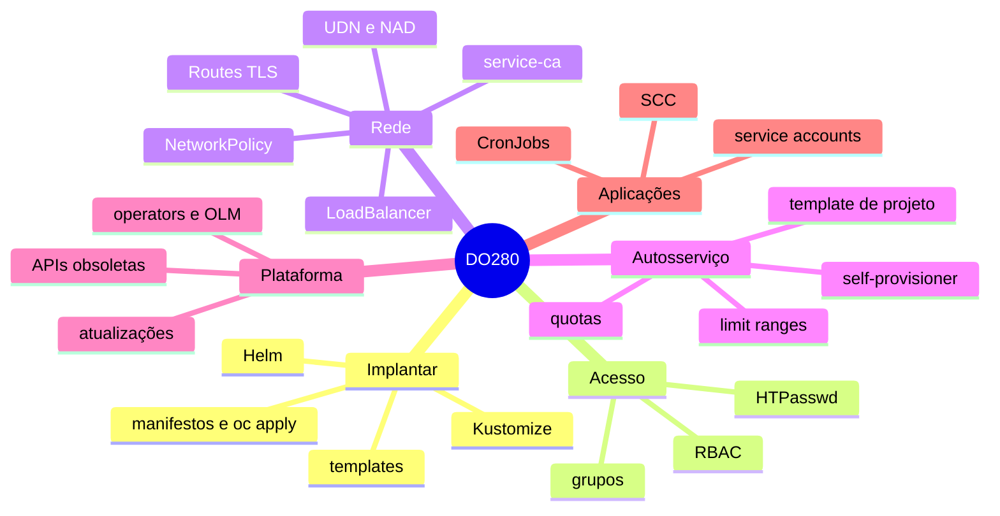

# Resumo — Capítulo 10 e visão final do DO280

Síntese autoral para revisão rápida. Correspondência oficial: seção 10.5 (PDF p. 468).

## O curso em uma tabela

| Capítulo | Ideia central | Resumo |
|----------|---------------|--------|
| 1 — Declarative Resource Management | Manifestos versionados aplicados com `oc apply`; variações por ambiente com Kustomize | [RESUMO](../01-gerenciamento-declarativo/RESUMO.md) |
| 2 — Deploying Packaged Applications | Templates (`oc process`) e charts Helm (releases, valores, versões) | [RESUMO](../02-aplicacoes-empacotadas/RESUMO.md) |
| 3 — Authentication and Authorization | HTPasswd, usuários, grupos e RBAC; o que fazer com o `kubeadmin` | [RESUMO](../03-autenticacao-autorizacao/RESUMO.md) |
| 4 — Network Security | Routes com TLS, NetworkPolicies e certificados de serviço | [RESUMO](../04-seguranca-de-rede/RESUMO.md) |
| 5 — Exposing Non-HTTP/SNI Applications | Services `LoadBalancer`/MetalLB, UDN/CUDN e NAD | [RESUMO](../05-redes-nao-http/RESUMO.md) |
| 6 — Enabling Developer Self-service | Quotas, limit ranges, template de projeto e `self-provisioner` | [RESUMO](../06-autosservico/RESUMO.md) |
| 7 — Managing Kubernetes Operators | OLM, catálogos, OperatorGroup, Subscription e InstallPlan | [RESUMO](../07-operadores-kubernetes/RESUMO.md) |
| 8 — Application Security | SCC, service accounts, acesso à API e CronJobs de manutenção | [RESUMO](../08-seguranca-aplicacoes/RESUMO.md) |
| 9 — OpenShift Updates | Canais, `oc adm upgrade`, APIs obsoletas e atualização de operators | [RESUMO](../09-atualizacoes-openshift/RESUMO.md) |
| 10 — Comprehensive Review | Três labs por especificação que integram tudo | [10.1](10.1-resumo-dos-objetivos-de-aprendizagem.md) |

## Mapa final

## 25 comandos essenciais do curso

| # | Comando | Para quê |
|---|---------|----------|
| 1 | `oc apply -f <dir> [--dry-run=server]` · `oc diff -f <dir>` | Aplicar e comparar manifestos |
| 2 | `oc apply -k <overlay>` · `oc kustomize <overlay>` | Kustomize |
| 3 | `oc process -f <t> -p K=V \| oc apply -f -` | Template |
| 4 | `helm install <rel> <repo>/<chart> --version <v> -f values.yaml` | Helm |
| 5 | `helm upgrade <rel> <chart> [--reuse-values]` · `helm rollback <rel> <rev>` | Helm |
| 6 | `htpasswd -B -b <arquivo> <user> <senha>` + `oc set data secret/<s> -n openshift-config --from-file htpasswd=<arquivo>` | Usuários HTPasswd |
| 7 | `oc adm groups new <g> <users...>` · `oc adm groups add-users <g> <u>` | Grupos |
| 8 | `oc adm policy add-role-to-group <papel> <g> -n <ns>` · `add-cluster-role-to-group` | RBAC |
| 9 | `oc auth can-i <verbo> <recurso> -n <ns> --as <sujeito>` | Testar permissões |
| 10 | `oc create route edge\|passthrough\|reencrypt <r> --service <s> [--cert --key --ca-cert --dest-ca-cert]` | Routes TLS |
| 11 | `oc apply -f networkpolicy.yaml` · `oc label namespace <ns> k=v` | NetworkPolicies |
| 12 | `oc annotate service <s> service.beta.openshift.io/serving-cert-secret-name=<s>` | Certificado de serviço |
| 13 | `oc expose deployment/<d> --type LoadBalancer --port 
` | Expor não HTTP |
| 14 | `oc create quota <q> --hard ...` · `oc create clusterresourcequota ...` | Quotas |
| 15 | `oc describe quota,limitrange -n <ns>` | Conferir limites |
| 16 | `oc adm create-bootstrap-project-template -o yaml` · `oc edit projects.config.openshift.io cluster` | Template de projeto |
| 17 | `oc annotate clusterrolebinding/self-provisioners --overwrite rbac.authorization.kubernetes.io/autoupdate=false` | Autosserviço permanente |
| 18 | `oc describe packagemanifest 
` · `oc get sub,installplan,csv -n <ns>` | Operators |
| 19 | `oc patch installplan <ip> --type merge -p '{"spec":{"approved":true}}'` | Aprovar operator |
| 20 | `oc adm policy scc-subject-review -f <manifesto>` | SCC necessária |
| 21 | `oc adm policy add-scc-to-user <scc> -z <sa>` · `oc set serviceaccount deployment/<d> <sa>` | SCC na SA |
| 22 | `oc create token <sa>` | Token de SA |
| 23 | `oc create cronjob <cj> --image <i> --schedule '<cron>' -- <cmd>` · `oc create job <j> --from cronjob/<cj>` | Manutenção |
| 24 | `oc adm upgrade` · `oc adm upgrade --to=<v>` | Atualizar cluster |
| 25 | `oc get apirequestcounts` | APIs obsoletas |

## Divergências registradas em relação à apostila (Cap. 10)

| Ponto | Apostila | Observação |
|-------|----------|------------|
| Diretório dos arquivos (p. 438, 446, 459 e soluções) | `~/DO0019L/labs/...` e `~/DO0019L/solutions/...` | Os demais capítulos usam `~/DO280/...`; conferir com `ls ~` o diretório criado pelo `lab start` |
| Nome do exame (p. 434 × p. 468) | "Red Hat Certified System Administrator in OpenShift (EX280)" na abertura | O próprio resumo (p. 468) usa o nome correto: Red Hat Certified OpenShift Administrator |
| Tabela de configuração do Lab 10.4 (p. 460–461) | Lista chaves sem indicar quais são labels e quais são anotações | Seguir o `kustomization.yaml` fornecido |

## Próximos passos

1. Concluir os labs de revisão no tempo de referência.
2. Refazer os simulados da [REVISAO.md](REVISAO.md) até completá-los no tempo-alvo.
3. Usar a [matriz EX280](../../certificacao/matriz-ex280.md) para treinar cada competência sem consulta.
4. Fazer o exame **EX280 — Red Hat Certified OpenShift Administrator**.
5. Continuar com o **DO380 — Red Hat OpenShift Administration III: Scaling Deployments in
   the Enterprise** (a apostila remete a ele alguns temas, como a limpeza de imagens).

---
[← Revisão](REVISAO.md) | [Índice do capítulo](README.md) | [Certificação →](../../certificacao/README.md)
