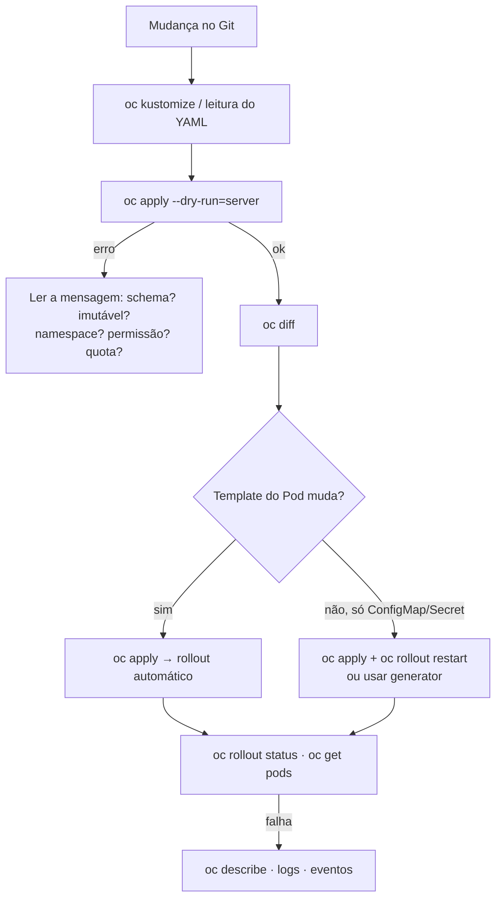

# Troubleshooting: sintoma → causa → verificação

> Cobertura: **Capítulos 1–6**. Para Pods, Services, Routes, storage e recursos, veja o
> [troubleshooting do DO180](https://github.com/eduardoandradej/openshift-do180-4.22-estudos/blob/main/consulta-rapida/troubleshooting.md).

## Roteiro geral para mudanças declarativas

## Manifestos e `oc apply` (Cap. 1)

| Sintoma | Causa provável | Como verificar / resolver |
|---------|----------------|---------------------------|
| `AlreadyExists` | `oc create -f` em objeto existente | Usar `oc apply -f` |
| `field is immutable` | Alteração de `spec.selector` (ou outro campo imutável) | Recriar o objeto de forma planejada; não mudar selectors |
| `the namespace from the provided object ... does not match` | `namespace` do arquivo ≠ `-n` | Remover `-n` ou ajustar o arquivo |
| `strict decoding error: unknown field` | Campo inexistente/indentação errada | `oc explain`; corrigir YAML |
| Campo apagado do arquivo continua no objeto | Nunca esteve no `last-applied` | `oc apply view-last-applied`; remover uma vez com `oc patch`/`oc set` |
| Réplicas voltam ao valor do arquivo | `replicas` no manifesto × `oc scale`/HPA | Definir a fonte da verdade; omitir `replicas` com HPA |
| Pods com configuração antiga | Só ConfigMap/Secret mudou | `oc rollout restart deployment/<d>` |
| Patch recusado: container sem `image` | `name` do container errado no strategic merge | `oc get deploy <d> -o jsonpath='{..containers[*].name}'` |
| Dois `mountPath` para o mesmo volume | Strategic merge mescla `volumeMounts` por `mountPath` | JSON Patch `replace` ou corrigir o manifesto |

## Kustomize (Cap. 1)

| Sintoma | Causa provável | Como verificar / resolver |
|---------|----------------|---------------------------|
| `namespaces "x" not found` | Projeto do overlay não existe | `oc new-project x` |
| `... exists; behavior must be merge or replace` | Overlay redefine generator da base | `behavior: merge` |
| Patch sem efeito | `target` errado | `oc kustomize` e conferir `kind`/`name` |
| Nome do patch ignorado | Strategic merge sem `allowNameChange` | Adicionar `options: {allowNameChange: true}` |
| Route quebrada após `namePrefix`/`nameSuffix` | `spec.to.name` não ajustado | Comparar Route × Service; patch na Route |
| ConfigMaps/Secrets antigos acumulados | Cada versão do generator cria outro objeto | `oc get cm,secret`; limpeza planejada |
| Aviso sobre `commonLabels` | Campo obsoleto | Converter para `labels: - pairs:` |
| `apply -k` sem efeito nos Pods após mudar dados | `disableNameSuffixHash: true` | Reativar hash ou `oc rollout restart` |

## Templates (Cap. 2)

| Sintoma | Causa provável | Como verificar / resolver |
|---------|----------------|---------------------------|
| `Forbidden` ao processar template do `openshift` | Processar no servidor exige escrita no namespace | Copiar o template (`oc get template -o yaml`) e processar a cópia |
| `templates.template.openshift.io "x" not found` | Namespace errado | `oc get templates -A`; usar `-n` |
| Aplicação perde acesso ao banco após reaplicar | Parâmetro gerado (senha) gerado de novo | `oc process ... \| oc diff -f -`; informar o valor original |
| `AlreadyExists` com `oc new-app --template` | `new-app` só cria | `oc process ... \| oc apply -f -` |

## Helm (Cap. 2)

| Sintoma | Causa provável | Como verificar / resolver |
|---------|----------------|---------------------------|
| Release não aparece no `helm list` | Outro namespace | `helm list -A` |
| `cannot re-use a name that is still in use` | Release já existe | `helm upgrade` |
| `ImagePullBackOff` após instalar | Imagem pública padrão sem internet / chaves de imagem erradas | `oc describe pod`; `helm show values`; ajustar valores |
| Versão do chart mudou sozinha | `helm upgrade` sem `--version` | `helm list`; usar `--version` |
| Valor anterior "sumiu" após upgrade | Valores novos não reaproveitam os antigos | `helm get values <r>`; arquivo de valores completo |
| `another operation ... is in progress` | Release em `pending-*` | `helm history`; rollback para a última `deployed` |
| Repositório não aparece na console | `helm repo add` é local | `HelmChartRepository` / `ProjectHelmChartRepository` |

## Autenticação (Cap. 3)

| Sintoma | Causa provável | Como verificar / resolver |
|---------|----------------|---------------------------|
| `401 Unauthorized` logo após mudar Secret/OAuth | Pods `oauth-openshift` reimplantando | `oc get pods -n openshift-authentication`; aguardar |
| `401` persistente para usuário novo | Usuário fora do Secret, chave ≠ `htpasswd`, Secret fora de `openshift-config` | `oc extract secret/<s> -n openshift-config --to -` |
| IdP antigo (LDAP) sumiu | Lista `identityProviders` substituída | `oc get oauth cluster -o yaml`; restaurar o item |
| Usuários antigos perderam acesso | `htpasswd -c` em arquivo existente ou cópia desatualizada | Extrair sempre antes de editar |
| Erro de mapeamento ao logar | `mappingMethod: claim` e User ligado a outro IdP | `oc get user <u> -o yaml`; limpar User/Identity |
| Usuário removido ainda listado | User/Identity não apagados | `oc delete user`, `oc delete identity` |

## Autorização / RBAC (Cap. 3)

| Sintoma | Causa provável | Como verificar / resolver |
|---------|----------------|---------------------------|
| `cannot <verbo> resource "<r>" ... at the cluster scope` | Falta ClusterRoleBinding | `oc auth can-i <verbo> <r> --as <u>`; papel de cluster mínimo |
| `cannot <verbo> resource "<r>" ... in the namespace "
"` | Falta RoleBinding no projeto | `oc get rolebindings -o wide -n 
` |
| `cannot list resource "rolebindings"` ao conceder acesso | Quem concede não é `admin` do projeto | `oc auth can-i create rolebindings -n 
` |
| Acesso concedido não funciona | Projeto, nome de usuário/grupo errado ou usuário fora do grupo | `oc describe rolebinding`; `oc get groups` |
| Admin "de projeto" não vê nós | `cluster-admin` concedido como RoleBinding | `add-cluster-role-to-user` |
| Acesso indevido | Vínculo herdado por grupo (inclusive LDAP/virtual) | `oc adm policy who-can <verbo> <r>` |

## TLS e Routes (Cap. 4)

| Sintoma | Causa provável | Como verificar / resolver |
|---------|----------------|---------------------------|
| `curl: (60) SSL certificate problem` | Cliente não confia na CA | `curl -v --cacert <ca>` |
| Nome do host não confere | Hostname fora do SAN | `openssl x509 -noout -ext subjectAltName` |
| Pods `0/1` após habilitar TLS | Probes em HTTP | `scheme: HTTPS` |
| Route passthrough sem resposta | Porta/Service errados ou app sem TLS | `oc describe route`; `oc get endpoints` |
| Route criada com `--dry-run=server` | `oc create route` ignora dry-run de servidor | `--dry-run=client -o yaml` |
| `oc create secret tls`: arquivo não encontrado | Diretório errado | `pwd`; caminho correto |

## NetworkPolicies (Cap. 4)

| Sintoma | Causa provável | Como verificar / resolver |
|---------|----------------|---------------------------|
| `curl` sem resposta até o tempo limite | Bloqueado por política | `oc get/describe networkpolicy` no namespace de destino |
| Allow não funciona | Política no namespace de origem, labels ou porta errados | `--show-labels`; `oc describe networkpolicy` |
| Acesso aberto demais | `from` com itens separados (OU) | Juntar no mesmo item (E) |
| Route para após default-deny (multinó) | Routers não liberados | Política com `policy-group.network.openshift.io/ingress: ""` |
| Route funciona com default-deny (nó único) | Routers na rede do host | Esperado |
| `oc label namespace` → `Forbidden` | Sem permissão sobre Namespace | Administrador |
| `cannot unmarshal bool` em ANP/selector | Label sem aspas | `"true"` |
| Allow correto, tráfego negado | ANP `Deny` acima | `oc get adminnetworkpolicies` |

## TLS interno (Cap. 4)

| Sintoma | Causa provável | Como verificar / resolver |
|---------|----------------|---------------------------|
| Secret do certificado não criado | Anotação errada no Service | `oc describe svc` |
| `self signed certificate in certificate chain` | Cliente sem a CA do service-ca | ConfigMap `inject-cabundle` montado no cliente |
| ConfigMap perdeu dados | Anotação de injeção em ConfigMap compartilhado | Usar ConfigMap dedicado |
| Cliente perde confiança em CAs públicas | Bundle do sistema substituído pelo do service-ca | Montar a CA em outro caminho |

## LoadBalancer (Cap. 5)

| Sintoma | Causa provável | Como verificar / resolver |
|---------|----------------|---------------------------|
| `EXTERNAL-IP <pending>` | Pool esgotado ou sem implementação de LoadBalancer | `oc get svc -A \| grep LoadBalancer`; `oc get ipaddresspool -n metallb-system` |
| IP atribuído, sem conexão | IP não anunciado ou rede não roteia | `oc get l2advertisement -n metallb-system`; `ping`/`traceroute` |
| `nc` recusa | Sem endpoints ou `targetPort` errado | `oc get endpoints <s>` |

## Redes adicionais (Cap. 5)

| Sintoma | Causa provável | Como verificar / resolver |
|---------|----------------|---------------------------|
| Pods não sobem: `invalid primary network state` | Namespace com label de UDN primária sem UDN | Criar a UDN |
| UDN com falha nas condições | Namespace sem o label | Recriar o namespace com o label |
| CUDN: `foreign NetworkAttachmentDefinition ... already exist` | Nome em conflito | Nome único |
| Pod sem `net1` | Anotação fora do template, nome errado, NAD em outro namespace, espaços | `oc get pod -o yaml`; eventos |
| Pod novo preso após update (host-device) | Interface presa ao Pod antigo | `strategy: Recreate` |

## Quotas e limit ranges (Cap. 6)

| Sintoma | Causa provável | Como verificar / resolver |
|---------|----------------|---------------------------|
| Pods `Pending` com `Insufficient cpu` | Requests de outros projetos ocupam o nó | `oc describe node` (Allocated resources); quota no projeto que exagera |
| Deployment `READY 0/N`, sem Pods | Quota de Pods/computação barrando o ReplicaSet | `oc events` (`FailedCreate`, `exceeded quota`) |
| `failed quota: ... must specify ...` | Quota de computação e container sem request/limit | `oc set resources` ou LimitRange com padrões |
| Quota sem efeito | Chave errada (`count/deployment`, `count/pod`) | `status.used` zerado; `count/deployments.apps`, `count/pods` |
| Rollout parado | ReplicaSets novo + antigo excedem a quota | `oc describe quota` |
| `minimum/maximum ... usage per Container` | Valor fora de `min`/`max` do limit range | Evento do ReplicaSet; ajustar recursos |
| Pods antigos sem os padrões do limit range | Admission só age na criação | `oc rollout restart deployment/<d>` |
| Containers reservando o máximo | Limit range só com `min`/`max` (`defaultRequest` herda de `max`) | `oc get limitrange -o yaml`; declarar padrões |

## Template de projeto e self-provisioner (Cap. 6)

| Sintoma | Causa provável | Como verificar / resolver |
|---------|----------------|---------------------------|
| Projeto novo sem os objetos do template | Rollout do `openshift-apiserver` em andamento; nome/namespace do template | `oc get pod -n openshift-apiserver`; `oc get template -n openshift-config`; `oc get projects.config.openshift.io cluster -o yaml` |
| `oc new-project` falha após ativar o template | Objeto inválido no template | Mensagem do comando; corrigir e republicar |
| `You may not request a new project via this API` | Usuário sem `self-provisioner` | `oc describe clusterrolebinding self-provisioners` |
| Restrição ao self-provisioner desfeita | `autoupdate` ainda `true` e API server reiniciado | Anotar `autoupdate=false` e refazer |

---
[Início](../README.md)
