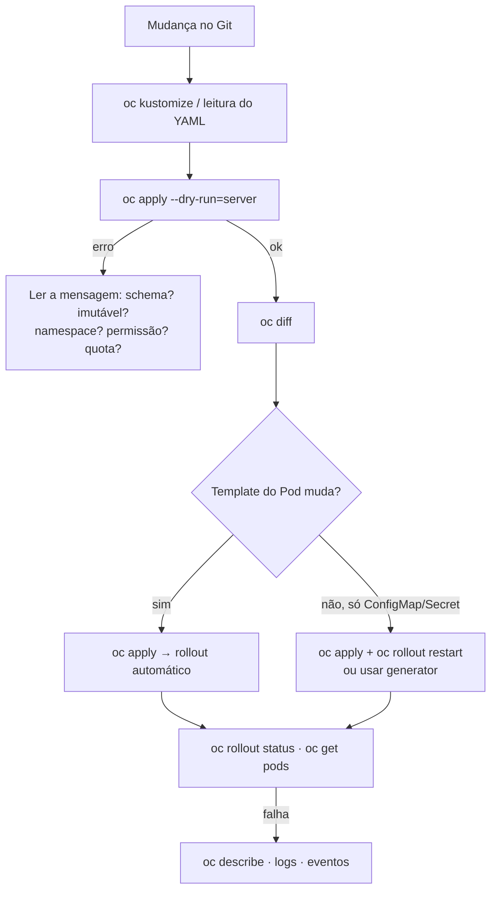

# Troubleshooting: sintoma → causa → verificação

> Cobertura: **Capítulo 1**. Para Pods, Services, Routes, storage e recursos, veja o
> [troubleshooting do DO180](https://github.com/eduardoandradej/openshift-do180-4.22-estudos/blob/main/consulta-rapida/troubleshooting.md).

## Roteiro geral para mudanças declarativas

## Manifestos e `oc apply` (Cap. 1)

| Sintoma | Causa provável | Como verificar / resolver |
|---------|----------------|---------------------------|
| `AlreadyExists` | `oc create -f` em objeto existente | Usar `oc apply -f` |
| `field is immutable` | Alteração de `spec.selector` (ou outro campo imutável) | Recriar o objeto de forma planejada; não mudar selectors |
| `the namespace from the provided object ... does not match` | `namespace` do arquivo ≠ `-n` | Remover `-n` ou ajustar o arquivo |
| `strict decoding error: unknown field` | Campo inexistente/indentação errada | `oc explain`; corrigir YAML |
| Campo apagado do arquivo continua no objeto | Nunca esteve no `last-applied` | `oc apply view-last-applied`; remover uma vez com `oc patch`/`oc set` |
| Réplicas voltam ao valor do arquivo | `replicas` no manifesto × `oc scale`/HPA | Definir a fonte da verdade; omitir `replicas` com HPA |
| Pods com configuração antiga | Só ConfigMap/Secret mudou | `oc rollout restart deployment/<d>` |
| Patch recusado: container sem `image` | `name` do container errado no strategic merge | `oc get deploy <d> -o jsonpath='{..containers[*].name}'` |
| Dois `mountPath` para o mesmo volume | Strategic merge mescla `volumeMounts` por `mountPath` | JSON Patch `replace` ou corrigir o manifesto |

## Kustomize (Cap. 1)

| Sintoma | Causa provável | Como verificar / resolver |
|---------|----------------|---------------------------|
| `namespaces "x" not found` | Projeto do overlay não existe | `oc new-project x` |
| `... exists; behavior must be merge or replace` | Overlay redefine generator da base | `behavior: merge` |
| Patch sem efeito | `target` errado | `oc kustomize` e conferir `kind`/`name` |
| Nome do patch ignorado | Strategic merge sem `allowNameChange` | Adicionar `options: {allowNameChange: true}` |
| Route quebrada após `namePrefix`/`nameSuffix` | `spec.to.name` não ajustado | Comparar Route × Service; patch na Route |
| ConfigMaps/Secrets antigos acumulados | Cada versão do generator cria outro objeto | `oc get cm,secret`; limpeza planejada |
| Aviso sobre `commonLabels` | Campo obsoleto | Converter para `labels: - pairs:` |
| `apply -k` sem efeito nos Pods após mudar dados | `disableNameSuffixHash: true` | Reativar hash ou `oc rollout restart` |

---
[Início](../README.md)
