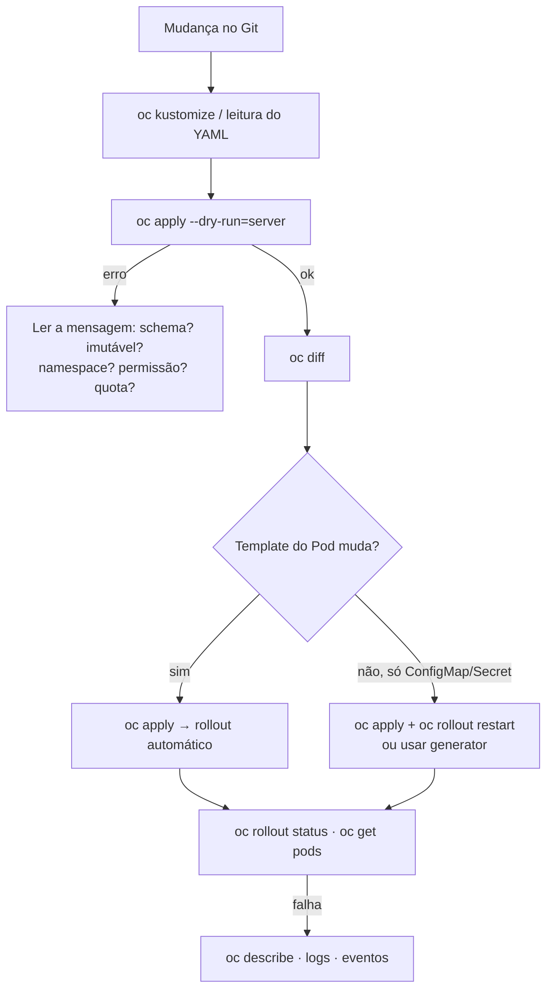

# Troubleshooting: sintoma → causa → verificação

> Cobertura: **Capítulos 1–2**. Para Pods, Services, Routes, storage e recursos, veja o
> [troubleshooting do DO180](https://github.com/eduardoandradej/openshift-do180-4.22-estudos/blob/main/consulta-rapida/troubleshooting.md).

## Roteiro geral para mudanças declarativas

## Manifestos e `oc apply` (Cap. 1)

| Sintoma | Causa provável | Como verificar / resolver |
|---------|----------------|---------------------------|
| `AlreadyExists` | `oc create -f` em objeto existente | Usar `oc apply -f` |
| `field is immutable` | Alteração de `spec.selector` (ou outro campo imutável) | Recriar o objeto de forma planejada; não mudar selectors |
| `the namespace from the provided object ... does not match` | `namespace` do arquivo ≠ `-n` | Remover `-n` ou ajustar o arquivo |
| `strict decoding error: unknown field` | Campo inexistente/indentação errada | `oc explain`; corrigir YAML |
| Campo apagado do arquivo continua no objeto | Nunca esteve no `last-applied` | `oc apply view-last-applied`; remover uma vez com `oc patch`/`oc set` |
| Réplicas voltam ao valor do arquivo | `replicas` no manifesto × `oc scale`/HPA | Definir a fonte da verdade; omitir `replicas` com HPA |
| Pods com configuração antiga | Só ConfigMap/Secret mudou | `oc rollout restart deployment/<d>` |
| Patch recusado: container sem `image` | `name` do container errado no strategic merge | `oc get deploy <d> -o jsonpath='{..containers[*].name}'` |
| Dois `mountPath` para o mesmo volume | Strategic merge mescla `volumeMounts` por `mountPath` | JSON Patch `replace` ou corrigir o manifesto |

## Kustomize (Cap. 1)

| Sintoma | Causa provável | Como verificar / resolver |
|---------|----------------|---------------------------|
| `namespaces "x" not found` | Projeto do overlay não existe | `oc new-project x` |
| `... exists; behavior must be merge or replace` | Overlay redefine generator da base | `behavior: merge` |
| Patch sem efeito | `target` errado | `oc kustomize` e conferir `kind`/`name` |
| Nome do patch ignorado | Strategic merge sem `allowNameChange` | Adicionar `options: {allowNameChange: true}` |
| Route quebrada após `namePrefix`/`nameSuffix` | `spec.to.name` não ajustado | Comparar Route × Service; patch na Route |
| ConfigMaps/Secrets antigos acumulados | Cada versão do generator cria outro objeto | `oc get cm,secret`; limpeza planejada |
| Aviso sobre `commonLabels` | Campo obsoleto | Converter para `labels: - pairs:` |
| `apply -k` sem efeito nos Pods após mudar dados | `disableNameSuffixHash: true` | Reativar hash ou `oc rollout restart` |

## Templates (Cap. 2)

| Sintoma | Causa provável | Como verificar / resolver |
|---------|----------------|---------------------------|
| `Forbidden` ao processar template do `openshift` | Processar no servidor exige escrita no namespace | Copiar o template (`oc get template -o yaml`) e processar a cópia |
| `templates.template.openshift.io "x" not found` | Namespace errado | `oc get templates -A`; usar `-n` |
| Aplicação perde acesso ao banco após reaplicar | Parâmetro gerado (senha) gerado de novo | `oc process ... \| oc diff -f -`; informar o valor original |
| `AlreadyExists` com `oc new-app --template` | `new-app` só cria | `oc process ... \| oc apply -f -` |

## Helm (Cap. 2)

| Sintoma | Causa provável | Como verificar / resolver |
|---------|----------------|---------------------------|
| Release não aparece no `helm list` | Outro namespace | `helm list -A` |
| `cannot re-use a name that is still in use` | Release já existe | `helm upgrade` |
| `ImagePullBackOff` após instalar | Imagem pública padrão sem internet / chaves de imagem erradas | `oc describe pod`; `helm show values`; ajustar valores |
| Versão do chart mudou sozinha | `helm upgrade` sem `--version` | `helm list`; usar `--version` |
| Valor anterior "sumiu" após upgrade | Valores novos não reaproveitam os antigos | `helm get values <r>`; arquivo de valores completo |
| `another operation ... is in progress` | Release em `pending-*` | `helm history`; rollback para a última `deployed` |
| Repositório não aparece na console | `helm repo add` é local | `HelmChartRepository` / `ProjectHelmChartRepository` |

---
[Início](../README.md)
